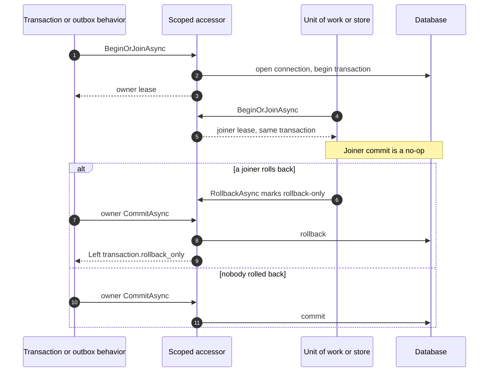

# ADR-037: The Outbox Is Written Inside the Request's Transaction, Through One Shared Transaction Lease

## Status

**Accepted** - 2026-10-20, issue [#718](https://github.com/dlrivada/Encina/issues/718). The six design choices were decided by the maintainer on 2026-10-06 (plan [outbox-atomicity-ado-implementation-plan-718.md](../../plans/outbox-atomicity-ado-implementation-plan-718.md), "Design Choices"); the provider-neutral lease contract was settled by elimination on 2026-10-20 (see choice 3). The first slice, the three ADO.NET providers, is implemented; the other families follow (see "Slices").

## Context

The Outbox pattern promises that an event and the business change that caused it are stored together, so an event is neither published for a change that rolled back nor lost for one that committed. Before this decision the promise was false on all 10 database providers, for four reasons found in the code:

1. **The write ran after the commit.** `OutboxPostProcessor<,>` is an `IRequestPostProcessor`. `PipelineBuilder` wraps post-processors outermost, so they run after every behavior, including the transaction behavior that had already committed. The outbox row was always a separate, later statement: if the business change committed and the outbox write failed, the event was lost.
2. **The failure was swallowed.** The post-processor discarded the `Either` returned by the outbox store, so the request reported success. That breaks "errors are never swallowed" ([ADR-001](001-railway-oriented-programming.md), [ADR-006](006-pure-rop-exception-handling.md), `AGENTS.md` section 3).
3. **No store could see the transaction.** The ADO.NET transaction was a private field of the transaction behavior or of the unit of work. On SQL Server and MySQL the driver rejects a command that runs on a connection with a pending transaction unless the command carries that transaction; Npgsql silently runs it inside. A store that did not carry the transaction therefore either failed or behaved differently per driver.
4. **Two owners on one connection.** The transaction behavior and `IUnitOfWork` each began a transaction on the same scoped connection and did not know about each other.

[ADR-048](048-inbox-record-vs-business-transaction.md) had already introduced a plain holder for the open transaction (`IDbTransactionAccessor.Current`, written by the transaction behavior) so the inbox could enlist. That holder did not own the transaction and was not visible to the unit of work.

## Decision

The outbox rows of a request's notifications are written by a pipeline behavior inside the request's single database transaction. All participants (transaction behavior, unit of work, messaging stores, the outbox behavior) take that transaction from one scoped accessor.

### The six design choices

| # | Choice | Decision |
| --- | --- | --- |
| 1 | Plan scope | All 10 database providers (ADO.NET, Dapper and EF Core on SQL Server, PostgreSQL and MySQL; MongoDB), as `AGENTS.md` section 5 requires for a provider-dependent feature. Rejected: ADO.NET only, ADO.NET and Dapper only, because the shared change would land with part of its consumers and the families would diverge. |
| 2 | Where the write runs | `TransactionalOutboxPipelineBehavior<,>` joins the active transaction or begins one around the handler. It works with or without `UseTransactions`, whatever the registration order, and returns `Left` when the write or the commit fails. Rejected: pre-commit participants of the transaction behavior (atomicity would depend on `UseTransactions`, and MongoDB has no transaction behavior), moving post-processors inside the behaviors (a core semantic change that still could not fail the request), explicit-only calls from handlers (`IHasNotifications` would stop working). |
| 3 | How the transaction is shared | A scoped `IDbTransactionAccessor` hands out ownership leases (`BeginOrJoinAsync`). The first participant of a scope owns the transaction; later ones join. Rejected: making the unit of work's transaction public (the unit of work is optional), `TransactionScope` (driver-dependent enlistment, no `Either`, MongoDB does not enlist), a connection decorator that assigns the transaction to every command (breaks the provider-specific fast paths and does nothing for EF Core or MongoDB). |
| 4 | Placement | `Encina.Messaging`, namespace `Encina.Messaging.Transactions`. The consumers already live in or reference it, so no provider package needs a new reference. Rejected: `Encina.DomainModeling` and a new data-abstractions package. |
| 5 | Nested transactions | Join with rollback-only and a single owner (next section). Rejected: keeping `TransactionAlreadyActive` for nested use, and savepoints (syntax differs per database, MongoDB has none, and a partial rollback contradicts an all-or-nothing outbox guarantee). |
| 6 | Enlistment scope | The four messaging stores (Outbox, Inbox, Saga, ScheduledMessage) and the unit-of-work repositories. Stores outside that set (audit, anonymization, ABAC, read/write separation, shard connections) do not enlist; they are tracked by [#1934](https://github.com/dlrivada/Encina/issues/1934). |

### The neutral lease contract

The behavior of choice 2 depends on `ITransactionLeaseSource` (`HasActiveTransaction`, `BeginOrJoinAsync`), which returns an `ITransactionLease` (`IsOwner`, `CommitAsync`, `RollbackAsync`, `IAsyncDisposable`). Neither mentions a database type. `IDbTransactionAccessor` extends the source with the relational members (`Connection`, `Current`, `BeginOrJoinAsync(IsolationLevel?, ...)`), and `IDbTransactionLease` adds `Transaction`.

The neutral base exists because MongoDB, whose transactions are client sessions and not `IDbTransaction`, is in the 1.0 scope by `AGENTS.md` section 5. With it, the behavior's constructor, its registration and the public API are written once, and the MongoDB slice implements the same source. The alternative (the behavior depending on `IDbTransactionAccessor` and extracting the base when MongoDB arrives) would ship a relational-only contract that the MongoDB slice must change again. It was settled by elimination: the rule makes the MongoDB slice mandatory, which removes the only scenario in which the early abstraction would be speculative.

### Join and rollback-only semantics

- The first `BeginOrJoinAsync` in a scope owns the transaction and is the only participant that commits.
- A joiner's `CommitAsync` is a no-op that succeeds. Its `RollbackAsync` marks the transaction rollback-only. A joiner's success therefore does not mean the data is durable.
- The owner's `CommitAsync` on a rollback-only transaction rolls back and returns `Left` with `transaction.rollback_only`. A swallowed inner failure cannot turn into a commit.
- A joiner that asks for an isolation level different from the active transaction's gets `transaction.isolation_level_mismatch`; `IsolationLevel.Unspecified` joins any level.
- Disposing an owner lease that was neither committed nor rolled back rolls the transaction back; disposing the accessor at the end of the scope does the same.
- `HasActiveTransaction` of a unit of work keeps its meaning ("this unit of work holds a lease"). `TransactionAlreadyActive` remains only for a second `BeginTransactionAsync` on the same unit of work.
- The accessor requires a `DbConnection` and opens and begins asynchronously with the caller's token; there is no synchronous fallback (a non-`DbConnection` gets `transaction.not_supported`). The behaviors run commit and rollback with `CancellationToken.None`, so a canceled request still cleans up; the accessor's owner commit passes the token it is given to the driver.
- The error codes are `transaction.begin_failed`, `transaction.commit_failed`, `transaction.rollback_only`, `transaction.isolation_level_mismatch`, `transaction.lease_disposed` and `transaction.not_supported`. Errors carry the code (and the exception type); `EncinaError.Message` never reaches logs.

### Behavior flow and ordering

For a request that implements `IHasNotifications`, the outbox behavior begins or joins the transaction, runs the handler, reads the notifications after the handler returned, writes them through the outbox store, and commits. A handler `Left` rolls back and leaves no outbox row; an outbox or commit `Left` is returned and rolls back the business change. A request that cannot carry notifications skips the behavior after a static per-type check and a runtime check, without opening a transaction (pay-for-what-you-use).

Atomicity does not depend on the order of the transaction and outbox behaviors, because the second one joins. When Recoverability is enabled it is registered outermost, before the transaction, so a retry begins a new transaction instead of running inside the failed one ([ADR-029](029-recoverability-error-classification.md)). ADR-050 (row Recoverability) forbids that placement inside Transactions, but its check waits for the named-stage contract of [#2184](https://github.com/dlrivada/Encina/issues/2184); today the order rests on registration order. ADR-050 also lists Transactions as a requirement of the Outbox; that requirement is enforced by the startup validator [#2382](https://github.com/dlrivada/Encina/issues/2382), which is not implemented yet.

### Slices and the interim write path

The change is delivered one provider family at a time. The Outbox registration chooses between two write paths through an internal switch, `OutboxWritePath`:

| Value | Used by | Behavior |
| --- | --- | --- |
| `TransactionalBehavior` | ADO.NET (SQL Server, PostgreSQL, MySQL) | `TransactionalOutboxPipelineBehavior<,>` writes inside the transaction. |
| `PostProcessor` | Dapper, EF Core, MongoDB | The post-processor still writes after the pipeline, outside the transaction. It now returns the first `Left` of the store instead of swallowing it. |

The switch is a scaffold, not an extension point: it is `internal` and is deleted, with `OutboxPostProcessor<,>`, when the last family moves. `AGENTS.md` section 3 forbids keeping compatibility layers. The accessor registration is internal too and uses `TryAdd`, so an application's own registration wins; it is made by the ADO.NET and Dapper registration paths (it needs a scoped `IDbConnection`, which EF Core and MongoDB containers do not have) and by `AddEncinaUnitOfWork`.

Slice 1 (delivered; issue #718 stays open until every family is done): the shared abstractions, the accessor, the two behaviors, the three ADO.NET providers, observability, and the move of the inbox to the same accessor. Not yet implemented: Dapper ([#719](https://github.com/dlrivada/Encina/issues/719)), EF Core, MongoDB, and the removal of the post-processor ([#1935](https://github.com/dlrivada/Encina/issues/1935), closed as a duplicate of #718). Each is a later slice of the same plan.

### Observability

EventIds 2963-2970 (`MessagingLog`, in the registered Messaging range, [ADR-021](021-eventid-uniqueness-enforcement.md)); the activity source `Encina.Messaging.Transactions` for the transaction; the counters `encina.outbox.enqueued` and `encina.transaction.rollback_only`. The unused transaction log methods (EventIds 2834-2836) are now called by the transaction behavior.

## Alternatives considered

Per choice, in the table above. In short: a narrower provider scope was rejected for coherence; a pre-commit participant hook was rejected because it hides a dependency on `UseTransactions`; `TransactionScope` and a connection decorator were rejected because they behave differently per driver or break provider fast paths.

## Consequences

- **Positive**: a committed command leaves exactly one outbox row per notification, and a rolled-back command, a `Left` or a failed outbox write leaves none and fails the request, on the ADO.NET providers. The unit of work, the transaction behavior and the four messaging stores compose in one transaction. The inbox ([ADR-048](048-inbox-record-vs-business-transaction.md)) reads the same transaction.
- **Negative, limits**:
  - Other ADO.NET components and stores outside the four messaging stores do not enlist ([#1934](https://github.com/dlrivada/Encina/issues/1934)). On SQL Server and MySQL the driver rejects their commands while the transaction is active; PostgreSQL silently joins.
  - Until its slice lands, Dapper, EF Core and MongoDB keep the non-atomic post-processor path: their outbox is written after the business commit, so retrying a request whose outbox write failed repeats a change that was already committed.
  - A joiner's `CommitAsync` returning success does not mean the data is durable; only the owner's commit does.
  - `UnitOfWorkADO` implements only `IAsyncDisposable`, so resolving `IUnitOfWork` inside a request that Encina dispatches fails when the request scope is disposed synchronously. This is a known defect. ([#2556](https://github.com/dlrivada/Encina/issues/2556))
  - The ADO.NET PostgreSQL and MySQL registrations do not support module isolation (`UseModuleIsolation`); SQL Server does. ([#2557](https://github.com/dlrivada/Encina/issues/2557))
- Registration completeness is proven by a DI test that builds the provider with `ValidateOnBuild` and `ValidateScopes` (`AGENTS.md` section 3).

## Related

- [How to write the outbox inside the request's transaction](../../features/transactional-outbox.md) (how a developer uses it)
- [ADR-048](048-inbox-record-vs-business-transaction.md) (inbox enlisted and independent writes; amended by this ADR), [ADR-050](050-modules-may-require-modules.md) (Outbox requires Transactions), [ADR-021](021-eventid-uniqueness-enforcement.md), [ADR-001](001-railway-oriented-programming.md), [ADR-006](006-pure-rop-exception-handling.md)
- [SPEC-000](../../specifications/SPEC-000-encina-1.0-baseline-and-release-scope.md) (1.0 scope: the 10 database providers)
- Issues [#718](https://github.com/dlrivada/Encina/issues/718), [#719](https://github.com/dlrivada/Encina/issues/719), [#1935](https://github.com/dlrivada/Encina/issues/1935), [#1934](https://github.com/dlrivada/Encina/issues/1934)

## Date

2026-10-20
