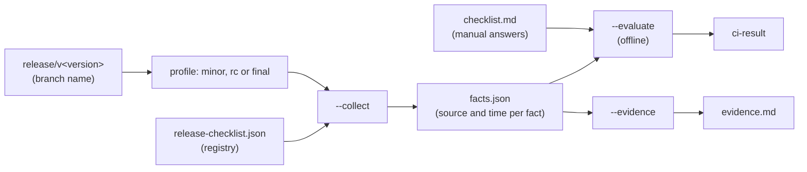

# ADR-038: The Release Readiness Gate: a Registry, Three Profiles and a Fail-Closed Facts Snapshot

## Status

**Accepted** - decisions 4, 7 and 9 of the implementation plan were taken by the maintainer on 2026-10-20; the other design choices were classified settled by the decision register of the same day, recorded in the plan's "Maintainer Decisions" section (each rests on SPEC-000, SPEC-002, AGENTS.md or an existing precedent). The plan is [pre-release-checklist-implementation-plan-104.md](../../plans/pre-release-checklist-implementation-plan-104.md).

## Context

Issue #104 asks for a final pre-release checklist for 1.0. Read against [SPEC-000](../../specifications/SPEC-000-encina-1.0-baseline-and-release-scope.md) it is two things: a checklist that can be verified (SPEC-000 acceptance criteria AC-001 to AC-029, plus the release-process criteria AC-025 to AC-030 of [SPEC-002](../../specifications/SPEC-002-eu-regulatory-readiness.md)), and the act of cutting 1.0 (sign-off, tag, publish, announce).

A hand-ticked list does not fit the 1.0 sequence. SPEC-000 DEC-005 makes every 1.0 block close its own minor version, and SPEC-002 REQ-025 requires the law map to be re-verified before each minor tag and before `1.0.0-rc.1`. The checklist therefore runs about five times before 1.0, and manual checks drift: the `pack` job of a CI Full run reached success while 18 test jobs had failed, and the process did not require a green CI Full run on the commit to tag (#1747). SPEC-000 INV-001 also requires that nothing is claimed that CI cannot regenerate, and AC-022 requires an evidence report generated by a script. No other issue implemented that report.

## Decision

The checklist is an executable **release readiness gate**: a registry, a C# file-based tool and a sign-off file for the items only a person can answer. The usage is in [How to run the release readiness gate](../../releases/release-readiness.md) and in [How to cut a release by hand](../../releases/RELEASE-PROCESS.md).

1. **Deliverable.** An executable gate that also renders the checklist and the sign-off file, not a Markdown page ticked by hand.
2. **Registry.** `.github/release-checklist.json` lists every item. Each item traces to a SPEC-000 or SPEC-002 acceptance criterion or to #104, belongs to one SPEC-000 section 8 group, and carries a severity per profile (`block`, `warn` or `skip`). `--check-registry` fails when an acceptance criterion of a listed spec has no entry or retired record. An item is retired with a reason and a reference, never deleted, so the history of a superseded requirement stays readable.
3. **Profiles.** Three profiles run before every tag of the 1.0 sequence: `minor` for each `vX.Y.0`, `rc` for `1.0.0-rc.N` and `final` for `1.0.0`. The profile is derived from the branch name `release/v<version>`; a name the tool cannot map is an error and never the lightest profile (maintainer decision, 2026-10-20).
4. **Facts snapshot, evaluated offline.** `--collect` reads GitHub, GitHub Pages, SonarCloud, nuget.org and the checkout, and writes `facts.json`, with a source URL and a retrieval time for every answer. `--evaluate` and `--evidence` read only that file and the sign-off file, so the verdict and the evidence report cannot disagree, and the evidence report can be regenerated byte for byte from the committed facts. A fact that carries an error, or is missing, fails a blocking item (AGENTS.md section 3, fail closed). Facts collected for another version or profile, or older than the age limit, are rejected.
5. **Enforcement.** A blocking `release-readiness` job in `ci.yml` runs only on `release/*` heads and feeds `ci-result`, so the required checks stay exactly `build`, `ci-result` and `Analyze` as SPEC-000 REQ-020 and AC-020 fix them (maintainer decision, 2026-10-20). A second, pre-tag call, `--evaluate --only ci-full-on-sha`, checks the merge commit, which does not exist while the release PR is open.
6. **Scope boundary.** The gate checks; the owners of the sibling release issues implement. A gap with no owner becomes its own issue. The gate reports red items until those owners land.
7. **Lifecycle of #104.** The pull request that delivers the gate closes #104. A new `[INFRA]` issue, "Cut 1.0.0-rc.1 and 1.0.0 through the readiness gate", owns the final run, and EPIC #893's criterion points to it (maintainer decision, 2026-10-20).
8. **Language.** A C# 14 file-based app, `.github/scripts/release-readiness.cs`, next to the other release scripts. GitHub is read through `gh api` (REST only) with one retry helper.
9. **Facts the Actions token cannot read.** Open secret-scanning alerts, open Dependabot alerts and the branch protection of `main` come from a GitHub App installed only on `dlrivada/Encina` with read-only "Secret scanning alerts", "Dependabot alerts" and "Administration" permissions. The workflow mints a token with `actions/create-github-app-token` from the repository variable `RELEASE_GATE_APP_ID` and the secret `RELEASE_GATE_APP_PRIVATE_KEY`. When either is missing or the API call fails, the fact records an error and the item fails closed. The only fallback is a manual attestation item, accepted only when the matching automatic fact has an error, with an evidence link, and logged in the evaluation output. Branch protection has no attestation: until the Administration permission is granted, `branch-protection-exact` fails closed with a message that names the step. A committed `facts.json` never carries alert data supplied by hand (maintainer decision, 2026-10-20). The maintainer creates the App; the setup is in [How to cut a release by hand](../../releases/RELEASE-PROCESS.md#set-up-the-github-app-for-alert-facts).

## Alternatives considered

| Design choice | Chosen | Rejected, and why |
| --- | --- | --- |
| Deliverable | Executable gate plus rendered checklist | A Markdown page ticked by hand: checked by hand five or more times, breaks INV-001, produces no AC-022 evidence. A GitHub issue per release: still manual, and adds a ninth issue template |
| Source of truth | JSON registry traced to acceptance criteria | A Markdown checklist the tool parses: fragile structure out of prose. Items hard-coded in the tool: adding an item needs a code change and the traceability hides in comments |
| Cadence | Three profiles, run before every tag | One checklist before `1.0.0`: misses the law-map step before each minor tag and finds problems last. A nightly "distance to 1.0" run: a dashboard is outside the 1.0 contract (SPEC-000 section 6) and a red nightly nobody acts on becomes noise |
| Enforcement | Release-only job feeding `ci-result`, plus the pre-tag call | Advisory local run: nothing stops a failed release. A separate required workflow: breaks the "exactly the required checks" rule of REQ-020 |
| Data flow | Facts snapshot, offline evaluation, evidence from the same snapshot | Live evaluation: network mocks for self-tests, verdict and evidence can differ. No evidence report: AC-022 stays unimplemented |
| Scope | Gate only, unowned gaps become issues | #104 implements every missing item: one pull request mixing tooling, licensing, SDK pinning and branding. Unowned gaps as tick boxes: hides real gaps |
| Lifecycle of #104 | Split: #104 is the gate, a new issue cuts 1.0 | #104 closes after one live run: closes criteria that were not met. #104 stays open until 1.0: hides that the tool merged |
| Language | C# file-based app | PowerShell script: loosely typed models for a registry of this size. A marketplace action: no action covers the SPEC-000 criteria and it adds a third-party dependency to the release path |
| Trust for alert facts | GitHub App with read-only alert permissions | Decided by the maintainer on 2026-10-20 (decision 9); a hand-supplied alert snapshot was ruled out |

## Diagram

## Consequences

- **Positive**: every machine-checkable item is checked the same way each time and fails closed; the same facts give both the verdict and the AC-022 evidence; the human items are explicit and block until answered; the required checks of REQ-020 do not change; adding or retiring an item is a registry edit, validated against the specs.
- **Negative**: a tool, a registry and self-test fixtures to maintain; the gate reports red items for months, until the owning issues land; the release PR depends on a GitHub App that the maintainer must create and keep installed; the tool reads facts through `gh api`, so it needs `gh` on the path.
- **Neutral**: cutting 1.0 itself (sign-off, tag, publish, announcement) is not part of this decision. It is tracked by its own issue. The gate reads the branch protection of `main` with the same GitHub App token as the alert facts, which needs the App permission "Administration: Read-only" (decision of 2026-10-20). Until the maintainer grants it, `branch-protection-exact` fails closed; there is no manual attestation for it.

## Related

- [SPEC-000](../../specifications/SPEC-000-encina-1.0-baseline-and-release-scope.md): REQ-020, AC-001 to AC-029, AC-022, INV-001, DEC-005
- [SPEC-002](../../specifications/SPEC-002-eu-regulatory-readiness.md): REQ-025, AC-025 to AC-030
- [Implementation plan](../../plans/pre-release-checklist-implementation-plan-104.md), including its "Maintainer Decisions" section
- [How to run the release readiness gate](../../releases/release-readiness.md) and [How to cut a release by hand](../../releases/RELEASE-PROCESS.md)
- [ADR-018](018-cross-cutting-integration-principle.md): the gate was evaluated against the twelve cross-cutting functions in the plan
- Issues: #104 (this gate), #893 (EPIC), #1100 (CI release workflow), #1747 (no green CI Full required before the tag)

## Date

2026-10-20
