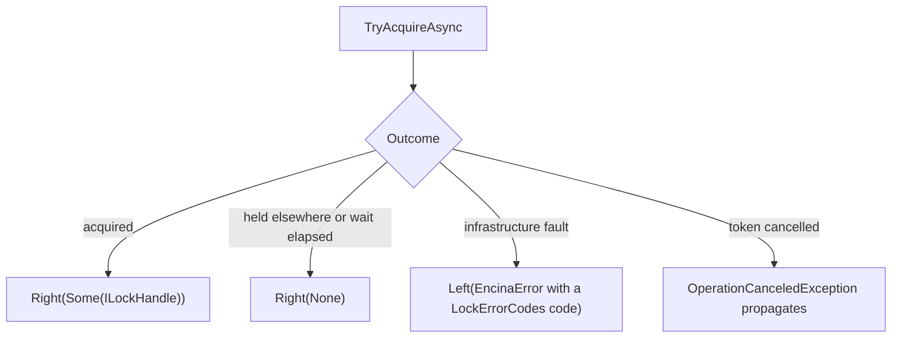

# ADR-052: Distributed Lock Providers Report Outcomes Through Either; Contention Is Not an Error

## Status

**Accepted** - 2026-10-22, maintainer decision on [#1799](https://github.com/dlrivada/Encina/issues/1799): option D. The evidence is in the [spike report](../../engineering/rop-exceptions-locks-aggregates-spike-1799-1798.md), section 3. The implementation is [#2667](https://github.com/dlrivada/Encina/issues/2667).

## Context

[SPEC-000](../../specifications/SPEC-000-encina-1.0-baseline-and-release-scope.md) (REQ-027, DEC-003, AC-027) requires five distributed lock providers before 1.0: InMemory, Redis, SQL Server, PostgreSQL ([#207](https://github.com/dlrivada/Encina/issues/207)) and MySQL ([#208](https://github.com/dlrivada/Encina/issues/208)). Three exist under `src/` today, and the other two are not written, so they can be written to whichever contract this ADR fixes (spike report, section 3.2).

[ADR-001](001-railway-oriented-programming.md) lists database connection issues, external API failures, timeouts and network errors as `Left`, not exceptions (lines 222-226). [AGENTS.md](../../../AGENTS.md) section 3 adds that a failure in background infrastructure is never swallowed. [ADR-006](006-pure-rop-exception-handling.md) makes any exception that escapes a service fatal. Both ADR-001 and ADR-006 are being reconciled in [#1800](https://github.com/dlrivada/Encina/issues/1800).

What the code does at `origin/main` (spike report, sections 3.1 to 3.4, unchanged at `fd19613e1`):

| Fact | Evidence |
| --- | --- |
| `TryAcquireAsync` returns `Task<IAsyncDisposable?>`; `null` means not acquired within the wait | `src/Encina.DistributedLock/IDistributedLockProvider.cs:77` |
| `AcquireAsync` returns `Task<IAsyncDisposable>` and documents `LockAcquisitionException` for every provider | `IDistributedLockProvider.cs:92-93` |
| `IsLockedAsync` and `ExtendAsync` return `Task<bool>` | `IDistributedLockProvider.cs:108` and `:121` |
| The provider returns `IAsyncDisposable`, so `ILockHandle.ExtendAsync` and `ExpiresAtUtc` need a cast | `src/Encina.DistributedLock/ILockHandle.cs:15`, `:38`, `:51` |
| `LockAcquisitionException` is thrown by one provider only, SQL Server; the other implementations never throw it (spike report, section 3.4) | `src/Encina.DistributedLock.SqlServer/SqlServerDistributedLockProvider.cs:119`, `:121-124` |
| In SQL Server every negative `sp_getapplock` result collapses to `null` in `TryAcquireAsync`, so a caller cannot tell "held elsewhere" from "the server reported a failure" | `SqlServerDistributedLockProvider.cs:70-86` |
| Redis faults propagate as raw exceptions | spike report, section 3.4 |
| No lock error codes exist | spike report, section 3.4 |
| No production code in `src/` consumes `IDistributedLockProvider`; the callers are tests, NBomber scenarios, benchmarks and the README | spike report, section 3.3 |

The precedent for "not obtained" versus "failed" in one return value already exists: `IDeadLetterStore.TryClaimForReplayAsync` returns `Task<Either<EncinaError, bool>>`, where `Right(true)` is a won claim, `Right(false)` is a lost race and `Left` is an infrastructure fault (`src/Encina.Messaging/DeadLetter/IDeadLetterStore.cs:102`). `EitherHelpers.TryAsync` already re-throws `OperationCanceledException` and converts every other exception (`src/Encina/Results/EitherHelpers.cs:38`).

Pre-1.0, breaking changes are acceptable ([AGENTS.md](../../../AGENTS.md) section 1), so the cost of changing the signatures is not an argument in this decision.

## Decision

**Option D is chosen.** The lock providers report outcomes as values, and contention is a normal outcome, not an error.



- `TryAcquireAsync` returns `Either<EncinaError, Option<ILockHandle>>`. Acquired is `Right(Some(handle))`. Contention or timeout is `Right(None)`. An infrastructure fault is `Left`.
- `AcquireAsync` returns `Either<EncinaError, ILockHandle>`.
- The methods return `ILockHandle`, not `IAsyncDisposable`, so `ExtendAsync` and `ExpiresAtUtc` are reachable without a cast. This comes from option D as written in the spike report, section 3.7, and is part of the option the maintainer chose.
- `OperationCanceledException` still propagates, the same rule as `EitherHelpers.TryAsync`. Cancellation is not an error.
- `LockAcquisitionException` is removed. No shim, alias or compatibility layer is left.
- A new `LockErrorCodes` class holds the codes of the `Left` cases. An error never carries the raw exception message ([AGENTS.md](../../../AGENTS.md) section 3).
- A documented `Match` pattern or helper extension keeps `await using` usable with the `Either` result. The exact form is decided in the implementation.
- The decision applies to all five SPEC-000 providers. InMemory, Redis and SQL Server are changed; PostgreSQL (#207) and MySQL (#208) are written to this contract. Contract tests run the same scenarios over all five (AC-027).

`IsLockedAsync` and `ExtendAsync` on the provider return `Either<EncinaError, bool>`: a fault is `Left`; "not locked" or "not held" is `Right(false)`. This is a consequence the orchestrator derived from the decision, not wording of the maintainer's comment, because only one shape complies. Both methods reach Redis or SQL Server; ADR-001 (lines 222-226) classifies connection, timeout and network failures as `Left`; and the principle of option D is that a fault is never collapsed into a normal result such as `false`. A `Task<bool>` would therefore either throw or hide a fault. It is recorded in [#2667](https://github.com/dlrivada/Encina/issues/2667).

Target contract, illustrative and **not existing code** (the current signatures are in the table above):

```csharp
// Target signatures decided by this ADR; the implementation is #2667.
Task<Either<EncinaError, Option<ILockHandle>>> TryAcquireAsync(
    string resource, TimeSpan expiry, TimeSpan wait, TimeSpan retry,
    CancellationToken cancellationToken);

Task<Either<EncinaError, ILockHandle>> AcquireAsync(
    string resource, TimeSpan expiry, CancellationToken cancellationToken);

Task<Either<EncinaError, bool>> IsLockedAsync(string resource, CancellationToken cancellationToken);

Task<Either<EncinaError, bool>> ExtendAsync(
    string resource, TimeSpan extension, CancellationToken cancellationToken);

// Using the result with await using (the helper name is open).
var outcome = await locks.TryAcquireAsync("orders:42", expiry, wait, retry, ct);
await outcome.Match(
    Right: maybeHandle => maybeHandle.Match(
        Some: async handle =>
        {
            await using (handle)
            {
                // work under the lock
            }
        },
        None: () => Task.CompletedTask /* contention: skip, retry later */),
    Left: error => ReportFaultAsync(error) /* placeholder: fail the operation, never swallow it */);
```

The basis is ADR-001 lines 222-226 and [AGENTS.md](../../../AGENTS.md) section 3: faults are `Left`, and background infrastructure never swallows an error. Contention is not a fault, which is why it is `Right(None)`, following `TryClaimForReplayAsync`.

## Alternatives considered

The spike's options A, B and C are the issue's; D was added by the spike. The ids follow the [spike report](../../engineering/rop-exceptions-locks-aggregates-spike-1799-1798.md), section 3.7.

### Option A: `Either<EncinaError, ILockHandle>` for both acquire methods (not chosen)

A lock that is not obtained is a `Left`. It aligns fully with ADR-001. It was not chosen because contention would then be a `Left`, so logs and metrics would record the most common outcome of a lock as a failure, and `await using` cannot be applied directly to an `Either`. Option D keeps A's fault handling and removes both problems.

### Option B: keep today's signatures and document an exception exemption (not chosen)

`LockAcquisitionException` and raw provider exceptions become a documented exemption. It was ruled out by ADR-001 lines 222-226, which list connection, timeout and network failures as `Left`, and by [AGENTS.md](../../../AGENTS.md) section 3, which forbids swallowing errors in background infrastructure: every future consumer would need a try/catch. The exemption exists in neither ADR-001 nor ADR-006.

### Option C: a `CanAcquire` pre-check plus exceptions (not chosen)

`AcquireAsync` stays exception-based for faults and a check method is added. It was ruled out for the same reasons as B, and because a check-then-act call has the race that `IsLockedAsync`'s own documentation warns about (`IDistributedLockProvider.cs:105-106`). Contention and timeout are already non-exceptional in `TryAcquireAsync`, and `AcquireAsync` has no timeout to remove.

### Industry practice

The two lock libraries the spike read (madelson/DistributedLock, RedLock.net) return `null` or a flag for contention and throw for faults; none returns `Either` (spike report, section 3.6). Encina's own rule, ADR-001, weighs more here than the ecosystem norm, and the contention shape of option D, "absent, not failed", is the same one the ecosystem uses.

## Consequences

- [#2667](https://github.com/dlrivada/Encina/issues/2667) implements the contract: the interface and `ILockHandle`, `LockErrorCodes`, the `await using` helper, removal of `LockAcquisitionException`, `PublicAPI` lines, the three existing providers, and the unit, guard, property, integration and contract tests, NBomber scenarios, benchmarks and README. No production caller in `src/` changes, because there is none.
- SQL Server classifies the `sp_getapplock` result: contention and timeout stay `Right(None)`; a fault becomes a `Left` with a `LockErrorCodes` code instead of `null`.
- [#207](https://github.com/dlrivada/Encina/issues/207) (PostgreSQL) and [#208](https://github.com/dlrivada/Encina/issues/208) (MySQL) are written to this contract, and a lock feature is complete for 1.0 only when contract tests cover all five providers.
- Logging and OpenTelemetry do not count `Right(None)` as a failure, only as contention (the cross-cutting check of [ADR-018](018-cross-cutting-integration-principle.md)). This comes from option D in the spike report, section 3.7, and is part of the option the maintainer chose.
- Related defects stay in their own issues: [#2654](https://github.com/dlrivada/Encina/issues/2654) (SQL Server wraps `OperationCanceledException`, Redis ignores the token, "Redlock" wording), [#2653](https://github.com/dlrivada/Encina/issues/2653) (duplicate providers in the caching packages, which must follow this contract whatever it decides) and [#2405](https://github.com/dlrivada/Encina/issues/2405) (SQL Server `ExtendAsync` is a no-op).
- [#1795](https://github.com/dlrivada/Encina/issues/1795), the ROP architecture rule, can enforce this afterwards. No exemption entry is needed for locks.
- [#1800](https://github.com/dlrivada/Encina/issues/1800) (reconciling ADR-001 and ADR-006) is open; this decision rests on ADR-001's runtime-failure rule and on AGENTS.md section 3, not on any exemption category.

## Related

- [ADR-001](001-railway-oriented-programming.md) (Railway Oriented Programming; operational failures are `Left`)
- [ADR-006](006-pure-rop-exception-handling.md) (pure ROP exception handling)
- [ADR-018](018-cross-cutting-integration-principle.md) (locks are cross-cutting function 7)
- [ADR-053](053-aggregate-rule-violations-return-either.md) (the companion decision for compliance aggregates)
- [SPEC-000](../../specifications/SPEC-000-encina-1.0-baseline-and-release-scope.md) (REQ-027, DEC-003, AC-027)
- [Spike report](../../engineering/rop-exceptions-locks-aggregates-spike-1799-1798.md)
- Issues [#1799](https://github.com/dlrivada/Encina/issues/1799) (the spike), [#2667](https://github.com/dlrivada/Encina/issues/2667) (implementation), [#2654](https://github.com/dlrivada/Encina/issues/2654), [#2653](https://github.com/dlrivada/Encina/issues/2653), [#2405](https://github.com/dlrivada/Encina/issues/2405), [#207](https://github.com/dlrivada/Encina/issues/207), [#208](https://github.com/dlrivada/Encina/issues/208), [#1795](https://github.com/dlrivada/Encina/issues/1795), [#1800](https://github.com/dlrivada/Encina/issues/1800)

## Date

2026-10-22
