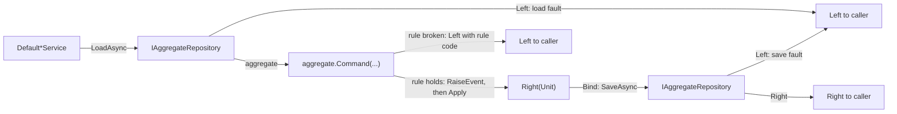

# ADR-053: Compliance Aggregate Rule Violations Are a Left, Not an Exception

## Status

**Accepted** - 2026-10-22, maintainer decision on [#1798](https://github.com/dlrivada/Encina/issues/1798): option A. The evidence is in the [spike report](../../engineering/rop-exceptions-locks-aggregates-spike-1799-1798.md), section 4. The implementation is [#2668](https://github.com/dlrivada/Encina/issues/2668). It supersedes the throwing aggregate sample of [ADR-019](019-compliance-event-sourcing-marten.md).

## Context

[ADR-001](001-railway-oriented-programming.md) says business rule violations are `Left` (line 218) and allows exceptions only at startup and configuration (lines 193-204). [AGENTS.md](../../../AGENTS.md) section 3 says never to use exceptions for business logic. [ADR-006](006-pure-rop-exception-handling.md) makes an exception that escapes a service fatal. [ADR-019](019-compliance-event-sourcing-marten.md) nevertheless shows an aggregate command that throws `InvalidOperationException` (lines 173-178) and says aggregate command methods validate invariants (line 338) without calling exceptions an exempt category, so the pattern was copied into the compliance packages (spike report, section 4.7).

What the code does at `origin/main` (spike report, sections 4.1 to 4.5, reproduced at `fd19613e1`):

| Fact | Evidence |
| --- | --- |
| 16 compliance aggregates, each `sealed class X : AggregateBase`; command methods are `void` or static factories; none returns `Either` | `src/Encina.DomainModeling/AggregateBase.cs:64` (`RaiseEvent` at `:109`) |
| 81 `throw new` in them, 74 of which are `InvalidOperationException`; most are state-machine guards, a few are data invariants | spike report, section 4.1; for example `src/Encina.Compliance.Consent/Aggregates/ConsentAggregate.cs:212` (state) and `:241` (expire without an expiration date) |
| 56 `catch (InvalidOperationException` sites in 15 `Default*Service` classes, each followed by a catch-all `Exception` branch | spike report, section 4.4 |
| The catch is type-based, so it also catches an `InvalidOperationException` thrown by any collaborator in the same `try` (`ObjectDisposedException` derives from it) | spike report, section 4.3 |
| A rule broken for one reason is reported as another: `DefaultSCCService` maps both revoked and expired to "already revoked" | `src/Encina.Compliance.CrossBorderTransfer/Aggregates/SCCAgreementAggregate.cs:131` and `:136`, `.../Services/DefaultSCCService.cs:129` |
| A domain error is reported as an infrastructure error: all seven DPIA catches map to `StoreError` | `src/Encina.Compliance.DPIA/Services/DefaultDPIAService.cs:166`, `:224`, `:273`, `:322`, `:370`, `:418`, `:464` |
| Exception text is copied into `EncinaError.Message`, which must not reach logs or storage; retention catches drop the details | spike report, section 4.5; [#1591](https://github.com/dlrivada/Encina/issues/1591) |
| Six packages own an `invalid_state_transition` code with three incompatible factory signatures | spike report, section 4.5 |
| `IBusinessRule`, `Check` (`Either<BusinessRuleError, Unit>`), `CheckAll` and `BusinessRuleError` exist and no compliance package uses them; `BusinessRuleError` is not an `EncinaError` | `src/Encina.DomainModeling/BusinessRule.cs:30`, `:112`, `:163`, `:197` |
| In the default configuration the Marten repository returns `Left` for infrastructure faults, so the ambiguity is real but narrower than the issue claimed | spike report, section 4.3 |

Pre-1.0, breaking changes are acceptable ([AGENTS.md](../../../AGENTS.md) section 1), so the amount of code touched is not an argument against a design that complies with the rules.

## Decision

**Option A is chosen.** A broken state or invariant rule is a returned value, decided before the event is raised.



- Compliance aggregate command methods return `Either<EncinaError, Unit>`. Static factories return `Either<EncinaError, TAggregate>`.
- A broken state or invariant rule is a `Left` with its own error code, decided before `RaiseEvent`. `Apply` stays pure and no event is raised on a violation. No exception is thrown on the rule-violation path.
- Argument guards (`ArgumentException.ThrowIf*`, `ArgumentNullException.ThrowIfNull`) stay exceptions: they are programming errors, not business logic.
- Services stop catching `InvalidOperationException` and compose aggregate results with `Bind` and `Match`. The 56 catch sites and the per-package mappings go away.
- One shared catalogue of rule codes replaces the six incompatible `invalid_state_transition` factories. A rule violation is logged by its code, never by an exception message.
- The `IBusinessRule` and `Check` support in `Encina.DomainModeling` is the starting point, with an adapter from `BusinessRuleError` to `EncinaError`.

Together these remove the defects of the spike report, section 4.5: wrong error for a rule, `StoreError` for domain errors, `ex.Message` copied into `EncinaError`, and six incompatible factories.

Target contract, illustrative and **not existing code**: it shows the shape only, not the real signature (the current method is `ConsentAggregate.Withdraw(string, string?, DateTimeOffset)` in `src/Encina.Compliance.Consent/Aggregates/ConsentAggregate.cs:208`, and [ADR-019](019-compliance-event-sourcing-marten.md) has the older sample). `ComplianceRuleErrors` does not exist yet; the real catalogue is built by the implementation:

```csharp
// Target shape decided by this ADR; the implementation is #2668.
public Either<EncinaError, Unit> Withdraw(string withdrawnBy, string? reason, DateTimeOffset occurredAtUtc)
{
    if (Status is not (ConsentStatus.Active or ConsentStatus.RequiresReconsent))
        return /* shared catalogue, name not yet existing */ ComplianceRuleErrors.InvalidStateTransition(
            Id, operation: "withdraw", currentState: Status.ToString());   // Left with a rule code

    ArgumentException.ThrowIfNullOrWhiteSpace(withdrawnBy);   // programming error: stays an exception

    RaiseEvent(new ConsentWithdrawn(Id, DataSubjectId, Purpose, withdrawnBy, reason, occurredAtUtc));
    return Unit.Default;
}

// In the service: no try/catch for the rule; compose with Bind.
// load.Bind(consent => consent.Withdraw(by, reason).Map(_ => consent)).BindAsync(SaveAsync);
```

## Alternatives considered

Options A, B and C are the issue's; D was added by the spike. The ids follow the [spike report](../../engineering/rop-exceptions-locks-aggregates-spike-1799-1798.md), section 4.9. Option A is chosen.

### Option B: documented exemption, services translate the exception (not chosen)

An ADR declares aggregate exceptions exempt and the services keep `catch (InvalidOperationException)`. It matches Marten and Wolverine practice of throwing in decision code and changes no aggregate. It was not chosen because it keeps the type-based catch and the defects above, and fixing them would need an audit of all 56 catch sites. It also contradicts ADR-001 line 218 and [AGENTS.md](../../../AGENTS.md) section 3.

### Option C: an adapter that catches `InvalidOperationException` at the boundary (not chosen)

One adapter layer routes the 15 services through one catch. It concentrates the catch but keeps it type-based, so the ambiguity remains, and adds a layer. It was ruled out for the same reasons as B.

### Option D: one typed, coded exception and one shared mapping (not chosen)

Aggregates throw one typed rule-violation exception, such as `BusinessRuleViolationException` (`src/Encina.DomainModeling/BusinessRule.cs:71`), and services catch only that type through a shared helper. It fixes the divergent mappings and the `ex.Message` copy with less code than A and stops the catch from swallowing infrastructure exceptions. It was the alternative: a typed exception as an exemption to ADR-001. It was not chosen because the rule path still throws, which [AGENTS.md](../../../AGENTS.md) section 3 forbids for business logic, and #1795 would need a narrow allowlist entry for it.

### Industry practice

Marten, Wolverine and Axon throw inside decision code and translate at the boundary; Chassaing's Decider returns events or a result (spike report, section 4.8). None of the sources catches a generic BCL exception type as the rule-violation signal. A shape that returns a result is consistent with the functional lineage and with ADR-001. The longer-term form of pure `Decide(state, command)` functions is not decided here.

## Consequences

- [#2668](https://github.com/dlrivada/Encina/issues/2668) implements it as one PR per package: the shared rule-code catalogue and the adapter in core first, then Consent, Retention, BreachNotification with DataSubjectRights, DataResidency with LawfulBasis, CrossBorderTransfer, and ProcessorAgreements with DPIA. The per-package state-transition factories are removed at the end.
- About 200 `Should.Throw<InvalidOperationException>` assertions in the compliance unit and guard tests (spike report, section 4.6) are rewritten to assert the `Left` code of each rule. The service tests that modelled "database down" as `InvalidOperationException` start to distinguish a rule violation from an infrastructure fault.
- The aggregate keeps two failure paths by design: a `Left` for rules and exceptions for argument guards.
- Resolved when implemented: [#1591](https://github.com/dlrivada/Encina/issues/1591) for the compliance services (verify the other packages before closing it) and [#2655](https://github.com/dlrivada/Encina/issues/2655).
- [#1795](https://github.com/dlrivada/Encina/issues/1795), the ROP architecture rule, can then enforce "no `InvalidOperationException` on aggregate rule paths". [#1800](https://github.com/dlrivada/Encina/issues/1800) is open and concerns the wording of ADR-001 and ADR-006; this decision rests on ADR-001 line 218 and AGENTS.md section 3.
- The `AggregateBase<TId>` test support in `Encina.Testing` (`AggregateTestBase`) is exception-based and applies to other aggregates; it matters only if this decision is later extended to them (spike report, section 4.6).
- [ADR-019](019-compliance-event-sourcing-marten.md) carries a note that its throwing sample is superseded; the implementation corrects the sample.

## Related

- [ADR-001](001-railway-oriented-programming.md) (Railway Oriented Programming; business rule violations are `Left`)
- [ADR-006](006-pure-rop-exception-handling.md) (pure ROP exception handling)
- [ADR-019](019-compliance-event-sourcing-marten.md) (compliance event sourcing; its throwing sample is superseded)
- [ADR-052](052-distributed-lock-failure-contract.md) (the companion decision for lock providers)
- [Spike report](../../engineering/rop-exceptions-locks-aggregates-spike-1799-1798.md)
- Issues [#1798](https://github.com/dlrivada/Encina/issues/1798) (the spike), [#2668](https://github.com/dlrivada/Encina/issues/2668) (implementation), [#1591](https://github.com/dlrivada/Encina/issues/1591), [#2655](https://github.com/dlrivada/Encina/issues/2655), [#1795](https://github.com/dlrivada/Encina/issues/1795), [#1800](https://github.com/dlrivada/Encina/issues/1800)

## Date

2026-10-22
