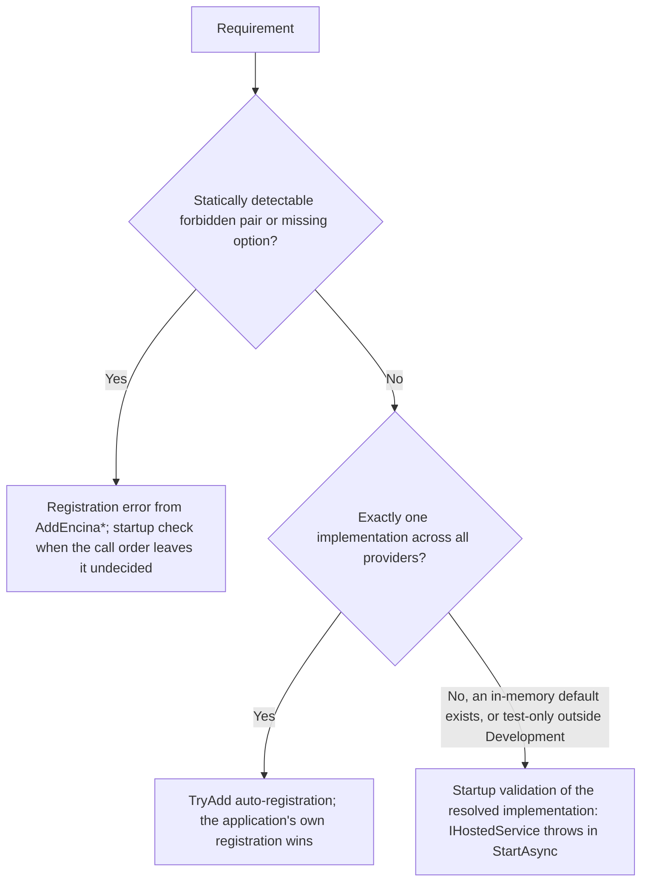

# About the module dependency matrix

This page is for a developer or contributor who wants to understand which Encina modules need other modules, why that does not contradict "everything is opt-in", and how a missing requirement shows up. It explains the matrix; the binding list, the mechanisms and the rules are in [ADR-050](adr/050-modules-may-require-modules.md), and this page repeats the list so it can be read without leaving the architecture section.

## Why a matrix exists

Encina's rule is pay-for-what-you-use: every feature is opt-in. That rule is right for everything a module does not need. It is wrong for what a module needs to keep the guarantee it advertises. An Outbox that does not write in the same transaction as the business data does not deliver "at least once"; a compliance gate without an audit store cannot prove what it decided; an in-memory key store loses data on restart. ADR-050 therefore lets a module require other modules, and keeps the list of requirements closed: a requirement exists only if the ADR table has a row for it.

## How to read a row

| Column | Meaning |
| --- | --- |
| Requires | The guarantee is false without the other module. Enabling the module without it fails. |
| Forbids | Enabling both modules together breaks a guarantee, so the combination fails. |
| Condition | `Required` when the requirement always applies; otherwise the exact condition (multi-instance, multi-tenant, personal data, an environment other than Development, a feature switched on). |
| Mechanism | How the requirement is enforced; binding, as in the ADR. |
| Source | The issue or decision the row comes from. |

"Planned (#n)" after a name means the type does not exist in `src/` yet and issue #n delivers it. "Decision pending" means the maintainer has not yet chosen between options, and the row is final once that issue records the choice.

Each failure names the module, the requirement and ADR-050, and says how to add the missing module.

## How a requirement is enforced

ADR-050 sub-decision 1 (Option A) picks the earliest safe mechanism per row. The deciding question is how many implementations of the required dependency exist across all providers, not how many adapters one module ships:

## The matrix

The table below is the ADR-050 table. If the two differ, the ADR is right. Counts and coverage figures do not appear here.

| Module | Requires | Forbids | Condition | Mechanism | Source |
| --- | --- | --- | --- | --- | --- |
| Event sourcing (`Encina.Marten`) | Outbox (`OutboxStoreMarten`, planned (#2383), written in the Marten session); Inbox for domain events, enlisted in the Marten transaction as [ADR-048](adr/048-inbox-record-vs-business-transaction.md) defines; Recoverability and Dead Letter Queue; processor health and metrics ([#2396](https://github.com/dlrivada/Encina/issues/2396)); multi-instance coordination ([#1251](https://github.com/dlrivada/Encina/issues/1251)) | `TransactionPipelineBehavior` (the Marten session is already transactional) | Required. Conditional: multi-tenancy, scheduling. Multi-instance is always assumed; there is no single-instance opt-out for this row | Outbox, Inbox, Recoverability, Dead Letter Queue, multi-instance coordination, processor health and metrics: startup validation of the resolved implementation (several providers, in-memory defaults). `TransactionPipelineBehavior`: registration error from both modules' `AddEncina*` methods, and startup validation when the order of the two calls cannot decide it | [#2239](https://github.com/dlrivada/Encina/issues/2239), [#2383](https://github.com/dlrivada/Encina/issues/2383) |
| Pipeline core | Stage-order contract (planned (#2184), ADR-049 reserved) | The same behavior registered twice | Required | Registration error (idempotent registration, [#1784](https://github.com/dlrivada/Encina/issues/1784)) | [#2184](https://github.com/dlrivada/Encina/issues/2184) |
| Transactions (ADO.NET, Dapper, EF Core) | A transaction accessor shared with the stores | Marten; MongoDB without a replica set | Required | Startup validation (the stores resolve the accessor of the transaction; several providers). The Marten pair follows the event-sourcing row | [#2382](https://github.com/dlrivada/Encina/issues/2382), [#2239](https://github.com/dlrivada/Encina/issues/2239) |
| Outbox | Transactions, so the write joins the business transaction ([#718](https://github.com/dlrivada/Encina/issues/718)); row claiming or a lock ([#1251](https://github.com/dlrivada/Encina/issues/1251)); Dead Letter Queue; processor health ([#2396](https://github.com/dlrivada/Encina/issues/2396)); transport publisher (planned (#2385)) | The CDC outbox handler together with the polling processor ([#1968](https://github.com/dlrivada/Encina/issues/1968)) | Required. Conditional: multi-tenancy (`TenantId` on the row) | Startup validation (ten database providers plus in-memory default). The CDC pair is a registration error, order-independent as described in the ADR | [#718](https://github.com/dlrivada/Encina/issues/718), [#1251](https://github.com/dlrivada/Encina/issues/1251), [#2385](https://github.com/dlrivada/Encina/issues/2385) |
| Inbox | Transactions ([ADR-048](adr/048-inbox-record-vs-business-transaction.md)); purge processor ([#1969](https://github.com/dlrivada/Encina/issues/1969)) | | Required. Conditional: row claiming or a lock when consumers run concurrently ([#2401](https://github.com/dlrivada/Encina/issues/2401)) | Startup validation (several providers, in-memory default) | [#2401](https://github.com/dlrivada/Encina/issues/2401), [#1969](https://github.com/dlrivada/Encina/issues/1969) |
| Saga | Saga state persistence results honoured ([#1581](https://github.com/dlrivada/Encina/issues/1581)); concurrency control on the saga row (planned, issue not yet opened); timeout processor ([#2208](https://github.com/dlrivada/Encina/issues/2208)) | | Required. Conditional: Outbox when the saga sends messages; lock when timeouts run on several instances; multi-tenancy | Startup validation (several store providers) | [#1581](https://github.com/dlrivada/Encina/issues/1581), [#2208](https://github.com/dlrivada/Encina/issues/2208) |
| Routing slips, choreography | A persistent `IRoutingSlipStore` (no implementation exists; planned, issue not yet opened) | | Required | Startup validation (no store registered) | Module dependency study of 2026-10-16 |
| Scheduling | Row claiming or a lock ([#1251](https://github.com/dlrivada/Encina/issues/1251)); idempotent dispatch ([#735](https://github.com/dlrivada/Encina/issues/735)); a default `ICronParser` (planned (#1222)) | | Required. Conditional: `ICronParser` only when `EnableRecurringMessages` is on; multi-tenancy ([#739](https://github.com/dlrivada/Encina/issues/739)) | `ICronParser`: `TryAdd` once the single default exists. Claiming or lock and dispatch idempotency: startup validation | [#1222](https://github.com/dlrivada/Encina/issues/1222), [#735](https://github.com/dlrivada/Encina/issues/735) |
| Recoverability | Dead Letter Queue | Placement inside Transactions (retries would reuse the open transaction; checked once [#2184](https://github.com/dlrivada/Encina/issues/2184) defines stages) | Required | Dead Letter Queue: startup validation. Placement: registration error once stages exist | [#2184](https://github.com/dlrivada/Encina/issues/2184) |
| Delayed retries (Recoverability) | An `IDelayedRetryStore` (no implementation exists; planned (#594)) | | Required while delayed retries are on by default; revisit with [#2248](https://github.com/dlrivada/Encina/issues/2248), whose fix may change that default | Startup validation (several store providers) | [#2248](https://github.com/dlrivada/Encina/issues/2248), [#594](https://github.com/dlrivada/Encina/issues/594) |
| Dead Letter Queue | An operation-audit adapter (planned (#2013)); a tenant on every entry (already met, [ADR-046](adr/046-persistent-dead-letter-queue.md)) | | Required | Startup validation of the resolved `IOperationAuditStore` (several providers, in-memory default) | [#2013](https://github.com/dlrivada/Encina/issues/2013), a feature issue, not a recorded decision |
| Transports (10) | Outbox to publish ([ADR-028](adr/028-domain-events-versus-integration-events.md)); Inbox and acknowledgement after success to consume; Dead Letter Queue | | Required | Startup validation (Outbox and Inbox registered for the transport) | [#2385](https://github.com/dlrivada/Encina/issues/2385) |
| Cloud (AwsLambda, AzureFunctions) | Inbox or idempotency by `MessageId` for queue triggers; tenant taken from a verified source | The tenant header ranked above the verified claim ([#2399](https://github.com/dlrivada/Encina/issues/2399)) | Required | Startup validation | [#2399](https://github.com/dlrivada/Encina/issues/2399) |
| CDC | A persistent `ICdcPositionStore` (planned (#2393)); a reachable dead letter queue ([#2344](https://github.com/dlrivada/Encina/issues/2344)); row claiming, lock or leader ([#1251](https://github.com/dlrivada/Encina/issues/1251)); idempotent handlers | The CDC outbox handler together with the polling Outbox processor | Required. Conditional: multi-tenancy | Startup validation (in-memory default position store). The pair is a registration error | [#2393](https://github.com/dlrivada/Encina/issues/2393), [#2343](https://github.com/dlrivada/Encina/issues/2343) |
| Hangfire, Quartz | A persistent scheduler store | An in-memory Quartz store outside Development | Required outside Development. Conditional: tenant propagation; idempotent handlers on retries | Startup validation | [#2382](https://github.com/dlrivada/Encina/issues/2382) |
| Caching (8) | Backplane for L1 caches on several instances; invalidation after commit (planned (#2408)) | Query caching in a multi-tenant application with no tenant resolved | Conditional: multi-tenancy (tenant in the key, [#1913](https://github.com/dlrivada/Encina/issues/1913)); multi-instance (backplane); personal data (purge on DSR erasure, [#2407](https://github.com/dlrivada/Encina/issues/2407)) | Startup validation (several providers) | [#1913](https://github.com/dlrivada/Encina/issues/1913), [#2408](https://github.com/dlrivada/Encina/issues/2408) |
| Distributed locks (5) | A real provider (Redis, SQL Server today; PostgreSQL and MySQL planned (#207, #208)) | The in-memory provider on several instances, including the one `AddEncinaMemoryCache` registers | Conditional: multi-instance (assumed) | Startup validation (several providers) | [#2382](https://github.com/dlrivada/Encina/issues/2382) |
| Validation (3) | Exactly one validation provider | A second provider (the first registered would win silently) | Required | Registration error for two providers, order-independent as described in the ADR; startup validation when validators exist and no provider is registered | [#2382](https://github.com/dlrivada/Encina/issues/2382) |
| Resilience (Polly, Extensions.Resilience, Http.Resilience) | Idempotency before retrying a command (decision pending, [#2411](https://github.com/dlrivada/Encina/issues/2411)) | Several retry layers on the same request | Required once [#2411](https://github.com/dlrivada/Encina/issues/2411) records the choice. Conditional: multi-instance (distributed circuit-breaker state) | Registration error | [#2411](https://github.com/dlrivada/Encina/issues/2411) |
| Security (RBAC, ASP.NET Core authorization) | An `ISecurityContextAccessor` that something populates (decision pending, [#2400](https://github.com/dlrivada/Encina/issues/2400)) | | Required once [#2400](https://github.com/dlrivada/Encina/issues/2400) records the choice | Startup validation | [#2400](https://github.com/dlrivada/Encina/issues/2400) |
| ABAC | Operation audit, awaited (sub-decision 5) | | Conditional: `DecisionAudit` enabled. Conditional: multi-tenancy | Startup validation (exists: `ABACDecisionAuditStartupCheck`) | [#2382](https://github.com/dlrivada/Encina/issues/2382) |
| Audit stores (operation, read, entity change) | A persistent store; the write is awaited ([ADR-036](adr/036-three-audit-stores.md)) | The in-memory stores outside Development | Required outside Development. Conditional: same transaction as the data for evidence reads ([SPEC-002](../specifications/SPEC-002-eu-regulatory-readiness.md) REQ-007) | Startup validation (several providers, in-memory default) | [#2382](https://github.com/dlrivada/Encina/issues/2382) |
| Operation audit (PII masking) | An `IPiiMasker` | | Required unless the explicit, logged opt-out is set | Startup validation (exists: `OperationAuditMaskingStartupValidator`) | [#1835](https://github.com/dlrivada/Encina/issues/1835) |
| Encryption, Messaging.Encryption | A persistent key store | A KMS key provider together with `InMemoryKeyProvider` (the first registered wins, [#2403](https://github.com/dlrivada/Encina/issues/2403)); the in-memory key store outside Development | Required. Conditional: per-tenant keys | Startup validation of the resolved `IKeyProvider` (the KMS and in-memory pair is order-dependent, so it is not a registration error) | [#2403](https://github.com/dlrivada/Encina/issues/2403) |
| AntiTampering | An atomic, distributed `INonceStore` | In-memory nonces on several instances or outside Development | Conditional: multi-instance (assumed); an environment other than Development | Startup validation (in-memory default) | [#2412](https://github.com/dlrivada/Encina/issues/2412) |
| Secrets | A cache when `EnableCaching` is on; Operation audit when `EnableAccessAuditing` is on | Access auditing switched on with no audit store, skipped silently | Conditional: each option switched on | Startup validation | [#1875](https://github.com/dlrivada/Encina/issues/1875) |
| GDPR | A persistent processing-activity registry; a real `IGDPRComplianceValidator` | The default validator that always reports compliant, outside Development | Required | Startup validation ([#2409](https://github.com/dlrivada/Encina/issues/2409) sets the Block default) | [#2409](https://github.com/dlrivada/Encina/issues/2409) |
| Consent | Cache invalidation on withdrawal | | Conditional: a cache provider is registered | Startup validation | [#2408](https://github.com/dlrivada/Encina/issues/2408) (related) |
| LawfulBasis | The Consent adapter for `IConsentStatusProvider` (planned (#1920)) | | Required | `TryAdd` (one adapter) | [#1920](https://github.com/dlrivada/Encina/issues/1920) |
| Data subject rights (DSR) | Operation audit, awaited (sub-decision 5); legal holds from Retention (`ILegalHoldService`, [#1188](https://github.com/dlrivada/Encina/issues/1188)); cache purge and reliable processor notification of the erasure (Art. 19, planned (#2407)) | | Required. Conditional: crypto-shredding when event sourcing is on; multi-tenancy | Startup validation of the resolved `IOperationAuditStore` | [#2407](https://github.com/dlrivada/Encina/issues/2407), [#1188](https://github.com/dlrivada/Encina/issues/1188) |
| Crypto-shredding (`Encina.Marten.GDPR`) | A persistent subject key store; purge of projections and cache; operation audit | `InMemorySubjectKeyProvider` outside Development (today a warning, [#1191](https://github.com/dlrivada/Encina/issues/1191)) | Required | Startup validation (exists: `CryptoShreddingStartupValidationHostedService`, to be tightened) | [#1191](https://github.com/dlrivada/Encina/issues/1191) |
| Crypto-shredding locators | Every registered locator is reachable through the resolved one | | Required | Startup validation | [#1773](https://github.com/dlrivada/Encina/issues/1773) |
| Retention | A lock or Scheduling ([#1158](https://github.com/dlrivada/Encina/issues/1158)); an application `IRetentionDataEraser` | | Required | Startup validation | [#1158](https://github.com/dlrivada/Encina/issues/1158) |
| BreachNotification | Reliable delivery (Outbox); a lock on the deadline monitor; a real `IBreachNotifier`; operation audit | The no-op notifier outside Development ([#2391](https://github.com/dlrivada/Encina/issues/2391)) | Required | Startup validation | [#2391](https://github.com/dlrivada/Encina/issues/2391), [#2390](https://github.com/dlrivada/Encina/issues/2390) |
| NIS2 | BreachNotification; operation audit, awaited (sub-decision 5, [#2413](https://github.com/dlrivada/Encina/issues/2413)); a real `IMFAEnforcer` | The default MFA enforcer outside Development ([#2389](https://github.com/dlrivada/Encina/issues/2389)) | Required | Startup validation | [#2413](https://github.com/dlrivada/Encina/issues/2413), [#2389](https://github.com/dlrivada/Encina/issues/2389) |
| CrossBorderTransfer | DataResidency registrations (already satisfied for `IAdequacyDecisionProvider`) | | Required | `TryAdd` (one DataResidency registration) | [#1285](https://github.com/dlrivada/Encina/issues/1285) |
| DPIA, ProcessorAgreements, PrivacyByDesign | A lock for reminders; Scheduling for DPA expiration ([#2406](https://github.com/dlrivada/Encina/issues/2406)); ProcessorAgreements subscribes to DSR erasures (Art. 19, 28) | | Conditional: multi-instance (assumed) | Startup validation | [#2406](https://github.com/dlrivada/Encina/issues/2406) |
| AI Act | Operation audit, awaited (sub-decision 5; Art. 12 record keeping, [#842](https://github.com/dlrivada/Encina/issues/842)); an AI-system registry | Treating an unregistered system as `MinimalRisk` ([#2388](https://github.com/dlrivada/Encina/issues/2388)) | Required | Startup validation | [#2388](https://github.com/dlrivada/Encina/issues/2388), [#842](https://github.com/dlrivada/Encina/issues/842) |
| Anonymization | A persistent key provider and token mapping store | The in-memory key and token stores outside Development | Required | Startup validation (in-memory defaults) | [#2412](https://github.com/dlrivada/Encina/issues/2412) |
| Attestation | A persistent chain; a stable HMAC key; a lock across instances | The in-memory hash chain outside Development | Required. Conditional: multi-instance (assumed) | Startup validation | [#2412](https://github.com/dlrivada/Encina/issues/2412) |
| Multi-tenancy | The verified claim ranked above the header (decision pending, [#2399](https://github.com/dlrivada/Encina/issues/2399)); `RequireTenant` | | Conditional: the application is multi-tenant | Startup validation | [#2399](https://github.com/dlrivada/Encina/issues/2399) |
| Module isolation | A behavior that sets the module for every provider (planned, [#2442](https://github.com/dlrivada/Encina/issues/2442)) | | Required | Startup validation | [#2442](https://github.com/dlrivada/Encina/issues/2442) (related) |
| Read/write separation and sharding | Reads inside a command go to the primary; the Outbox lives in the entity's shard (planned, issue not yet opened) | An atomic Outbox with an entity on another shard | Conditional: sharding is on | Startup validation | Module dependency study of 2026-10-16 |
| ID generation (Snowflake) | A unique `MachineId` per instance (decision pending, [#2394](https://github.com/dlrivada/Encina/issues/2394)) | The default `MachineId` of 0 on several replicas | Conditional: multi-instance (assumed) | Startup validation | [#2394](https://github.com/dlrivada/Encina/issues/2394) |
| Health and observability | Liveness health for each background processor (planned (#2396)) | | Required | Startup validation (a processor registered without its health check) | [#2396](https://github.com/dlrivada/Encina/issues/2396) |
| Testing, Aspire testing | Test-only environments | `Encina.Testing.Fakes` in an environment other than Development or Test | Required | Startup validation (the fakes use `TryAdd` and could block the real services) | [#2382](https://github.com/dlrivada/Encina/issues/2382) |

Publishing directly from a handler instead of through the Outbox is not detectable by registration or startup checks, so it has no row (an architecture test is the place for it). A module family that is not in the table has no requirement; adding a row is an amendment to ADR-050 with its source issue, and this page follows.

## Rules that apply to every row

These come from the sub-decisions of ADR-050; the page does not restate their reasoning.

- An in-memory implementation outside Development is a startup error; the only escape is an explicit, logged opt-out (SPEC-002 DEC-006).
- Multi-instance is assumed; single-instance is declared explicitly, except for event sourcing, where multi-instance is always assumed.
- The compliance modules default to blocking; warn-only is the explicit opt-out ([#2409](https://github.com/dlrivada/Encina/issues/2409)).
- Where Audit is mandatory (DSR, NIS2, AI Act, ABAC decision audit), the audit write is awaited and its failure fails the operation.

## Related

- [ADR-050](adr/050-modules-may-require-modules.md), the binding list and the sub-decisions
- [ADR-018](adr/018-cross-cutting-integration-principle.md), the cross-cutting integration check
- [About the request pipeline](request-pipeline.md)
- Validator feature: [#2382](https://github.com/dlrivada/Encina/issues/2382)
