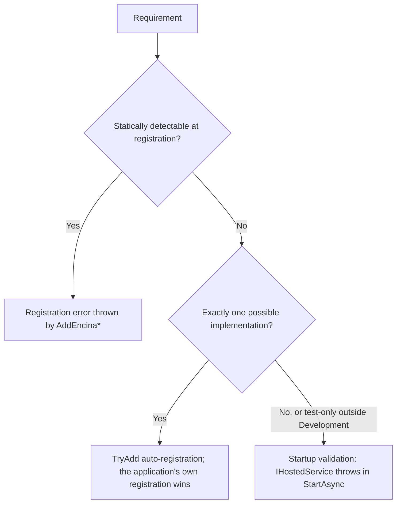

# About the module dependency matrix

This page is for a developer or contributor who wants to understand which Encina modules need other modules, why that does not contradict "everything is opt-in", and how a missing requirement shows up. It explains the matrix; the binding list and the rules are in [ADR-050](adr/050-modules-may-require-modules.md).

## Why a matrix exists

Encina's rule is pay-for-what-you-use: every feature is opt-in. That rule is right for everything a module does not need. It is wrong for what a module needs to keep the guarantee it advertises. An Outbox that does not write in the same transaction as the business data does not deliver "at least once"; a compliance gate without an audit store cannot prove what it decided; an in-memory key store loses data on restart. ADR-050 therefore lets a module require other modules, and keeps the list of requirements closed: a requirement exists only if the ADR table has a row for it.

## How to read a row

| Term | Meaning |
| --- | --- |
| Requires | The guarantee is false without the other module. Enabling the module without it fails. |
| Conditional | Required only under the stated condition. |
| Forbids | Enabling both modules together breaks a guarantee, so the combination fails. |

Each failure names the module, the requirement and ADR-050, and says how to add the missing module.

## How a requirement is enforced

ADR-050 sub-decision 1 (Option A) picks the earliest safe mechanism per row:

## The matrix

The "Mechanism" column applies the flowchart above to each row of the ADR; the issue that implements the row confirms it. Counts and coverage figures do not appear here.

| Module | Requires | Conditional | Forbids | Mechanism | Issue |
| --- | --- | --- | --- | --- | --- |
| Event sourcing (`Encina.Marten`) | Outbox (`OutboxStoreMarten`, written in the Marten session); Inbox for domain events; Recoverability and Dead Letter Queue; processor health and metrics | Multi-instance coordination: always required, because multi-instance is assumed and a single-instance application declares itself explicitly | `TransactionPipelineBehavior`, because the Marten session is already transactional | Outbox, Inbox, Recoverability and Dead Letter Queue: `TryAdd` (one implementation). Processor health and metrics: chosen by the implementing issue. Multi-instance coordination: startup validation (several lock providers). `TransactionPipelineBehavior`: registration error | [#2239](https://github.com/dlrivada/Encina/issues/2239), [#2383](https://github.com/dlrivada/Encina/issues/2383) |
| Dead Letter Queue | The operation-audit adapter | Always | | `TryAdd` (one adapter) | [#2013](https://github.com/dlrivada/Encina/issues/2013) |
| Operation audit | An `IPiiMasker` | Unless the explicit, logged opt-out is set | | Startup validation (the application supplies the masker) | [#1835](https://github.com/dlrivada/Encina/issues/1835) |
| Delayed retries (Recoverability) | An `IDelayedRetryStore` | Always, because delayed retries are on by default | | Startup validation (several store providers) | [#2248](https://github.com/dlrivada/Encina/issues/2248) |
| Crypto-shredding locators | Every registered locator is reachable through the resolved one | Always | | Startup validation | [#1773](https://github.com/dlrivada/Encina/issues/1773) |

Module families not in the table have no recorded requirement yet. Each issue of [#2382](https://github.com/dlrivada/Encina/issues/2382) to [#2413](https://github.com/dlrivada/Encina/issues/2413) that settles a family adds its row to the ADR by amendment, and this page follows.

## Rules that apply to every row

These come from the sub-decisions of ADR-050; the page does not restate their reasoning.

- An in-memory implementation outside Development is a startup error; the only escape is an explicit, logged opt-out (SPEC-002 DEC-006).
- Multi-instance is assumed; single-instance is declared explicitly.
- The compliance modules default to blocking; warn-only is the explicit opt-out ([#2409](https://github.com/dlrivada/Encina/issues/2409)).
- Where Audit is mandatory (DSR, NIS2, AI Act, ABAC decision audit), the audit write is awaited and its failure fails the operation.

## Related

- [ADR-050](adr/050-modules-may-require-modules.md), the binding list and the sub-decisions
- [ADR-018](adr/018-cross-cutting-integration-principle.md), the cross-cutting integration check
- [About the request pipeline](request-pipeline.md)
- Validator feature: [#2382](https://github.com/dlrivada/Encina/issues/2382)
