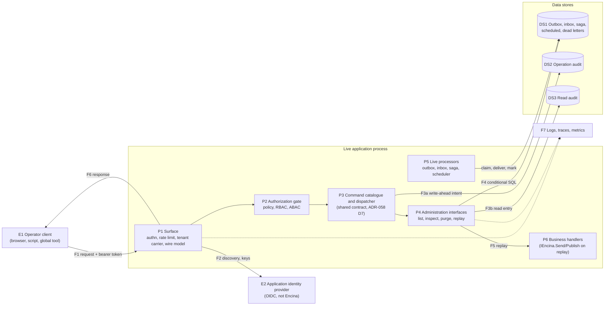
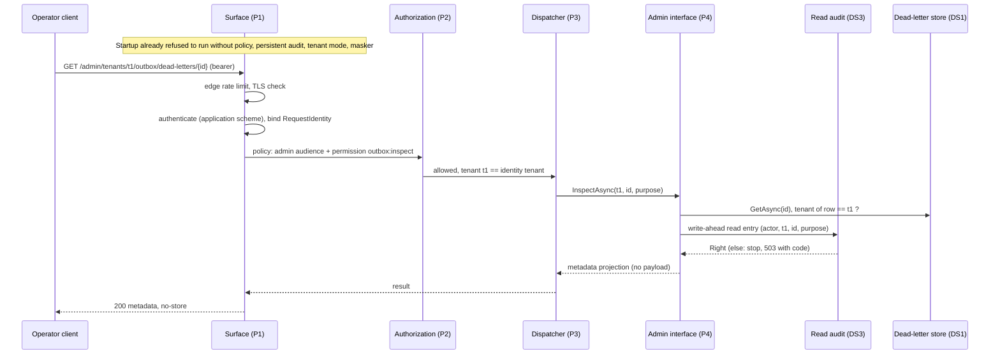

# Remote administration surface: threat model, competitors and options (spike #2972)

This page is for the maintainer, who has to answer the open questions of section 7 before the ADR can be written, and for the authors of the plans that will build the surface. It records what is already settled, what other products do, what the threat model finds, what today's code does and does not provide, and, for each open question, the options, where each wins, what the research implies and a recommendation. The recommendations are input for the maintainer and not decisions: the issue stays open until the maintainer picks the options, and the decisions then get their own ADR (its number is the next one neither used nor reserved when it is written). Nothing is built.

**Status:** evidence gathered on 2026-11-03 against `origin/main` at 3ccef02d2 (code inventory, competitor documentation). **Issue:** [#2972](https://github.com/dlrivada/Encina/issues/2972). **Parent decisions:** [ADR-058](../architecture/adr/058-encina-cli-command-architecture.md) (decision D2 = D + E of [#2605](https://github.com/dlrivada/Encina/issues/2605)) and the [contract page](cli-command-contract-spike-2605.md). **Full threat model:** [admin-surface-threat-model-2972.md](admin-surface-threat-model-2972.md).

Pre-1.0, backward compatibility and breaking-change cost are not criteria ([AGENTS.md](../../AGENTS.md) section 1). The administration surface does not exist yet; the command-host names of ADR-058 (`IEncinaCommand`, `IOutboxAdministration`, `ISagaAdministration`) are illustrative.

Question ids (`D3`, `D7`, ...) are those of the #2972 decision register; "ADR-058 D17" means the ADR's own numbering. Option letters follow the register.

## 1. What is already decided

| Point | Settled as | Source |
| --- | --- | --- |
| The surface ships before 1.0 | Deferring it (Option C of the issue) is excluded | ADR-058 D2 (E); [#2605 decision comment](https://github.com/dlrivada/Encina/issues/2605#issuecomment-6470207054); [SPEC-000](../specifications/SPEC-000-encina-1.0-baseline-and-release-scope.md) REQ-030 |
| One command contract | The surface reads the same command catalogue as the console host and shares its identity model | ADR-058 D2, D7 (a), D14 |
| Identity | The operator authenticates against the application's own identity provider; Encina is not one; automation uses client credentials with its own service identity, audited as such; with no provider configured the command is denied | ADR-058 D14 |
| Fail closed by construction (D9, the settled part) | The "authorization is the caller's responsibility" pattern of `MapDPIAEndpoints` is excluded; the surface refuses to start or denies when authentication and authorization are not configured. Policy versus scheme is open (section 7) | AGENTS.md section 3; SPEC-002 REQ-019 |
| No opt-out of a control (D11) | Except an explicit, justified, audited one for territorial non-applicability; never by tier | [#686 comment](https://github.com/dlrivada/Encina/issues/686#issuecomment-6521534413); [SPEC-002](../specifications/SPEC-002-eu-regulatory-readiness.md) REQ-019 |
| No clinical data (register D14) | The surface never grants access to a subject's clinical data; break-the-glass ([#1244](https://github.com/dlrivada/Encina/issues/1244)) does not apply to operator commands | SPEC-002 REQ-019, scenario S0 |
| Mutating commands | Dry-run by default, executed only on explicit confirmation (ADR-058 D10); audit written ahead and awaited, a failure fails the command (D17); no persistent audit store outside Development fails startup (D18); reads of personal data go to the read audit when it is enabled (D19, in part) | ADR-058 |
| Tenant | Explicit on every call that touches tenant data; the identity must have access to it; missing means denied. How the surface carries it is open (D21) | ADR-058 D13, D14 |
| Responses and logs | An error code, a generic title and a trace id; never `EncinaError.Message` | AGENTS.md section 3; [#2649 comment](https://github.com/dlrivada/Encina/issues/2649#issuecomment-6338135514) |
| Opt-in | Disabled by default; the administration interfaces are registered only when command hosting or the surface is enabled; they are implemented on all 10 database providers | AGENTS.md sections 1 and 5; ADR-058 D21 |
| Prototype (D41, the settled part) | A paper walkthrough of one read-only command; no endpoint code in this spike | Issue #2972, Out of Scope 2. Section 5 is that walkthrough |

Two of the issue's statements needed correction and have been corrected in its text: ADR-058 settled D17 and D18 and only part of D19 (whether dry-runs are audited is left to the plans), and Option C contradicts the maintainer's "both before 1.0".

## 2. How other products do it

Sources are public documentation read on 2026-11-03. Anything not confirmed on a page that was read is marked **unconfirmed**.

| Product | Transport | Remote mutating operations | Authentication default | Audit of operator actions | Payload exposure |
| --- | --- | --- | --- | --- | --- |
| NServiceBus: ServiceControl and ServicePulse ([security](https://docs.particular.net/servicecontrol/security/), [authentication](https://docs.particular.net/servicecontrol/security/configuration/authentication), [authorization](https://docs.particular.net/servicecontrol/security/configuration/authorization), [ServicePulse](https://docs.particular.net/servicepulse/)) | HTTP API and a web UI | Retry, delete, archive, restore of failed messages and groups; endpoint and queue management | Off. When enabled: OpenID Connect with JWT. The [security overview](https://docs.particular.net/servicecontrol/security/) advises enabling HTTPS on ServiceControl and ServicePulse before enabling authentication, because tokens would otherwise travel in plain text (advice, not enforcement). Some endpoints stay anonymous so the UI can start the login | Unconfirmed | Headers and metadata shown; the body view and masking are unconfirmed |
| MassTransit ([configuration](https://masstransit.massient.com/documentation/configuration)) | Unconfirmed (the documentation links a dashboard page that was not reviewed) | Unconfirmed | Not applicable | Not applicable | Not applicable |
| Wolverine core ([durability](https://wolverinefx.net/guide/durability/managing)) | Command line and C# API only | Storage clear, rebuild, release, schema apply | No network surface; shell access is the boundary | None documented | Not applicable |
| CritterWatch, the Wolverine console ([introduction](https://jasperfx.net/news/introducing-critterwatch), [1.0 RC 1](https://jasperfx.net/news/announcing-critterwatch-1-0-rc-1)) | A web console with live updates; services reach it over broker transports or an HTTP/gRPC channel; an MCP server exposes the same actions | Dead-letter replay, edit-and-replay, discard; projection pause, restart, rebuild; tenant administration | You bring your own security for a separate app; RBAC is opt-in | Every action is written to an audit log tied to the host `ClaimsPrincipal` | The original envelope is shown; masking is unconfirmed |
| Hangfire Dashboard ([dashboard](https://docs.hangfire.io/en/latest/configuration/using-dashboard.html), [advisory GHSA-7rq6-7gv8-c37h](https://github.com/HangfireIO/Hangfire/security/advisories/GHSA-7rq6-7gv8-c37h)) | An embedded web UI | Retry, delete, trigger, enqueue; a read-only mode blocks them | Closed: local requests only, unless you add filters | None documented | Job arguments are shown (general behaviour, unconfirmed on the pages read) |
| Quartz.NET community dashboards ([Quartzmin](https://github.com/jlucansky/Quartzmin), [CrystalQuartz](https://github.com/guryanovev/CrystalQuartz)) | Embedded web UIs | Pause, resume, delete, trigger now, interrupt, standby, shutdown (the union of the two tools: delete comes from CrystalQuartz and interrupt from Quartzmin) | No authentication in the README or sample | None documented | Not applicable |
| Quartz.NET official dashboard ([issue 251](https://www.github.com/quartznet/quartznet/issues/251)) | Unconfirmed | Unconfirmed | Unconfirmed; the maintainer once called admin functions "considered intranet" | Unconfirmed | Unconfirmed |
| Rebus ([wiki](https://github.com/rebus-org/Rebus/wiki)) and Brighter ([site](https://www.brighter.dev/)) | Unconfirmed: the Rebus wiki lists extra tools without detail; no Brighter admin tool was found | Unconfirmed | Unconfirmed | Unconfirmed | Unconfirmed |

Facts worth keeping beyond the table:

- Hangfire 1.7.25 dropped the default authorization filter, so applications using the default options were reachable remotely; the advisory is rated High (CVE-2021-41238, CWE-862) and 1.7.26 fixed it.
- ServiceControl's role model is cumulative (reader, writer, admin) and off by default: with authentication on and role-based access off, every authenticated user has full access. It must be enabled on every instance, and a mismatch leaves the disabled instance open.
- CritterWatch scopes capabilities per service and optionally per tenant. Its MCP mutating calls pass a license check and then a role check.
- Operator actions are paid features in CritterWatch (a license is needed for operator actions) and ServiceControl is part of the Particular Service Platform (licensing not verified on the cited pages); MassTransit v9 is a commercial product ([banner](https://masstransit.massient.com/documentation/configuration)), and whether it has an admin surface is unconfirmed. An open, in-library surface with authentication built in has no direct peer among the products read.

Lessons for Encina, as input to the questions of section 7:

1. **Default closed.** Refuse to start the surface without authentication configured; this is the class of defect behind the Hangfire advisory and ServiceControl's off-by-default authentication, and it is the fail-closed rule of AGENTS.md.
2. **Authentication and authorization are inseparable.** Require an explicit permission on every command; there is no "authenticated means allowed" mode.
3. **Tiers with per-command permissions.** Role tiers read, write, admin are easy to explain, but per-command permissions let a GDPR erase be separate from an outbox retry, and tenant-scoped grants have a precedent in CritterWatch.
4. **Audit every mutating action against the operator principal.** Only CritterWatch documents this among the products read.
5. **A read-only mode as a first-class switch.** Hangfire's per-request read-only function is the cheap pattern.
6. **Do not rely on network position.** Require TLS and a token on every call.
7. **Keep any anonymous discovery tiny.** ServiceControl exposes its authentication configuration anonymously so the UI can start the login; a device-code bootstrap for Encina would need the same, read-only and free of data.
8. **Inspection is a personal-data hole.** CritterWatch shows the full envelope and no product reviewed documents masking; default to metadata only, with body access a separate, audited permission.
9. **Maintenance commands need guardrails remotely.** Wolverine's `storage clear` is protected only by shell access; remote equivalents need confirmation, dry-run and scope limits.
10. **Automation needs its own identity and scopes.** Define the audience and scopes once in the command contract.

Could not be confirmed: rate limiting, API versioning, CORS defaults and tenant handling for most products; MassTransit monitoring tooling; the Rebus Snoop and HTTP Gateway behaviour; Brighter tooling; the content and authentication of the new official Quartz.NET dashboard; Wolverine HTTP admin endpoints; Hangfire payload display and current CSRF behaviour.

## 3. Threat model summary

The method is STRIDE per element with a LINDDUN pass for the three commands that touch personal data (inspect, export, erase). The full model (assets, actors, trust boundaries, the inventory of existing building blocks with file and line, the STRIDE rows T-01 to T-45, LINDDUN, verification items) is in [admin-surface-threat-model-2972.md](admin-surface-threat-model-2972.md).

Assets: operator credentials (A1), the destructive capability (A2), payloads that can hold health data (A3), the audit trail (A4), the tenant boundary (A5), authorization configuration (A6), availability of the live processors (A7), secrets in options (A8), elevations (A9). Trust boundaries: network to surface, surface to identity provider, admin plane to data plane, tenant to tenant, application to audit store, operator client to the person.

What differs from the console host: the live processors (P5) run in the same process and database as the surface, so ADR-058 D6 (hosted services do not run in command mode) does not hold. Section 6 deals with it.

The highest-impact threats, with the control the design must contain ("by construction" means the unsafe state is unrepresentable):

| Id | Threat | Required control |
| --- | --- | --- |
| T-05 | Endpoints mapped with no authorization requirement, the pattern of `MapDPIAEndpoints` ([#3126](https://github.com/dlrivada/Encina/issues/3126)) | The only public mapping method applies `RequireAuthorization(policy)` and cannot remove it; startup validation walks the endpoints; a no-token test gets 401 (by construction) |
| T-15 | A command ships without a permission and runs for any caller | Mandatory permission metadata in the contract; registration throws without it (by construction) |
| T-16 | Authorization weakened by configuration (ABAC `Disabled`, security context optional) | Startup validation of the effective options; refuse to start |
| T-02 | A valid token for ordinary users is accepted as an operator token | A named policy checking an admin audience or scope and a permission |
| T-01 | Replay of a stolen bearer token | Short lifetime as a documented precondition, admin audience, step-up claim for mutating commands, no refresh token to the surface |
| T-32 | The effect happens and the audit write fails | An intent entry awaited before the effect; failure stops the command |
| T-38 | The audit store is the in-memory default | Startup fails outside Development without a persistent store |
| T-36 | Inspect returns payloads or stack traces | A metadata projection by default; payload only through a separate, audited command, never for clinical categories |
| T-10 | One call touches every row (`RequeueExhaustedAsync(..., null)`, `DeleteManyAsync(filter)`) | A mandatory filter and a row ceiling per call; the confirmation token binds the count |
| T-11 | Mass assignment onto `AllTenants` | A separate wire model; cross-tenant only through a platform scope |
| T-24 | The `AllTenants` opt-out reachable by any operator | Platform scope only, write-ahead audited with a reason |
| T-21 | Replay resolves a stored type string with `Type.GetType` | An allow-list of registered types; an integrity check at capture |
| T-07 | CSRF through a cookie session | Bearer-only authentication; cookie schemes rejected at startup |
| T-09 | Flooding before or after authentication | An edge limiter per address and a per-identity limiter, on by default |
| T-45 | The surface starves the live application | Mandatory pagination, command timeouts, indexed reads |

LINDDUN findings that shape the design:

- **Linking and identifying:** a correlation id or a type name plus tenant plus timestamp can identify a patient in a small practice, so lists show neither the correlation id nor the source message id.
- **Detecting:** a 403 for another tenant's id and a 404 for a missing one is an existence oracle, so not-found is uniform.
- **Non-repudiation (the unwanted kind):** a read audit entry is itself a record about a data subject, so its retention and access are restricted.
- **Data disclosure:** payloads, stack traces and free-text error columns are the main channels; the response carries `Cache-Control: no-store` and no payload appears in telemetry.
- **Non-compliance:** an erase command cannot be a thin pass-through to a purge; it must consult the legal-hold and retention modules (GDPR Art. 17(3)(b)) and may lawfully answer "refused". A dry-run of an erase lists what would go and is an inspect in disguise.

## 4. Gaps in today's code

The gaps are candidates for issues if the maintainer agrees. **G-02, G-03, G-04 and G-10 exist whether or not the surface is ever built** and can be opened now (next steps, section 11).

| Gap | Evidence | Why it matters for the surface | Independent of the surface |
| --- | --- | --- | --- |
| G-01 | `src/Encina.Security/SecurityPipelineBehavior.cs:134`; `src/Encina.Security.ABAC/ABACPipelineBehavior.cs:173-182`; `src/Encina.Security/SecurityOptions.cs:36`, `:83` | Authorization is opt-in per request type, so a command without an attribute reaches its handler; the surface cannot rely on attributes | No |
| G-02 | `src/Encina.Security.Audit/AuditPipelineBehavior.cs:110`, `:127-131` | The operation audit is written after the handler, so it cannot provide ADR-058 D17 (write-ahead) | **Yes** |
| G-03 | `src/Encina.Security.Audit/ServiceCollectionExtensions.cs:96`, `:196` | Default audit stores are in-memory and nothing fails the start outside Development (ADR-058 D18 is a decision, not code) | **Yes** |
| G-04 | `src/Encina.Security.Audit/AuditedRepository.cs:259-260`, `:293`, `:301-308` | The read audit is sampled, discards the `Either` result and swallows failures in its only writers | **Yes** |
| G-05 | `src/Encina.Messaging/Outbox/IOutboxMessage.cs:26-71`; `src/Encina.Messaging/Sagas/ISagaState.cs:26-81`; `src/Encina.Messaging/Scheduling/ScheduledMessageProcessor.cs:42` | Outbox, saga and scheduled-message rows carry no tenant, so the tenant check cannot be applied to them ([#739](https://github.com/dlrivada/Encina/issues/739) is the scheduled-message case) | No |
| G-06 | `src/Encina.Messaging/DeadLetter/DeadLetterManager.cs:354`, `:360`, `:367`, `:413-416` | Replay resolves the type with `Type.GetType` from a stored string and dispatches under the ambient identity | No |
| G-07 | `src/Encina.AspNetCore/EncinaAspNetCoreOptions.cs:39-44`; `src/Encina.Tenancy.AspNetCore/Configuration/TenancyAspNetCoreOptions.cs:112`, `:128` | Two tenant resolution mechanisms with different trust rules | No |
| G-08 | `src/Encina/Identity/ClaimsRequestIdentityFactory.cs:183` | No path from a remote client-credentials token to `IdentityKind.Service`, so automation is not audited as such (ADR-058 D14) | No |
| G-09 | `src/Encina.Messaging/DeadLetter/DeadLetterManager.cs:151` | The dead-letter manager allows every tenant when tenancy is not registered | No |
| G-10 | `src/Encina.ADO.SqlServer/Sagas/SagaStoreADO.cs:118-127`; `src/Encina.ADO.SqlServer/Outbox/OutboxStoreADO.cs:70-76` | The saga update is `WHERE SagaId = @SagaId` (last writer wins) and the outbox batch fetch has no claim, so two processors can already fetch the same row | **Yes** |
| G-11 | `src/Encina.AspNetCore/DPIAEndpointExtensions.cs:27-29`, `:119-136`, `:339`, `:384` | `MapDPIAEndpoints` fails open and records `"DPO"` as a fallback actor; reported as [#3126](https://github.com/dlrivada/Encina/issues/3126); the surface must not copy it | Tracked |

G-10 is evidenced for SQL Server ADO.NET only; the other nine providers were not read (verification item V-4 of the threat model).

What can be reused: the identity binding of `UseEncinaContext()`, the verified-claim-over-header tenant rule, the problem-details gate for error messages, the ABAC engine with its fail-closed default, the break-the-glass startup validator as a pattern for the surface's own validator, `AllowUnmaskedPayloads` as the model of an explicit opt-out, and the dead-letter module as the closest precedent for an administration interface (tenant default, replay claim, typed denial). Section 3 of the threat model has the inventory with file and line.

## 5. Walkthrough: inspect a dead-lettered outbox message

This is the paper prototype (D41, settled part): `outbox inspect <id>` followed through the threat model. It is illustrative and read-only, so ADR-058 D22 applies (no confirmation, no dry-run), but fail closed and the read audit still do.

What "dead-lettered outbox message" is today: two things. The outbox row stays in its table in the exhausted state (`RetryCount >= MaxRetries`, `IOutboxMessage.IsDeadLettered` at `src/Encina.Messaging/Outbox/IOutboxMessage.cs:71`; `src/Encina.Messaging/Outbox/IOutboxStore.cs:101-115`). When the dead-letter queue is enabled, a copy is captured before the row is marked exhausted (`src/Encina.Messaging/Outbox/OutboxBatchProcessor.cs:345-361`) into the dead-letter store, which has a tenant and its own id (`src/Encina.Messaging/DeadLetter/IDeadLetterMessage.cs:29`, `:86`). The walkthrough inspects the copy, because only it has a tenant (G-05). The tenant on the copy is the ambient tenant at capture (`src/Encina.Messaging/DeadLetter/DeadLetterOrchestrator.cs:27-29`); the outbox processor is a background loop and `OutboxBatchProcessor` passes no tenant override (the only `tenantId` it names is a metrics argument, `src/Encina.Messaging/Outbox/OutboxBatchProcessor.cs:329`), so a captured outbox dead letter very probably has a null tenant. This was not run; it is verification item V-1, and if confirmed T-22 applies to the copy as well.

The route and the method names are illustrative; the carrier of the tenant is the open question D21.

| Step | What happens | Threats stopped | Where it is stopped today | Gap |
| --- | --- | --- | --- | --- |
| 0 | Startup validation of an enabled surface: authorization policy defined, effective authorization not weakened, persistent operation audit and read audit registered, masker registered, tenant mode declared, listener TLS rule | T-05, T-16, T-23, T-38 | Patterns exist for each (`src/Encina.Security.BreakTheGlass/Services/BreakTheGlassStartupValidator.cs:61-102`; `src/Encina.Security.Audit/OperationAuditMaskingStartupValidator.cs:49-58`) | The surface validator itself, and G-03 |
| 1 | Request arrives; edge rate limit; plain HTTP refused | T-09, T-13 | None (no HTTP limiter, no TLS rule in `src/`) | D26, D27 |
| 2 | Authentication by the application's scheme; no token gives 401 from the group's authorize requirement; `UseEncinaContext()` binds the identity and answers 403 for an ambiguous subject or tenant | T-01 (partly), T-05, T-06 | `src/Encina.AspNetCore/EncinaContextMiddleware.cs:174-178` for the ambiguity; the 401 does not exist until the group is built with `RequireAuthorization` | T-05 control; token theft stays an accepted, documented residual risk of any bearer scheme |
| 3 | The named policy requires the admin audience and the permission `outbox:inspect`; an ordinary user token fails here | T-02, T-15 | None (`src/Encina.Security/SecurityPipelineBehavior.cs:134` would let an unmarked command through) | Mandatory permission metadata; the catalogue throws without it |
| 4 | Command-level gate (RBAC permission; ABAC when data-dependent) with attributes tenant, command kind, data category; denied or indeterminate means deny | T-15, T-16, T-17 | ABAC is fail closed on indeterminate (`src/Encina.Security.ABAC/ABACOptions.cs:41-49`, `src/Encina.Security.ABAC/ABACPipelineBehavior.cs:264-267`) when enabled | G-01 |
| 5 | The route segment `t1` is compared with the identity's tenant claim; missing or different means 403 with a uniform body | T-03, T-25, T-11 | Claim over header and conflict 403 (`src/Encina.AspNetCore/EncinaContextMiddleware.cs:174-178`); a route resolver exists (`src/Encina.Tenancy.AspNetCore/Configuration/TenancyAspNetCoreOptions.cs:179`) | G-07: two mechanisms; the surface must use one |
| 6 | The administration interface loads the dead letter and checks the row's tenant equals `t1`; another tenant's row is reported as not found | T-22, T-26 | `src/Encina.Messaging/DeadLetter/DeadLetterManager.cs:165-168`, `:191-192` | Applies to the dead-letter copy only, and holds only if the copy carries a tenant, which is unverified until V-1 is run. The outbox row has no tenant (G-05), and `_tenancy is null` allows all (G-09) |
| 7 | Minimisation: the projection returns id, request type, source pattern, error code, exception type (not the stack trace), retry attempts, dates, replay state, payload size and hash. No `RequestContent`, no `ExceptionStackTrace`, no `CorrelationId` or `SourceMessageId` in lists | T-36, T-37, LINDDUN L, I, D | None (nothing projects) | Define the projection in the administration interface so a payload cannot be returned by this command at all |
| 8 | Write-ahead read-audit entry: actor, tenant, entity type, message id, purpose, correlation id, address; awaited; a `Left` ends the request with 503 and a code | T-14, T-39, T-40 | `IReadAuditStore.LogReadAsync` exists (`src/Encina.Security.Audit/Abstractions/IReadAuditStore.cs:78`) but its only writers are best-effort (`src/Encina.Security.Audit/AuditedRepository.cs:293`, `:301-308`) | G-04: a dedicated strict call, no sampling (REQ-007) |
| 9 | Response: 200 with the projection, or problem+json with status, fixed title, `errorCode`, trace id; `Cache-Control: no-store`; no payload or tenant in telemetry | T-12, T-41 | `src/Encina.AspNetCore/ProblemDetailsExtensions.cs:85`, `:151-152` | The surface must not forward `GetDetails()` |
| 10 | Residual: the human receives the projection; a pasted result in a ticket is outside Encina | LINDDUN data disclosure | None | Documented; the small projection is the mitigation |

If the operator needs the payload, the honest answers are: (i) metadata is enough, since hash and size let them compare with the producer's copy; (ii) a separate `payload` command with its own permission, a stated purpose, per-row read audit and masking; (iii) not possible for clinical categories. Option (ii) is hard to build: the stored `Content` is an opaque serialized string and `IPIIMasker` works on typed object graphs with `[PII]` attributes (`src/Encina.Security.PII/PIIMaskingPipelineBehavior.cs:113-184`), so masking means deserializing into the original type, which is the risky step of T-21. That is why the research leans to D38 (a) or (e) for 1.0.

Verdict. With today's code, steps 2, 3, 6 (outbox row), 7 and 8 are not stopped. Steps 4 and 5 are mostly present. Step 0 is the cheapest high-value control: it turns several "documented precondition" risks into startup failures.

## 6. Concurrency with running processors (D32)

ADR-058 D6 says hosted services do not run in command mode, so a console purge never races a processor in the same process. The surface runs inside the live application, where the outbox processor loops every `ProcessingInterval` (`src/Encina.Messaging/Outbox/OutboxProcessorBase.cs:88-109`); in a multi-instance deployment the processor that races the operator may be in another process, so an in-process guard is not enough. ADR-058 row 7 (line 152) leaves locks to the plans of [#2609](https://github.com/dlrivada/Encina/issues/2609) and [#2610](https://github.com/dlrivada/Encina/issues/2610); the surface needs an owner for the answer.

What is true today:

- No file under `src/Encina.Messaging` references `IDistributedLockProvider`, so the processors take no locks.
- No row claim or version condition exists on the outbox fetch or the saga update in SQL Server ADO.NET, the only provider read (G-10).
- Predicate guards do exist where an operation is a conditional statement: outbox requeue and the dead-letter replay claim.
- No processor pause switch exists (search for `Pause`, `IsPaused` and `Drain` in `src/Encina.Messaging`: no hit).

| Race | Scenario | Today |
| --- | --- | --- |
| R-1 Purge during delivery | An operator purges an outbox row while the processor has fetched it; the later `MarkAsProcessedAsync` matches zero rows (`WHERE Id = @Id`, `src/Encina.ADO.SqlServer/Outbox/OutboxStoreADO.cs:160`) | Plain batch fetch with no claim (`OutboxStoreADO.cs:70-76`); two processors can already fetch the same row, so the hazard exists without the surface |
| R-2 Replay of an exhausted message | `RequeueExhaustedAsync` sets the row pending again. The statement is conditional (`WHERE ProcessedAtUtc IS NULL AND RetryCount >= @MaxRetries`, `OutboxStoreADO.cs:306-312`), so a pending, processed or unknown id is ignored | Adequate and idempotent; the guard is the predicate |
| R-3 Two operators replay the same dead letter | Both call replay | `TryClaimForReplayAsync` is one conditional update with an expiring claim (`src/Encina.ADO.SqlServer/DeadLetter/DeadLetterStoreADO.cs:155-157`); the loser gets `dlq.replay_in_progress` (`src/Encina.Messaging/DeadLetter/DeadLetterManager.cs:228-239`). Adequate |
| R-4 Replay while a processor also retries the message | A message is both pending in the outbox and replayed from the dead-letter copy, so the business effect happens twice | The copy is captured before exhaustion; replay re-publishes (`DeadLetterManager.cs:413-416`). The inbox is the downstream guard; no guard at the source |
| R-5 Purge of a dead letter that holds a replay claim | The delete races the claim | Delete is unconditional (`src/Encina.Messaging/DeadLetter/IDeadLetterStore.cs:132`, `:143`); the claim is not checked |
| R-6 Saga mutation or cancel during a step | An operator cancels or edits state while a step runs | `WHERE SagaId = @SagaId` only (`SagaStoreADO.cs:118-127`): last writer wins |
| R-7 Scheduled cancel during dispatch | `CancelAsync` while the message is being dispatched (`src/Encina.Messaging/Scheduling/IScheduledMessageStore.cs:85`) | No claim on the due fetch is visible in the interface |
| R-8 Inbox purge reopens the duplicate window | Purging an inbox record that deduplicates lets a redelivered message run again | The inbox only removes expired records (`src/Encina.Messaging/Inbox/IInboxStore.cs:110`); an operator purge before expiry is a new capability and changes the exactly-once guarantee |
| R-9 A long operation outlives its guard | A purge of a large set exceeds a lock's expiry | `ExtendAsync` exists (`src/Encina.DistributedLock/IDistributedLockProvider.cs:121`) |
| R-10 Replay storm | A replay of N messages produces N business effects at once | Batch replay exists (`src/Encina.Messaging/DeadLetter/IDeadLetterManager.cs:45`); no throttle is visible |

Primitives that could guard it:

| Primitive | Fits | Does not fit |
| --- | --- | --- |
| Conditional single-statement update (state predicate in the `WHERE`) | R-2, R-3; extends to purge by deleting only rows in a purgeable state | Needs per-provider SQL on all 10 providers; states that no processor-visible column expresses (R-1, R-6) |
| Expiring row claim (the dead-letter pattern, `src/Encina.Messaging/DeadLetter/IDeadLetterStore.cs:87-105`) | A generic "claimed by admin until" column for purge and replay | Adds a column to every store and teaches the processors to skip claimed rows: schema and processor change on 10 providers |
| `IDistributedLockProvider` per pattern and tenant (`src/Encina.DistributedLock/IDistributedLockProvider.cs:77-121`) | Serialises admin operations against each other across instances | Does not stop a processor unless the processors take the same lock, and they take none; the in-memory provider guards one process only |
| Optimistic version column | R-6 | Not present on `ISagaState` (G-10) |
| Pause switch for processors | Would make purge safe in one place | No primitive exists; it must be shared across instances (a stored flag), and pausing production processing is itself a denial-of-service lever |
| Dedicated admin instance with processors off | Replicates ADR-058 D6 | Operationally heavy; defeats "administer production without shell access" for single-instance applications |
| Transaction (`IUnitOfWork`) | Atomic multi-row purge with its audit intent | Does not exclude a concurrent reader on its own |

What the research implies:

- A lock alone is not enough: it works only if the processors cooperate, and the hazards that matter (R-1, R-6, R-7) are against processors that hold no lock.
- The strongest existing guard that generalises is the state-predicated conditional statement; it needs no processor change and is already the pattern of requeue and claim. The cost is writing it for all 10 providers.
- The first slice can be limited to operations whose guard already exists: list, inspect, dead-letter replay (R-3) and outbox requeue of exhausted rows (R-2). Outbox purge, saga mutation, scheduled cancel and inbox purge each need their own guard decision.
- A distributed lock, keyed for example by pattern and tenant, fits only operations that are not expressible as a predicate, with expiry, `ExtendAsync` for long runs, a requirement that the provider is not the in-memory one when more than one instance runs, and a denial when the lock cannot be acquired.
- Replay is at-least-once by nature (R-4); the result should say so, and exactly-once effect needs the downstream inbox. Rows per call are capped (T-10) and batch replay is throttled (R-10).

## 7. Open questions for the maintainer

The questions are grouped as the issue asks: shape, authentication and authorization, audit, tenancy, transport and abuse controls, operation semantics, personal data, scope. The ones the research could answer outright (D6, D40, D41) are included so the register can be closed. Each subsection gives the question, the options with where each wins, what the research implies, and a recommendation that is not a decision.

### Shape

#### D3: package shape and name

- **Options.** (a) One `Encina.Admin.Http` package that depends on the contract package; (b) a transport-neutral `Encina.Admin` core (authentication hook, authorization, audit, tenant, wire model) plus `Encina.Admin.Http` and, if gRPC is chosen, `Encina.Admin.Grpc`; (c) a `Map...` extension inside `Encina.AspNetCore`, as `MapDPIAEndpoints` is; (d) endpoints shipped by each module package. Package names are illustrative.
- **Where each wins.** (a) for the smallest surface and fastest build, but a second transport forces authentication, audit and tenant logic to move. (b) when more than one transport or a UI backend is plausible; it costs one more package with its README, EventId range and coverage manifest. (c) for discoverability, but it puts admin code in every web application (pay-for-what-you-use) and repeats the place where #3126 lives. (d) for cohesion, but adds ASP.NET Core to every module package.
- **What the research implies.** The controls that stop T-05, T-15, T-16, T-32 and T-38 are transport independent, so they should be written once. Whatever the option, the startup validator must live in the same package as the mapping method. The contract package must carry no System.CommandLine dependency (see D33 in section 9).
- **Recommendation (not a decision).** (b), decided together with D24 and #2983 D9, so a second transport cannot be built without the security controls.

#### D4: EPIC shape

- **Options.** (a) A new EPIC "Administration surface" with its own children; (b) children added to EPIC [#2614](https://github.com/dlrivada/Encina/issues/2614); (c) one FEATURE child of #2614 for the first slice and later children.
- **Where each wins.** (a) because the work (security model, audit wiring, API, docs, tests, mitigations) is large and carries its own risk and milestone; #2614 is titled "Encina.Cli beyond scaffolding" and does not describe a remote service. (b) for one place to track everything built on the command contract. (c) if D7 chooses a small first slice.
- **What the research implies.** The prerequisite gaps (G-02, G-03, G-04, G-05, G-08) are not CLI work.
- **Recommendation (not a decision).** (a), referencing #2614 and [#2983](https://github.com/dlrivada/Encina/issues/2983).

#### D5: milestone

- **Options.** (a) v0.18.0 together with the command host (#2983); (b) v1.0.0-rc.1 together with the operations commands it exposes (#2610, #2611); (c) split: the read-only slice earlier, mutating commands with #2610.
- **Where each wins.** (a) if the security model should settle early and be testable as soon as the host exists. (b) because a surface with only introspection commands has little value. (c) for early feedback with the lowest-risk commands first.
- **What the research implies.** Prerequisites that gate mutating commands (G-02, G-03, G-04, G-05, G-08) do not gate a read-only slice that uses only the dead-letter copy. All options keep the order fixed by ADR-058 (the host first) and before 1.0.
- **Recommendation (not a decision).** (c).

#### D6: threat-model method

- **Options.** (a) STRIDE per asset and boundary; (b) STRIDE plus LINDDUN for privacy threats; (c) another method.
- **Where each wins.** (a) for speed and for the security rows of the issue. (b) when the main exposure is personal health data, because STRIDE's information-disclosure row does not list linkability or non-compliance threats of the GDPR kind.
- **What the research implies.** The LINDDUN pass produced findings STRIDE alone did not: the existence oracle (T-26), correlation ids linking messages to a patient visit, the audit trail as a new personal-data store (T-40), and the dry-run of an erase as an inspect in disguise.
- **Recommendation (not a decision).** Keep (b) as done: STRIDE for the table and a LINDDUN pass for the commands that touch personal data, rather than a second full method.

### Authentication and authorization

#### D7: which commands are remotely invocable

- **Options.** (a) The whole catalogue once the surface is enabled; (b) each command declares in the contract that it may be invoked remotely, default no; (c) the application enables categories (read-only, messaging operations, compliance) in options; (d) compliance operations such as erase are never remote; (e) read-only commands remote, mutating ones console-only in 1.0.
- **Where each wins.** (a) for zero per-command work, but a module author can expose a destructive command without thinking. (b) for least privilege and pay-for-what-you-use; the exposed set is listable. (c) for an operator who wants only read-only commands on a public deployment; coarser. (d) for the irreversible ones; it loses if production operators have no shell, which is the gap the surface exists to close. (e) for minimal risk at the first release, but it leaves part of the gap open.
- **What the research implies.** Default no per command (b) is what stops T-28 and T-31 (a third-party package never becomes remotely callable by being referenced). Erase is the case for (d): it is the only command whose lawful result may be "refused", and the only irreversible one with a data subject on the other end. Export does not exist today and needs its own decision before anyone adds it.
- **Recommendation (not a decision).** (b) with a category switch on top (c); erase console-only in 1.0 (d) unless a plan shows the controls of section 3, since the console host runs in the application's own container (ADR-058 D2 (D)).

#### D9 (the open part): policy or scheme

- **Options.** (a) The surface calls `RequireAuthorization` with a named admin policy the application must define; startup fails when it is missing; (b) options name the authentication scheme and the surface validates the token with it; (c) the surface returns the route group and the application applies authorization (the `MapDPIAEndpoints` precedent).
- **Where each wins.** (a) for fail-closed by construction and testability with `ValidateOnBuild`. (b) when the application has several schemes and the surface must pick one, at the price of more validation code in Encina. (c) for flexibility only, and it conflicts with the settled part of D9 unless combined with (a).
- **What the research implies.** (c) is the #3126 defect. (a) with a startup check that also inspects the endpoint metadata is the only form that makes T-05 unrepresentable.
- **Recommendation (not a decision).** (a), with the startup check on endpoint metadata and not only on the policy name.

#### D13: authorization model

- **Options.** (a) RBAC permissions from `ISecurityContext`, one per command; (b) ABAC policies evaluated per command with tenant, command kind and data category; (c) both: RBAC as the gate, ABAC for data-dependent rules; (d) a single coarse admin role. Also open: whether an admin audience or scope claim is required so an ordinary user token cannot call the surface.
- **Where each wins.** (a) for simple, reviewable policy. (b) when decisions depend on data attributes; the ABAC decision audit exists ([ADR-047](../architecture/adr/047-abac-decision-audit.md)). (c) for production deployments with several tenants and compliance operations, at the price of more configuration. (d) only for a first slice; too coarse for erase versus inspect.
- **What the research implies.** RBAC alone cannot express "tenant t1 only" or "no payload"; ABAC alone is skippable when an attribute is missing (G-01). The permission list must be a closed per-command set, not a coarse role (T-31). An audience or scope claim is what makes an ordinary user token fail (T-02), and it matters most when the application already issues tokens to patients or practitioners.
- **Recommendation (not a decision).** (c), plus a required admin audience or scope claim.

#### D15: extra assurance for destructive commands

- **Options.** (a) None beyond authorization and dry-run/confirmation; (b) an MFA or step-up claim (`amr` or `acr`, or the NIS2 `IMFAEnforcer`) for mutating commands; (c) four-eyes: a second person approves destructive commands; (d) (b) for all mutating plus (c) for irreversible ones.
- **Where each wins.** (a) for simplicity. (b) because the identity provider already performs MFA and Encina only checks the claim (it does not become an identity provider), with a freshness rule needed. (c) for irreversible commands with legal effect, because one stolen session cannot execute alone; it adds a workflow state.
- **What the research implies.** Credential theft (T-01, X4) is the realistic threat a human cannot see from the API. `IMFAEnforcer` lives in `Encina.Compliance.NIS2`, so a dependency from the security core on it is the wrong direction; a claim check in the policy has no such dependency. Four-eyes could reuse the self-review rule of break-the-glass (T-18).
- **Recommendation (not a decision).** (b) for mutating commands through a claim check; (c) only for irreversible commands, and only if erase or purge are remote.

### Audit

#### D18: what else is audited

- **Options.** Beyond mutating executions (settled): (a) dry-runs of mutating commands; (b) denied attempts and authentication failures; (c) reads of non-personal data such as `describe`; (d) all of them.
- **Where each wins.** (a) to prove who looked at an erase plan before it ran, at the price of volume. (b) for repudiation, spoofing and incident detection; the client address is personal data, so it is kept only if D26 and D27 need it. (c) for "audit every operation" read literally; low value and high volume.
- **What the research implies.** Denied attempts and authentication failures are the events needed to detect T-01 and T-09. The IP address is personal data (LINDDUN), and the existing entry already has the field. The dry-run of an erase is an inspect in disguise and follows the inspect rules.
- **Recommendation (not a decision).** (a) and (b), keeping the IP with the same retention and access rules as the rest of the entry.

#### D19 (the open part): is read audit mandatory for operator reads

- **Options.** (a) The surface requires `IReadAuditStore` to be enabled and persistent whenever any inspect can return personal data, with startup validation; (b) read audit stays optional with a startup warning; (c) whether a failed read-audit write fails the inspect (SPEC-002 REQ-007 provides an option) or only logs.
- **Where each wins.** Mandatory with failure of the read: for evidence of access (REQ-007, health data in Spain) and the compliance principle, but an audit outage then blocks inspect, which an operator may need during an incident. Optional with warning: for deployments that never return personal data. Log and continue: for incident repair, at the cost of evidence.
- **What the research implies.** The existing writers are best-effort (G-04), so a dedicated strict call is needed. Even a metadata projection carries ids, types and timestamps that can identify a patient in a small practice, so D38 (a) does not make the question disappear. The research sees no reason to choose "only log" for operators.
- **Recommendation (not a decision).** (a) and a failed write fails the read.

### Tenancy

#### D21: how the tenant reaches the surface

- **Options.** (a) A route segment such as `/admin/tenants/{tenant}/...`, checked against the identity's access; (b) a header accepted only from a configured trusted source, never ranked above a verified claim ([ADR-050](../architecture/adr/050-modules-may-require-modules.md) line 88); (c) a claim in the token, so one token is one tenant; (d) a body or query parameter.
- **Where each wins.** (a) for visibility in access logs, per-tenant rate limits and explicitness. (b) when a gateway sets the tenant. (c) for the strongest binding, but an operator of several tenants needs several tokens. (d) for nothing but ease; weakest for audit and caching.
- **What the research implies.** One carrier, compared once (T-25, G-07). A claim alone is right for a tenant administrator and wrong for a platform operator who legitimately addresses several tenants.
- **Recommendation (not a decision).** (a), compared with the identity's tenant claim once; never a header on the surface.

#### D22: cross-tenant operators

- **Options.** (a) One tenant per call, always; (b) tenantless commands (`describe`, `doctor`, which touch no tenant data, ADR-058 D22) allowed without a tenant and tenant-scoped ones always with it; (c) a distinct platform-operator scope that may address all tenants, with its own audit.
- **Where each wins.** (a) for isolation and simple audit. (b) for read-only introspection. (c) for a hosting provider operating many practices; it needs its own authorization and audit semantics.
- **What the research implies.** Outbox, saga and scheduled rows have no tenant (G-05), so a platform scope is unavoidable for those patterns until a tenant column exists. With it, `AllTenants` becomes a scoped, audited capability rather than a boolean (T-24).
- **Recommendation (not a decision).** (b) and (c) together: platform scope only, audited with a reason.

#### D23: module isolation

- **Options.** (a) Not applicable, as for the host (ADR-058 row 11); (b) authorization and audit scoped per module; (c) (a) now, (b) when [#2442](https://github.com/dlrivada/Encina/issues/2442) (the behavior that sets the module for every provider) lands.
- **Where each wins.** (a) for the first slice. (b) when an organisation separates module owners. (c) for sequencing.
- **What the research implies.** Low risk next to the others (T-27). The catalogue should record the owning module at least, so a later policy can use it.
- **Recommendation (not a decision).** (c).

### Transport and abuse controls

#### D24: transport

- **Options.** (a) HTTP/JSON only; (b) gRPC only; (c) HTTP first, gRPC later over the same contract; (d) both before 1.0. `Encina.gRPC` exists as a transport package, so Encina already hosts gRPC services.
- **Where each wins.** HTTP/JSON for ecosystem fit, simple debugging, browser and UI reach and non-.NET operators, with a larger CSRF and CORS surface. gRPC for strict typed contracts, streaming (audit tail) and bulk performance, with `.proto` management and gRPC-Web needed for browsers. (c) for 1.0 effort, at the cost of keeping the contract transport neutral. (d) only if a gRPC consumer is already known.
- **What the research implies.** The security-relevant differences are not performance. HTTP with bearer tokens has a known CSRF and CORS story that is closed by construction in a bearer-only API. gRPC removes browser attack surface by default but adds a second place to implement T-05 and T-25. Two transports double the testing of T-05, T-15 and T-25, and both must share the transport-neutral controls (D3).
- **Recommendation (not a decision).** (c): HTTP/JSON first.

#### D26: TLS and exposure

- **Options.** (a) Refuse non-TLS requests outside Development and require forwarded-header configuration behind a proxy; (b) TLS is the application's responsibility, documented; (c) a dedicated listener, port or host restriction separate from the public pipeline; (d) mutual TLS for automation identities.
- **Where each wins.** (a) for Art. 32 by default. (b) for minimalism, but a default install could serve tokens over HTTP. (c) when the admin API must never share the public ingress, at the price of operational complexity. (d) for machine identities, with certificate management.
- **What the research implies.** TLS refused outside Development (T-13), forwarded headers handled (the existing code already ignores `X-Forwarded-For` for the address, `src/Encina.AspNetCore/HttpContextInboundRequestExtensions.cs:36-41`), and a way to separate the admin listener reduces X1. mTLS is the strongest answer for machine credentials (T-01).
- **Recommendation (not a decision).** (a), with (c) supported and (d) documented as an option.

#### D27: rate limiting and size ceilings

- **Options.** (a) None, documented as the application's responsibility; (b) a built-in limiter per identity and per tenant, on by default, stricter for mutating commands; (c) a limiter that is off by default with a startup warning; (d) a maximum page size and a ceiling on rows one purge may touch per call.
- **Where each wins.** (a) for minimal code. (b) for secure by default, with sensible defaults needed. (c) for applications with their own gateway, but weak against forgetting. (d) independently of the others, for bulk purge and for exfiltration through inspect.
- **What the research implies.** No HTTP limiter exists in the repository and the pipeline limiter is keyed by request type (`src/Encina.Polly/Behaviors/RateLimitingPipelineBehavior.cs:58`). The main actors are authenticated (X3, X4), so a per-identity limiter and a row ceiling (T-09, T-10, T-45) have the most direct effect; an edge limiter before authentication handles X1.
- **Recommendation (not a decision).** (b) with an edge limiter per address, plus (d).

#### D28: CSRF and CORS

- **Options.** (a) Bearer-token only: cookie authentication rejected, no CORS policy registered, the application opts in an origin allow-list; (b) cookie sessions allowed for a web console, with antiforgery tokens and a CORS allow-list; (c) bearer-only now, cookie or backend-for-frontend later.
- **Where each wins.** (a) because CSRF needs ambient credentials, so the misconfiguration surface is smallest. (b) if a first-party web console is built (D43). (c) for sequencing.
- **What the research implies.** Bearer-only removes CSRF structurally (T-07, T-08). A cookie session for a web console reopens it and adds antiforgery and CORS work; that is the main security cost of shipping a UI in 1.0.
- **Recommendation (not a decision).** (a), or (c) if a UI is later chosen.

### Operation semantics

#### D31: long-running and duplicate calls

- **Options.** (a) Synchronous request and response; (b) `202 Accepted` with an operation id and a status resource for purge and replay; (c) (b) plus an idempotency key on mutating calls so a client retry does not run twice.
- **Where each wins.** (a) for small operations. (b) for bulk work that outlasts proxy and client timeouts; the status resource needs persistence and tenant scoping. (c) when clients retry on timeout; it needs a key store (ADR-018 function 9, which ADR-058 defers to the plans of #2609 and #2610).
- **What the research implies.** The idempotency key (T-30) and the replay claim (R-3) are the two guards. `202` with an operation id also gives a place for the intent and completion audit pair (T-32).
- **Recommendation (not a decision).** (c) for bulk purge and replay, with (a) for single-item calls.

#### D32: concurrency with running processors

- **Options.** (a) Rely on the administration interface implementations (row-level conditional updates; a purge never touches rows a processor claimed); (b) a distributed lock per pattern; (c) a "pause processors" command; (d) the operations run only on a dedicated admin instance with processors off.
- **Where each wins.** (a) for no new dependency, with each of the 10 providers implementing it correctly. (b) for a uniform guarantee across providers, adding the lock module as a requirement (an ADR-050 amendment). (c) for maintenance windows; it is a stateful, dangerous command in itself. (d) for isolation, pushing complexity to deployment.
- **What the research implies.** Section 6: predicate guards are the base; a lock only where no predicate exists and only with processor cooperation if in-flight rows are in scope; a pause has no existing primitive; a dedicated instance only as a deployment option.
- **Recommendation (not a decision).** (a) as the base, (b) only where a predicate cannot express the guard.

### Personal data

#### D36: wire versioning

- **Options.** (a) No version marker until the first post-1.0 break; (b) a `/v1` route prefix from the first release; (c) the version negotiated by header. Also whether an OpenAPI 3.1 document is published.
- **Where each wins.** (a) for pre-1.0 freedom. (b) because the wire shape becomes a 1.0 contract; small cost now. (c) for a single URL set, harder to debug.
- **What the research implies.** No security argument either way, except that a version in the route lets a dangerous command be withdrawn without changing the others.
- **Recommendation (not a decision).** (b).

#### D38: mechanism for minimisation in inspect

- **Options.** (a) Metadata only, no payload field in any inspect result; (b) payload masked through `IPiiMasker` (`src/Encina.Security.Audit/Abstractions/IPiiMasker.cs`) or the typed masker of `Encina.Security.PII`; (c) payload with role, permission or purpose based redaction; (d) payload only under a break-the-glass elevation; (e) payload hash and size only. Bounded by the settled points: an operator never sees clinical content, and break-the-glass does not apply to operator commands, which rules out (d).
- **Where each wins.** (a) for the strongest default and the simplest test, at the price that operators cannot diagnose a bad payload. (b) when payload shape matters, but masking can miss fields. (c) for mixed roles; it needs a policy source (D13). (e) for tamper checks and deduplication without exposure.
- **What the research implies.** Masking (b) needs typed deserialization of an opaque string, which is the risky step of T-21; `PIIMaskingPipelineBehavior` has no notion of role or purpose, so (c) is SPEC-002 REQ-019 work that does not exist yet.
- **Recommendation (not a decision).** (a) with (e) for 1.0; (b) and (c) as later work.

#### D40: competitor scope

- **Options.** (a) Exactly the five products named; (b) the five plus the JasperFx command-host model that decision D adopts and the nearest .NET messaging dashboards (Rebus, Brighter); (c) each product examined for authentication, tenant, audit and personal-data handling, not only features.
- **What the research implies.** Section 2 follows (b) and (c). Gaps remain where documentation was thin (Rebus, Brighter, the official Quartz.NET dashboard, tenant handling and audit for most products). They do not change a recommendation of this report, because the lessons rest on the products with documented behaviour.
- **Recommendation (not a decision).** Accept the survey as done; open a follow-up only if the maintainer wants the official Quartz.NET dashboard read once its documentation is available.

#### D41 (the open part): which command, and whether to run code

- **Options.** (a) A paper walkthrough of one read-only command (settled); (b) a throwaway code prototype; (c) none. Open: which command.
- **What the research implies.** Section 5 used the dead-letter outbox inspect, because it exercises personal-data exposure; `describe` exercises almost nothing. The unknowns a throwaway test would resolve are V-1 (tenant on a captured outbox dead letter) and V-2 (whether `UseEncinaContext()` plus a group without `RequireAuthorization` returns 200 with an anonymous identity). They are verification items for the plans, not a reason to reopen the settled "no endpoint code".
- **Recommendation (not a decision).** Keep the paper walkthrough; run V-1 and V-2 as tests at the start of the first implementation plan.

### Scope

#### D42: remote mode of the global tool

- **Options.** (a) No: the tool launches the local startup project only; (b) yes: a remote mode reusing the device-grant login of ADR-058 D14; (c) later.
- **Where each wins.** (a) for scope; the surface serves other clients. (b) for operators who want one tool for local and remote, at the price of a profile or endpoint configuration. (c) for sequencing.
- **What the research implies.** A remote client adds token handling to the tool; the threat is token storage on the operator's machine (T-01). The surface is safe without it.
- **Recommendation (not a decision).** Not a blocker for the surface; decide separately, after the surface exists.

## 8. UI in 1.0 (D43): a SPEC-000 scope question

The issue puts UI design out of scope for the spike, but that is a spike boundary and not a release decision. [SPEC-000](../specifications/SPEC-000-encina-1.0-baseline-and-release-scope.md) REQ-030 puts everything not listed in its section 6 inside 1.0, and section 6 lists no UI.

- **Options.** (a) 1.0 ships only the API; (b) 1.0 ships the API and a UI in the ServicePulse style; (c) API in 1.0, UI after 1.0.
- **Where each wins.** (a) keeps the surface bearer-only and the first release small. (b) serves the operators the decision targets. (c) for focus, but under REQ-030 it needs a section 6 entry, which only the maintainer can add.
- **What the research implies.** A web console is the only thing in the model that creates browser attack surface: CSRF (T-07), CORS (T-08) and script injection through payloads. API-only keeps the surface bearer-only. The competitors split the same way: CritterWatch and ServicePulse are separate consoles on top of an API, and the embedded dashboards of Hangfire and Quartz are the ones with the worst authentication histories.
- **Recommendation (not a decision).** (a) or (c) for the first release. Choosing (c) requires the maintainer to amend SPEC-000 section 6; choosing (b) reopens D28.

## 9. What follows #2983

The command host child, [#2983](https://github.com/dlrivada/Encina/issues/2983), decides these before its plan. The surface cannot decide them; it states its requirements so those decisions account for them.

| Question | Requirement from the surface |
| --- | --- |
| D30: dry-run and confirmation over the wire | The remote confirmation must work without a terminal, carry no secret in a URL, and resist replay and time-of-check/time-of-use changes: it must be bound to the plan (T-29), for example a signed single-use digest of actor, tenant, command, normalised arguments, affected count and expiry. A plain `confirm: true` does not stop T-29 |
| D33: where the contract lives | A package reachable without System.CommandLine. The mandatory-permission metadata and the remote flag (T-15, T-28) belong in the contract package, not in a host, so no host can skip them |
| D34: names and routes | A route that stays stable when a console verb is renamed (the wire shape is a 1.0 contract), versioned (D36) and tenant-scoped (D21) |
| D35: result and error model | One result type that carries only a code, a generic title and a trace id, so leaking free text is impossible by type (T-12). The HTTP status mapping (denied, audit failure, conflict) is part of it |

## 10. Questions the research raised

| Id | Question | Source |
| --- | --- | --- |
| N-1 | Does a tenant column on outbox, saga and scheduled rows come before the surface, or does the first slice treat those patterns as platform-scope only? | G-05, T-22 |
| N-2 | Replay identity: restore the persisted originating actor and tenant, or refuse? (SPEC-002 scenario S0 wants the originator rebuilt from persisted metadata) | T-20 |
| N-3 | Replay type resolution: an allow-list of registered types and a payload integrity check at capture? (`Encina.Security.AntiTampering` exists) | T-21, G-06 |
| N-4 | How does a remote automation credential become a distinct identity kind (ADR-058 D14, "audited as such")? | G-08, T-04 |
| N-5 | Is an intent entry plus a completion entry the shape of "write-ahead" (ADR-058 D17), or one entry written before? | T-32 |
| N-6 | May the surface ever read or purge audit stores? The model says read only, and itself audited | T-33 |
| N-7 | One tenant carrier across `Encina.AspNetCore` and `Encina.Tenancy.AspNetCore` | G-07, T-25 |
| N-8 | Startup validation for the surface: which effective settings make it refuse to start (authorization weakened, in-memory audit, tenant mode undeclared, no TLS rule)? | T-05, T-16, T-23, T-38 |
| N-9 | The `DeadLetterManager` tenancy-absent branch and the `AllTenants` boolean: tighten as part of this work or as a separate bug? | G-09, T-24 |
| N-10 | Open issues now for the gaps that exist independently of the surface (G-02, G-03, G-04, G-10)? | Section 4 |

Two record-keeping points for the ADR: the requirements the surface places on other modules (a persistent audit store, a security context, tenant resolution, read audit if D19 (a)) must be added to the closed list of ADR-050 by an amendment, or they do not exist; and the principle "compliance is never optional" is recorded only in the #686 comment, so recording it in a repository document would make it citable by file.

## 11. Next steps

1. The maintainer answers the questions of sections 7 and 8 (decisions are taken once a day, so the blocking ones come first: D3, D7, D13, D21, D24, then the rest).
2. The ADR follows the answers, taking the next free number.
3. Issues are opened for G-02, G-03, G-04 and G-10 now if the maintainer agrees; they stand on their own.
4. The EPIC and its children are decomposed after the ADR (D4, D5), each child recording the 12 cross-cutting functions (ADR-018).
5. The first implementation plan starts with V-1 to V-5 of the threat model as tests.
6. The contract page ([cli-command-contract-spike-2605.md](cli-command-contract-spike-2605.md)) is updated when the ADR is accepted, as its section 9 says.

## Related

- [Threat model of the remote administration surface](admin-surface-threat-model-2972.md)
- [ADR-058: Encina.Cli command architecture](../architecture/adr/058-encina-cli-command-architecture.md)
- [About the command contract for module authors (spike #2605)](cli-command-contract-spike-2605.md)
- [ADR-036: three audit stores](../architecture/adr/036-three-audit-stores.md)
- [ADR-018: cross-cutting integration principle](../architecture/adr/018-cross-cutting-integration-principle.md)
- [ADR-050: modules may require modules](../architecture/adr/050-modules-may-require-modules.md)
- [SPEC-000: 1.0 baseline and release scope](../specifications/SPEC-000-encina-1.0-baseline-and-release-scope.md)
- [SPEC-002: EU regulatory readiness](../specifications/SPEC-002-eu-regulatory-readiness.md)
- Issues: [#2972](https://github.com/dlrivada/Encina/issues/2972), [#2605](https://github.com/dlrivada/Encina/issues/2605), [#2614](https://github.com/dlrivada/Encina/issues/2614), [#2983](https://github.com/dlrivada/Encina/issues/2983), [#1244](https://github.com/dlrivada/Encina/issues/1244), [#3126](https://github.com/dlrivada/Encina/issues/3126)
