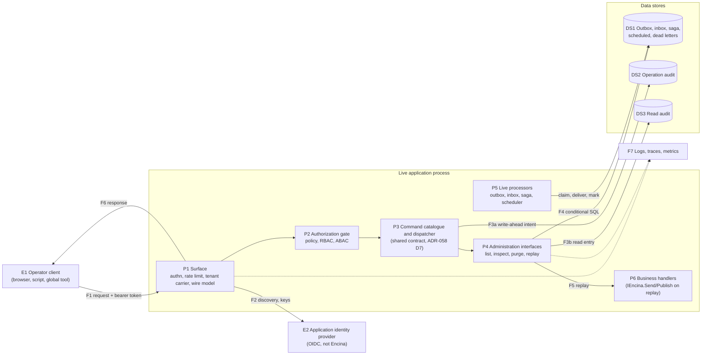

# Threat model of the remote administration surface (spike #2972)

This page is for the maintainer and for the authors of the plans that will build the administration surface. It is the full threat model behind the [spike report](admin-surface-spike-2972.md): assets, trust boundaries, data flow, an inventory of what Encina already has (with file and line), a STRIDE table per element, a LINDDUN pass for personal data, and the checks that must be run before an ADR relies on it. Nothing is built. The model proposes inputs for the maintainer's choices; it decides none of them.

**Status:** evidence gathered on 2026-11-03 against `origin/main` at 3ccef02d2. **Issue:** [#2972](https://github.com/dlrivada/Encina/issues/2972). Encina is pre-1.0, so nothing here is a stable API.

## 0. Conventions and limits

- The model is drawn against what `origin/main` already contains, so every "existing control" is a file and line in `src/` and every "none" is a gap that a plan must close.
- Ids. Threat ids are `T-nn`; gaps found in existing code are `G-nn` (section 3.5); verification items are `V-n` (section 8). Question ids `Dnn` are the ids of the #2972 decision register; the report gives every open one its own subsection and writes "ADR-058 Dnn" when it means the ADR's own numbering. Option letters follow the register.
- The settled points are respected throughout: the surface fails closed by construction; no opt-out of a control except an explicit, justified, audited territorial non-applicability, never by tier; the surface never grants access to clinical data ([SPEC-002](../specifications/SPEC-002-eu-regulatory-readiness.md) REQ-019); the audit is written ahead and awaited ([ADR-058](../architecture/adr/058-encina-cli-command-architecture.md) D17); the tenant is explicit (ADR-058 D13, D14); responses carry a code, never `EncinaError.Message`; the surface is opt-in and disabled by default.
- Evidence limits. The cited files were read; nothing was run. Where a claim rests on an absence, the search that found nothing is named. Statements about other products are out of scope here; the report has the competitor table.
- Only the ADO.NET SQL Server stores and the in-process orchestrators were read. The other nine database providers, MongoDB, Marten and the in-memory implementations were not read, so claims about row-level behaviour (R-1, R-5, R-6 and G-10 of the report) are cited from SQL Server ADO.NET only (V-4). The `Encina.Cli` package holds only scaffolding (`src/Encina.Cli/Program.cs`, three commands under `Commands/` and three services under `Services/`), so every statement about the command contract rests on ADR-058 and the [contract page](cli-command-contract-spike-2605.md), not on code.

## 1. Scope and assets

### 1.1 What is modelled

The surface in the sense of ADR-058 D2 (E): an authenticated, authorized remote API inside the live application that reads the same command catalogue as the console host (ADR-058 D7), calls the administration interfaces (ADR-058 D21, illustrative `IOutboxAdministration` and `ISagaAdministration`) and so operates outbox, inbox, saga, scheduling, dead letters and compliance operations (list, inspect, purge, replay, erase, and possibly export). The transport (HTTP or gRPC, D24) is left open; the threats below are transport-neutral unless a row says otherwise.

### 1.2 Assets

| Id | Asset | Why it matters | Harm if lost |
| --- | --- | --- | --- |
| A1 | Operator credentials and tokens (OIDC access token, refresh token, client secret of an automation identity) | Whoever holds one acts as the operator; Encina is not an identity provider (ADR-058 D14), so it cannot revoke | Total takeover of the admin plane |
| A2 | The capability itself: purge, replay, erase | Destructive and irreversible; replay re-executes business handlers with side effects | Data loss, duplicated business effects, unlawful erasure or failure to erase |
| A3 | Payloads: outbox `Content`, inbox response, saga `Data`, dead-letter `RequestContent` and `ExceptionStackTrace` | Serialized business messages, which in the reference application can reveal health data (an appointment with a psychologist is special-category data, `docs/specifications/SPEC-002-eu-regulatory-readiness.md:184`) | GDPR Art. 9 breach; REQ-019 "an operator never sees therapist notes" violated |
| A4 | The audit trail: operation audit, read audit, entity-change audit ([ADR-036](../architecture/adr/036-three-audit-stores.md)) | Evidence of who did what; also itself personal data (user id, IP address, user agent, entity ids of data subjects) | Loss of accountability, or a new store of personal data |
| A5 | The tenant boundary | In the operator-hosts-several-practices model each practice is the controller and the operator its processor (`docs/specifications/SPEC-002-eu-regulatory-readiness.md:184`) | Cross-controller disclosure |
| A6 | Authorization configuration: ABAC policies (`IPolicyAdministrationPoint`), break-the-glass scopes and reviewer roles | Whoever edits them re-defines "authorized" | Silent privilege escalation |
| A7 | Availability of the live processors (outbox, inbox, saga, scheduler) and of the database they share with the surface | The surface runs in the same process, on the same tables | Production outage caused by an admin call |
| A8 | Secrets held by options (connection strings, JWKS or authority configuration, HMAC keys) | AGENTS.md section 3 requires `[JsonIgnore]` and `ToString()` overrides | Credential leak through a diagnostic endpoint |
| A9 | Elevations (break-the-glass) | Time-boxed bypass of a denial, itself audited | Standing access in disguise |

### 1.3 Actors and adversaries

| Id | Actor | Capability assumed |
| --- | --- | --- |
| X1 | Anonymous network attacker | Reaches the listener, no credentials |
| X2 | Authenticated ordinary user of the application | Holds a valid token for the same identity provider, not an operator |
| X3 | Legitimate operator exceeding need | Valid operator token; wants to look at patient data out of curiosity (the insider) |
| X4 | Compromised operator or automation credential | Valid token used by an attacker, possibly outside working hours |
| X5 | Tenant administrator of tenant A | Valid, scoped to A; targets tenant B |
| X6 | Compromised or careless business code in the same process | Can resolve anything from DI, including the administration interfaces |
| X7 | Anyone who can write to a store table (SQL injection elsewhere, a restored backup, a shared database) | Plants or edits rows that the surface later reads or replays |

### 1.4 Trust boundaries

| Id | Boundary |
| --- | --- |
| TB1 | Network to surface |
| TB2 | Surface to identity provider |
| TB3 | Admin plane to data plane (surface and administration interfaces versus business code and runtime stores) |
| TB4 | Tenant to tenant |
| TB5 | Application to audit store |
| TB6 | Operator client to the person: what leaves the API is read by a human and may be stored in a terminal, a ticket or a screenshot |

## 2. Data flow

Flows:

- F1: operator to surface (TLS assumed, D26).
- F2: surface to identity provider (metadata and signing keys).
- F3a and F3b: audit writes, which must precede the effect (ADR-058 D17).
- F4: administration interface to the stores, which the live processors share.
- F5: replay into business handlers through `IEncina` (`src/Encina.Messaging/DeadLetter/DeadLetterManager.cs:413-416`).
- F6: response to the human.
- F7: telemetry.

The distinctive feature against the console host is that P5 runs concurrently with P1 to P4 in one process and one database. ADR-058 D6 (processors do not run in command mode) does not hold here; the report's concurrency section deals with it.

## 3. What Encina already has (evidence)

This is the inventory the threats are checked against. "Reuse" means the building block exists and fits; "adapt" means it exists with a property that conflicts with the surface's rules; "none" means a search found nothing.

### 3.1 Authentication, identity, authorization

| Building block | Evidence | Verdict for the surface |
| --- | --- | --- |
| Identity binding per HTTP request: `UseEncinaContext()` builds `InboundRequestInfo` from `HttpContext.User`; an ambiguous tenant or subject answers 403 problem+json with a fixed detail and no claim value | `src/Encina.AspNetCore/EncinaContextMiddleware.cs:29-32`, `:53-60`, `:174-178`; `src/Encina.AspNetCore/HttpContextInboundRequestExtensions.cs:93-105` | Reuse. It binds an identity, it does not demand one: an anonymous request runs on as `RequestIdentity.Anonymous` (`src/Encina/Identity/RequestIdentity.cs:110`). The 401 must come from the group's authorization requirement (T-05) |
| Client IP is `RemoteIpAddress` only, never `X-Forwarded-For`; proxies via `UseForwardedHeaders` with known proxies | `src/Encina.AspNetCore/HttpContextInboundRequestExtensions.cs:36-41` | Reuse. Good for the audit |
| Tenant from the verified claim; the header chooses the tenant only if `TrustTenantIdHeader` (default false), logged once; a header that disagrees with the claim is refused | `src/Encina.AspNetCore/EncinaAspNetCoreOptions.cs:24-44`; `src/Encina.AspNetCore/EncinaContextMiddleware.cs:86-89` | Reuse |
| A second tenant mechanism: `TenantResolutionMiddleware` with route, claim, header and subdomain resolvers; `RequireTenant` true by default; header honoured only for trusted proxies or `TrustAnyPeer`; 400 when missing, 403 on mismatch | `src/Encina.Tenancy.AspNetCore/Middleware/TenantResolutionMiddleware.cs:109-111`, `:149-151`, `:169-173`; `src/Encina.Tenancy/Configuration/TenancyOptions.cs:55`; `src/Encina.Tenancy.AspNetCore/Configuration/TenancyAspNetCoreOptions.cs:112`, `:128`, `:179` | Adapt. Two carriers with different trust rules (G-07) |
| A token cannot claim a service identity: a subject with the reserved `service:` prefix is refused | `src/Encina/Identity/ClaimsRequestIdentityFactory.cs:19`, `:183`; kinds in `src/Encina/Identity/IdentityKind.cs:22-28` | Adapt. ADR-058 D14 wants automation "audited as such", but no path turns a remote client-credentials token into `IdentityKind.Service` (G-08) |
| `SecurityPipelineBehavior`: attribute driven. A request with no security attribute passes unless `RequireAuthenticatedByDefault` (default false); a missing security context passes unless `ThrowOnMissingSecurityContext` (default false); `[AllowAnonymous]` bypasses everything | `src/Encina.Security/SecurityPipelineBehavior.cs:121`, `:134`, `:193`; `src/Encina.Security/SecurityOptions.cs:36`, `:83` | Adapt. Fail open by default (G-01) |
| `AuthorizationPipelineBehavior` (ASP.NET policies and roles): an anonymous identity is denied, but only for requests that carry authorization metadata; `failureReasons` messages are copied into error details | `src/Encina.AspNetCore/AuthorizationPipelineBehavior.cs:199-202`, `:217`, `:356` | Adapt (T-12) |
| ABAC: default mode `Block`; anonymous caller denied; write-ahead decision record with `FailClosed` default; but `Disabled` skips everything (the startup check only logs) and a request type with no ABAC attribute skips evaluation | `src/Encina.Security.ABAC/ABACOptions.cs:45-49`; `src/Encina.Security.ABAC/ABACPipelineBehavior.cs:29-34`, `:49-56`, `:173-182`; `src/Encina.Security.ABAC/ABACEnforcementModeStartupCheck.cs:38-40` | Reuse with a gate (G-01) |
| Break-the-glass: lets a denied `IdentityKind.User` continue when the request type is `[BreakTheGlassEligible]`; write-ahead access audit; tenant required when configured; a reviewer may not review their own elevation; a startup validator fails the host on tenancy, store and audit misconfiguration | `src/Encina.Security.BreakTheGlass/Gate/BreakTheGlassAccessGate.cs:14-29`, `:77-93`, `:138`; `src/Encina.Security.BreakTheGlass/Abstractions/RoleBreakTheGlassAuthorizer.cs:36-38`, `:49-54`; `src/Encina.Security.BreakTheGlass/Services/BreakTheGlassStartupValidator.cs:61-81`, `:85-102` | Reuse as a pattern. `Enabled` defaults true and `RequireTenant` false (`src/Encina.Security.BreakTheGlass/BreakTheGlassOptions.cs:35`, `:96`), guarded by the validator |
| MFA: `IMFAEnforcer` exists in the NIS2 module | `src/Encina.Compliance.NIS2/Abstractions/IMFAEnforcer.cs:25`, `:36`, `:56` | Adapt. A security-core dependency on a compliance module is the wrong direction (D15) |

### 3.2 Audit, masking, error handling

| Building block | Evidence | Verdict |
| --- | --- | --- |
| `IOperationAuditStore.RecordAsync` returns `ValueTask<Either<...>>`; the interface also has `PurgeEntriesAsync` | `src/Encina.Security.Audit/Abstractions/IOperationAuditStore.cs:50`, `:172` | Reuse for writing. The purge must never be reachable from the surface (T-33) |
| `AuditPipelineBehavior` runs the handler first and records afterwards; `FailClosed` replaces only a successful result; queries are unaudited unless `AuditAllQueries` | `src/Encina.Security.Audit/AuditPipelineBehavior.cs:110`, `:127-131`, `:144-156`; default `FailClosed` at `src/Encina.Security.Audit/OperationAuditOptions.cs:87`; `AuditAllQueries` at `:77` | Adapt. It is audit-after, so it cannot be the mechanism of ADR-058 D17 (G-02) |
| Write-ahead precedents: the ABAC decision record before the handler; policy administration awaits the audit write before applying the change and fails the change if it fails; the break-the-glass gate | `src/Encina.Security.ABAC/ABACPipelineBehavior.cs:49-56`; `src/Encina.Security.ABAC/Administration/PersistentPolicyAdministrationPoint.cs:61-65`; `src/Encina.Security.BreakTheGlass/Gate/BreakTheGlassAccessGate.cs:24` | Reuse as the pattern for ADR-058 D17 |
| Defaults register in-memory audit stores with `TryAdd`; no persistent-store startup validation found in the audit package (break-the-glass only logs a warning for an in-memory operation store) | `src/Encina.Security.Audit/ServiceCollectionExtensions.cs:96`, `:196`; `src/Encina.Security.BreakTheGlass/Services/BreakTheGlassStartupValidator.cs:25-26` | None for ADR-058 D18 (G-03) |
| Read audit: `IReadAuditStore.LogReadAsync`; `Enabled` default true, `RequirePurpose` default false; the only writers are the audited repository decorators, which sample, discard the returned `Either`, use `CancellationToken.None` and swallow failures | `src/Encina.Security.Audit/Abstractions/IReadAuditStore.cs:78`; `src/Encina.Security.Audit/ReadAuditOptions.cs:57`, `:88`; `src/Encina.Security.Audit/AuditedRepository.cs:259-260`, `:293`, `:301-308` | Adapt. Nothing writes a read-audit entry for an arbitrary read, and the existing writer is best-effort (G-04) |
| Entry fields: `UserId`, `TenantId`, `IpAddress`, `UserAgent`, payload hash; a read entry has `EntityId`, `Purpose`, `Metadata` | `src/Encina.Security.Audit/OperationAuditEntry.cs:77-86`, `:185`, `:194`, `:208`; `src/Encina.Security.Audit/ReadAuditEntry.cs:80`, `:90`, `:135`, `:176` | The audit is itself personal data (LINDDUN) |
| Masking in audit payloads fails the start without a masker unless `AllowUnmaskedPayloads` (explicit, warned each start) | `src/Encina.Security.Audit/OperationAuditMaskingStartupValidator.cs:49-58`; `src/Encina.Security.Audit/NullPiiMasker.cs:8-10` | Reuse as the model of an explicit opt-out |
| `PIIMaskingPipelineBehavior` masks `[PII]` properties of responses, `MaskInResponses` default true, fails closed with `pii.masking_failed`; it has no notion of role, permission or purpose (no reference in the file) and works on object graphs, not on a serialized string | `src/Encina.Security.PII/PIIMaskingPipelineBehavior.cs:36-38`, `:113-116`, `:172-184`; `src/Encina.Security.PII/PIIOptions.cs:68` | Adapt. Opaque payload strings cannot be masked (T-36, D38). Role-aware redaction is SPEC-002 REQ-019 and is not implemented here |
| Problem details: generic title, `errorCode`, trace id; the message only when the option is on **and** the host is Development | `src/Encina.AspNetCore/ProblemDetailsExtensions.cs:85`, `:151-152`; `src/Encina.AspNetCore/EncinaAspNetCoreOptions.cs:68` | Reuse |

### 3.3 The administered stores, today

| Store | Operations today | Tenant column | Evidence |
| --- | --- | --- | --- |
| Outbox | add, fetch pending, mark processed, mark failed, mark exhausted, counts, `RequeueExhaustedAsync(maxRetries, ids or null)`, save. No list, inspect or purge | **none** on `IOutboxMessage` (`Id`, `NotificationType`, `Content`, dates, `ErrorMessage`, `RetryCount`, `NextRetryAtUtc`) | `src/Encina.Messaging/Outbox/IOutboxStore.cs:31-149`; `src/Encina.Messaging/Outbox/IOutboxMessage.cs:26-71` |
| Inbox | get, add, mark processed, cache handler error, mark failed, get expired, remove expired | yes (`InboxOrchestrator` stamps `TenantId`) | `src/Encina.Messaging/Inbox/IInboxStore.cs:31-119`; `src/Encina.Messaging/Inbox/InboxOrchestrator.cs:165`, `:277` |
| Saga | get, add, update, stuck, expired, save | **none** on `ISagaState` (`Data`, `Status`, `ErrorMessage`, `CurrentStep`) | `src/Encina.Messaging/Sagas/ISagaStore.cs:31-76`; `src/Encina.Messaging/Sagas/ISagaState.cs:26-81` |
| Scheduled messages | add, due, mark, reschedule, `CancelAsync` | **none**; the processor documents it, and issue [#739](https://github.com/dlrivada/Encina/issues/739) tracks it | `src/Encina.Messaging/Scheduling/IScheduledMessageStore.cs:31-92`; `src/Encina.Messaging/Scheduling/ScheduledMessageProcessor.cs:42` |
| Dead letters | add, get, list, count, `TryClaimForReplayAsync`, `MarkAsReplayedAsync`, delete, `DeleteManyAsync(filter)`, delete expired; the manager adds replay and statistics | yes (`IDeadLetterMessage.TenantId`, `DeadLetterFilter.TenantId`) | `src/Encina.Messaging/DeadLetter/IDeadLetterStore.cs:51`, `:70`, `:102`, `:121`, `:132`, `:143`; `src/Encina.Messaging/DeadLetter/IDeadLetterManager.cs:31-120`; `src/Encina.Messaging/DeadLetter/IDeadLetterMessage.cs:39`, `:54`, `:86` |

The dead-letter module already is a small administration interface with a tenant default, a replay claim and a typed denial. `DeadLetterManager` defaults to the ambient tenant, denies with `encina.authorization.dlq_tenant_required` when multi-tenancy is registered and no tenant resolves, and offers `DeadLetterFilter.AllTenants` as an "operator tooling" opt-out that is logged (`src/Encina.Messaging/DeadLetter/DeadLetterManager.cs:18-25`, `:133-155`; `src/Encina.Messaging/DeadLetter/DeadLetterFilter.cs:72-81`; `src/Encina.Messaging/DeadLetter/DeadLetterErrorCodes.cs:88`). It is the closest existing precedent to ADR-058 D21 and shows the properties the other stores lack.

### 3.4 Other primitives

| Primitive | Evidence | Note |
| --- | --- | --- |
| Distributed locks: `TryAcquireAsync(resource, expiry, wait, retry)`, `AcquireAsync`, `IsLockedAsync`, `ExtendAsync` | `src/Encina.DistributedLock/IDistributedLockProvider.cs:77`, `:93`, `:108`, `:121` | No file under `src/Encina.Messaging` references `IDistributedLockProvider` (search: no hit). The processors do not use locks today |
| Rate limiting | `src/Encina.Polly/Behaviors/RateLimitingPipelineBehavior.cs:58` keys the limiter by request type, not by identity or tenant; the `Encina.Extensions.Resilience` rate limiters are outbound (`src/Encina.Extensions.Resilience/ServiceCollectionExtensions.cs:79`, `:157`) | No HTTP rate limiting, CORS or antiforgery anywhere in `src/` (search `AddRateLimiter\|UseRateLimiter\|AddCors\|UseCors\|Antiforgery`: only the two Resilience hits) |
| ASP.NET endpoint pattern | `src/Encina.AspNetCore/DPIAEndpointExtensions.cs:119-136` is the only `Map*` extension in `src/` (search `MapGroup`, `Map\w+Endpoints`) | See [#3126](https://github.com/dlrivada/Encina/issues/3126) and T-05 |
| Compliance operations | `src/Encina.Compliance.DataSubjectRights/Abstractions/IDataErasureExecutor.cs:52`; `src/Encina.Compliance.DataSubjectRights/Abstractions/IDSRService.cs:207`; `src/Encina.Compliance.DataSubjectRights/Services/DefaultDSRService.cs:622-638` | Erase exists as a service, not as a command |
| Cli | `src/Encina.Cli` holds `Program.cs`, three scaffolding commands and three services; no command catalogue, host or contract | Nothing of the shared contract exists to reuse |

### 3.5 Gaps found while inventorying

These are candidates for issues if the maintainer agrees. G-02, G-03, G-04 and G-10 exist whether or not the surface is ever built.

| Id | Gap | Evidence |
| --- | --- | --- |
| G-01 | The authorization stack is opt-in per request type: an administrative request with no attribute, or with ABAC `Disabled`, reaches its handler. A surface built on "put attributes on commands" fails open when an attribute is forgotten | `src/Encina.Security/SecurityPipelineBehavior.cs:134`; `src/Encina.Security.ABAC/ABACPipelineBehavior.cs:173-182`; `src/Encina.Security/SecurityOptions.cs:36`, `:83` |
| G-02 | The operation audit is written after the handler, so it cannot provide ADR-058 D17 | `src/Encina.Security.Audit/AuditPipelineBehavior.cs:110`, `:127-131` |
| G-03 | The default audit stores are in-memory singletons and nothing fails the start outside Development (ADR-058 D18 is a decision, not code) | `src/Encina.Security.Audit/ServiceCollectionExtensions.cs:96`, `:196` |
| G-04 | The read audit is sampled, swallows failures and discards the `Either` result in its only writers | `src/Encina.Security.Audit/AuditedRepository.cs:259-260`, `:293`, `:301-308` |
| G-05 | Outbox, saga and scheduled-message rows carry no tenant, so the tenant check of ADR-058 D13 cannot be applied to them | `src/Encina.Messaging/Outbox/IOutboxMessage.cs:26-71`; `src/Encina.Messaging/Sagas/ISagaState.cs:26-81`; `src/Encina.Messaging/Scheduling/ScheduledMessageProcessor.cs:42` |
| G-06 | Dead-letter replay resolves the type with `Type.GetType` from a stored string and dispatches under the ambient identity | `src/Encina.Messaging/DeadLetter/DeadLetterManager.cs:354`, `:360`, `:367`, `:413-416` |
| G-07 | Two tenant resolution mechanisms with different trust rules | `src/Encina.AspNetCore/EncinaAspNetCoreOptions.cs:39-44` ("an address-based trust list is not offered") against `src/Encina.Tenancy.AspNetCore/Configuration/TenancyAspNetCoreOptions.cs:112`, `:128` |
| G-08 | No path from a remote client-credentials token to `IdentityKind.Service` | `src/Encina/Identity/ClaimsRequestIdentityFactory.cs:183` |
| G-09 | `DeadLetterManager` allows every tenant when tenancy is not registered (`_tenancy is null`) | `src/Encina.Messaging/DeadLetter/DeadLetterManager.cs:151` |
| G-10 | Saga update is `WHERE SagaId = @SagaId` with no version or status condition (last writer wins); the outbox batch fetch is a plain `SELECT TOP` with no claim | `src/Encina.ADO.SqlServer/Sagas/SagaStoreADO.cs:118-127`; `src/Encina.ADO.SqlServer/Outbox/OutboxStoreADO.cs:70-76` |
| G-11 | `MapDPIAEndpoints` fails open (issue #3126), the anti-pattern the surface must not copy | `src/Encina.AspNetCore/DPIAEndpointExtensions.cs:27-29`, `:119-136`, `:339`, `:384` |

## 4. STRIDE per element

Legend for the control columns. **Existing** is what Encina has today, with file and line, or "none". **Required** is the control the design must contain; "(by construction)" means the surface must make the unsafe state unrepresentable (a startup failure, or no API to express it), not merely document it. S is spoofing, T tampering, R repudiation, I information disclosure, D denial of service, E elevation of privilege.

### 4.1 E1 Operator client and credentials (A1)

| Id | STRIDE | Threat and example | Existing | Required |
| --- | --- | --- | --- | --- |
| T-01 | S | X4 replays a stolen bearer token from another network | None at the surface: Encina does not validate tokens, the application's scheme does | Short token lifetime documented as a precondition; require the admin audience (T-02); a step-up claim for mutating commands (D15); no refresh token to the surface; optionally sender-constrained tokens (DPoP or mTLS, D26) |
| T-02 | S/E | X2 presents a valid token of the same identity provider that was never meant for operations | None: a valid user token produces `IdentityKind.User` like any other (`src/Encina/Identity/ClaimsRequestIdentityFactory.cs`) | The group requires a named policy that checks an admin audience or scope claim and a permission; startup fails when the policy is absent (D9 (a), D13) |
| T-03 | S | X3 or X5 sends another tenant in a header to read it | Header ignored unless `TrustTenantIdHeader`; the claim wins; a mismatch gives 403 (`src/Encina.AspNetCore/EncinaAspNetCoreOptions.cs:39-44`; `src/Encina.AspNetCore/EncinaContextMiddleware.cs:174-178`) | The surface accepts the tenant only from a route segment checked against the identity's access, or a claim (D21); never a header |
| T-04 | S | An automation credential is indistinguishable from a human in the audit | `service:` subjects are refused from tokens (`src/Encina/Identity/ClaimsRequestIdentityFactory.cs:183`), so a remote automation caller is a `User` (G-08) | Decide how a client-credentials token maps to a distinct identity kind recorded in every audit entry (ADR-058 D14 requires it); until then automation is a `User` with a recognisable subject prefix, and that is a gap |
| T-14 | R | A legitimate operator denies having run a purge | The operation audit exists but is written after (`src/Encina.Security.Audit/AuditPipelineBehavior.cs:110`) | A write-ahead entry with actor, tenant, command, arguments' hash and plan hash, correlation id and `RemoteIpAddress`, before the effect (ADR-058 D17); a completion entry afterwards |

### 4.2 P1 Surface (transport, endpoints, wire model)

| Id | STRIDE | Threat and example | Existing | Required |
| --- | --- | --- | --- | --- |
| T-05 | S/E | The #3126 pattern: endpoints mapped without an authorization requirement, "authorization is the caller's responsibility" | `src/Encina.AspNetCore/DPIAEndpointExtensions.cs:27-29`, `:119-136`; no `RequireAuthorization` anywhere in `src/` outside a doc example (`:53`) | The only public mapping method builds the group with `RequireAuthorization(policy)` already applied and returns a builder that cannot remove it; startup validation walks the `EndpointDataSource` and fails if any endpoint of the group lacks authorize metadata or carries `AllowAnonymous`; a test per group proves a request with no token gets 401 (by construction) |
| T-06 | R/S | A static fallback actor, as in `httpContext.User.Identity?.Name ?? "DPO"` | `src/Encina.AspNetCore/DPIAEndpointExtensions.cs:339`, `:384` | The actor is read once from `IRequestContext.Identity`; absence denies; no literal actor string exists in the surface (a code-search test) |
| T-07 | T | CSRF: a browser with a cookie session is lured to POST a purge | No antiforgery in `src/` | Bearer-only authentication for the group; cookie schemes rejected at startup (D28 (a)); a state-changing request additionally requires the confirmation token (T-29) |
| T-08 | I | Permissive CORS exposes responses to another origin | No CORS registered in `src/` | No CORS policy registered by default; the application adds an origin allow-list explicitly (D28) |
| T-09 | D | X1 floods unauthenticated; X4 hammers list and inspect | `src/Encina.Polly/Behaviors/RateLimitingPipelineBehavior.cs:58` is keyed by request type, in the pipeline, after authentication; nothing at the HTTP edge | A limiter in front of authentication (per remote address) and a per-identity and per-tenant one after it, stricter for mutating commands (D27 (b)); on by default |
| T-10 | D/T | One call touches everything: `RequeueExhaustedAsync(..., null)` requeues every exhausted message; `DeleteManyAsync(filter)` is set-based | `src/Encina.Messaging/Outbox/IOutboxStore.cs:132-142`; `src/Encina.Messaging/DeadLetter/IDeadLetterStore.cs:143` | A mandatory filter and a row ceiling per call; the dry-run returns the count and the confirmation token binds that count (D27 (d), D30) |
| T-11 | T/E | Mass assignment: the request body binds straight onto the internal filter, including `AllTenants` (`init`, "operator tooling") | `src/Encina.Messaging/DeadLetter/DeadLetterFilter.cs:72-81` | A separate wire model; `AllTenants`, `TenantId` and ambient defaults are never bindable from the body; cross-tenant only through a distinct platform scope (D22 (c)) |
| T-12 | I | Error text discloses data: ASP.NET failure reasons copied into details; replay results that echo the stored type name | `src/Encina.AspNetCore/AuthorizationPipelineBehavior.cs:356`; `src/Encina.Messaging/DeadLetter/DeadLetterManager.cs:357`, `:363`; message gate `src/Encina.AspNetCore/ProblemDetailsExtensions.cs:151-152` | Only status, fixed title, `errorCode` and trace id (ADR-058 D16; the result model is D35 of the report); the surface never forwards `EncinaError.GetDetails()` or free text from a store |
| T-13 | I/T | Plain HTTP, or a proxy that lets `X-Forwarded-*` through, so the audit shows the wrong address | Address handling `src/Encina.AspNetCore/HttpContextInboundRequestExtensions.cs:36-41`; TLS: none | Refuse non-TLS requests outside Development; a startup warning or failure without forwarded-header configuration behind a proxy (D26 (a)) |
| T-45 | D | The surface competes with the live app: a broad list on the outbox table holds locks or saturates the pool | None | Mandatory pagination with a maximum page size; a command timeout; read-only queries use indexed predicates and no table scans on hot tables; the surface's database work is cancellable with the request token (AGENTS.md section 3) |

### 4.3 P2 Authorization gate (A2, A6, A9)

| Id | STRIDE | Threat and example | Existing | Required |
| --- | --- | --- | --- | --- |
| T-15 | E | A command ships without a permission attribute and runs for any authenticated caller, or for anyone | `src/Encina.Security/SecurityPipelineBehavior.cs:134`; `src/Encina.Security.ABAC/ABACPipelineBehavior.cs:179` | The command contract makes the required permission mandatory metadata; registration in the catalogue throws when it is missing (by construction); the surface's authorization does not depend on an attribute on the request type |
| T-16 | E | Authorization weakened by configuration: ABAC `Disabled`, `ThrowOnMissingSecurityContext` false | `src/Encina.Security.ABAC/ABACEnforcementModeStartupCheck.cs:38-40` (log only); `src/Encina.Security/SecurityOptions.cs:83` | Enabling the surface validates the effective options at startup and refuses to start on a weakened gate; the only exit is a territorial non-applicability that is justified and audited (D11) |
| T-17 | E | Break-the-glass turned into a way for an operator to read patient data: a denied operator proceeds under an elevation | Gate preconditions `src/Encina.Security.BreakTheGlass/Gate/BreakTheGlassAccessGate.cs:14-29`; the type must be `[BreakTheGlassEligible]` | Settled by D14: no administration command is eligible. The existing startup validator scans eligible types (`src/Encina.Security.BreakTheGlass/Services/BreakTheGlassStartupValidator.cs:104-113`) and can reject administration commands (by construction) |
| T-18 | E/R | One person approves and executes their own destructive command | Break-the-glass forbids self review (`src/Encina.Security.BreakTheGlass/Abstractions/RoleBreakTheGlassAuthorizer.cs:54`) | If D15 (c) or (d) is chosen, the same self-approval rule for irreversible commands |
| T-19 | E | Business code (X6) resolves `IOutboxAdministration` and purges | ADR-058 line 74 asks the plans to prove business code cannot resolve it; no mechanism exists | Keyed or surface-internal registration, an architecture test that no non-surface assembly depends on the interfaces, and registration only when the surface or command hosting is enabled (ADR-058 D21) |
| T-20 | S/E | Replay runs under the operator's identity, not the originating one: the handler authorizes against the wrong actor, or an operator-only permission lets a replay do what the original actor could not | Replay calls `IEncina.Send/Publish` with the ambient context (`src/Encina.Messaging/DeadLetter/DeadLetterManager.cs:413-416`); SPEC-002 scenario S0 wants the originating actor and tenant rebuilt from persisted metadata (`docs/specifications/SPEC-002-eu-regulatory-readiness.md:203`) | Replay restores the persisted actor and tenant as a scoped, logged identity and records both the originator and the replaying operator; where the originator cannot be restored the replay is refused (fail closed) |
| T-21 | T/E | X7 plants a row whose `RequestType` names an unexpected type; replay deserializes and dispatches it | `Type.GetType(message.RequestType)`, then `Deserialize`, then dispatch (`src/Encina.Messaging/DeadLetter/DeadLetterManager.cs:354`, `:360`, `:413-416`) | Resolve the type only from the registered handler and notification set (an allow-list), never from an arbitrary assembly-qualified string; sign or hash stored payloads at capture (the `Encina.Security.AntiTampering` package exists) and verify before replay |

### 4.4 P3 Tenant and module isolation (A5)

| Id | STRIDE | Threat and example | Existing | Required |
| --- | --- | --- | --- | --- |
| T-22 | I | Inspecting an outbox, saga or scheduled message of another tenant because the row carries no tenant | None (G-05) | Until those rows carry a tenant, the surface returns those patterns only to a platform-operator scope (D22 (c)) with its own audit, or not at all; a prerequisite issue for the tenant column on all providers (#739 is the scheduled-message case) |
| T-23 | I | Tenancy not registered, so the dead-letter manager allows every tenant | `src/Encina.Messaging/DeadLetter/DeadLetterManager.cs:151` (G-09) | The surface requires an explicit tenant mode at startup: single-tenant declared in options, or tenancy registered and the tenant required; "unknown" is not a mode |
| T-24 | I/E | The `AllTenants` opt-out is reachable by any operator | `src/Encina.Messaging/DeadLetter/DeadLetterFilter.cs:72-81`; logged only (`src/Encina.Messaging/DeadLetter/DeadLetterManager.cs:140-145`) | Platform scope only, write-ahead audited with a reason, never from the wire body (T-11) |
| T-25 | S | The carrier of the tenant differs between layers, so a request is authorized for tenant A and executed for tenant B | Two mechanisms (G-07) | One carrier for the surface; the route tenant is compared with the identity's tenant claim once, and the command receives the compared value, never re-reading a header |
| T-26 | I | Existence oracle: 403 for another tenant's id, 404 for a missing one | Other-tenant dead letters are reported as not found (`src/Encina.Messaging/DeadLetter/DeadLetterManager.cs:191-192`) | The same uniform not-found for every pattern |
| T-27 | E | Module isolation (function 11): an operator limited to one module reaches another's commands | `ModuleId` is not part of the identity today; ADR-058 row 11 is "not applicable" for the host | D23: at minimum the command catalogue carries the owning module so a policy can scope by it |

### 4.5 P3 Command catalogue and dispatcher

| Id | STRIDE | Threat and example | Existing | Required |
| --- | --- | --- | --- | --- |
| T-28 | E | Every registered command becomes remotely callable the day the surface is enabled, including the most dangerous (erase) | None (the contract does not exist) | A per-command remote flag, default no (D7 (b)), plus application-level enabling of categories (D7 (c)); irreversible compliance commands console-only unless a plan shows the controls (D7 (d)) |
| T-29 | T | The plan shown in the dry-run differs from what executes (time of check to time of use); a client scripted by an attacker confirms something else | None | A confirmation token that is a signed digest of actor, tenant, command, normalised arguments, affected count and expiry; single use; verified server side; arguments cannot change between the two calls (D30 (a)) |
| T-30 | R/D | A client retry executes a confirmed purge twice, or a double click replays twice | The header name exists (`src/Encina.AspNetCore/EncinaAspNetCoreOptions.cs:50`) but nothing at the surface consumes it | An idempotency key per actor and command recorded before the effect (D31 (c)); the dead-letter replay claim is the per-message equivalent (`src/Encina.Messaging/DeadLetter/IDeadLetterStore.cs:102`) |
| T-31 | E | A third-party package registers a command and thereby extends the attack surface | ADR-058 D8: only registered modules contribute | The remote flag defaults to no for every command, including those of third-party modules, so a new package never becomes remotely callable by being referenced |

### 4.6 P4 Administration interfaces and stores (A2, A3, A7)

| Id | STRIDE | Threat and example | Existing | Required |
| --- | --- | --- | --- | --- |
| T-32 | T/R | The effect happens, the audit write fails, nothing records it | `AuditPipelineBehavior` records after (G-02); write-ahead precedent `src/Encina.Security.ABAC/Administration/PersistentPolicyAdministrationPoint.cs:61-65` | An intent entry awaited before the effect; failure returns an error and nothing runs (ADR-058 D17); a completion entry afterwards; a crash between the two leaves an intent without a completion, which is detectable |
| T-33 | T/R | The admin plane edits or deletes the evidence of its own actions | `IOperationAuditStore.PurgeEntriesAsync` exists (`src/Encina.Security.Audit/Abstractions/IOperationAuditStore.cs:172`); retention service `src/Encina.Security.Audit/OperationAuditRetentionService.cs` | No command may purge, update or reach audit stores except read queries, and those are themselves audited; audit retention stays with the retention service, with its own permission |
| T-34 | D/T | Purge or replay races a running processor | See the report's concurrency section | See the report's concurrency section |
| T-35 | T | A saga edit or cancel overwrites a step that is running | `src/Encina.ADO.SqlServer/Sagas/SagaStoreADO.cs:118-127` (G-10) | No saga mutation in the first slice, or a version-conditioned update plus a lock |
| T-36 | I | Inspect returns the payload (`Content`, `RequestContent`, `Data`, `ExceptionStackTrace`) | None; masking cannot see inside a serialized string (`src/Encina.Security.PII/PIIMaskingPipelineBehavior.cs:113-184`) | A default projection without payload (D38 (a)/(e)); any payload step is a separate command, a separate permission, a declared purpose, masked or hashed, read-audited per row, and never for the clinical categories (D37) |
| T-37 | I | Free-text columns (`ErrorMessage`) hold more than a code | The convention stores codes (`src/Encina.Messaging/Sagas/SagaOrchestrator.cs:273`, `:377`) but the column is a string (`src/Encina.Messaging/Outbox/IOutboxMessage.cs:51`; `src/Encina.Messaging/Sagas/ISagaState.cs:67`) | Treat as untrusted: a length cap, return it only if it matches the error-code pattern, otherwise a placeholder |
| T-38 | I | The audit store behind the surface is the in-memory default, so evidence disappears on restart | `src/Encina.Security.Audit/ServiceCollectionExtensions.cs:96` (G-03) | Enabling the surface fails startup outside Development without a persistent operation audit store, and without read audit when any inspect can return personal data (D19 (a)) |
| T-39 | R | Reads by operators are not recorded, or only sampled | `src/Encina.Security.Audit/AuditedRepository.cs:259-260`, `:293`, `:301-308` (G-04) | A dedicated write-ahead read-audit call in the administration read path: per returned id, no sampling, purpose mandatory, failure fails the read (SPEC-002 REQ-007 already specifies the option) |
| T-40 | I | The audit trail is a new personal-data store: IP address, user agent, patient entity ids | Fields listed in section 3.2 | Audit access is itself a command with its own permission and read audit; retention per category (REQ-007); document the IP as personal data (D18) |
| T-41 | I | Telemetry carries tenant, user or payload | EventIds and tags are governed by [ADR-054](../architecture/adr/054-observability-conventions-and-trace-propagation.md) | Tag the tenant only; never a payload, a response body or a direct identifier of a data subject; exceptions through `ForLogging()` (AGENTS.md section 3) |

### 4.7 E2 Identity provider

| Id | STRIDE | Threat and example | Existing | Required |
| --- | --- | --- | --- | --- |
| T-42 | D | The identity provider is unreachable during an incident, so operators are locked out of the production fix | None | Fail closed is kept. The availability answer is the console host in the application's own container (ADR-058 D2 (D)), not a bypass in the surface; document it |
| T-43 | S | Signing-key or metadata discovery over a downgraded channel | None; the identity provider is the application's | Document the precondition (D53); the surface refuses an authority that is not HTTPS outside Development |
| T-44 | T | The identity provider issues the same `sub` to a person and a machine | `src/Encina/Identity/ClaimsRequestIdentityFactory.cs:19`, `:183` | Subject namespacing documented; see T-04 |

## 5. LINDDUN pass: inspect, export, erase

Personal data here is data about patients (the data subjects of the controller tenants) and about operators (the data subjects of the surface's own audit). Export is not in ADR-058 or in the issue's command list; it appears in the model because "export" of dead letters or of a subject's records is the natural next request (access and portability, GDPR Art. 15 and 20), and D7 must say whether it exists. Where a cell says a command is not a command today, read it as a question for D7.

| LINDDUN | Inspect | Export | Erase |
| --- | --- | --- | --- |
| **L**inking: can records be tied together across calls or stores | A list that shows correlation id and type for each dead letter links messages to one patient visit. Mitigation: show the correlation id only on single-item inspect, never in lists; do not return `SourceMessageId` where it embeds a subject id | A bulk export joins outbox, inbox and dead letters by correlation id into a profile. Mitigation: not a command in the first slice; if added, per-subject scope, not per-pattern | Erasure across patterns requires the join; it is done server side by `IDataErasureExecutor` (`src/Encina.Compliance.DataSubjectRights/Abstractions/IDataErasureExecutor.cs:52`) and returns counts only |
| **I**dentifying: can a person be identified from the data presented | Type names such as an appointment notification, plus tenant, plus timestamps, identify a patient in a one-patient practice. Mitigation: a metadata default (D38 (a)/(e)); payload hash and size rather than content | Same, stronger | The response of an erase names the subject id the operator already supplied; it must not echo any other attribute |
| **N**on-repudiation (the unwanted kind: a data subject cannot deny a fact) | Read audit entries state that "subject X was looked at by operator Y for purpose Z", which is the legitimate accountability and also a record about X. Mitigation: retention per category, restricted access (REQ-007) | The export itself is evidence of the existence of records | The erasure record must itself not hold the erased data: store the subject reference class and counts, not content |
| **D**etecting: can the existence of data be inferred | The difference between not-found and forbidden reveals other tenants' ids (T-26); counts in list responses reveal volumes per category. Mitigation: uniform not-found; counts only within the caller's tenant | The export size reveals volume | A "not found" for an erase of an unknown subject versus "done" reveals whether the subject existed. Mitigation: a uniform outcome for the caller, the difference only in the audit |
| **D**ata disclosure: excess exposure | Payload fields, stack traces, free-text error columns (T-36, T-37); logs and traces (T-41); terminals and tickets where operators paste results (TB6). Mitigation: minimisation by default (GDPR Art. 5(1)(c), 25); `Cache-Control: no-store`; no payload in spans | The largest disclosure channel; an export leaves the system. If it exists: tenant scope, subject scope, purpose, four-eyes, encrypted at rest and a short life | Disclosure through the erasure report; also the dry-run, which lists what would be erased, is an inspect in disguise and must follow the inspect rules |
| **U**nawareness: do data subjects and the controller know | The tenant (controller) must be able to see which operator accessed its patients' data: a tenant-scoped read of the read audit, supporting the access-notice duties in SPEC-002 (`docs/specifications/SPEC-002-eu-regulatory-readiness.md:184`) | The controller must know of an export | The controller must receive the erasure record for Art. 12(3) answers |
| **N**on-compliance | GDPR Art. 5(1)(c) minimisation, Art. 25 by default, Art. 32 security, Art. 9 special category (health). The reference application cannot offer an inspect that shows clinical content. Health data in the payload makes the surface's audit store part of the regulated processing | Art. 15 and 20 procedures; Art. 28 processor limits when the operator hosts several controllers | Art. 17 with the retention exception of Art. 17(3)(b) (clinical records are kept at least 5 years and then blocked, `docs/specifications/SPEC-002-eu-regulatory-readiness.md:184`), legal hold, and the order of operations; an erase command that does not consult the legal-hold and retention modules is non-compliant. Erase through the surface must go through the same compliance services (`src/Encina.Compliance.DataSubjectRights/Services/DefaultDSRService.cs:622-638`), never a raw purge of the store |

LINDDUN conclusions that feed the report: minimise by default (D38); read audit mandatory and write-ahead for operator reads of personal data (D19); erase is the highest-risk command and the only one whose lawful outcome can be "refused" (retention), so it cannot be a thin pass-through (D7); export needs an explicit decision before it exists.

## 6. Walkthrough and concurrency

The paper walkthrough of one read-only command (inspect a dead-lettered outbox message) and the analysis of purge and replay against the running processors (D32) are in the [report](admin-surface-spike-2972.md), sections 5 and 6. This page holds the threats they refer to.

## 7. Where the threats go

| Threat | Report subsection that proposes the control |
| --- | --- |
| T-05, T-15, T-16, T-32, T-38 (transport-independent controls) | Package shape (D3), policy binding (D9), authorization model (D13) |
| T-01, T-18, T-29 | Step-up or four-eyes (D15), dry-run and confirmation (D30, following #2983) |
| T-03, T-22 to T-26 | Tenant carrier (D21), cross-tenant operators (D22), module isolation (D23) |
| T-07, T-08, T-09, T-10, T-13, T-45 | Transport (D24), TLS (D26), rate limiting (D27), CSRF and CORS (D28) |
| T-14, T-39, T-40 | Audit scope (D18), read audit (D19) |
| T-34, T-35 | Concurrency (D32) |
| T-36, T-37 | Minimisation (D38) |

## 8. Verification items before the ADR relies on this model

| Id | Item | How |
| --- | --- | --- |
| V-1 | Tenant stamped on a dead letter captured from the outbox processor | A test with a tenant-scoped outbox message through `OutboxBatchProcessor` into the dead-letter store |
| V-2 | A request to a group built without `RequireAuthorization` reaches the endpoint with `RequestIdentity.Anonymous` and returns 200 | An integration test with `TestServer`; confirms the #3126 reproduction and the 401 source of step 2 of the walkthrough |
| V-3 | `Encina.AspNetCore` and `Encina.Tenancy.AspNetCore` used together: which tenant wins | A two-tenant test |
| V-4 | Whether providers other than SQL Server share the unconditional `MarkAsProcessed` and the plain batch fetch | Read the nine other outbox stores; only SQL Server ADO.NET was read for this model |
| V-5 | How a client-credentials token maps in `ClaimsRequestIdentityFactory` | Read the factory body (only its header comment and the reserved-subject branch were read) |

## Related

- [Spike report: remote administration surface](admin-surface-spike-2972.md)
- [ADR-058: Encina.Cli command architecture](../architecture/adr/058-encina-cli-command-architecture.md)
- [About the command contract for module authors (spike #2605)](cli-command-contract-spike-2605.md)
- [ADR-036: three audit stores](../architecture/adr/036-three-audit-stores.md)
- [ADR-018: cross-cutting integration principle](../architecture/adr/018-cross-cutting-integration-principle.md)
- [SPEC-002: EU regulatory readiness](../specifications/SPEC-002-eu-regulatory-readiness.md)
