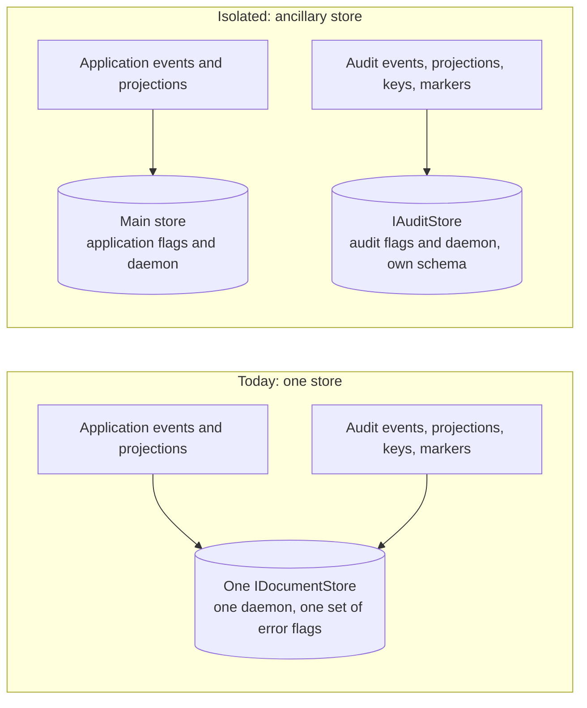

# A separate Marten store for Encina audit: measured behaviour and options (spike #2930)

This page is for the maintainer, who has to answer the open questions of section 7 before an ADR can be written, and for the authors of the plans that will build the change. It records what is already settled, what Marten does when a second ("ancillary") store holds the audit data, what a scratch prototype measured, what Encina's code does today and what would have to change, and, for each open question, the options, where each wins, what the evidence implies and a recommendation. Recommendations are input for the maintainer and not decisions: the issue stays open until the maintainer picks. Nothing under `src/` was changed.

**Status:** evidence gathered on 2026-11-05 against `origin/main` at `bd8b070a0`. **Issue:** [#2930](https://github.com/dlrivada/Encina/issues/2930). **Trigger:** the [#3111](https://github.com/dlrivada/Encina/issues/3111#issuecomment-6639322570) G4 decision (2026-11-04): `AllowSkippedProjectionErrors` is removed, the startup guard stays fail-closed, and the audit projections move to their own store later "if SPIKE #2930 approves it". The page is an explanation page (a spike report); the operating instructions for the audit store are in [audit-marten](../features/audit-marten.md).

Pre-1.0, backward compatibility and migration cost are not criteria ([AGENTS.md](../../AGENTS.md) section 1). Question ids (`D3`, `D7`, ...) are those of the #2930 decision register; option letters follow the register.

## How this was verified

- **Encina facts** are `file:line` references in the worktree at `bd8b070a0`; each was re-read for this page.
- **Marten facts** come from martendb.io pages and one Marten source file. Those pages were read through a summarising fetch tool, not line by line, so quotes are as returned and a detail the summary dropped is marked **[unconfirmed]**. Where the prototype could run the behaviour, it is marked **[measured]** and that is the stronger evidence.
- **Measurements** come from a throw-away harness (section 5) on one Windows 11 machine with Docker Desktop 29.8.1, Marten 9.38.0 ([`Directory.Packages.props:53`](../../Directory.Packages.props)), Npgsql 10.0.2, Testcontainers 4.15.0 and `postgres:17-alpine`. The harness is not committed; section 5 reproduces what it did. The first runs of scenarios C and G used an earlier version of the harness (C showed 4 connections and G showed the non-generic configurator reaching the audit store); the page reports the final harness. Scenarios C, E, F, G and H were run again against the final harness on 2026-11-05 and reproduced the figures and outcomes below.
- **No regulation text was read for this spike.** The page does not claim that ENS or ISO/IEC 27001 requires a separate store (section 7, D20).

## 1. The problem from the basics

Marten configures projections per store. Settings such as `Projections.Errors.SkipApplyErrors`, `SkipSerializationErrors`, the `RebuildErrors` equivalents, the stream identity and the asynchronous daemon's mode live on `StoreOptions`, so they apply to everything in that one `IDocumentStore`.

Encina's audit projections run inside the application's store today. A concrete case: the application has a high-volume telemetry projection and wants Marten to skip a malformed event so ingestion never stops. The audit projections must never skip an event, because a skipped audit event is a missing record. In one store those two wishes cannot both hold, because the flags are store-wide. G4 resolved this for now by requiring the application to set the flags to `false` (the application's telemetry projection then also stops on a bad event) and left open the other route: give the audit data a store of its own, so the audit flags and daemon belong to Encina and the application keeps its own policy ([principle C1b](https://github.com/dlrivada/Encina/issues/1770#issuecomment-6436978234): Encina's scope is Encina).

The question of this spike is whether that second store is worth its cost, and how to build it if it is.

## 2. What is already settled

| Point | Settled as | Rule |
| --- | --- | --- |
| A schema split inside the application's store (D4 part) | Excluded. It does not scope the daemon or the store-wide error flags (section 3, M4), so it cannot deliver what G4 asks of this spike | Purpose stated in the G4 decision |
| How to measure (D27) | A throw-away prototype under the git-ignored `artifacts/` measures daemon and pool cost, as [#3170](https://github.com/dlrivada/Encina/issues/3170) did; nothing is committed | The issue's own "measure, do not estimate"; precedent #3170 |
| An ADR (D29) | One is written whatever the outcome, because keeping and changing are both architectural decisions | [AGENTS.md](../../AGENTS.md) section 8 |
| The opt-out (D1) | `AllowSkippedProjectionErrors` goes away; the fail-closed guard stays | G4 = (d); [compliance principle](https://github.com/dlrivada/Encina/issues/686#issuecomment-6521534413) |
| Who sets the flags in an isolated store (D2) | Encina sets the four flags to `false` itself on the store it creates and keeps the guard as a verifier. Precedent: [`ConfigureMartenCryptoShredding.cs:52`](../../src/Encina.Marten.GDPR/ConfigureMartenCryptoShredding.cs) sets `SkipSerializationErrors = false` | C1b protects the application's code; the audit store would be Encina's own |
| Existing audit data (D18, D19) | No migration helper and no compatibility layer; the public constructors change completely | [AGENTS.md](../../AGENTS.md) sections 1 and 3 |
| Retention default (D15) | An isolated store inherits no 2555-day default | #3111 G1 |
| Tests (D25, D26) | No InMemory store for the event-sourced audit; Marten on PostgreSQL through Testcontainers, a distinct `DatabaseSchemaName` per store inside the shared `MartenFixture` | [AGENTS.md](../../AGENTS.md) section 3 |
| Instrumentation and log ids (D22, D23) | `ActivitySource` and `Meter` keep the package names; new `[LoggerMessage]` ids stay in the registered `AuditMarten` range ([`EventIdRanges.cs:112`](../../src/Encina/Diagnostics/EventIdRanges.cs)) | [ADR-054](../architecture/adr/054-observability-conventions-and-trace-propagation.md); [AGENTS.md](../../AGENTS.md) section 7 |

## 3. What Marten does

Marten ids M1 to M13 are used in the rest of the page.

| Id | Fact | Evidence |
| --- | --- | --- |
| M1 | An ancillary store needs a public marker interface deriving `IDocumentStore`; Marten builds a dynamic type for it. It is registered with `services.AddMartenStore<IMarker>(opts => { ... })` and chained with `.ApplyAllDatabaseChangesOnStartup()`, `.AddAsyncDaemon(...)` and `.InitializeWith(...)`. Stores can target different databases or different schemas of one database | [Hosting with the generic host](https://martendb.io/configuration/hostbuilder.html), section "Ancillary Marten Stores". **[measured]** works on 9.38.0 |
| M2 | Sessions come from the marker: inject it and call `LightweightSession()` or `QuerySession()`. The session factory is a keyed service keyed by the marker type, and `Lazy<T>` is registered too. There is no injectable `IDocumentSession` for an ancillary store | Same page; [Marten source](https://github.com/JasperFx/marten/blob/master/src/Marten/MartenServiceCollectionExtensions.cs) |
| M3 | The per-store configuration hook is `IConfigureMarten<T>`. The non-generic `IConfigureMarten` is applied only to the main store | The source file above (the summary did not show the full `SecondaryStoreConfig<T>.Build`). **[measured]** scenario G: a non-generic `IConfigureMarten` that sets `SkipApplyErrors = false` gave `app=False`, `audit=True` (the default) |
| M4 | The projection error flags are store-wide on `StoreOptions`, not per projection. `Errors.*` default to skip (`true`); `RebuildErrors.*` default to `false`. A non-skipped error pauses the individual projection | [Async daemon](https://martendb.io/events/projections/async-daemon.html), sections "Projection error handling" and "Per-projection options". Because `StoreOptions` is per store, the flags are per store. **[measured]** D, E, F |
| M5 | `AddAsyncDaemon(DaemonMode.Solo \| HotCold)` is available on the `AddMarten` builder and on the `AddMartenStore<T>` builder. HotCold elects a leader per projection and per tenant database. This is Marten-only hosting | Async daemon page; hosting page; source file. **[measured]** Solo and HotCold both start one daemon per store |
| M6 | `AddMartenAsyncDaemonHealthCheck(maxEventLag, maxSameLagTime)` in `Marten.AspNetCore` compares each async projection's progress with the high-water mark. Whether it covers ancillary stores is **[unconfirmed]** (the page is silent) | [Health checks](https://martendb.io/events/projections/healthchecks.html) |
| M7 | Do not constructor-inject an ancillary store into a projection (startup deadlock); inject `Lazy<T>`, open `QuerySession()` at projection time and register `AddProjectionWithServices<T>(ProjectionLifecycle.Async, ServiceLifetime.Scoped)`. Relevant to D5(b) | [Ancillary stores in projections](https://martendb.io/events/projections/ancillary-stores.html) |
| M8 | Multi-tenancy is configured on each store's `StoreOptions` (conjoined tenancy, database per tenant). "Separate schemas within one database" is not a tenancy strategy. The page does not cover several stores side by side. Conjoined tenancy on an ancillary store is **[unconfirmed]** (not tested) | [Multi-tenancy](https://martendb.io/configuration/multitenancy.html) |
| M9 | `AutoCreate` modes All, CreateOrUpdate (default), CreateOnly, None. `ApplyAllDatabaseChangesOnStartup()` applies outstanding changes in a hosted service; `AssertDatabaseMatchesConfigurationAsync()` throws listing missing DDL; CLI `db-patch`, `db-apply`, `db-assert`. A tip says the tooling works with ancillary stores. **[measured]** the ancillary schema `audit` was created at startup independently of schema `app` | [Schema migrations](https://martendb.io/schema/migrations.html). The assert call was not run |
| M10 | Each store builds its own `NpgsqlDataSource` and pool from its connection string. `UseNpgsqlDataSource` exists only on the main-store builder. **[measured]** `StoreOptions.Connection(NpgsqlDataSource)` worked for both stores through one shared data source (scenario C) | Source file; scenario C |
| M11 | A session is bound to one store and one connection. Marten has no distributed transaction across stores, and no Marten document found offers one. **[measured]** scenario H: two independent commits. Any Marten-native cross-store atomicity is **[unconfirmed]** | Scenario H |
| M12 | A skipped event is not silent in Marten: with the defaults a failing event is skipped, the daemon logs an `Error` from `ProjectionCoordinator` and the event is recorded in `mt_doc_deadletterevent`. The G4 material says the event vanishes "without a stop": that is true for the read model and the host, not for Marten's own dead-letter table and log | **[measured]** scenario D |
| M13 | Stream identity is per store. **[measured]** the application store `AsGuid` and the audit store `AsString` side by side. The audit stream ids are strings (`audit:{EntityType}:{EntityId}`, built at [`MartenOperationAuditStore.cs:131`](../../src/Encina.Audit.Marten/MartenOperationAuditStore.cs)) while no code in `src/` sets `StreamIdentity` | Scenario G |

## 4. Encina today

The audit data shares the application's Marten store. Line numbers are at `bd8b070a0`.



**Registration.** [`ServiceCollectionExtensions.cs`](../../src/Encina.Audit.Marten/ServiceCollectionExtensions.cs) registers `MartenTemporalKeyProvider` (`:119`), `AuditEventEncryptor` (`:122`), replaces `IOperationAuditStore` and `IReadAuditStore` with the Marten stores (`:125-126`, scoped), registers the projections as `IConfigureOptions<StoreOptions>` and calls `AddEncinaMartenStoreOptionsBridge()` (`:129-130`), and adds `AuditProjectionErrorPolicyStartupGuard` (`:133`). There is no second store.

**The bridge.** [`EncinaStoreOptionsConfigurator`](../../src/Encina.Marten/EncinaStoreOptionsConfigurator.cs) (`:24`) is a non-generic `IConfigureMarten`; it runs every `IConfigureOptions<StoreOptions>` and `IPostConfigureOptions<StoreOptions>` of the container (`:32-40`) and is registered at [`Encina.Marten/ServiceCollectionExtensions.cs:127`](../../src/Encina.Marten/ServiceCollectionExtensions.cs). By M3 it reaches the main store only. An ancillary audit store would therefore receive none of the configurators that arrive through it (event metadata, upcasters, the crypto-shredding serializer, the audit projections) unless they are re-registered as `IConfigureMarten<IAuditStore>`.

**Projections and keys.** [`ConfigureMartenOperationAuditProjections.cs`](../../src/Encina.Audit.Marten/Projections/ConfigureMartenOperationAuditProjections.cs) registers both projections as `ProjectionLifecycle.Async` and the `AuditResolution` table; its comment at `:84-87` says the flags are never touched. `OperationAuditEntryProjection.LoadTemporalKeyAsync` (`:172-190`) reads the `TemporalKeyDocument` and `TemporalKeyDestroyedMarker` through the `IQuerySession` parameter (`:173`; the doc comment at `:29-30` says the projection uses its own `IDocumentOperations`), that is, from the store that holds the events.

**Sessions and commits.** `MartenOperationAuditStore` (`:69`, `:86`), `MartenReadAuditStore` (`:51`) and `Crypto/MartenTemporalKeyProvider` (`:39`, `:50`) take the scoped `IDocumentSession`. Each commits with its own `SaveChangesAsync` (`MartenOperationAuditStore.cs:134`, `MartenReadAuditStore.cs:112`, `MartenTemporalKeyProvider.cs:110` and `:204`). Queries use `_session.Query<...>()` (`MartenOperationAuditStore.cs:166`, `:209`, `:240`, `:280`). Their public constructors are in `PublicAPI.Unshipped.txt` (lines 56, 309, 317).

**The pipeline path.** [`AuditPipelineBehavior.WriteEntryAsync`](../../src/Encina.Security.Audit/AuditPipelineBehavior.cs) (`:302-319`) opens a `TransactionScope` with `Suppress` (`:306`), then a new DI scope (`:307`), resolves `IOperationAuditStore` in it (`:308`) and records with `CancellationToken.None` (`:309`). The new DI scope already gives the operation-audit store its own scoped `IDocumentSession`, separate from the request's. This corrects an observation of the decision register (D8) that the audit save "runs on the application's scoped session": that does not hold for the pipeline path. It holds for the callers that take the store by constructor in the request scope: read audit (`AuditedRepository` takes `IReadAuditStore`, [`AuditedRepository.cs:63`](../../src/Encina.Security.Audit/AuditedRepository.cs); `AuditedReadOnlyRepository.cs:61`) and break-the-glass (`DefaultBreakTheGlassService.cs:49` and `BreakTheGlassAccessGate.cs:42` in `src/Encina.Security.BreakTheGlass`, which take `IOperationAuditStore`). With `Encina.Audit.Marten` those stores get the request's `IDocumentSession`.

**The guard.** [`AuditProjectionErrorPolicyStartupGuard`](../../src/Encina.Audit.Marten/Projections/AuditProjectionErrorPolicyStartupGuard.cs) injects the main `IDocumentStore` (`:49`), reads `_store.Options as StoreOptions` (`:86`), lists the four flags (`:67-72`) and throws at `StartingAsync` (`:107`) unless `MartenOperationAuditOptions.AllowSkippedProjectionErrors` (`MartenOperationAuditOptions.cs:153`, removed by the #3111 work) is set (`:99`).

**Daemon and schema.** A search of `src/**/*.cs` for `AddAsyncDaemon`, `AddMartenStore`, `IConfigureMarten<`, `DaemonMode`, `StreamIdentity` and `ApplyAllDatabaseChanges` finds only a doc-comment mention in the guard (`AuditProjectionErrorPolicyStartupGuard.cs:19`). Encina hosts no Marten daemon and sets no schema creation today: the application owns both. The [feature page](../features/audit-marten.md) shows a manual `BuildProjectionDaemonAsync()` for rebuilds (line 194).

**Health and retention.** [`MartenHealthCheck.cs:35`](../../src/Encina.Marten/Health/MartenHealthCheck.cs) resolves the default `IDocumentStore` only, so it never sees an ancillary store. `MartenOperationAuditHealthCheck` resolves `ITemporalKeyProvider` (`:71`) and follows the session change. `MartenOperationAuditRetentionService` resolves `IOperationAuditStore` in a scope and calls `PurgeEntriesAsync` (`:81-84`), which reaches `DestroyKeysBeforeAsync` (`MartenTemporalKeyProvider.cs:179`): it deletes the key documents and stores the marker in one session (`:261`, `:264`) and one commit (`:204`), so keys and markers must live in the same store under any option.

**Everything that changes for an isolated store:**

1. `AddEncinaAuditMarten` registers `AddMartenStore<IAuditStore>` (a new public marker interface) instead of using the bridge.
2. The three classes take the marker (or a session factory) instead of `IDocumentSession`.
3. The configurators are re-registered as `IConfigureMarten<IAuditStore>`: projections, indexes, `AuditResolution`, event types, `StreamIdentity`, the flags.
4. The daemon: `AddAsyncDaemon` on the store builder, or a documented duty of the application.
5. Schema creation or verification for the audit store.
6. The guard is re-pointed at `IAuditStore` or replaced.
7. Health checks: connectivity of the audit store and paused or lagging shards.
8. The retention service changes only its session source.
9. Options for the connection (a string or an `NpgsqlDataSource`) and the schema name.
10. Tests and fixtures: unit and guard tests of `ServiceCollectionExtensions`, the guard tests, and the integration tests under `tests/Encina.IntegrationTests/Infrastructure/Marten/Audit/`; the docs [audit-marten](../features/audit-marten.md), [abac audit decisions](../features/abac/audit-decisions.md), [ADR-020](../architecture/adr/020-temporal-crypto-shredding-audit-store.md), the package README and the [audit projection resolver plan](../plans/audit-projection-resolver-implementation-plan-3049.md).

## 5. The prototype

**What it is.** A console project outside the repository (git-ignored `artifacts/spike-2930/proto`, its own empty `Directory.Build.props` and `Directory.Packages.props`), referencing Marten 9.38.0, Testcontainers.PostgreSql 4.15.0 and Microsoft.Extensions.Hosting 10.0.0. It starts PostgreSQL 17 (`postgres:17-alpine`) through Testcontainers, makes a fresh database per scenario and writes 200 events per store. Commands, from the project folder: `dotnet build -v q`, then `dotnet run --no-build -- <scenario letters>` (for example `-- A,B`); `MODE=HotCold` selects the HotCold daemon.

**Fidelity limits.** The projections are stand-ins (`EventProjection` classes with one `Create` per event and one poison event that throws), not the real encrypting audit projections and not Encina's guard. No Encina code was referenced, so the behaviour measured is Marten's. Timings come from one machine and are noisy; connection counts are snapshots.

**How the second store is registered in the harness** (the part that matters):

```csharp
public interface IAuditStore : IDocumentStore { }

b.Services.AddMarten(o =>
{
    o.Connection(appCs);
    o.DatabaseSchemaName = "app";
    o.Projections.Add(new AppProj(), ProjectionLifecycle.Async);
    o.Events.AddEventType<AppEv>();
}).ApplyAllDatabaseChangesOnStartup().AddAsyncDaemon(Mode);

b.Services.AddMartenStore<IAuditStore>(o =>
{
    o.Connection(auditCs);                        // or o.Connection(sharedNpgsqlDataSource) in scenario C
    o.DatabaseSchemaName = "audit";
    o.Events.StreamIdentity = StreamIdentity.AsString;
    o.Projections.Add(new AuditProj(), ProjectionLifecycle.Async);
    o.Events.AddEventType<AuditEv>();
    o.Projections.Errors.SkipApplyErrors = false;          // fail closed on the audit store only
    o.Projections.RebuildErrors.SkipApplyErrors = false;
}).ApplyAllDatabaseChangesOnStartup().AddAsyncDaemon(Mode);
```

**Scenarios.** A: one store with both projections. B: two stores (schemas `app` and `audit`, two connection strings, audit flags `false`). C: both stores through one shared `NpgsqlDataSource`. D: one store, default flags, one poison audit event. E: two stores, audit flags `false`, one poison audit event. F: two stores, application flags `false`, one poison application event. G: which store a non-generic `IConfigureMarten` reaches, and the stream identity per store. H: a business write in one store and an audit write in the other.

### Cost of a second store

| Measure | Result |
| --- | --- |
| Startup until `host.StartAsync` returns, Solo, five runs each | A: 646, 868, 336, 550, 429 ms (median 550). B: 950, 858, 579, 417, 886 ms (median 858). The ranges overlap (336 to 950 ms): a difference of the order of 100 to 300 ms, not decisive |
| Connections 3 s after start (`pg_stat_activity`, Solo) | A: 1 to 2. B: 4 in all five runs (2 per store). Each extra store with a daemon holds about two idle connections |
| One shared `NpgsqlDataSource` (C) | 2 idle, 3 busy (one pool), against 4 for B |
| HotCold | A: 3 idle (one idle, two idle in transaction), 5 under load. B: 6 (per store: two idle, one idle in transaction). Advisory locks in `pg_locks`: 2 in both A and B, one per projection |
| Catch-up of 200 events (first write until rows readable) | A: 663 to 956 ms. B: 377 to 1399 ms. Same order |

### Failure behaviour

| Scenario | Flags | Audit side | Application side |
| --- | --- | --- | --- |
| D: one store, poison audit event | Skip on (default) | The event is skipped: 200 read-model rows, progression advances to 401, the host keeps running, one `Error` log from `ProjectionCoordinator`, one row in the application store's `mt_doc_deadletterevent` | Unaffected |
| E: two stores, poison audit event | Audit skip off | **Paused**: 0 of 200 rows (the poison event sits in the first batch, so the good events of that batch are not projected either), no `AuditProj` row in the progression table, high-water mark 201, `Error` logs repeat (4 in about 6 s) plus one `ObjectDisposedException` from the batch block | Unaffected: 200 rows, progression 200 |
| F: two stores, poison application event | Application skip off | Unaffected: 200 rows, progression 200 | **Paused**, symmetric to E |
| G: scope of a non-generic `IConfigureMarten` | It sets `SkipApplyErrors = false` | `audit.SkipApplyErrors = True` (not reached); `audit.StreamIdentity = AsString` | `app.SkipApplyErrors = False`; `app.StreamIdentity = AsGuid` |
| H: business write and audit write in two stores | n/a | The audit session committed: 1 event | The business session was never saved: 0 events. Two independent commits; nothing links them |

Excerpt of the log of E (the same two lines repeat):

```text
LOG Error Marten.Events.Daemon.Coordination.ProjectionCoordinator: Subscription AuditProj:All failed while creating a SQL batch for updates for events from 0 to 201 ApplyEventException
LOG Error Marten.Events.Daemon.Coordination.ProjectionCoordinator: Error trying to build and apply changes to event subscription AuditProj:All from 0 to 201 ApplyEventException
```

**What was not run.** A shared store with the application flags `false` and an application poison event as its own scenario (by M4 only the failing projection's shard pauses; not measured), tenancy on an ancillary store, the real encrypting projections with temporal keys, cross-store key reads (M7), `AssertDatabaseMatchesConfigurationAsync`, restricted-DDL roles, and Marten's daemon health check on an ancillary store.

## 6. What the evidence says

1. **Isolation delivers what G4 asks.** The flags, the daemon, the schema and the stream identity are per store (M3, M4, M13; E and F show a poison event stopping only its own store). Scenario E is the intended fail-closed behaviour: once the audit flags are `false`, one unreadable audit event stops the audit shard and every later audit event until an operator resolves it. That makes the daemon health signal (D21) and the resolution workflow ([#3049](https://github.com/dlrivada/Encina/issues/3049)) load-bearing.
2. **The cost is small and measurable.** About two more idle connections and one more daemon per store, startup inside the run-to-run noise (section 5). A shared `NpgsqlDataSource` gives one pool but loses pool isolation (D11).
3. **Atomicity is not worse for relational business data.** The operation-audit write already commits separately after the handler, in its own DI scope (`AuditPipelineBehavior.cs:307-309`), and EF Core or Dapper business data never shared a transaction with Marten ([spike #1225](efcore-marten-consistency-spike-1225.md)). Isolation removes only the possibility that a Marten-only business write and the audit write share one session. That possibility exists today only for the callers that take the audit store by constructor in the request scope: read audit and break-the-glass (section 4). Break-the-glass records the evidence of an emergency access, so it is the strongest case for keeping D9(b) open. A failed audit write after the business commit is returned as `WriteFailedCode` today (D10, settled; [ADR-050](../architecture/adr/050-modules-may-require-modules.md) sub-decision 5).
4. **ADR-050 line 69 cannot be met by an isolated store.** The Audit stores row requires a persistent store and an awaited write, and adds a conditional requirement: "same transaction as the data for evidence reads" ([SPEC-002](../specifications/SPEC-002-eu-regulatory-readiness.md) REQ-007, read audit as evidence of access). An isolated store cannot satisfy that condition, because Marten has no cross-store transaction (M11, H). The condition applies to the readers who treat read audit as evidence tied to a data read in a Marten-only application. For a business store in EF Core or Dapper the condition was never satisfiable with a Marten audit store. If isolation is approved, the ADR for this spike has to amend or narrow that row.
5. **Moving only the events is not enough.** The projections read keys and markers from the store that holds the events (`OperationAuditEntryProjection.cs:172-190`), and key destruction writes the marker in the same commit as the deletions. Events, keys and markers move together unless the projection takes a cross-store read (M7).
6. **No daemon is hosted by Encina today.** An isolated store without an Encina-hosted daemon would leave the audit read models empty with no error. The same hazard exists today for an application that forgets its daemon.
7. **Skipping is not silent in Marten** (M12, D). The integrity argument for `false` still stands: the audit query reads the read model, and a skipped event is absent from it.

## 7. Open questions for the maintainer

Each entry has the question, the options, where each option wins, what the evidence implies and a recommendation. Every recommendation is a **Recommendation (not a decision)**.

### D3. Topology: where does the audit store live?

- **Options.** A: keep the shared store (today). B: a second store in the same database, own schema. C: a second store in a different database or instance. D: same database and store family but a different PostgreSQL role (access separation only).
- **Where each wins.** A: a small application whose own projections already run with the flags `false` (the G4 consequence). B: the application's projections must keep skipping errors, and one database, one backup chain and one set of credentials are acceptable. C: audit must be backed up, restored and access-controlled apart from the business database, at the cost of a second backup chain. D: only access control matters and no second pool is wanted; it does not scope flags or the daemon, so it does not meet G4's purpose on its own.
- **Evidence.** Ancillary stores are first class (M1) and give per-store flags, daemon, schema and identity. Option C uses the same API (`opts.Connection(...)`). The register worried that the bridge could not hold two connection strings; the bridge never reaches ancillary stores at all (M3), so each store has its own `IConfigureMarten<IAuditStore>`.
- **Recommendation (not a decision).** B is the smallest change that delivers G4. C remains a configuration of the same code (a connection string or data source option), not a second implementation. D only as an operator practice on top of B.

### D4. Mechanism

- **Options.** (a) `AddMartenStore<IAuditStore>` with a public marker interface. (b) A `DocumentStore` created and owned by the package.
- **Where each wins.** (a) when the daemon, sessions and `IConfigureMarten<T>` should be DI-integrated and testable like the main store. (b) when the package must not depend on the application's `AddMarten`; it loses all DI integration, the daemon builder and the migration tooling.
- **Evidence.** (a) is the documented pattern (M1, M2, M3, M5, M9). Cost: a new public interface and no injectable `IDocumentSession` (M2).
- **Recommendation (not a decision).** (a).

### D5. What moves with the events

- **Options.** (a) Events, projections, read models, `AuditResolution`, `TemporalKeyDocument` and `TemporalKeyDestroyedMarker` all move. (b) Keys and markers stay in the application's store. (c) Only the read models move.
- **Where each wins.** (a) restore consistency and no projection change. (b) key custody apart from ciphertext (a stolen audit backup holds no keys); it needs a cross-store read in a projection with `Lazy<T>` and a scoped projection (M7) and adds a failure mode: an unavailable key store pauses the audit shard. (c) when only the query-side policy matters; the events and the daemon stay shared, so it probably does not meet G4.
- **Evidence.** Section 4 (projection key access, key destruction in one commit); M7.
- **Recommendation (not a decision).** (a). Key custody separation (b) is an argument for the ADR to weigh with its cost, not a default.

### D6. One audit store or two

- **Options.** (a) One store for operation and read audit. (b) One store each. (c) Only operation audit isolated.
- **Where each wins.** (a) the smallest cost: one daemon, one pool, one shared `MartenTemporalKeyProvider`. (b) when read audit volume ([ADR-036](../architecture/adr/036-three-audit-stores.md) calls it the highest) must be retained, backed up or rebuilt independently. (c) when read audit is evidence-light; it leaves the read-audit projection under the application's flags, which the G4 reasoning does not accept.
- **Evidence.** Nothing in Marten limits the number of ancillary stores; each costs about two connections and a daemon. A read-audit volume measurement does not exist.
- **Recommendation (not a decision).** (a) first, with the marker as the single seam so a read-audit marker can be added later.

### D7. Mandatory or opt-in, and who creates the store

- **Options.** (a) Isolation is the only mode. (b) Opt-in; shared stays the default. (c) Isolation by default, shared an explicit and logged choice. Separately: Encina creates the store from options (a connection string or `NpgsqlDataSource`, a schema name), or the application registers it and Encina binds to it.
- **Where each wins.** (a) uniform behaviour, a smaller test matrix, no second code path or guard. (b) pay-for-what-you-use for applications that already set the flags to `false`. (c) when audit integrity is the product promise and shared mode is the exception. Encina creating the store wins for one-line adoption; the application registering it wins for a particular data source (secrets, managed identity).
- **Evidence.** The shared mode needs `IDocumentSession` and the bridge; the isolated mode needs neither, and supporting both keeps two guards and a registration matrix (M3). `Connection(NpgsqlDataSource)` works on an ancillary store (M10). If isolation became a required relationship between modules, [ADR-050](../architecture/adr/050-modules-may-require-modules.md) is amended ("adding a row is an amendment to this ADR with its source issue").
- **Recommendation (not a decision).** (a) with Encina creating the store from audit options, per [AGENTS.md](../../AGENTS.md) section 3 (no compatibility layer; pre-1.0). The ADR-050 amendment check is part of the ADR.

### D8. Session acquisition

- **Options.** (a) Inject the marker and open a lightweight session per call. (b) A scoped audit-store session. (c) A package-owned factory abstraction.
- **Where each wins.** (a) correctness (a short session cannot flush unrelated pending changes) and isolated tests, at one connection use per call. (b) fewer connections within a request. (c) testing with a fake, at the price of public surface.
- **Evidence.** No scoped `IDocumentSession` exists for an ancillary store (M2). The pipeline path already has its own scoped session; read audit and break-the-glass use the request's (section 4).
- **Recommendation (not a decision).** (a).

### D9. Atomicity of the business write and the audit write

- **Options.** (a) Two independent commits, as today. (b) The same Marten session (possible only in the shared store, never with EF Core or Dapper). (c) Write-ahead audit: the intent first, the outcome after (the model chosen for the admin surface, [#2972](https://github.com/dlrivada/Encina/issues/2972) D18). (d) Outbox-style relay to the audit store (the Marten outbox is planned, [#2383](https://github.com/dlrivada/Encina/issues/2383)). (e) (a) plus a reconciliation job.
- **Where each wins.** (a) simplicity, and when the business data is outside Marten. (b) a Marten-only application needing atomicity of an event-sourced change and its audit event. (c) evidence-first commands, where a missing record must stop the action. (d) when audit must never be lost and a delayed entry is acceptable. (e) as a safety net.
- **Evidence.** Section 6, points 3 and 4; scenario H.
- **Recommendation (not a decision).** Record that isolation does not worsen atomicity for relational business stores and removes the shared-session option that read audit and break-the-glass have today for Marten-only business data. Keep (c) for the commands already decided write-ahead, treat (d) as a follow-up of #2383, and (e) as an optional safety net.

### D11. Connection pool

- **Options.** (a) A separate pool for the audit store. (b) One shared `NpgsqlDataSource`. (c) A separate pool with a small explicit maximum and a dedicated role.
- **Where each wins.** (a) fault isolation (application pool exhaustion does not block audit writes) and a different credential. (b) scarce connections in one database. (c) predictable audit capacity.
- **Evidence.** 4 connections for separate pools against 2 idle and 3 busy shared (section 5, C). There is no load data for a maximum.
- **Recommendation (not a decision).** (a) by default (it is what option C and D20(b) need), allowing an `NpgsqlDataSource` to be supplied; no custom maximum in 1.0 without load data.

### D12. Who hosts the audit daemon

- **Options.** (a) The application adds the daemon for each store. (b) `AddEncinaAuditMarten` registers it. (c) (b) plus an Encina check that the daemon started and reports lag and paused shards.
- **Where each wins.** (a) control and no Encina daemon code; a forgotten daemon leaves read models empty with no error. (b) completeness ([AGENTS.md](../../AGENTS.md) section 3, registration completeness). (c) fail closed at startup; the heaviest.
- **Evidence.** `AddAsyncDaemon(Solo | HotCold)` is one call on the store builder (M5). HotCold takes one advisory lock per projection (section 5), relevant because multi-instance is assumed for event sourcing (ADR-050 row "Event sourcing").
- **Recommendation (not a decision).** (b), with the mode as an option and HotCold as the default for multi-instance safety (HotCold semantics beyond the cited page are unverified), plus the signal of D21.

### D13. Which configurators reach the audit store

- **Options.** (a) Audit configuration only. (b) Audit plus selected shared settings (event metadata and correlation columns). (c) A second bridge that applies everything.
- **Where each wins.** (a) isolation: no crypto-shredding serializer, no application upcasters. (b) when audit events need correlation columns for investigations. (c) uniformity, at the risk of double encryption and application upcasters touching audit events.
- **Evidence.** The bridge does not reach ancillary stores (M3, G). Audit events are encrypted by `AuditEventEncryptor`, not by `CryptoShredderSerializer`, so leaving the serializer out is the correct isolation. The stream identity can be string for the audit store only (M13).
- **Recommendation (not a decision).** (a), with an explicit decision per setting the audit store needs (event metadata is the only candidate). No second bridge.

### D16. Tenancy

- **Options.** (a) `TenantId` stays a data field. (b) Marten conjoined tenancy on the audit store. (c) Schema or database per tenant.
- **Where each wins.** (a) single-tenant applications and the status quo. (b) multi-tenant applications that want Marten to enforce the filter; needs a tenant per session and a rule for audited platform-operator reads across tenants. (c) strict per-tenant backup and erasure, at high operating cost.
- **Evidence.** Tenancy is per store (M8). An application policy such as `AllDocumentsAreMultiTenanted()` stops applying to audit documents in an ancillary store. Schema per tenant is not a Marten strategy. Conjoined tenancy on an ancillary store was not tested. Whether temporal keys become tenant-scoped (SPEC-002 REQ-061) is a separate question that this spike only records.
- **Recommendation (not a decision).** (a) in 1.0; (b) as a later decision together with the tenant-scoped keys question. Isolation by itself does not change tenancy.

### D17. Schema creation and migration

- **Options.** (a) The application configures auto-create for the audit store. (b) Encina creates or updates the schema at startup. (c) Assert at startup plus generated scripts for the operator, with a restricted-DDL runtime role.
- **Where each wins.** (a) operators with change control. (b) adoption; it needs DDL rights at runtime, in tension with D20. (c) regulated environments: fail on drift, reviewed scripts.
- **Evidence.** The default `AutoCreate` (CreateOrUpdate) drops columns and indexes no longer declared, a risk for evidence tables (M9); `None` fails with raw PostgreSQL errors. The assert call was not exercised.
- **Recommendation (not a decision).** (c), with `ApplyAllDatabaseChangesOnStartup` as an explicit opt-in for development.

### D20. What "log protection" must mean

- **Options.** (a) Documentation only. (b) A supported least-privilege role pattern (a writer that appends only, a daemon role with projection write, a reader role). (c) Tamper evidence (a hash chain). (d) Backup and restore consistency.
- **Where each wins.** (a) inside the time box. (b) when the ENS or ISO evidence has to show that nobody can alter audit data. (c) when a third party must verify the evidence; a new feature, likely its own issue. (d) in every option.
- **Evidence.** No regulation text was read. [SPEC-002](../specifications/SPEC-002-eu-regulatory-readiness.md) lines 109 (ENS activity logging) and 123 (ISO/IEC 27001:2022 A.8.15) only map the frameworks to existing modules, and [ADR-036](../architecture/adr/036-three-audit-stores.md) records that no standard cited by spike #1674 prescribes one store or several. A separate store enables a separate schema or database, role and pool, and a separate backup scope only with its own database (option C). Restoring events without keys or markers pauses the shard on every event with a missing key ([audit-marten](../features/audit-marten.md), line 186). Whether the Marten daemon needs more than write access to its own tables is unconfirmed.
- **Recommendation (not a decision).** (b) as a documented pattern on top of B or C; do not claim that ENS or ISO 27001 requires a separate store; tamper evidence stays a separate issue; (d) is mandatory and follows from D5(a): events, keys and markers in one store and one backup unit.

### D21. Health check

- **Options.** (a) Connectivity of the audit store. (b) Connectivity plus daemon state: unhealthy when a shard is paused or progress lags. (c) (b) with a lag threshold option.
- **Where each wins.** (a) simplicity. (b) the "operator resolves it" step has a trigger. (c) alert tuning.
- **Evidence.** The existing `MartenHealthCheck` sees only the default store. Marten's lag check has an unconfirmed ancillary-store story (M6). Scenario E shows what a paused shard looks like: no progression row for the projection, a high-water mark ahead of it, repeated `Error` logs and no host failure.
- **Recommendation (not a decision).** (b), implemented through `IAuditStore` directly (projection progress against the high-water mark) if Marten's check cannot take the marker; (c) later.

## 8. Cross-cutting check (ADR-018)

The change is not built here. If it is approved, each function is evaluated as follows, per [AGENTS.md](../../AGENTS.md) section 6.

| # | Function | Verdict | Note |
| --- | --- | --- | --- |
| 1 | Caching | Not applicable | Audit data is not cached |
| 2 | OpenTelemetry | Integrate | Keep the package `ActivitySource` and `Meter`; a store or schema tag is detail |
| 3 | Structured logging | Integrate | New ids stay in `AuditMarten` (2550 to 2599), registered first |
| 4 | Health checks | Integrate | D21 |
| 5 | Validation | Not applicable | No new input |
| 6 | Resilience | Defer | The audit store is a database dependency; retry policy on the audit write is not part of this decision |
| 7 | Distributed locks | Integrate | HotCold leader election is Marten's own (D12) |
| 8 | Transactions | Integrate | Section 6, points 3 and 4; D9 |
| 9 | Idempotency | Not applicable | Unchanged |
| 10 | Multi-tenancy | Defer | D16, with the tenant-scoped keys question |
| 11 | Module isolation | Not applicable | Unchanged |
| 12 | Audit trail | Integrate | It is the subject of the change |

## 9. Findings for the orchestrator

1. **The issue body is stale.** It calls #2928 open and unmerged and relies on the `AllowSkippedProjectionErrors` opt-out that G4 removed on 2026-11-04. #2928 is merged (commit `474ed52f3`), and #2909 is closed with the guard in place. It says "prototype: not planned" while asking to measure; this report measured with a throw-away harness (D27).
2. **ADR-050 line 69 conflicts with an isolated Marten store** (section 6, point 4). The ADR for this spike must narrow or amend that row.
3. **The "shared scoped session" observation was wrong for the pipeline path** (section 4, "The pipeline path"); it holds for read audit and break-the-glass. It corrects D8 and D9 of the register.
4. **No ADR records the choice of storage topology for audit.** [ADR-020](../architecture/adr/020-temporal-crypto-shredding-audit-store.md), [ADR-036](../architecture/adr/036-three-audit-stores.md), [ADR-019](../architecture/adr/019-compliance-event-sourcing-marten.md) and [ADR-027](../architecture/adr/027-marten-as-the-event-sourcing-provider.md) neither choose nor exclude it; the new ADR fills the gap whatever the outcome (D29).
5. **The G4 consequence text depends on this outcome** (D32). If isolation is not approved, "or use a separate store" is dropped from the documented consequence; if it is, the separate store is the audit store of this spike.

## 10. Not verified

- Marten conjoined tenancy on an ancillary store.
- Marten's daemon health check on an ancillary store.
- Least-privilege DDL roles for the audit store, and whether the daemon needs more than write access to its own tables.
- Any Marten-native cross-store atomicity.
- HotCold behaviour per ancillary store beyond the advisory-lock count.
- `AssertDatabaseMatchesConfigurationAsync` on an ancillary store.
- The real encrypting projections, and a cross-store key read, on an ancillary store.
- The Marten pages and source file were read through a summarising fetch (see "How this was verified").

## 11. Next steps

1. The maintainer decides the questions of section 7, first D3 (topology), D7 (mandatory or opt-in) and D12 (daemon hosting); the orchestrator opens the gates from them.
2. An ADR records the decision whatever it is, with the ADR-050 amendment check (section 6, point 4). Its number is the next one neither used nor reserved when it is written.
3. If isolation is approved, implementation issues follow: the `IAuditStore` marker and registration; moving the three classes and the configurators to it; the audit daemon and the health check; tests (unit, guard and integration on Testcontainers PostgreSQL) and documentation.
4. Whatever the outcome, #3111 removes `AllowSkippedProjectionErrors` and updates the consequence text (D32).

## Related

- [#2930](https://github.com/dlrivada/Encina/issues/2930), [#3111](https://github.com/dlrivada/Encina/issues/3111) (G4), [#2770](https://github.com/dlrivada/Encina/issues/2770), [#3049](https://github.com/dlrivada/Encina/issues/3049)
- [Audit with Marten](../features/audit-marten.md) (the operating instructions, including the four flags)
- [ADR-019](../architecture/adr/019-compliance-event-sourcing-marten.md), [ADR-020](../architecture/adr/020-temporal-crypto-shredding-audit-store.md), [ADR-027](../architecture/adr/027-marten-as-the-event-sourcing-provider.md), [ADR-036](../architecture/adr/036-three-audit-stores.md), [ADR-050](../architecture/adr/050-modules-may-require-modules.md)
- [SPEC-002](../specifications/SPEC-002-eu-regulatory-readiness.md), [spike #1225 on EF Core and Marten consistency](efcore-marten-consistency-spike-1225.md), [the admin surface spike](admin-surface-spike-2972.md)
