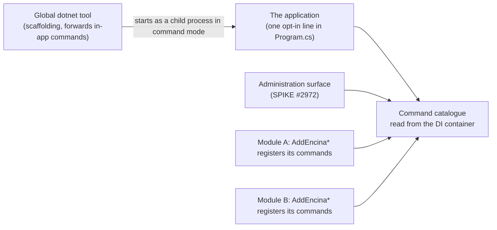

# About the command contract for module authors (spike #2605)

This page is for a module author, someone who maintains an Encina package and wants to know how that package will contribute operator commands to `encina` and to the administration surface, and why the contract is shaped the way it is. It explains the decisions of [ADR-058](../architecture/adr/058-encina-cli-command-architecture.md); it is not a how-to and not a reference.

**Status:** the contract is **not built yet**. Nothing named below exists in `src/`, and the type names used here (`IEncinaCommand`, `AddEncinaCommand<T>()`, `IOutboxAdministration`, `ISagaAdministration`) are **illustrative**: the implementation plan of the command-host child of [EPIC #2614](https://github.com/dlrivada/Encina/issues/2614) (to be opened) fixes the final names. What is settled is the shape and the rules. **Issue:** [#2605](https://github.com/dlrivada/Encina/issues/2605). Encina is pre-1.0, so none of this is a stable API.

## 1. The picture

`Encina.Cli` today only scaffolds files (`new`, `generate`, `add`). Operator commands (inspect the outbox, replay a dead letter, erase a data subject) need the application's real container, configuration and providers. ADR-058 therefore splits the tool in two modes that share one command contract, and adds a third consumer of the same contract:

A module author writes a command once. The console host and the administration surface read the same catalogue, so the module does not know which one invoked it.

## 2. How a module contributes commands

The decision (D7 in ADR-058) is that a module's own `AddEncina*` method registers its commands in DI, for example an `IEncinaCommand` implementation added through `AddEncinaCommand<T>()` (illustrative). Two consequences follow:

- **Only registered modules contribute.** A package that is referenced but never registered adds no command. This is the pay-for-what-you-use rule of [AGENTS.md](../../AGENTS.md) section 1, and it is why unrestricted assembly scanning was excluded.
- **Registration is tested like any other.** The module's DI test builds the provider with `ValidateOnBuild` and `ValidateScopes` and proves that every command and every dependency it resolves is registered (AGENTS.md section 3, registration completeness).

A source-generated registry may be added later on top of this; it would not change the contract.

## 3. Read-only and mutating commands

The contract distinguishes the two, because they carry different safety rules.

| Kind | Rules (ADR-058) |
| --- | --- |
| Read-only (for example listing or inspecting) | No confirmation and no dry-run. Still fails closed when it touches tenant data. Reads of personal data go to the read audit (`IReadAuditStore`) when it is enabled. |
| Mutating (for example purge, replay, erase) | Dry-run by default; it executes only on explicit confirmation. Every execution is audited before it runs, and an audit failure fails the command. |

The plans decide how the contract expresses dry-run (D11), the confirmation mechanism (D12: prompt, flag or typed token) and whether dry-runs are themselves audited. That a mutating command is dry-run by default and needs confirmation is already settled, because EPIC #2614 and the context of #2605 require it.

## 4. Identity and tenant: what a command can rely on

A command never reads a tenant or an operator from the operating system. ADR-058 D14 fixes where they come from, and a module author can rely on this:

- The operator has logged in against **the application's own identity provider** (the OAuth 2.0 Device Authorization Grant is preferred; a password prompt is a last resort). Encina does not become an identity provider. With no provider configured, the command is denied.
- Unattended automation uses client credentials with its own service identity, and the audit records it as automation.
- The tenant is an explicit `--tenant`, and the authenticated identity must have access to it. A missing tenant, or no access, denies the command: the gate fails closed (AGENTS.md section 3).
- The operating-system user is audit context only, never the identity.

The same identity model serves the console, the administration surface and the web, so a command written for one is not weaker on another. Why the earlier proposal of using the operating-system user was replaced is in the ADR, section "Alternatives considered".

## 5. Audit

The rules, all settled by existing decisions ([ADR-018](../architecture/adr/018-cross-cutting-integration-principle.md) function 12, [ADR-036](../architecture/adr/036-three-audit-stores.md), [ADR-050](../architecture/adr/050-modules-may-require-modules.md)):

- Every mutating execution is recorded through `IOperationAuditStore` (`RecordAsync` returns a `ValueTask<Either<EncinaError, Unit>>`).
- The record is written before the operation and awaited; if the write fails, the command does not run.
- The entry holds the error code or exception type, never `EncinaError.Message`.
- Outside Development a persistent audit store is required; without one, startup validation fails, and the only exit is an explicit, logged opt-out.

## 6. Administration interfaces, kept apart from the runtime stores

Runtime stores such as `IOutboxStore` and `ISagaStore` serve the processors and have no list, purge or inspect operations. ADR-058 D21 does not grow them. Operator operations live in separate administration interfaces (illustrative: `IOutboxAdministration`, `ISagaAdministration`), with these properties that matter to a module author:

- A command depends on the administration interface and on no provider type, so it works on every provider (AGENTS.md section 5).
- A module whose pattern is provider-dependent supplies the administration implementation for all 10 database providers, as it does for its store.
- The administration interfaces are registered only when command hosting or the administration surface is enabled, so an application that does not use them never has purge or replay in its container, and business code cannot reach them by accident.

## 7. In command mode, what runs

Processors and other hosted services do not run in command mode, so an `outbox purge` never competes with a running processor in the same process. The requirement validators of [ADR-050](../architecture/adr/050-modules-may-require-modules.md) are hosted services too and still run, so a command never starts on an invalid composition. The `describe` and `doctor` commands judge only Encina's own registrations and configuration, not the application's own code (maintainer principle C1b).

## 8. What a module's tests must cover

From AGENTS.md section 9 (decision D27 of the ADR):

- Unit and guard tests for the commands, executing real code.
- Integration tests on real databases for every provider-dependent command, using the shared `[Collection]` fixtures; never a `.md` justification in their place.
- Contract tests for the public contract, because it is public API (D29).
- A DI test with `ValidateOnBuild` and `ValidateScopes` for the registration (section 2).

## 9. What is not decided here

Left to the implementation plans: the final type names, the package name and shape (D9), locating the startup project (D4), the dry-run and confirmation expression (D11, D12), error rendering (D23), command naming and collisions (D24), output format and exit codes (D25), the handshake tests (D28) and whether a prototype is needed (D36). The remote administration surface (its package, threat model, authentication, authorization and audit) is the subject of SPIKE [#2972](https://github.com/dlrivada/Encina/issues/2972); this page will need an update when that spike is decided.

For the decision record and the alternatives that were weighed, read [ADR-058](../architecture/adr/058-encina-cli-command-architecture.md).
