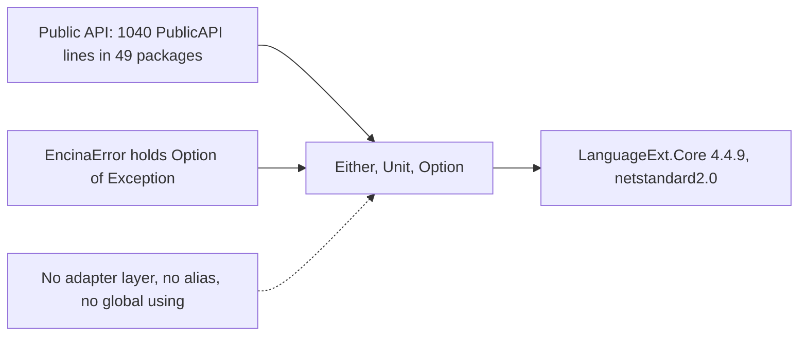
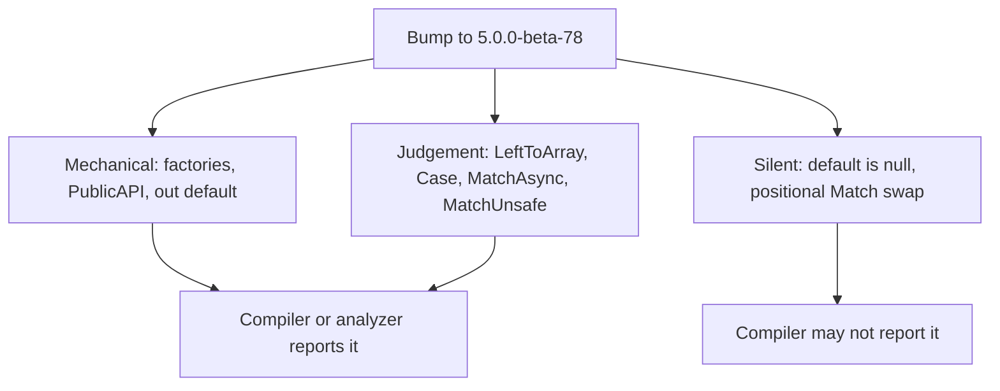

# LanguageExt v5 spike (#1899)

This page is for a maintainer or contributor who has to decide which LanguageExt version Encina 1.0 ships on: it records what was measured about LanguageExt v5, about how Encina uses LanguageExt, and about a throwaway migration of the core package, so the decision starts from evidence. It states measurements and the findings drawn from them, and recommends nothing; the options and the decision are in [ADR-051](../architecture/adr/051-languageext-version-for-1-0.md).

**Decision:** [ADR-051](../architecture/adr/051-languageext-version-for-1-0.md) (Accepted, option D).

**Status:** measured spike, 2026-10-21. **Issue:** [#1899](https://github.com/dlrivada/Encina/issues/1899). **Decision record:** [ADR-051](../architecture/adr/051-languageext-version-for-1-0.md) (Proposed).

## 1. Question and time box

[ADR-001](../architecture/adr/001-railway-oriented-programming.md) makes `Either<EncinaError, T>` from LanguageExt the return type of every Encina operation, and [ADR-004](../architecture/adr/004-reject-mediator-result.md) lists "LanguageExt makes breaking changes to Either" as a known risk. The spike asks what that risk looks like today: is v5 a viable base for 1.0, what would moving cost, and what can be improved on v4.4.9 whichever way the decision goes.

Three pieces of work fed this page, all done on 2026-10-21:

| Piece | What it covered |
| --- | --- |
| v5 health research | Release status, maintenance, target frameworks, breaking changes, downloads (GitHub and NuGet REST APIs) |
| Usage inventory | Every LanguageExt use in `src/` on `origin/main`, counted by regex over `src/**/*.cs` (2951 files) and over the `PublicAPI.*.txt` files |
| Pilot migration | `LanguageExt.Core` 4.4.9 to 5.0.0-beta-78 on `src/Encina` only, on a local throwaway branch ("pilot branch, not merged"), plus the core subset of the unit tests and two benchmark classes |

Pilot machine: i9-13900KS, .NET SDK 10.0.402, runtime 10.0.13.

## 2. LanguageExt v5 health

Read on 2026-10-21 through `gh api repos/louthy/language-ext/...` and the NuGet flat container, registration and search APIs.

### 2.1 Release status

| Fact | Value |
| --- | --- |
| Latest v5 | `5.0.0-beta-78`, published 2026-10-09. The release note says only "Minor release to fix issue #1562" (`Arr` indexing) |
| Previous beta | `5.0.0-beta-77`, published 2025-12-30: a gap of about 9.3 months between betas |
| Stable or release candidate | None. Every 5.x version on NuGet is `5.0.0-beta-N` (542 versions in total across all lines) |
| v4 line | Last version `4.4.9` (2024-06-26); listed and not deprecated on NuGet |
| v4 maintenance | The `v4-latest` branch has 0 commits since 2025-12-30: v4 is frozen |
| Notes status | The v5 migration notes are headed "WORK IN PROGRESS" and end with an open TODO list (Pipes operators removed temporarily, `Index` handling in collection indexers, MonoidK versus Alternative on collections, Foldable overrides for sequences) |
| Roadmap | No dated roadmap or 5.0 stable date found in the repository, README, release notes or web search; the only in-repo statement is that alpha/beta versioning exists "so we can release 5.0.0 when done" |

The issue text said beta-77 was the latest with nothing since; that was out of date, beta-78 exists.

Sources: `https://api.nuget.org/v3-flatcontainer/languageext.core/index.json`, `https://api.github.com/repos/louthy/language-ext/releases/tags/v5.0.0-beta-78`, `gh api repos/louthy/language-ext/commits?sha=v4-latest&since=2025-12-30T00:00:00Z`.

### 2.2 Maintenance and bus factor

| Fact | Value |
| --- | --- |
| Default branch | `main`, which is the v5 line (there is no `v5` branch) |
| Commits on `main` since 2025-12-30 | 18; last one 2026-10-09; authors louthy and pikammmmm |
| Commits 2025-06-30 to 2026-10-21 | 100 (the API page cap, so a lower bound): louthy 98, pikammmmm 1, ExtraClock 1 |
| Issues opened since 2026-04-21 | 3; one issue closed in that window |
| Contributors by commits | louthy 2609, TysonMN 103, blakeSaucier 82, StefanBertels 51, bmazzarol-bunnings 18, others fewer than 15 |
| Bus factor | 1: in the last 15 months essentially one person commits |
| Repository | 7,083 stars, 18 open issues and pull requests (GitHub counter) |

Source: `gh api repos/louthy/language-ext/contributors`, `.../commits`, `.../issues?state=all&since=2026-04-21...`. The author frames v5 as a deliberate hard break ("my '.NET Framework to .NET Core' moment").

### 2.3 Target frameworks and AOT

| Package | Target framework | Dependencies |
| --- | --- | --- |
| `LanguageExt.Core` 5.0.0-beta-78 | `net10.0` only | none |
| `LanguageExt.Core` 5.0.0-beta-54 (2025-05-08) | `net8.0` | not recorded |
| `LanguageExt.Core` 4.4.9 | `.NETStandard2.0` | 10 (for example `Microsoft.Bcl.AsyncInterfaces` 7.0.0, `System.Reflection.Emit`, `System.Linq.Queryable`) |

- v5 will not support netstandard: the maintainer confirmed in issue #1524 that v5 relies on static abstract interface members. Encina is .NET 10 only ([AGENTS.md](../../AGENTS.md) section 1), so the target framework is not a constraint.
- Neither v4 nor v5 sets `IsTrimmable`, `IsAotCompatible` or `EnableTrimAnalyzer` in its project file. v4 depends on `System.Reflection.Emit`; v5 has no dependencies but carries no AOT annotations, so trim and AOT safety of the package itself is unverified (see section 8 for what the pilot could check).

Source: `https://api.nuget.org/v3-flatcontainer/languageext.core/5.0.0-beta-78/languageext.core.nuspec` and `.../4.4.9/languageext.core.4.4.9.nuspec`.

### 2.4 Adoption

Downloads from the NuGet search API on 2026-10-21 (`https://azuresearch-usnc.nuget.org/query?q=packageid:languageext.core&prerelease=true&semVerLevel=2.0.0`):

| Version | Downloads |
| --- | --- |
| 4.4.9 | 10,029,610 |
| 5.0.0-beta-77 | 49,239 |
| 5.0.0-beta-54 | 84,142 |
| 5.0.0-beta-78 | 0 (published 12 days earlier) |
| All versions | 48,984,105 |

The ratio of 4.4.9 to beta-77 is about 200 to 1. No v4-versus-v5 performance claim exists in the v5 notes, README or release notes; the repository's benchmark project covers only HashMap, HashSet and List operations.

## 3. What Encina uses

Counted on 2026-10-21 over `src/**/*.cs` (excluding `bin`, `obj`, `.backup`; 2951 files) on `origin/main` of that day; a re-count on a later `origin/main` gave figures within 1% (for example 5146 `Either<`), so treat them as approximate. The installed version is `LanguageExt.Core` 4.4.9 (`Directory.Packages.props:11`) referenced by 30 `src/*.csproj`. Counts are raw regex hits, not Roslyn-resolved symbols; `Either`, `Unit` and `Prelude` figures are reliable (Encina has no other `Either` or `Unit`), the others are upper bounds.

### 3.1 The surface is narrow

| Figure | Value |
| --- | --- |
| Files with `using LanguageExt` | 830 of 2951, in 82 packages |
| Files with `using static LanguageExt.Prelude;` | 297 |
| `Either<` occurrences | 5138 in 811 files |
| `Option<` occurrences | 467 in 123 files |
| `Unit` (word) | 2639 in 424 files |
| Named `.Match(Left:` / `.Match(Right:` | 459 in 215 files |
| `.MatchAsync(` | 31 in 18 files |
| `.LeftToArray()` / `.RightToArray()` | 117 in 17 files |
| `.Case` | 8 in 3 files |
| `.BiMap(`, `EitherAsync`, `Seq<`, `Arr<`, `Lst<`, `HashMap<`, `Try<`, `Aff<`, `Eff<`, `Fin<` | 0 |
| Test files with `using LanguageExt` (outside `src/`) | 768 |

Encina uses `Either<EncinaError, T>`, `Unit` and `Option<T>`, plus the Prelude helpers `Left`, `Right`, `Some`, `None`, `unit` and `Optional`. It uses no collections, effects, `Try`, `Fin` or `LanguageExt.Common.Error`. There is no global using and no type alias.

### 3.2 Public API

Command: for each `src/**/PublicAPI.Shipped.txt` and `PublicAPI.Unshipped.txt` (177 files, 15,480 non-comment lines), count lines containing the literal `LanguageExt.`.

| Figure | Value |
| --- | --- |
| Lines mentioning `LanguageExt.` | 1040 (6.7% of 15,480), in 49 packages |
| Token occurrences | `LanguageExt.Either` 1077, `LanguageExt.Unit` 227, `LanguageExt.Option` 41 |
| Largest packages (lines) | Encina 184, DomainModeling 86, Security.ABAC 75, Compliance.Anonymization 53, Messaging 51 |

Only `Either`, `Unit` and `Option` appear in the public API. `EncinaError` is a `readonly record struct` holding an `Option<Exception>` (`src/Encina/Errors/EncinaError.cs`), so a LanguageExt type is also part of the error contract. There is no adapter layer: the only wrappers are extension helpers such as `EitherExtensions` in `src/Encina.DomainModeling/EitherExtensions.cs` and the assertion helpers of the testing packages.

## 4. Pilot migration

The pilot branch is kept locally, unpushed, as a throwaway; its figures come from the commands stated in each section. Setup: `LanguageExt.Core` 4.4.9 changed to 5.0.0-beta-78 on a local branch of `origin/main` ("pilot branch, not merged"), scope `src/Encina` plus a core subset of `tests/Encina.UnitTests`. Edits were made with the editor tools; three bulk rewrites were delegated to `mechanical-fixer`.

### 4.1 Compile breaks

First build after the bump: `dotnet build src\Encina\Encina.csproj -c Release -v q -clp:NoSummary`, 515 distinct errors, 3.2 s.

| Code | Count | Cause | Example |
| --- | --- | --- | --- |
| RS0016 | 178 | PublicAPI: `Either<..>` is now a reference type and signatures need `!` | `PublicAPI.Unshipped.txt` |
| RS0017 | 178 | The old PublicAPI line no longer matches | same |
| CS1955 | 78 | `Either<L,R>.Left(x)`: `Left` is now a nested class, not invocable | `Sharding/Routing/DirectoryShardRouter.cs:74` |
| CS1503 | 57 | `Either<L,R>.Right(x)` binds to `Right` (Action overloads); also `EncinaError?` to `EncinaError` | `Sharding/Routing/CompoundShardRouter.cs:127` |
| CS1061 | 16 | `Option<Exception>.MatchUnsafe` (8), `Either.Case` (6), `Either.MatchAsync` (2) removed | `Core/Encina.cs:134`, `Core/Encina.cs:94` |
| CS8625 | 5 | `error = default;` for `out Either<..>` now means null | `Pipeline/EncinaRequestGuards.cs:22` |
| CS0201 | 2 | Positional `Match(_ => (EncinaError?)null, err => err)`: v5 order is (Left, Right) | `Dispatchers/Encina.RequestDispatcher.cs:138` |
| CS8603 | 1 | Null returned from a `Match` flows into a class | `Sharding/ReferenceTables/PollingRefreshDetector.cs:91` |

`Either<L,R>.Left(x)` and `.Right(x)` need the same fix but raise two different diagnostics.

### 4.2 v4 to v5 mapping in `src/Encina`

33 files changed, +168 / -167 lines in `.cs` (`git diff origin/main...HEAD --numstat -- 'src/Encina/*.cs'` on the pilot branch).

| Pattern | v4 | v5 | Sites (lines) | Done by |
| --- | --- | --- | --- | --- |
| Static factories | `Either<A,B>.Left(x)`, `.Right(x)` | `Either.Left<A,B>(x)`, `Either.Right<A,B>(x)` | 137 lines, 25 files | `mechanical-fixer`, 213 s wall |
| `Option.MatchUnsafe` | `opt.MatchUnsafe(Some:, None:)` | `opt.Match(Some:, None:)` | 8 lines, 8 files | 8 edits by hand |
| `.Case` | `r.Case is IRequestContext c ? .. : (EncinaError)r.Case` | `r is Either<EncinaError,IRequestContext>.Right { Value: var c } ? .. : ((..Left)r).Value` | 6 lines, 2 files | 3 edits |
| `Either.MatchAsync` | `MatchAsync(RightAsync:, Left:)` | `Match(Right: async .., Left: .. => Task.FromResult(..))` | 3 lines, 2 files | 3 edits |
| `out Either` default | `error = default;` | `error = default!;` | 5 lines, 1 file | 1 replace-all |
| Positional `Match` | `Match(_ => null, err => err)` | `Match(Right: _ => .., Left: err => err)` | 1 | 1 edit |
| Nullable struct to `Left<L,R>` | `Left<EncinaError,Unit>(holder.Error)` | `.Error.Value` | 1 | 1 edit |
| Null into `Match` result | `Right: _ => null` | `Right: _ => null!` | 1 | 1 edit |
| PublicAPI | `...Either<A, B>>` | `...Either<A, B>!>` | 181 lines, 1 file (`src/Encina/PublicAPI.Unshipped.txt`, +181 / -181) | `mechanical-fixer`, 351 s wall |

About 137 of the changed `.cs` lines are the factory rewrite; about 25 lines are cases that need judgement (137 + 25 = 162 of the 168 added lines; the rest are small variants). `dotnet format analyzers --diagnostics RS0016 RS0017` changed nothing, so the PublicAPI churn has no automatic fix. `PublicAPI.Shipped.txt` for Encina did not change.

### 4.3 Effort and extrapolation

Measured on the core: `src/Encina` reached 0 errors after the edits above, 5 commits spanning 19 minutes of edit commits, about 10 minutes of wall time for the first pass excluding PublicAPI, and about 1.5 hours for the whole session including reading the API by reflection, the probe app and the test and benchmark setup. For the tests, 135 compile errors in 24 files (CS1503 88, CS1061 28, CS1955 19) were fixed with 207 s of `mechanical-fixer` time.

Extrapolation method: scale the core's measured ratio by the usage inventory's totals. The ratios are crude because the core's Sharding code is heavy on `Either` factories; this is an estimate, not a measurement.

| Item | Core measured | Inventory total | Scaling | Estimated total |
| --- | --- | --- | --- | --- |
| Source `.cs` lines | 168 lines per 519 `Either<` occurrences (0.32) | 5,138 `Either<` in 811 files | x0.32 | about 1,650 lines (upper-ish) |
| Factory-call sites | 137 per 519 | 5,138 | x0.26 | about 1,350 sites |
| PublicAPI lines | 181 of 184 Encina lines (98%) | 1,040 lines in 49 packages | x0.98 | about 1,020 lines |
| `LeftToArray` / `RightToArray` | 0 in the core | 117 in 17 files; 82 `LeftToArray` and 32 obsolete `RightToArray` seen downstream | one each, with reasoning | about 120 judgement edits |
| `MatchAsync` / `MatchUnsafe` | 3 and 8 | 31 `MatchAsync` in 18 files; 7 `MatchUnsafe` seen downstream | n/a | about 40 judgement edits |
| Test files | 24 of about 135 included core test files edited (18%) | 768 test files with `using LanguageExt` | x0.18 | about 140 files, about 800 lines |
| Agent edit time | about 19 minutes for about 330 lines | about 3,500 lines | linear | about 3.5 hours, plus at least one extra build cycle per package (106 `src/` projects: 30 reference `LanguageExt.Core` directly, 82 use it in source, 49 expose it in PublicAPI) |

The mechanical part (factories, PublicAPI) is linear and tool-friendly; the judgement part (`LeftToArray` extraction, `MatchAsync`, `Case`, async `Match`) is about 160 sites that need individual reading. No estimate in person-days was derived.

### 4.4 Downstream breaks

Command: `dotnet build Encina.slnx -c Release -v q -clp:NoSummary` after the core fix, 11.8 s. 438 errors reported, 435 distinct. The build stops at failing layers, so this is a lower bound: dependents of the failing projects were skipped.

| Project | Distinct errors |
| --- | --- |
| Encina.Messaging | 129 |
| Encina.Compliance.Anonymization | 108 |
| Encina.Compliance.AIAct | 61 |
| Encina.Compliance.Attestation | 34 |
| Encina.Security.Encryption | 32 |
| Encina.Compliance.GDPR | 30 |
| Encina.Compliance.PrivacyByDesign | 22 |
| Encina.DomainModeling | 16 |
| Encina.Security | 2 |
| Encina.Refit.Benchmarks | 1 |

10 projects failed in this pass. By code: RS0016 137, RS0017 137, CS1061 103 (82 missing `LeftToArray`, 12 `MatchAsync`, 7 `MatchUnsafe`, 2 `Case`), CS0618 32 (obsolete `RightToArray`, warnings as errors), CS1503 11, CS1955 6, CS0201 2, CS0266 2, CS8603 2, CS8625 2, CS8600 1.

### 4.5 PublicAPI churn

| Figure | Value |
| --- | --- |
| Lines changed in `src/Encina/PublicAPI.Unshipped.txt` | 181 added, 181 removed |
| Cause | `Either<..>` is a class in v5 and prints as `Either<..>!` |
| Public surface effect | Every public signature returning `Either`, including `IEncina.Send/Publish`, `IPipelineBehavior` and `ValueTask<Either<EncinaError,..>>`, now exposes a reference type: a value is allocated per Right or Left, and `default` is null |

### 4.6 Tests

The test, benchmark and AOT figures in sections 4.6 to 4.8 are one-off measurements from a throwaway pilot branch that was not pushed; the raw logs are not retained in the repository, so they cannot be re-run from a clean checkout.

The full `tests/Encina.UnitTests` has 102 project references to packages that no longer compile, so it could not be built. The pilot used a throwaway project linking the `Core`, `Dispatchers`, `Pipeline` and `Sharding` folders and referencing only `src/Encina`; about 35 of 170 files that need other packages were excluded (including `Core/EncinaTests.cs`).

| Figure | Value | Command |
| --- | --- | --- |
| Result on v5 for the subset | 1974 passed, 0 failed, 0 skipped (2 s) | `dotnet test tests\Encina.CoreUnitTests\Encina.CoreUnitTests.csproj -c Release --no-build` |
| Same subset on v4 | not run (the `src/Encina` fixes use v5-only API) | n/a |

The 35 excluded files were not exercised on v5.

### 4.7 Benchmarks

Only `MediatorBenchmarks` and `StreamRequestBenchmarks`, through a throwaway project referencing only `src/Encina` (the full `Encina.Benchmarks` project references about 25 packages that do not compile on v5). BenchmarkDotNet 0.15.8, ShortRun (3 warmup, 3 iterations, 1 launch), one run each: differences under about 20 to 30% are within noise.

Command: `dotnet run -c Release --no-build --project tests\Encina.BenchmarkTests\Encina.Benchmarks.CoreOnly\Encina.Benchmarks.CoreOnly.csproj -- --job short --filter '*' --artifacts artifacts\performance\{v4|v5}`.

| Benchmark | v4 mean | v5 mean | v4 allocated | v5 allocated |
| --- | --- | --- | --- | --- |
| Publish_Notification_WithMultipleHandlers | 1.849 us | 1.416 us | 4.2 KB | 3.81 KB |
| Send_Command_WithInstrumentation | 2.558 us | 1.850 us | 4.45 KB | 4.66 KB |
| Stream_SmallDataset_10Items | 4.231 us | 3.223 us | 11,584 B | 11.33 KB |
| Stream_MediumDataset_100Items | 30.688 us | 39.026 us | 74,225 B | 74.61 KB |
| Stream_LargeDataset_1000Items | 323.976 us | 217.703 us | 700,633 B | 707.43 KB |
| Stream_WithPipelineBehaviors | 21.617 us | 18.568 us | 41,953 B | 42.94 KB |
| Stream_MaterializeToList_100Items | 30.380 us | 25.073 us | 90,441 B | 106.07 KB |
| Stream_CountOnly_NoMaterialization | 27.619 us | 25.095 us | 74,225 B | 74.61 KB |
| Stream_WithCancellation_EarlyExit | 55.363 us | 43.162 us | 90,001 B | 90.02 KB |
| Stream_DirectHandlerInvocation_NoEncina | 1.407 us | 1.531 us | 400 B | 2.7 KB |

Observed: means moved in both directions, inside the noise band (error columns up to 150% of the mean on some rows). Allocations are about flat on `Send` (+0.2 KB) and `Publish`, and rise for `Stream_MaterializeToList_100Items` (+15.6 KB, about 17%) and for the direct-handler loop that bypasses Encina (400 B to 2.7 KB). The pilot's reading of the last rise (an inference, not separately measured) is that `Either` was a struct in v4 and is an abstract class in v5, so each yielded item becomes a heap object.

### 4.8 Analyzer and AOT warnings

| Check | v4 (`origin/main`) | v5 (pilot) | Command |
| --- | --- | --- | --- |
| Warnings in the `src/Encina` Release build | 0 | 0 after the fixes | `dotnet build src\Encina\Encina.csproj -c Release` |
| IL2xxx / IL3xxx with AOT analyzers | 0 | 0 | `dotnet build src\Encina\Encina.csproj -c Release -t:Rebuild -p:IsAotCompatible=true`, then `Select-String 'IL[23]\d{3}'` |
| New CA warnings | n/a | 0 | same |

The analyzer checks Encina's own code only. Neither LanguageExt package is annotated for trimming or AOT, so 0 warnings says nothing about the library. A first AOT baseline reported success in 2 s, probably a no-op up-to-date build, and was redone with `-t:Rebuild` on a clean `origin/main` worktree (also 0).

## 5. Silent-behaviour hazards

These are the changes the compiler does not always report. Each was checked with a probe app (`dotnet run probe.cs` with `#:package LanguageExt.Core@5.0.0-beta-78`) and by reflection over `LanguageExt.Core.dll`.

| Hazard | v4 | v5 beta-78 | Detected by |
| --- | --- | --- | --- |
| `default(Either<L,R>)` | a struct with a bottom state | `null` (abstract class): `d.IsRight` and `d.Match(...)` throw `NullReferenceException`; no bottom state exists | Nullable warnings only (CS8625, 5 sites in `Pipeline/EncinaRequestGuards.cs`); those `out` values are read only on the failure path |
| Positional `Match(a, b)` | (Right, Left) order | (Left, Right) order | CS0201 or CS1503 when the lambda types differ; **compiles silently when both sides have the same type**. The core had one positional call, found as CS0201; none remain in `src/Encina` by search |
| `BiMap` argument order | (Right, Left) | `BiMap(Func<L,L2>, Func<R,R2>)`; probe: `Left("bad").BiMap(x => x + "!", x => x + 1)` gives `Left(bad!)` | n/a: Encina has 0 uses |
| Same-type conversion | n/a | `Either<Unit,Unit> x = unit` is a hard CS0457 ambiguity | Compiler (error) |

Behaviours that stayed the same in the probe: implicit conversion from `R` and `L` (and from `Pure<R>` and `Fail<L>`), equality of two Rights with equal values, `Option<A>` as a `readonly struct` (so `EncinaError` still compiles with `Option<Exception>`).

Removed or changed members seen in the probe: `.Case` is gone (replaced by pattern matching on the nested `Either<L,R>.Right` and `.Left` types, which expose `Value`, `IsLeft` and `IsRight`); `LeftToArray()`, `LeftAsEnumerable()` and `LeftToList` are gone; `RightToArray()` is `[Obsolete("Use ToArray() instead")]`; `Option.MatchUnsafe` is gone; `Either.MatchAsync(RightAsync:, Left:)` is gone; the test helper `LeftAsEnumerable()` (28 uses in the core tests) maps to `.Swap().AsEnumerable()`. The v5 notes also list `EitherAsync`, `TryAsync`, `OptionAsync`, `Try`, `Result` and `EitherUnsafe` as removed; Encina uses none of them (section 3.1).

## 6. Idiomatic-v4 findings

The usage audit found patterns that are untidy on v4.4.9; all but the async row are also v5-removed or v5-changed members, so cleaning them up helps either decision. The async row is different and is explained in its cell. Counts are regex-based and approximate; every example was read at its line.

| Pattern | Count (occurrences / files) | Why it matters | Verified example |
| --- | --- | --- | --- |
| `LeftToArray()[0]` / `RightToArray()[0]` extraction after an `IsLeft` check | 117 / 17 | Array allocation plus indexing; the members are gone or obsolete in v5 | `src/Encina.DomainModeling/ResultMapper.cs:204,274`; `src/Encina.Messaging/DeadLetter/DeadLetterOrchestrator.cs:319` |
| `.IsLeft` / `.IsRight` followed by `Match`, `IfRight` or `LeftToArray` to extract | 36 / 26 (multi-line pattern) and 73 / 38 (second pattern) | Double inspection; one `Match` or `Bind` does the job | `src/Encina/Dispatchers/Strategies/ParallelDispatchStrategy.cs:117,124-126` |
| `Match(Right: x => x, Left: _ => default!/null!)` to extract | 19 / 17, plus 21 / 19 for `Left: _ => default/null` | Relies on a prior check or a null value | `src/Encina/Sharding/ReferenceTables/PollingRefreshDetector.cs:79-81` |
| `.Case is X` / `(EncinaError)x.Case` | 8 / 3 | Untyped object; removed in v5 | `src/Encina/Core/Encina.cs:94,96,109,111` |
| Async matching: `Match(async ...)` (8 / 4) versus `MatchAsync` (31 / 18) | 8 / 4 and 31 / 18 | On 4.4.9 `MatchAsync` is the idiomatic call, but v5 removes `Either.MatchAsync` and the v5 form is `Match(async ...)`; Encina also hand-rolls `BindAsync`, `MapAsync` and `TapAsync` (Encina code, not a v5 removal). This tension is resolved by the [ADR-051](../architecture/adr/051-languageext-version-for-1-0.md) decision, not by a cleanup on 4.4.9 | `src/Encina.EntityFrameworkCore/TransactionPipelineBehavior.cs:162-174`; `src/Encina.DomainModeling/EitherExtensions.cs:259-340` |
| `Right(Unit.Default)` / `Right(unit)` noise | 174 / 56, 44 / 26 and 62 / 35 in three forms | One constant would remove it; not LanguageExt-specific | `src/Encina/Dispatchers/Encina.NotificationDispatcher.cs:72` |
| Boolean `Match(Right: _ => true, Left: _ => false)` | 5 / 4 | Equivalent to `.IsRight` | Count from the regex only; no site was verified at a line |

`Match(..., Left: x => throw ...)` at startup boundaries (116 / 51) is intentional under [ADR-001](../architecture/adr/001-railway-oriented-programming.md) and is not a finding; about 50 are test-assertion helpers where the throw is the point.

## 7. Unknowns

| Unknown | Why it is open |
| --- | --- |
| Date of a stable 5.0 | No roadmap statement found; paullouth.com and GitHub Discussions were not reachable through the searches used |
| Whether the removal list changes before stable | The v5 notes are marked "WORK IN PROGRESS" |
| Whether beta-78 breaks anything versus beta-77 | Its release note lists only the `Arr` fix; nothing else was diffed |
| Full v5 member surface of `Either`, `Option`, `Seq` and `Prelude` against v4.4.9 | Reflection with `MetadataLoadContext` failed in the shell; only source on `main`, the notes and the probe were used |
| Trim and AOT safety of the library | No annotations in either line, and the analyzer checks Encina's code only |
| Tests outside the core subset on v5 | 35 files, including `Core/EncinaTests.cs`, were excluded from the pilot |
| Benchmarks beyond the core | Only `Send`, `Publish` and stream paths ran, one ShortRun each |
| v4 behaviour of the same test subset | Not run |
| Active contributors outside the maintainer | The commit list was page-capped |

## Related

- [ADR-051](../architecture/adr/051-languageext-version-for-1-0.md): the options and the decision this spike informs
- [ADR-001](../architecture/adr/001-railway-oriented-programming.md), [ADR-004](../architecture/adr/004-reject-mediator-result.md), [ADR-006](../architecture/adr/006-pure-rop-exception-handling.md)
- [SPEC-000](../specifications/SPEC-000-encina-1.0-baseline-and-release-scope.md): the 1.0 boundary
- [Stryker.NET 5.0.0 MTP spike (#1087)](stryker-5-mtp-spike-1087.md): the model for this page
