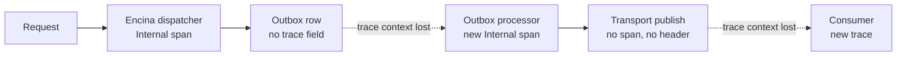

# Observability conventions and cross-boundary trace propagation (spike #1791)

This page is for the maintainer, who has to choose the open points of Encina's observability conventions, and for a contributor who needs the evidence behind them. It records what the code does today at `origin/main` fd19613e1, what [#1791](https://github.com/dlrivada/Encina/issues/1791) claims that the code or the tracker does not support, how the industry handles each point, which points are already settled, and the true dilemmas that remain. It recommends nothing and decides nothing: the issue stays open until the maintainer picks an option for each dilemma, and the decision will get its own ADR (number 054, reserved in [the ADR index](../architecture/adr/index.md#reserved-numbers)).

**Status:** evidence gathered and verified against the worktree at fd19613e1 on 2026-10-22. **Issue:** [#1791](https://github.com/dlrivada/Encina/issues/1791). **Reserved ADR:** 054 (observability conventions and cross-boundary trace propagation), "Reserved, ADR not written". **Source assessment:** [Observability assessment, 2026-10-05](assessments/2026-10-05-observability.md).

**Outcome:** the maintainer decided D1 to D6 on 2026-10-22 (comments on [#1791](https://github.com/dlrivada/Encina/issues/1791)). The decisions are recorded in [ADR-054](../architecture/adr/054-observability-conventions-and-trace-propagation.md); this page keeps the evidence and the options as they stood before the decision.

Pre-1.0, backward compatibility and breaking-change cost are not criteria ([AGENTS.md](../../AGENTS.md) section 1). Where the issue weighs "breaking change" or "backward-compatible if nullable" as a pro or con, that criterion does not apply and is left out below.

## 1. Question

How should Encina name, subscribe and propagate its telemetry, so that one trace follows a request across the dispatcher, the outbox, inbox, scheduling and saga stores, and the transports, and so that every instrument can be found by a single convention?

The issue offers three options: A (W3C context in the outbox only), B (full W3C propagation and naming, no exporters) and C (B plus exporters, dashboards and a test framework). Section 5 shows that most of what separates them is either settled by a rule or already tracked by its own issue, which leaves the dilemmas of section 6.

## 2. What the code does today

Counts come from scanning `src/**/*.cs` at fd19613e1 on 2026-10-22; the line numbers are in the table.

| Area | What the code does | Evidence |
| --- | --- | --- |
| Sources and meters | 57 `ActivitySource` constructions (49 distinct names) and 56 `Meter` constructions (30 distinct names) in 36 packages. Sources are named `Encina` or `Encina.<Feature>`; meters are `Encina` (27 constructions) or `Encina.<Feature>` (29). No source or meter name is lowercase | `src/Encina/Diagnostics/EncinaDiagnostics.cs:10`, `src/Encina/Diagnostics/IEncinaMetrics.cs:46` |
| Duplicate names | `Encina.Audit`, `Encina.Messaging.Outbox`, `.Inbox`, `.Saga`, `.Scheduling` and `Encina.QueryCache` are created twice (feature package and `Encina.OpenTelemetry` decorator), as different `ActivitySource` instances; `Encina` itself is constructed in three packages (core, Polly, Refit) | `src/Encina.Messaging/Diagnostics/OutboxActivitySource.cs`, `src/Encina.OpenTelemetry/MessagingStores/` |
| What `WithEncina()` subscribes | 20 `AddSource` calls (19 real names and one phantom), `AddMeter("Encina")` and runtime instrumentation. Resource built with `AddService` | `src/Encina.OpenTelemetry/ServiceCollectionExtensions.cs:175`, `:183`, `:213` |
| Phantom subscription | `Encina.Cdc.Sharded` is subscribed but no `ActivitySource` with that name exists in `src/` | `src/Encina.OpenTelemetry/ServiceCollectionExtensions.cs:183` |
| Not subscribed | 30 of the 49 source names (the compliance, security, audit-store, crypto-shredding, message-encryption, transaction and CDC cache invalidation sources) and 29 of the 30 meter names | same file; names in each package's `Diagnostics/` folder |
| Exporters | None configured. The `OpenTelemetry.Exporter.Console` and `OpenTelemetry.Exporter.OpenTelemetryProtocol` packages are referenced but no code uses them | `src/Encina.OpenTelemetry/Encina.OpenTelemetry.csproj:23-24` |
| W3C propagation | None. No `traceparent`, `tracestate`, `Baggage`, `ActivityLink` or `DistributedContextPropagator` use in `src/` (the only `ActivityContext` hits are unrelated Blazor circuit types) | search of `src/*.cs` |
| `Activity.Current` | Read only to derive a correlation id string | `src/Encina/Core/RequestContext.cs:194` |
| Persisted message shape | `IOutboxMessage`, `IInboxMessage`, `IScheduledMessage` and `ISagaState` have no trace, header or request-context field | `src/Encina.Messaging/Outbox/IOutboxMessage.cs:21` and the sibling interfaces |
| Span kinds | Every `Encina.Messaging` span is `ActivityKind.Internal`. In the whole of `src/` there is one `Producer` (CDC cache invalidation), one `Server` (DPIA) and `Client` spans in Refit, Secrets and Sharding; no `Consumer` | `src/Encina.Messaging/Diagnostics/OutboxActivitySource.cs:42,61`, `src/Encina.Cdc/Caching/Diagnostics/CacheInvalidationActivitySource.cs:128` |
| Transports | None of the 10 transports (RabbitMQ, AzureServiceBus, AmazonSQS, Kafka, NATS, Redis.PubSub, MQTT, InMemory, gRPC, GraphQL) injects or extracts W3C headers, creates activities or emits metrics | search of each `src/Encina.<Transport>/` package |
| Databases, caches, locks, schedulers | No spans or metrics in the ADO, Dapper, MongoDB, caching, distributed-lock, Hangfire and Quartz packages. Instrumented: the built-in scheduling processor, EF Core query cache and soft delete, Polly retry (`Encina.Polly`), Refit outbound, and store decorators in `Encina.OpenTelemetry` | `src/Encina.Polly/Diagnostics/RetryTelemetry.cs:15`, `src/Encina.Refit/Diagnostics/OutboundTelemetry.cs:17` |
| Error content in telemetry | No `SetStatus`, tag or event passes `EncinaError.Message` or `Exception.Message` (scan of `src/`, 0 hits). `ActivityStatusDescriptions` supplies the error code or the exception type name at the call sites that use it. Caller-supplied free-text reason strings still reach the status in some sources (for example `AIActDiagnostics.cs:91` and `CommandActivityPipelineBehavior.cs:146` pass a `failureReason`); that residual is tracked by [#2474](https://github.com/dlrivada/Encina/issues/2474) and [#1788](https://github.com/dlrivada/Encina/issues/1788) | `src/Encina/Diagnostics/ActivityStatusDescriptions.cs:24,35` |
| Health check tags | `ready` is the default tag (`DefaultTags = ["encina", "ready"]`) and appears in 79 files; `live` is never applied by default and appears only in XML documentation | `src/Encina.AspNetCore/Health/HealthCheckBuilderExtensions.cs:32,38` |
| Logs and traces | No `BeginScope` and no `ActivityTrackingOptions` use in `src/` | search of `src/*.cs` |
| Instrument names | 424 instruments with a literal name (scan of `src/**/*.cs` on 2026-10-22 for `.CreateCounter`, `.CreateHistogram`, `.CreateUpDownCounter`, `.CreateGauge` and `.CreateObservable*`, commented lines ignored). 122 start with lowercase `encina.`, 7 with `Encina.`, 295 have no `encina` prefix (for example `abac.*`, `retention.*`, `secrets.*`). 198 end in `_total` or `.total`. Histograms with a unit: 84 are `ms` and 1 is `s`. The first research pass counted 404; the scan method changed, the proportions did not | `src/Encina/Diagnostics/IEncinaMetrics.cs:47-50`, `src/Encina.Messaging/Diagnostics/SchedulingProcessorMetrics.cs` |
| Activity names | Mixed: `encina.outbox.add` (lowercase dotted) against `Encina.Command.<Type>`, `Encina.Retry`, `Encina.Outbound.Send` | `src/Encina.Messaging/Diagnostics/OutboxActivitySource.cs:42` |
| Project count | 106 `src/**/*.csproj` | `git ls-files 'src/*.csproj'` |

## 3. Claims in #1791 that the code or the tracker does not support

The issue text derives from the assessment of 2026-10-05; several claims were true then and changed after, or were mis-copied.

| # | Claim in #1791 | What the evidence shows |
| --- | --- | --- |
| 1 | "Of 108 source projects, 35 have instrumentation (68% gap)" | 106 `src` projects (the assessment itself says 106); 36 packages construct an `ActivitySource` or `Meter` (34 if `Encina.Polly` and `Encina.Refit`, which reuse the source name `Encina`, are excluded). The gap is about two thirds, not 68% |
| 2 | "`WithEncina()` registers ~19 sources" | 20 `AddSource` calls: 19 real plus the phantom `Encina.Cdc.Sharded` (section 2) |
| 3 | "Error messages leak into Activity status ... in 26 files" | Stale for `Message`. [#2134](https://github.com/dlrivada/Encina/issues/2134) (closed, PR #2460, merged 2026-10-17) removed every `.Message` from status and tags and added `ActivityStatusDescriptions`. Still open: [#1788](https://github.com/dlrivada/Encina/issues/1788) (satellite packages), [#1468](https://github.com/dlrivada/Encina/issues/1468) (saga store decorator, whose subject #2134 appears to cover) and [#2474](https://github.com/dlrivada/Encina/issues/2474) (free-text reason strings) |
| 4 | Transports "RabbitMQ, Azure Service Bus, NServiceBus, MassTransit, Redis (Stream, PubSub), Kafka, Amazon SQS, Google Pub/Sub, In-Memory, GraphQL" | NServiceBus and MassTransit are competitors from the assessment's comparison table (MassTransit appears once in a RabbitMQ error string, `src/Encina.RabbitMQ/RabbitMQMessagePublisher.cs:156`); Google Pub/Sub and Redis Streams are planned for v0.15.0, not existing. The 10 real transports are in section 2 and in [AGENTS.md](../../AGENTS.md) section 5; NATS, MQTT and gRPC were missing from the issue's list |
| 5 | "#72 Telemetry exhaustive tests (closed by delivery)" | [#72](https://github.com/dlrivada/Encina/issues/72) is open (milestone v0.19.0) |
| 6 | "#1164 Persist trace context in outbox and inbox" | #1164 persists the request-context envelope (user, tenant, correlation and causation ids), not trace context. It is [SPEC-002](../specifications/SPEC-002-eu-regulatory-readiness.md) REQ-015, milestone v0.18.0, and its comment 3 records it as settled |
| 7 | "#177 ... semantic conventions for RPC attributes; #185 ... for database attributes" | #177 asks for messaging attributes on `MessagingActivityEnricher`; #185 asks for an `ErrorRecordingBehavior`. Its sample writes `error.Message` into the status and tags, which the [AGENTS.md](../../AGENTS.md) rule on `EncinaError.Message` forbids. Neither concerns RPC or database attributes |
| 8 | "#454 Separate liveness and readiness" | #454 is a new `Encina.HealthChecks` package for Kubernetes probes (Post-1.0). The tag split in `HealthCheckBuilderExtensions.cs:32` does not need that package |
| 9 | "Separate health check tags live and ready" in the style of Microsoft | Microsoft documents only a `ready` tag; liveness uses `Predicate = _ => false`. `live` is a community convention (section 4). In Encina `ready` exists; `live` would be added |
| 10 | Option C: wire `AddOtlpExporter` and `WithLogging` in `WithEncina()` | The exporter packages are referenced and unused. The same issue puts collector configuration out of scope, and the assessment recommends keeping exporters out of the library (assessment, "What the comparison implies", finding 7) |
| 11 | "Rename ... `encina.*` prefix, lowercase, seconds, no `_total`" for sources and meters | Source and meter names are PascalCase `Encina.*` (49 and 30 names); the rule the issue quotes applies to instrument names, where 122 of 424 follow the lowercase prefix, 84 histograms use `ms` against 1 `s`, and 198 carry `_total`. See D3 |
| 12 | Effort of "5-7 days" and "10-14 days" | The body carries no evidence for these figures; they are not used here |
| 13 | "no transport, cache, lock, provider or async scheduler emits spans or metrics" | Correct for the 10 transports, caching, lock, ADO, Dapper, MongoDB, Hangfire and Quartz packages; incorrect for the built-in scheduling processor, EF Core query cache and soft delete, Polly retry and Refit outbound |
| 14 | "#906 observability documentation" in the related list | #906 (`docs/features/observability.md`, v0.21.0) is a consumer of the ADR, not a prerequisite |

## 4. Industry practice

Read on 2026-10-22; "not read" marks claims taken from search snippets that must be confirmed before they enter the ADR.

### 4.1 OpenTelemetry semantic conventions

| Topic | Practice | Source |
| --- | --- | --- |
| Messaging stability | All messaging span and client-metric definitions are Development. Instrumentations on the older v1.24.0 names should not switch by default; `OTEL_SEMCONV_STABILITY_OPT_IN=messaging` selects the new names, `messaging/dup` emits both | [Messaging spans](https://opentelemetry.io/docs/specs/semconv/messaging/messaging-spans/) |
| Producer and consumer correlation | Links are the default; parent-child only for single-message scenarios, as opt-in; if a parent is used while inside another span, the ambient span becomes a link. Batches can only use links | same |
| Span kinds | `create` is `PRODUCER`; `send` is `PRODUCER` when its context is the creation context, else `CLIENT`; `receive` is `CLIENT`; `process` is `CONSUMER` | same |
| Span name | `{messaging.operation.name} {destination}` | same |
| Propagation mechanism | The specification attaches a creation context to each message but does not prescribe the mechanism | same |
| Database spans | Stable. Query text is `db.query.text`; parameterised text is collected by default, non-parameterised text only when sanitised. The page does not use `db.statement`. Opt-in values `database` and `database/dup` | [Database spans](https://opentelemetry.io/docs/specs/semconv/database/database-spans/) |
| RPC spans | Release Candidate; opt-in `rpc` and `rpc/dup` | [RPC spans](https://opentelemetry.io/docs/specs/semconv/rpc/rpc-spans/) |
| Names | Lowercase, dot-separated namespaces, snake_case inside a component | [General naming](https://opentelemetry.io/docs/specs/semconv/general/naming/) |
| Metrics | Counters should not append `_total`; units live in metadata, not in the name; durations in seconds (`s`); count units singular in braces such as `{message}` | [General metrics](https://opentelemetry.io/docs/specs/semconv/general/metrics/) |
| Library rule | A library depends on the API only; the application chooses the SDK, configuration and exporters | [Library guidelines](https://opentelemetry.io/docs/specs/otel/library-guidelines/) |

### 4.2 .NET guidance

| Topic | Practice | Source |
| --- | --- | --- |
| Libraries | Rely on `System.Diagnostics.DiagnosticSource` only; only applications reference OpenTelemetry | [Tracing instrumentation](https://learn.microsoft.com/en-us/dotnet/core/diagnostics/distributed-tracing-instrumentation-walkthroughs) |
| `ActivitySource` | Created once, static; hierarchical name based on the assembly name; versioned; one source per sub-component is fine so apps can toggle independently. `StartActivity` returns `null` without a listener | same |
| Links | Set at `StartActivity`, immutable afterwards; 128 links suggested as a limit | same |
| Instruments | Lowercase dotted names with `_` between words; UCUM units; time in seconds as a double; globally unique instrument names; keep tag combinations per instrument under about 1000 and never tag with unbounded ids; `InstrumentAdvice<T>` for buckets | [Metrics instrumentation](https://learn.microsoft.com/en-us/dotnet/core/diagnostics/metrics-instrumentation) |
| `IMeterFactory` | Create meters through the factory in DI code; isolates meters per container and parallel tests; test with `MetricCollector<T>` | same |
| Health checks | Documentation uses only a `ready` tag; the liveness endpoint runs no checks | [Health checks](https://learn.microsoft.com/en-us/aspnet/core/host-and-deploy/health-checks) |

### 4.3 Other .NET libraries

| Library | Source and meter naming | Trace relationship across messages | Source |
| --- | --- | --- | --- |
| NServiceBus | Meters `NServiceBus.Core.Pipeline.Incoming` and siblings (PascalCase) | Send span is the parent of the receive span; publish spans are linked to process spans in a new trace; delayed messages start a new trace linked to the origin; `StartNewTraceOnReceive()` and `ContinueExistingTraceOnReceive()` switch the behaviour | [Particular docs](https://docs.particular.net/nservicebus/operations/opentelemetry) |
| MassTransit | Source name from `DiagnosticHeaders.DefaultListenerName`, meter from `InstrumentationOptions.MeterName`; instrument names configurable | not read in detail | [MassTransit observability](https://masstransit.massient.com/documentation/configuration/observability) |
| Wolverine | Source `Wolverine`; meter `Wolverine:{ApplicationName}`, subscribed with `AddMeter("Wolverine*")`; per-endpoint `TelemetryEnabled(false)`; extra diagnostics default off | Parent id stored in the envelope, so it survives the durable outbox; retries link to the failed attempt (assessment, line 137; source not read for this page) | [Wolverine logging](https://wolverinefx.net/guide/logging.html) |
| CAP | `AddCapInstrumentation()` in `DotNetCore.CAP.OpenTelemetry`; injects `traceparent` and `baggage` into message headers and restores them on receive; `TraceContextPropagator` opts out of baggage | restored as context | [CAP docs](https://cap.dotnetcore.xyz/user-guide/en/monitoring/opentelemetry/) |
| Brighter | Sources `Paramore.Brighter` and `Paramore.Brighter.ServiceActivator`, subscribed with `Paramore.*`; spans for add-to-outbox, fetch and dispatch | `traceparent`/`tracestate` header; consumer is a child (assessment); page predates newer versions | [Brighter observability source](https://github.com/BrighterCommand/Brighter/tree/master/src/Paramore.Brighter/Observability) |
| Npgsql | `AddNpgsql()`; Npgsql 10 meter `Npgsql` with `db.client.operation.duration` in `s` | not applicable | [Npgsql tracing](https://www.npgsql.org/doc/diagnostics/tracing.html), [metrics](https://www.npgsql.org/doc/diagnostics/metrics.html) |
| Polly | Meter `Polly`; instruments `resilience.polly.*`; durations in milliseconds (a departure from the seconds rule) | not applicable | [Polly telemetry](https://www.pollydocs.org/advanced/telemetry.html) |
| Hangfire, Quartz | Separate contrib or community packages (`AddHangfireInstrumentation()`, `AddQuartzInstrumentation()`); the official Quartz package is marked obsolete and incompatible with .NET 10 | not read | [Hangfire contrib](https://github.com/open-telemetry/opentelemetry-dotnet-contrib/tree/main/src/OpenTelemetry.Instrumentation.Hangfire), [Quartz](https://www.quartz-scheduler.net/documentation/quartz-3.x/packages/opentelemetry-integration.html) |

Patterns that hold across the libraries read: PascalCase, assembly-based source names with a wildcard for subscription; instrument names lowercase and dotted in newer libraries; none registers an exporter; the one persistence precedent found is Wolverine, which keeps the parent id in the stored envelope (an envelope-style store, the shape of D1 option 1b); how MassTransit and Brighter persist it is not documented in the sources read, so a dedicated-column precedent for D1 option 1a was not found and a source read would be needed.

### 4.4 Personal data (EU, not legal advice)

| Point | Basis |
| --- | --- |
| Online identifiers can be personal data | [GDPR Art. 4(1) and Recital 30](https://eur-lex.europa.eu/legal-content/EN/TXT/?uri=CELEX:32016R0679) |
| Data minimisation applies to span tags, baggage, log fields and metric tags | Art. 5(1)(c), same text |
| Privacy by design and by default argues for telemetry that is opt-in and carries no identifiers by default | Art. 25, same text |
| Backends and exports are part of the processing chain | Art. 32, same text |
| Whether a tenant, user or patient id in a tag or baggage is personal data | Inference from the articles above: yes when it can identify a person directly or with other data. No authority was found that rules on traces or baggage directly; the Spanish AEPD design guide could not be text-extracted |

## 5. Settled points

These are not dilemmas. Each has a citation; the ADR records them without reopening them.

| Point | Settled by |
| --- | --- |
| Exporters and dashboards stay out of `WithEncina()`: a library depends on the API and the application chooses the SDK and exporters | [OTel library guidelines](https://opentelemetry.io/docs/specs/otel/library-guidelines/); "pay-for-what-you-use" in [AGENTS.md](../../AGENTS.md) section 1; assessment finding 7 (line 178 of the assessment). Exporter work is tracked by [#1043](https://github.com/dlrivada/Encina/issues/1043), [#1048](https://github.com/dlrivada/Encina/issues/1048) and [#1049](https://github.com/dlrivada/Encina/issues/1049), dashboards by [#187](https://github.com/dlrivada/Encina/issues/187) |
| No telemetry is sent to the maintainer or project | [SPEC-000](../specifications/SPEC-000-encina-1.0-baseline-and-release-scope.md) line 32, SPEC-002 DEC-010 |
| Spans and tags carry the error code or exception type, never `EncinaError.Message`; `Left` marks the span as error with the code | [AGENTS.md](../../AGENTS.md) section 3 (why: #1168, #1173, #1259, #1274); implemented by #2134 (PR #2460); remaining work in [#1788](https://github.com/dlrivada/Encina/issues/1788), [#1789](https://github.com/dlrivada/Encina/issues/1789), [#1468](https://github.com/dlrivada/Encina/issues/1468) and [#2474](https://github.com/dlrivada/Encina/issues/2474) |
| All 10 transports must be coherent, so a partial subset (the issue's option A) is ruled out | [AGENTS.md](../../AGENTS.md) section 5 ("a feature that touches one MUST be consistent across every provider of that category"; transports require metadata propagation) |
| Backward compatibility is never a criterion: renaming sources, meters and instruments and changing the stores' schema need no compatibility layer | [AGENTS.md](../../AGENTS.md) sections 1 and 3 |
| W3C Trace Context (`traceparent`, `tracestate`) as the wire format (proposed as settled; the maintainer confirms by accepting this page) | No project rule names it. It is the only propagation standard the research found, and the format NServiceBus, CAP and Brighter use (section 4.3); no competing format appeared |
| Instrument names follow the OTel metric rules: lowercase dotted names, durations in seconds with unit `s`, no `_total`, units in metadata (proposed as settled; the maintainer confirms by accepting this page) | No project rule names it. Both the OTel specification and Microsoft's guidance say so ([General metrics](https://opentelemetry.io/docs/specs/semconv/general/metrics/), [Metrics instrumentation](https://learn.microsoft.com/en-us/dotnet/core/diagnostics/metrics-instrumentation)); the libraries that use `ms` (Polly, and per the assessment MassTransit and Wolverine) depart from them, and Encina today has 84 `ms` histograms against 1 `s`. Applies to instrument names; source and meter name roots are D3 |
| Instrumentation costs nothing without a listener (`HasListeners()` guards, `StartActivity` returning `null`) | [AGENTS.md](../../AGENTS.md) section 1; pattern in `src/Encina.Polly/Diagnostics/RetryTelemetry.cs:19` |
| Time is read from `TimeProvider` | [AGENTS.md](../../AGENTS.md) section 3 |
| Persisting the request context (user, tenant, correlation, causation) with background messages and rebuilding it on dispatch is planned, not yet in the code | [#1164](https://github.com/dlrivada/Encina/issues/1164) (open, v0.18.0; comment 3 records it as settled), SPEC-002 REQ-015. Persisting the trace context itself is a premise of #1791 and of the assessment, not a recorded decision |
| Each capability introduced by SPEC-002 is traced and metered with the tenant as an attribute | SPEC-002 REQ-062 and AC-044. D4 therefore covers only what AC-044 does not (baggage, and telemetry outside SPEC-002 capabilities); a choice that removes the tenant from metrics of SPEC-002 capabilities requires amending AC-044 |
| One owner per `ActivitySource` name (the duplicated names of section 2) and an architecture test that every source and meter is subscribed or excluded | Tracked: [#1787](https://github.com/dlrivada/Encina/issues/1787), [#1790](https://github.com/dlrivada/Encina/issues/1790), [#1637](https://github.com/dlrivada/Encina/issues/1637) |
| EventIds and structured logging | [ADR-021](../architecture/adr/021-eventid-uniqueness-enforcement.md), [AGENTS.md](../../AGENTS.md) section 7 |
| Evaluating every feature against the OpenTelemetry cross-cutting function | [ADR-018](../architecture/adr/018-cross-cutting-integration-principle.md). No ADR defines the conventions themselves; ADR-054 is the first |

### 5.1 Deliverables of #1791 that other issues already own

The ADR does not redo these.

| #1791 deliverable | Owner |
| --- | --- |
| Architecture test: every source and meter subscribed | [#1787](https://github.com/dlrivada/Encina/issues/1787), [#1637](https://github.com/dlrivada/Encina/issues/1637) |
| Static scan for `SetStatus` and tag leaks | [#1788](https://github.com/dlrivada/Encina/issues/1788) |
| `Left` marks the span as error (unit test) | [#1789](https://github.com/dlrivada/Encina/issues/1789) |
| Dead Outbox, Inbox and Saga sources and the phantom subscription | [#1790](https://github.com/dlrivada/Encina/issues/1790) |
| Transport instrumentation | [#725](https://github.com/dlrivada/Encina/issues/725) (all 10 transports) |
| `live` health check tag and probes | [#454](https://github.com/dlrivada/Encina/issues/454) |
| Dashboards | [#187](https://github.com/dlrivada/Encina/issues/187) |
| Exporters and `WithLogging` | [#1043](https://github.com/dlrivada/Encina/issues/1043), [#1048](https://github.com/dlrivada/Encina/issues/1048) |
| Observability guide | [#906](https://github.com/dlrivada/Encina/issues/906) |
| Telemetry tests of `Encina.OpenTelemetry` | [#72](https://github.com/dlrivada/Encina/issues/72) |

### 5.2 Points merged or dropped as dilemmas

| Candidate | Why it is not a dilemma |
| --- | --- |
| Exporters in `WithEncina()` (option C) | Settled by the library rule and pay-for-what-you-use (section 5) |
| Partial transport subset (option A) | Ruled out by provider coherence (section 5) |
| Seconds against milliseconds, `_total` | Settled by the OTel metric rules (section 5); the instrument rename is mechanical work |
| `BeginScope` against documenting `ActivityTrackingOptions` | Low impact and not a design fork: the assessment says to document `ActivityTrackingOptions` (finding 8, low priority), and no compared library adds `BeginScope` itself. It goes to the ADR as a note, not a question |
| `live` tag | One addition at `HealthCheckBuilderExtensions.cs:32`; no alternative |
| Default exporter on when `OTEL_EXPORTER_OTLP_ENDPOINT` is set | Exporters stay out of the library (section 5), so there is nothing to default |

## 6. Open decisions (dilemmas)

Effort is relative size only. Each option states the scenario in which it is the better fit. The page recommends nothing.

### D1. Where is the trace context stored with outbox, inbox, scheduled and saga rows?

That the context must be persisted with the row is a premise of #1791 and of the assessment (the request-context part is planned in #1164, section 5). The open point is its shape. The schema change touches four entity interfaces and the stores of all 10 database providers ([AGENTS.md](../../AGENTS.md) section 5), and [#1164](https://github.com/dlrivada/Encina/issues/1164) changes the same tables. See [#132](https://github.com/dlrivada/Encina/issues/132) for the dedicated-field sketch and SPEC-002 P-50 for the envelope.

| | Option 1a: dedicated `TraceParent` and `TraceState` columns | Option 1b: fields inside the #1164 context envelope |
| --- | --- | --- |
| Better when | The processors or ad-hoc queries filter or index by trace (for example, finding every row of one trace in an incident), or trace context must exist for rows that carry no request context | The same dispatcher code rebuilds both the request context and the trace on dispatch, and one serialised column per row is preferred |
| Pros | Plain typed columns; queryable and indexable; independent of the envelope version. No precedent found among the libraries read | Wolverine's model (parent id in the stored envelope); one migration and one reader for all context; no extra columns on four tables; the trace travels wherever the envelope travels (retries, dead-letter replay, CDC, gRPC per #1164) |
| Cons | Two or more columns on four tables across 10 providers, and a second coordinated change next to #1164 | Not queryable by trace without parsing the column; the envelope contract grows a tracing concern |
| Effort | Medium to high: four entities and 10 providers, tests for each | Medium: the same providers, folded into #1164's work |
| Depends on | Order of delivery with #1164 (v0.18.0) | #1164 being implemented first or together |

Sub-question inside either option: whether baggage is stored (D4).

### D2. Is the consumer or dispatch span a child of the producer span, or a link?

| | Option 2a: `ActivityLink` to the producer, new trace | Option 2b: child of the producer, same trace | Option 2c: link by default, per-message or per-endpoint switch to child |
| --- | --- | --- | --- |
| Better when | Batches, fan-out, delayed and scheduled messages, where a single trace would span hours or fan out to many consumers | One request produces one message that is processed once, and the operator wants one waterfall for the whole flow | Both shapes occur in the same application (an interactive command and a scheduled batch) |
| Pros | The OTel messaging default; correct for batches; trace length stays bounded | One trace for the full flow; simplest to read for single-message flows | Covers both, as NServiceBus and MassTransit offer a switch |
| Cons | Two traces to follow in a backend; some backends render links poorly | The OTel specification allows it only for single-message processing as opt-in; long-lived or fan-out traces; breaks for batches | Two code paths and an option to document and test on every transport |
| Effort | Low to medium: link at creation | Low to medium: restore parent from the stored context | Medium: both paths plus the switch |

NServiceBus mixes the two by operation (send = parent, publish = link, delayed = new trace with link). Whether Encina's `Send` and `Publish` should differ is part of this decision.

### D3. Naming root of sources and meters, and the semantic-convention target

Two linked questions: the name root of `ActivitySource` and `Meter`, and which semantic-convention version and stability opt-in the attributes target. Instrument names are settled (section 5).

| | Option 3a: keep PascalCase `Encina.*` per package for sources and meters | Option 3b: lowercase `encina.*` for sources and meters | Option 3c: one root `Encina` for sources and meters |
| --- | --- | --- | --- |
| Better when | Matching .NET library practice and the Microsoft guideline (assembly-based names) matters, and wildcard subscription (`Encina*`) is used by hosts | A single lowercase convention across sources, meters, instruments and attributes matters more than .NET precedent | The goal is the smallest subscription surface: one `AddSource("Encina")` and `AddMeter("Encina")` |
| Pros | Matches Wolverine, Npgsql, Polly and Brighter (section 4.3); hosts can toggle per package | Uniform with OTel attribute naming | Nothing to forget; the phantom and unsubscribed classes of defect disappear |
| Cons | Source names and instrument names follow different case rules | No studied .NET library does it; rename of 49 source and 30 meter names | Hosts cannot toggle one package; metrics and spans of 36 packages share one name, distinguished only by instrument or activity name |
| Effort | Low (the names exist); subscription helper or wildcard and the #1787 test | Medium to high: rename plus all tests, docs and dashboards | Medium: rename 49 and 30 names to one and update tests |

Convention version: messaging is Development, so any target may change. Options: (3i) pin the latest messaging names now and keep every key in one constants class, with `OTEL_SEMCONV_STABILITY_OPT_IN` support later; (3ii) stay on the v1.24.0 names the .NET ecosystem mostly uses today; (3iii) emit both with a `/dup` style switch. Pin-now is better when Encina's own backends (Grafana, Aspire) track the latest; v1.24.0 is better when dashboards shared with MassTransit or Wolverine are in use; dual emission is better when an app mixes Encina with such libraries, at the cost of double attributes.

### D4. Baggage propagation, and tenant id as span attribute or metric label

SPEC-002 AC-044 requires the tenant as an attribute of spans and metrics for SPEC-002 capabilities (section 5). Options 4a and 4c below apply to everything else (other packages, and baggage); applying 4a to SPEC-002 capabilities would require amending AC-044.

| | Option 4a: propagate only `traceparent` and `tracestate`; tenant as span attribute only | Option 4b: 4a plus tenant as a metric tag | Option 4c: also propagate baggage (opt-in) |
| --- | --- | --- | --- |
| Better when | The tenant count is unbounded or unknown, and the data-minimisation reading (Art. 5(1)(c)) is applied strictly | The deployment has a bounded tenant count and per-tenant dashboards or alerts are a requirement | Cross-service context such as a correlation or feature flag must travel, and the data in baggage is reviewed |
| Pros | No cross-boundary personal data; bounded metric cardinality | Per-tenant metrics, matching AC-044 literally | Standard OTel feature; CAP does it by default |
| Cons | No per-tenant metric; the AC-044 test must target spans | Cardinality grows with tenants (Microsoft suggests about 1000 combinations per instrument); a tenant id is an identifier that may be personal data | Baggage reaches third parties and brokers; size limits (#132 sketches 64 items and 8192 bytes); personal data risk |
| Effort | Low | Low to medium: a tag policy and an option | Medium: options, limits, persistence of baggage in D1 |

### D5. Release scope: which Post-1.0 issues move into v0.14.0

No SPEC-000 requirement names W3C propagation, transport instrumentation or dashboards; SPEC-002 REQ-062 asks only that new capabilities are instrumented. The scope is a milestone choice. Today #1791 is v0.14.0; [#132](https://github.com/dlrivada/Encina/issues/132), [#725](https://github.com/dlrivada/Encina/issues/725), [#177](https://github.com/dlrivada/Encina/issues/177), [#185](https://github.com/dlrivada/Encina/issues/185) and [#454](https://github.com/dlrivada/Encina/issues/454) are Post-1.0.

| | Option 5a: conventions and the persisted shape only; transports and the rest stay Post-1.0 | Option 5b: 5a plus transport instrumentation (#725, #177) in v0.14.0 | Option 5c: 5b plus #132's context API and #454's health package |
| --- | --- | --- | --- |
| Better when | The 1.0 date is tight and the ADR and schema must be fixed before #1164 | A trace broken at the first broker hop is judged unacceptable for 1.0 | Context propagation as a public API is judged a 1.0 capability |
| Pros | Smallest work; settles the part that is expensive to change after providers multiply | Delivers the visible value (end-to-end traces) | Everything related is done once |
| Cons | Traces still break at every transport until later; a 1.0 library with an unconnected outbox | Largest transport work (10 transports, tests per transport) | Widest scope; new public interfaces designed late |
| Effort | Small | Large | Largest |

[#185](https://github.com/dlrivada/Encina/issues/185) as written conflicts with the error-message rule and is being triaged by [#1794](https://github.com/dlrivada/Encina/issues/1794) whichever option is chosen. [#265](https://github.com/dlrivada/Encina/issues/265) overlaps #132 and #725 and should be reconciled by the same decision.

### D6. Emission shape for databases, caches and locks

| | Option 6a: metrics only by default, spans opt-in | Option 6b: spans on every call | Option 6c: store decorators only (today's `Encina.OpenTelemetry` approach), no per-driver instrumentation |
| --- | --- | --- | --- |
| Better when | The data-access hot path is latency-sensitive and the host already uses `OpenTelemetry.Instrumentation.*` or Npgsql tracing | The operators need a waterfall through every cache and database hop | The questions are about Encina's stores (outbox, inbox, saga), not the driver |
| Pros | Low overhead and cardinality; opt-in matches pay-for-what-you-use | Complete traces | Already exists; provider-agnostic across ADO, Dapper and EF Core |
| Cons | No per-call trace unless the host enables it | Cost on every call; `db.query.text` may carry sensitive values and needs sanitisation (OTel: parameterised text by default); duplicates driver instrumentation | Caches, locks and MongoDB stay dark; stores outside the decorated set are invisible |
| Effort | Medium: meters across 10 database providers, 8 caches and the lock providers | Large: spans across the same, plus a sanitising policy | Low: no new surface |

Every option needs a rule for query text; no Encina rule covers `db.query.text` today (the `EncinaError.Message` rule does not).

## 7. Effort and evidence summary

| Item | State |
| --- | --- |
| Verified at fd19613e1 | Section 2 counts and file:line; issue states of #72, #1468, #2134 |
| Not verified | Outbox trace-column design of MassTransit, Wolverine, Brighter (source not read); Dapr .NET and StackExchange.Redis instrumentation; latest semconv release number; `ActivitySource`/`Meter` options overloads and `DistributedContextPropagator` pages on .NET 10 |
| Relative size of the work | Conventions ADR and constants: small. Schema across four entities and 10 providers: large. Transports: large (10). Renames: medium to large depending on D3. Architecture test and leak scan: already tracked |

## Related issues

- [#1791](https://github.com/dlrivada/Encina/issues/1791) (this spike), [#1164](https://github.com/dlrivada/Encina/issues/1164) (request-context envelope), [#132](https://github.com/dlrivada/Encina/issues/132), [#725](https://github.com/dlrivada/Encina/issues/725), [#177](https://github.com/dlrivada/Encina/issues/177), [#185](https://github.com/dlrivada/Encina/issues/185), [#454](https://github.com/dlrivada/Encina/issues/454), [#265](https://github.com/dlrivada/Encina/issues/265), [#906](https://github.com/dlrivada/Encina/issues/906), [#72](https://github.com/dlrivada/Encina/issues/72)
- Already tracked pieces: [#1787](https://github.com/dlrivada/Encina/issues/1787), [#1788](https://github.com/dlrivada/Encina/issues/1788), [#1789](https://github.com/dlrivada/Encina/issues/1789), [#1790](https://github.com/dlrivada/Encina/issues/1790), [#1637](https://github.com/dlrivada/Encina/issues/1637), [#1468](https://github.com/dlrivada/Encina/issues/1468), [#2474](https://github.com/dlrivada/Encina/issues/2474), [#1043](https://github.com/dlrivada/Encina/issues/1043), [#1048](https://github.com/dlrivada/Encina/issues/1048), [#1049](https://github.com/dlrivada/Encina/issues/1049), [#187](https://github.com/dlrivada/Encina/issues/187), [#1794](https://github.com/dlrivada/Encina/issues/1794)
- [ADR-018](../architecture/adr/018-cross-cutting-integration-principle.md), [ADR-021](../architecture/adr/021-eventid-uniqueness-enforcement.md), [SPEC-000](../specifications/SPEC-000-encina-1.0-baseline-and-release-scope.md), [SPEC-002](../specifications/SPEC-002-eu-regulatory-readiness.md)
- [Observability assessment, 2026-10-05](assessments/2026-10-05-observability.md)
- Same format: [ROP, locks and aggregates spike (#1799, #1798)](rop-exceptions-locks-aggregates-spike-1799-1798.md)

**Next step:** the maintainer chooses an option for each of D1 to D6; ADR-054 is written afterwards.
