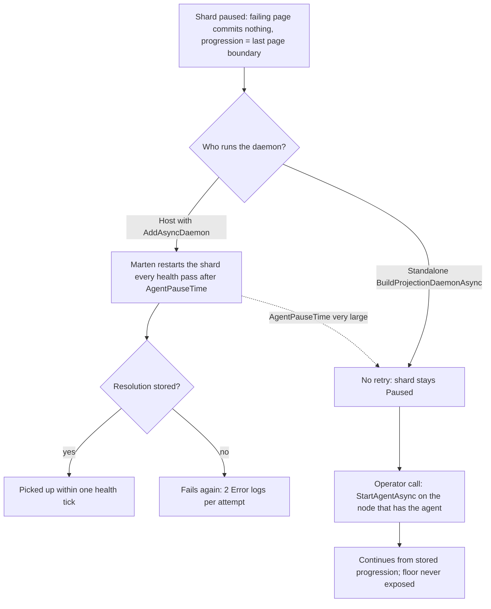

# Resuming one paused Marten shard after an audit resolution: measured behaviour and options (spike #3026)

This page is for the maintainer, who has to answer the open questions of section 8 before an ADR can be written, and for the authors of the plans that will build the resume seam, the paused-shard document and the operator command. It records what is already settled, what a scratch prototype measured on Marten 9.38.0 when one shard of the asynchronous daemon is paused and then restarted in different ways, what Encina's code does today, and, for each open question, the options, where each wins, what the evidence implies and a recommendation. Recommendations are input for the maintainer and not decisions: the issue stays open until the maintainer picks. Nothing under `src/` was changed. The page is an explanation page (a spike report); the operating instructions for the audit store are in [audit-marten](../features/audit-marten.md).

**Status:** evidence gathered on 2026-11-07 against `origin/main` at `143c5f534`. **Issue:** [#3026](https://github.com/dlrivada/Encina/issues/3026). **Related:** [#3049](https://github.com/dlrivada/Encina/issues/3049) (the audited resolver), [#3027](https://github.com/dlrivada/Encina/issues/3027) (the paused-shard health check), [#3024](https://github.com/dlrivada/Encina/issues/3024) and [#3025](https://github.com/dlrivada/Encina/issues/3025) (the operator surfaces of the resolver), [#2930](https://github.com/dlrivada/Encina/issues/2930) (a separate audit store; its [report](audit-store-spike-2930.md) is open for decision), [#3111](https://github.com/dlrivada/Encina/issues/3111) (G4).

Pre-1.0, backward compatibility and migration cost are not criteria ([AGENTS.md](../../AGENTS.md) section 1). Question ids (`D2`, `D4`, ...) are those of the #3026 decision register, which is a working file outside the repository; each question below states itself in full.

## How this was verified

- **Encina facts** are `file:line` references in the worktree at `143c5f534`; each was re-read for this page.
- **Marten facts** are either measured by the prototype (marked **[measured]**) or read in the XML documentation shipped in the NuGet packages (`Marten` 9.38.0, `JasperFx.Events` 2.73.2) and on martendb.io. The web pages were read through a summarising fetch tool, so a detail may have been dropped.
- **The pausing projection was a stand-in, not the audit projection.** The prototype uses two `EventProjection`s over one event type. `KeyedProj` loads a "temporal key" document and throws `InvalidOperationException` when it is missing, imitating `LoadTemporalKeyAsync` in [`OperationAuditEntryProjection.cs`](../../src/Encina.Audit.Marten/Projections/OperationAuditEntryProjection.cs) (lines 172-194), which in production fails with `EncryptedFieldDecryptionException`. `OtherProj` never fails and stands for the sibling shard or the application's own shard. Read models are keyed by event id (upsert). Cost figures therefore describe a trivial projection, not the real encrypting projections or a real audit store.
- **Everything ran on one machine** (Windows 11, Docker 29.8.1, .NET 10.0.403, `postgres:17-alpine`, Npgsql 10.0.2). Timings are noisy.
- **Multi-node behaviour was not measured.** "Two hosts" below means two hosts in one process against one database. Network partitions, leader loss in the middle of a resume and lock behaviour across machines need two real nodes (section 7).
- **Method.** 60 events (sequences 1 to 60), page size 10 (`AsyncOptions.BatchSize = 10`), a poison event at sequence 25. "Resolution" means storing the missing key document in a separate session, with no Marten call. The four skip flags are `false`, as the startup guard requires ([`AuditProjectionErrorPolicyStartupGuard.cs`](../../src/Encina.Audit.Marten/Projections/AuditProjectionErrorPolicyStartupGuard.cs) lines 68-71). A "host" is `Host.CreateApplicationBuilder` with `AddMarten(...).AddAsyncDaemon(Solo | HotCold)`; "standalone" is `store.BuildProjectionDaemonAsync()` followed by `StartAllAsync()`, which is what the existing integration test does ([`AuditProjectionUnreadableEventIntegrationTests.cs`](../../tests/Encina.IntegrationTests/Infrastructure/Marten/Audit/AuditProjectionUnreadableEventIntegrationTests.cs) lines 426-431). The prototype is git-ignored and is not committed; it ran with `dotnet run --no-build -- <scenario> key=value`, and two scenarios were re-run with Testcontainers (container ready in 5.8 s) with the same results.

## 1. The problem from the basics

The audit projections turn stored audit events into read models. When one event cannot be projected (for example its temporal key is missing and decryption fails), the projection throws and Marten **pauses that one shard** (the unit of work of one projection, named `<ProjectionName>:All`). G4 of [#3111](https://github.com/dlrivada/Encina/issues/3111) requires this: the shard stops instead of skipping the event, because a skipped audit event is a missing record.

An operator can then record a resolution for the event ([#3049](https://github.com/dlrivada/Encina/issues/3049)). The resolver only writes data. The question of this spike is what has to happen next so that the shard picks the resolution up, and how much of it Marten already does:

- Does a paused shard come back by itself?
- If not, which call restarts exactly that shard, from where, and with what cost compared with the documented `RebuildProjectionAsync`?
- Where must that call run, and what survives a crash between the resolution and the restart?

## 2. What is already settled

| Point | Settled as | Rule |
| --- | --- | --- |
| Where the check runs (D35) | Verified on today's topology (one shared store, the application's daemon). Any step whose result depends on the topology is repeated once #2930 is decided | Ordering is not a decision; #2930's gates are open and are not pre-decided here |
| Marten's extended tracking and #3027 (D32, scope only) | This page presents the evidence about the opt-in `EnableExtendedProgressionTracking`, including that its failure text lands in plaintext storage. It does not reopen the maintainer's [#3027 decision (d)](https://github.com/dlrivada/Encina/issues/3027#issuecomment-6522971785); that returns to the maintainer only if it proves unworkable | [AGENTS.md](../../AGENTS.md) section 3 (error messages never reach plaintext storage) |
| The resolver (D1) | It only writes data; it does not resume the shard | #3049 "Settled items" |
| Skipping events | Excluded | G4 = (d) of #3111 |
| Multi-instance, anonymous access, write-ahead audit, operator surfaces (D11, D22, D24, D17) | Multi-instance applications are supported; anonymous callers are denied; the audit of an operator action is written ahead; the surfaces are #3024 and #3025 | Register rows marked Settled |

## 3. Measured behaviour

Defaults on Marten 9.38.0, printed by the prototype: `AgentPauseTime = 00:00:01`, `HealthCheckPollingTime = 00:00:05`, `StopAndDrainTimeout = 5 s`, `LeadershipPollingTime = 5000`. The daemon settings live on `StoreOptions.Projections`.

### 3.1 Does a paused shard retry by itself?

| Setup | Result |
| --- | --- |
| Host Solo, defaults, poison unresolved for 100 s | The shard pauses at 6.7 s (page 21 to 30 fails at event 25; progression stays 20), then is restarted and fails again 17 more times: 18 attempts in 100 s, intervals 5.0 to 6.1 s, never stops |
| Host HotCold, defaults, same | Identical: 18 attempts, intervals 5.0 to 6.0 s |
| After the resolution is stored (no Marten call) | Solo: stored at 106.0 s, shard `Running` at 108.0 s, 90/90 rows at 109.1 s. HotCold: stored at 106.6 s, running at 107.0 s |
| Standalone daemon, 40 s unresolved then 30 s resolved | **No retry**: `Paused` for 70 s, one attempt, still `Paused` after the resolution. A manual `StartAgentAsync` resumed it |
| Host, `HealthCheckPollingTime = 15 s` | Attempts at 1.5, 17.5, 32.5 and 47.6 s (interval 15 to 16 s); resolved at 50 s, recovered by 63 s |
| Host, `AgentPauseTime = 30 s`, health pass 5 s | First retry at 36.4 s (about 30 s plus the next health tick), then every 5 s |
| Host, `AgentPauseTime = 1 h`, health pass default | No retry in 42 s; the sibling shard kept running; a manual stop and start worked at once |
| Host, both settings 1 h | No retry in 40 s |

Each attempt writes two `Error` log lines from `Marten.Events.Daemon.Coordination.ProjectionCoordinator` (about 24 per minute for an unresolved event): `Subscription KeyedProj:All failed while creating a SQL batch for updates for events from 20 to 30` with `ApplyEventException: Failure to apply event #25 Id(<event guid>)`, and `Error trying to build and apply changes to event subscription KeyedProj:All from 20 to 30`.

What follows from it:

- The premise of the issue, "a paused shard does not retry by itself", is **true only for a standalone daemon**. In a host with `AddAsyncDaemon` (Solo or HotCold) Marten restarts the shard on every health pass after `AgentPauseTime`, indefinitely. The existing integration test and the [#2930](audit-store-spike-2930.md) prototype disagree because the test uses a standalone daemon and #2930 used a host (its 4 log lines in about 6 s were the first retries).
- With a hosted daemon a resolution is therefore picked up without any operator action, within one health tick (2 s to 5 s measured).
- `AgentPauseTime = 1 h` with the default health pass turns the automatic retry off for the shard without disabling the health pass for other agents. The setting is store-wide: it also changes the application's own shards.

### 3.2 Do other shards keep running?

Yes. In every run `OtherProj:All` stayed `Running` and projected new events while `KeyedProj:All` was `Paused`: with events 61 to 90 appended after the shard had paused (at 21.4 s in the Solo run), the sibling read-model rows went from 60 to 90 while the paused shard stayed at 20. The same holds in HotCold, and the high-water mark is not affected. The pause is per shard. This was measured with two projections of the prototype, not with the application's real projections.

### 3.3 Resume options

Common facts (isolated runs with both timers at 1 h, so the manual effect is not hidden by Marten's retry; resolution stored first): the progression of the paused shard is the **last committed page boundary** (20). The failing page commits nothing, so events 1 to 20 are not applied again and the healthy events of the failing page (21 to 24) are. Read models upsert by event id, so no row is duplicated.

| Option | Call result | Continues from | Earlier events applied again | End state and notes |
| --- | --- | --- | --- | --- |
| `StopAgentAsync(name, null)` then `StartAgentAsync(name)` | ok, 0.00 s each | 20 | 21 to 24 (twice in total) | `Running`, 60/60 rows in about 0.3 s; sibling untouched |
| `StartAgentAsync(name)` alone on a `Paused` agent | ok, `Started seq=20` | 20 | 21 to 24 | Same result. Works for the `string` and `ShardName` overloads. No stop needed |
| `StartAgentAsync` while still **unresolved** | ok, then pauses again at once on event 25 | 20 | 21 to 25 | A second pair of `Error` logs. Safe, noisy, never skips |
| `EjectPausedShard(name)` alone | ok, agent becomes `Stopped` | The next coordinator tick restarted it from 20 about 4 s later | 21 to 24 | Not a resume by itself: it relies on the coordinator loop |
| `EjectPausedShard` then `StartAgentAsync` | ok | 20 | 21 to 24 | 60/60 in 0.2 s |
| `PauseShardAsync("KeyedProj", null)` then `StartAgentAsync` | ok | 20 | 21 to 24 | `null` tenant means store-global; same as stop and start |
| `RewindSubscriptionAsync("KeyedProj", ct, sequenceFloor: 20)` | ok, **restarts the agent itself** | 20 | 21 to 24 | 60/60; no extra start needed (an extra start was harmless) |
| `RewindSubscriptionAsync(..., 0)` | ok, restarts at 0 | 0 | All of 1 to 60 | 60/60; equals a rebuild without teardown |
| `RewindSubscriptionAsync(..., 25)` (the failing sequence) | ok, `Started seq=25` | After 25 | None | **Silently skips events 21 to 25: 55 rows instead of 60, progression 60.** The floor means "last processed", not "first to process". It behaves as a skip |
| `RewindSubscriptionAsync("KeyedProj:All", ...)` (shard name) | ok, **no effect** | Still `Paused` | None | No error and no change: the argument must be the projection name |
| `RebuildProjectionAsync("KeyedProj")` | ok in 0.23 s (60 events) | 0 | All | Works while paused; **leaves the live shard `Stopped`** until something restarts it (the 5 s health pass would, with defaults) |
| `StartAllAsync()` | ok | 20 | 21 to 24 | Starts only what is not running |
| `IProjectionCoordinator.PauseAsync()` then `ResumeAsync()` | ok | 20 (and the sibling at 60) | 21 to 24 | Blast radius is the whole daemon: every shard stops and starts |
| Do nothing | n/a | Stays `Paused` | n/a | 40 s, 0 retries |

A second daemon (`store.BuildProjectionDaemonAsync()` while the host daemon is paused) can start the shard (60/60), but the host's own agent keeps reporting `Paused pos=20` (stale). If the host's agent is also started it starts at 50, hits `ProgressionProgressOutOfOrderException` and goes `Stopped`; rows stay correct, 51 to 60 are applied twice. Two daemons are fenced by the progression check, not by a lock.

### 3.4 Cost at 20,000 events

Trivial projection, page size 500, poison event at 19,990:

| Method | Time | Notes |
| --- | --- | --- |
| Stop and start | 0.3 s | Resumed from 19,500; re-applied 489 healthy events of the failing page |
| `RebuildProjectionAsync` | 9.75 s | All 20,000 events; shard left `Stopped` |

The ratio is about 30 to 1 for this projection. The real encrypting projection and a real audit store size were not measured, so the ratio is an order of magnitude, not a prediction.

### 3.5 Solo, HotCold and how the daemon is obtained

- **The host daemon** comes from Marten's `IProjectionCoordinator` (registered by `AddMarten`): `DaemonForMainDatabase()`, `DaemonForDatabase(string)`, `AllDaemonsAsync()`, `PauseAsync()`, `ResumeAsync()`. Without a host, `IDocumentStore.BuildProjectionDaemonAsync(...)` builds a daemon. The XML documentation of `AllDaemonsAsync` warns that reading statuses must not go through `DaemonForDatabase`, which "is contractually allowed to go looking and start a daemon".
- **The daemon surface** on 9.38.0 (`IProjectionDaemon`): `StartAgentAsync`, `StopAgentAsync`, `PauseShardAsync`, `EjectPausedShard`, `RewindSubscriptionAsync`, `RebuildProjectionAsync`, `StatusFor`, `CurrentAgents()`, `HasAnyPaused()`, `WaitForShardToBeRunning` and `Tracker` (an `IObservable<ShardState>` that fires `Started`, `Updated`, `Paused` and `Stopped`, with the exception for `Paused`). `ISubscriptionAgent` exposes `Status`, `Position`, `PausedTime` and `Failure` (`ShardFailure`: category, exception types, `Message`, `Detail`, `Event`). **Without extended tracking, `agent.Failure` is already populated in process** (category `ApplyEvent`, event sequence 25).
- **Solo and HotCold behaved identically** for pause, retry and resume on one host.
- **Two hosts in HotCold, one process, one database.** Host A (leader) held both agents. Host B had no agents, reported both shards `Stopped` and `HasAnyPaused() = false`, so **a non-leader cannot see the pause** through the daemon API. After the resolution, `StartAgentAsync("KeyedProj:All")` on the follower returned ok, started an agent on the follower, which projected 20 to 60 and stopped itself about 2 s later; the leader's agent stayed reported `Paused pos=20` (stale) until a stop and start on the leader. So HotCold does not stop a manual start on a non-leader. The result was correct here because of the progression fence, but the start happened outside the leader election.

### 3.6 `EnableExtendedProgressionTracking`

The option defaults to `false`. When on, `mt_event_progression` gains `heartbeat`, `agent_status`, `pause_reason` (text), `running_on_node`, `warning_behind_threshold`, `critical_behind_threshold`, `failure_category`, `failure_event_sequence`, `failure_event_type` and `failure_event_tenant_id`. There is no `failure_message` or `failure_detail` column.

- **On pause:** `agent_status = Paused`, `failure_category = ApplyEvent`, `failure_event_sequence = 25`, `failure_event_type = ev`, and **`pause_reason` holds the full `exception.ToString()`**: the outer `ApplyEventException`, then the inner exception with its message, then the stack frames with file paths. `ShardFailure.Message` is only `Failure to apply event #25 Id(<guid>)`, but `ShardFailure.Detail` is the same full text.
- **On resume:** `agent_status = Running`; `pause_reason` and the `failure_*` columns are cleared.
- **Staleness:** `agent_status` is not set to `Stopped` on host shutdown, and after a kill the row keeps `Paused` and the stale reason until the next start.
- **Relevance to Encina:** the production projection fails with a fixed-message `EncryptedFieldDecryptionException` (asserted at [`AuditProjectionUnreadableEventIntegrationTests.cs`](../../tests/Encina.IntegrationTests/Infrastructure/Marten/Audit/AuditProjectionUnreadableEventIntegrationTests.cs) lines 224-232), but the stack frames and any other inner exception (a database error during the key lookup) would also be stored. [AGENTS.md](../../AGENTS.md) section 3 keeps error text out of plaintext storage.

### 3.7 A crash between the resolution and the resume

Two processes on one database; the first killed with `Stop-Process -Force`.

| Scenario | Result |
| --- | --- |
| Paused, killed, resolution stored before the restart | The progression row is found (`last_seq_id = 20`). The new host starts at 20; 60/60 rows within about 5 s; events 1 to 20 not applied again |
| Paused, killed, no resolution | The new host starts at 20, pauses again and retries every 5 to 6 s |
| Resolved, `StopAgentAsync` done, killed before `StartAgentAsync` | Restart at 20; 60/60; no failure |
| Extended tracking on, paused, killed, no resolution | The row keeps `Paused` and `pause_reason`; the new host pauses again at the same event and rewrites the row |

No state is lost by a crash. The only durable state is the progression row, and a start is always "from the stored progression", so a repeated or interrupted resume is harmless for keyed read models.

## 4. Encina today

Line numbers are at `143c5f534`. A search of `src/` for `AddAsyncDaemon`, `IProjectionCoordinator`, `IProjectionDaemon`, `BuildProjectionDaemon`, `EnableExtendedProgression`, `AgentPauseTime` and `IAuditProjectionResolver` finds nothing: Encina hosts no daemon, and the resolver interface and implementation are not in `main`.

| Concern | Where |
| --- | --- |
| Registration | [`ServiceCollectionExtensions.cs`](../../src/Encina.Audit.Marten/ServiceCollectionExtensions.cs): `AddEncinaAuditMarten` (line 89), the `IConfigureOptions<StoreOptions>` registration (line 129), the startup guard (line 133) |
| Projections | [`ConfigureMartenOperationAuditProjections.cs`](../../src/Encina.Audit.Marten/Projections/ConfigureMartenOperationAuditProjections.cs) lines 66-82 add `OperationAuditEntryProjection` and `ReadAuditEntryProjection` as async; their names are set at `OperationAuditEntryProjection.cs:85` and `ReadAuditEntryProjection.cs:75`, so the shards are `...:All`. The projections take only the placeholder strings from the options and a logger, never `IServiceProvider`, which is consistent with [AGENTS.md](../../AGENTS.md) section 3 |
| Startup guard | [`AuditProjectionErrorPolicyStartupGuard.cs`](../../src/Encina.Audit.Marten/Projections/AuditProjectionErrorPolicyStartupGuard.cs) (line 29, flags at 68-71) checks the four skip flags; it already receives `StoreOptions` |
| Resolution data | `src/Encina.Audit.Marten/Resolution/`: `AuditResolution` (line 19), `AuditResolutionRecord` (line 25), `AuditResolutionKind`, `AuditResolutionField`, `AuditResolutionTrail`, `AuditResolutionIds`; the document is registered at `ConfigureMartenOperationAuditProjections.cs:92-97` |
| Error codes and log ids | `src/Encina.Audit.Marten/MartenAuditErrors.cs`; EventIds `AuditMarten = (2550, 2599)` at [`EventIdRanges.cs:112`](../../src/Encina/Diagnostics/EventIdRanges.cs) |
| Health | [`MartenOperationAuditHealthCheck.cs`](../../src/Encina.Audit.Marten/Health/MartenOperationAuditHealthCheck.cs) line 37 implements the ASP.NET `IHealthCheck` (name `encina-audit-marten`, line 42), not `IEncinaHealthCheck` |
| Documentation | [`audit-marten.md`](../features/audit-marten.md) line 148 and lines 188-200 (see finding 2) |
| Existing test | `AuditProjectionUnreadableEventIntegrationTests.cs` lines 208-264 (no retry, standalone daemon), 307 (rebuild), 426-431 (`StartDaemonAsync`) |

Design context: Marten is the event-sourcing provider ([ADR-027](../architecture/adr/027-marten-as-the-event-sourcing-provider.md)) and compliance modules built on it follow [ADR-019](../architecture/adr/019-compliance-event-sourcing-marten.md). The CLI process of [ADR-058](../architecture/adr/058-encina-cli-command-architecture.md) hosts no daemon, which matters for D10.

## 5. How the options relate

## 6. Findings

1. **Premise challenged.** "A paused shard does not retry by itself" holds only for a standalone daemon. A host daemon retries every health pass (5 s by default).
2. **Documentation error.** [`audit-marten.md`](../features/audit-marten.md) line 148 says "A paused shard does not retry". That is wrong for a host daemon, and line 186 repeats the claim ("The daemon does not retry it"). Correcting it is outside this spike's scope, so the file is unchanged; the sentence needs a follow-up edit once D2 is decided.
3. **Dangerous API.** `RewindSubscriptionAsync` with a later floor silently skips audit events, and with the shard name instead of the projection name silently does nothing. No resume path may take a caller-supplied sequence.
4. **Plaintext failure text.** With `EnableExtendedProgressionTracking`, `pause_reason` stores the full exception text and stack frames in PostgreSQL ([AGENTS.md](../../AGENTS.md) section 3).
5. **Ownership gap.** No issue owns the daemon-control seam, the writer and closer of the paused-shard document, or the operator resume command: #3024 and #3025 are written for the resolver only.
6. **ADR number.** [ADR index](../architecture/adr/index.md): 059 (#2770) and 061 (#3049) are reserved and 060 exists, so the next free number is 062, not 059 as the issue says.
7. **EventId range.** `AuditMarten` is `(2550, 2599)` ([`EventIdRanges.cs:112`](../../src/Encina/Diagnostics/EventIdRanges.cs)). The #3049 plan is expected to take its tail, which would leave almost no room for the log messages of a resume seam; check the plan before allocating.

## 7. Not verified

- The real encrypting projections and a real audit store (cost and failure shape).
- Two or more real nodes: leader failover during a resume, partitions, lock behaviour across machines, the follower's health pass.
- Ancillary-store coordinators (`IProjectionCoordinator<T>` exists but was not run) and database-per-tenant.
- Non-keyed read models (idempotency of a replay is proven only for upserts).
- Behaviour with the application's own projections.
- The command-mode process of ADR-058, which hosts no daemon.
- Marten versions other than 9.38.0.

## 8. Open questions for the maintainer

Each question gives the options, where each wins, the evidence and a recommendation. The recommendations are not decisions.

### D2: Should Encina rely on Marten's own retry?

- **Options:** (a) rely on "a paused shard never restarts"; (b) accept and document that a hosted daemon restarts it; (c) in addition, recommend or validate a large `AgentPauseTime` in the startup guard.
- **Where each wins:** (a) never, the evidence refutes it; (b) accuracy and no new code; (c) quiet logs and an explicit operator step, at the price of a store-wide setting that Encina does not own.
- **Evidence:** section 3.1.
- **Recommendation (not a decision):** treat (b) as the actual behaviour, correct the runbook, and decide separately whether to recommend or validate (c).

### D4: Which recovery path is the supported one?

- **Options:** (a) rebuild only (status quo); (b) restart the one shard; (c) rewind the subscription.
- **Where each wins:** (a) amendments to events that were already projected; (b) the poison-event case, the cheapest; (c) targeted replays, but the most dangerous API.
- **Evidence:** sections 3.3 and 3.4: restart took 0.3 s against 9.75 s for a rebuild at 20,000 events, and a rebuild leaves the shard `Stopped`; a rewind floor of 25 skipped five events.
- **Recommendation (not a decision):** (b) for the poison event (and no new code at all when a hosted daemon retries), (a) kept for amendments, (c) only behind a seam that computes the floor and never accepts one from the operator.

### D6: What does "resume" mean?

- **Options:** (a) restart from the stored progression, which re-applies the healthy events of the failing page; (b) restart exactly at the failing event.
- **Where each wins:** (a) correctness, no skip; (b) fewer re-applied events, but it is the behaviour of a wrong rewind floor.
- **Evidence:** the stored progression is the last committed page (20), not the failing event; 489 healthy events were re-applied at page size 500.
- **Recommendation (not a decision):** define resume as (a). The seam never exposes a floor.

### D7: Which call sequence?

- **Options:** (a) `StopAgentAsync` then `StartAgentAsync`; (b) `EjectPausedShard` then `StartAgentAsync`; (c) `PauseShardAsync` then `StartAgentAsync`; (d) `StartAgentAsync` alone.
- **Where each wins:** (d) fewest steps; (a) and (c) are explicit but add a stop and its drain time (`StopAndDrainTimeout`, 5 s by default).
- **Evidence:** all four worked; `EjectPausedShard` alone is not a resume.
- **Recommendation (not a decision):** (d).

### D8: When is a rewind appropriate?

- **Options:** (a) never; (b) only after amending an event that was already projected, with the floor computed by the seam.
- **Evidence:** the floor means "last processed"; a floor of 0 equals a rebuild without teardown; a floor of 25 skips events.
- **Recommendation (not a decision):** (b), tied to D16.

### D9: Blast radius

- **Options:** (a) per-agent calls; (b) all audit shards; (c) `IProjectionCoordinator.PauseAsync`/`ResumeAsync`.
- **Evidence:** per-agent calls left the sibling and the application's shards untouched; the coordinator calls restarted everything.
- **Recommendation (not a decision):** (a).

### D10: How is the daemon reached?

- **Options:** (a) resolve the host's `IProjectionCoordinator` from DI; (b) build a second daemon with `BuildProjectionDaemonAsync`; (c) record a persisted request that the leader consumes.
- **Where each wins:** (a) simple and correct for Solo and for the leader; (b) works where no host daemon exists (the CLI), but duplicates the agent; (c) the only option that respects HotCold leadership from any node.
- **Evidence:** section 3.5: a follower cannot see the pause, a start on it runs outside the election, and a second daemon leaves the host's state stale.
- **Recommendation (not a decision):** act on the host's coordinator; on HotCold the action runs on the leader or is a persisted request (c). Verify with two real nodes.

### D12: Which topologies are supported?

- **Options:** (a) Solo; (b) HotCold on one host; (c) HotCold on several nodes.
- **Evidence:** (a) and (b) measured; two hosts in one process partially; real multi-node not measured.
- **Recommendation (not a decision):** document (a) and (b) as verified and (c) as unverified until it is measured.

### D13: Does Encina host the daemon?

- **Options:** (a) no, the seam uses whatever the application registered; (b) `AddEncinaAuditMarten` registers a daemon.
- **Evidence:** Encina hosts none today (section 4); with a standalone daemon (as the tests use) there is no retry and an explicit start is the only trigger. (b) overlaps the open #2930 questions.
- **Recommendation (not a decision):** (a); the seam resolves `IProjectionCoordinator` and returns a typed `Left` when it is absent.

### D15: Check before restarting?

- **Options:** (a) check that the failing event now has an effective resolution and refuse otherwise; (b) restart blind.
- **Evidence:** a blind start on an unresolved event pauses again within 0.1 s and never skips; the failing sequence is readable from `agent.Failure.Event` on the node that has the agent, with or without extended tracking.
- **Recommendation (not a decision):** (a) is possible on that node; (b) is safe, so (a) only buys quieter logs.

### D16: Resume or rebuild after an amendment?

- **Evidence:** a restart does not re-project events before the progression, so an amendment of an already projected event changes the read model only on a rebuild or a rewind.
- **Recommendation (not a decision):** resume for the poison event, rebuild (or a computed rewind) for amendments.

### D18: Who triggers the resume?

- **Options:** (a) an operator command; (b) an automatic reconciler; (c) Marten's own timed restart; (d) restarting the host.
- **Evidence:** (c) is already active in a hosted daemon; a reconciler (b) would duplicate it.
- **Recommendation (not a decision):** (c) where the daemon is hosted with default timers; (a) for standalone daemons, a large `AgentPauseTime`, and accountability of who restarted the audit pipeline.

### D19, D21, D23, D25, D34, D37: placement and ownership

- **Evidence:** no technical evidence favours any option; the seam is node-local (it needs the node that holds the agent), and `Failure`, `Position` and `PausedTime` are readable in process. The ownership gap of finding 5 stands.
- **Recommendation (not a decision):** open an issue that owns the daemon-control seam, the paused-shard document writer and closer, and the operator resume command; decide the public name, permission and audit entry there. This page is the result of D37 (a spike page, linked from the issue).

### D28: Is a resume crash-safe?

- **Evidence:** section 3.7.
- **Recommendation (not a decision):** no extra "resume requested" state is needed for keyed read models; not proven for non-keyed projections.

### D30 and D31: Where is the paused-shard document written and closed?

- **Options for writing:** (a) the daemon's `Tracker` observer; (b) inside the projection.
- **Evidence:** a write from inside the projection is rolled back with the page (the page commits nothing); the tracker fires `Paused` with the exception on the daemon node, outside the failed batch, but only on the leader in HotCold, and again on every retry (about every 5 s for an unresolved event unless deduplicated). `Started` is observable on the same tracker and the progression passing the failing sequence is readable; after a kill the dead node never closes its open document.
- **Recommendation (not a decision):** write from the tracker observer, with deduplication; close with a reconciler keyed on `Running` plus progression.

### D32: Marten's extended tracking or an Encina document?

- **Options:** (a) the Marten columns; (b) an Encina document fed only by `failure_category`, `failure_event_sequence` and `failure_event_type`.
- **Evidence:** section 3.6. The columns work from any process and clear on resume, but `pause_reason` stores the full exception text.
- **Recommendation (not a decision):** (b). This is the maintainer's call and does not reopen #3027 decision (d): the evidence shows (d) is workable with a node-local observer; the one condition is that in HotCold the document is written by the leader only, so a health check on another node reads the document.

### D35: Sequencing with #2930

- **Evidence:** nothing measured here depends on the store layout; an ancillary store only changes which `IProjectionCoordinator<T>` supplies the daemon, which was not measured.
- **Recommendation (not a decision):** proceed; repeat the topology-dependent steps once #2930 is decided.

## 9. Next steps

1. The orchestrator opens the gates from the questions of section 8.
2. [ADR-062](../architecture/adr/index.md) is written after D2, D4, D7, D10 and D32 are decided.
3. An issue is opened for the ownership gap (finding 5).
4. The `audit-marten.md` sentences of finding 2 are corrected once D2 is decided.
