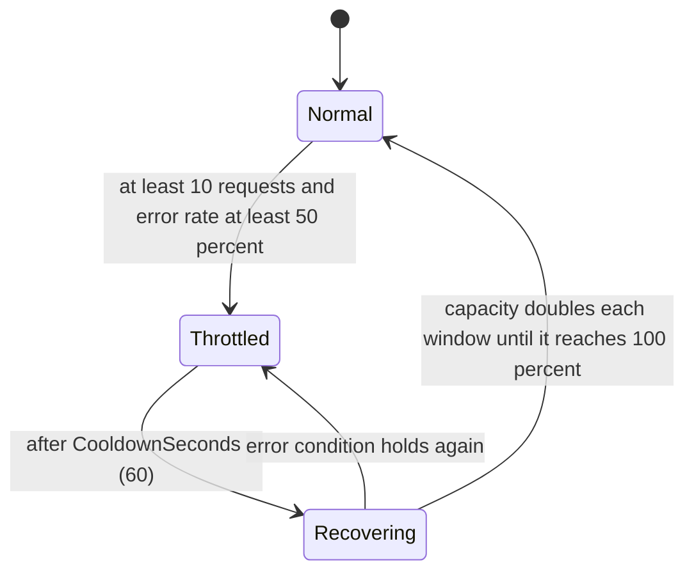

# Rate limiters: consolidate or keep three (spike #2414)

This page is for the maintainer, who has to decide whether Encina keeps several unrelated rate limiters or builds one, and for a contributor who needs the evidence behind that choice. It records what the code does today at `origin/main` f542fd2f5, what [#2414](https://github.com/dlrivada/Encina/issues/2414) claims that the code does not support, what other libraries do, which points are already settled by a rule or a recorded decision, and the dilemmas that remain. Each dilemma ends with the spike's recommendation, which is input for the maintainer and not a decision: the issue stays open until the maintainer picks an option, and the decision gets its own ADR (number assigned when it is written; 054 is taken by [#1791](https://github.com/dlrivada/Encina/issues/1791)).

**Status:** evidence gathered and verified against the worktree at f542fd2f5 on 2026-10-23. **Issue:** [#2414](https://github.com/dlrivada/Encina/issues/2414) (v0.14.0). **Related decisions:** [#2278](https://github.com/dlrivada/Encina/issues/2278) (limiter and circuit breaker stay independent, 2026-10-16) and [#1233](https://github.com/dlrivada/Encina/issues/1233) (`Encina.Http` scope, 2026-10-17).

Pre-1.0, backward compatibility and breaking-change cost are not criteria ([AGENTS.md](../../AGENTS.md) section 1). The public rate-limiting API of `Encina.Polly` is only in `PublicAPI.Unshipped.txt` (lines 44-97), so nothing has shipped either.

## 1. The problem from the basics

A **rate limiter** decides, before an operation runs, whether it may run now. It counts something (requests in a time window, requests in flight, tokens in a bucket) per **partition** (a key such as the request type, the tenant or the remote server) and either grants a permit or rejects the call, ideally saying how long to wait (**Retry-After**). It protects either the caller's own resources (inbound or self-protection) or a remote system that has its own quota (outbound).

A concrete story. A psychology practice runs the reference application ([SPEC-002](../specifications/SPEC-002-eu-regulatory-readiness.md), scenario S11: several practices are tenants of one deployment). The application sends `SendAppointmentReminder` through `IEncina.Send`, and the handler calls an SMS gateway over HTTP whose contract allows 10 messages per second per account and answers `429 Too Many Requests` with `Retry-After: 30` when exceeded.

- The developer adds `[RateLimit(MaxRequestsPerWindow = 600, WindowSizeSeconds = 60)]` to the command (limiter 1 below).
- The same request type also goes through the standard resilience pipeline of `Encina.Extensions.Resilience`, which adds its own Polly rate-limiter strategy (limiter 2) with a different meaning (a cap of 1000 requests in flight) and a different rejection shape.
- When `Encina.Http` exists ([#1233](https://github.com/dlrivada/Encina/issues/1233)), the HTTP client to the gateway gets a third limiter (limiter 3), which SPEC-002 requires to be per client and per tenant and to honour the gateway's `Retry-After`.

Today one practice sending a burst of reminders exhausts the single per-request-type bucket for every practice, because limiter 1 has no tenant dimension. A denial comes back as an `EncinaError` with no code, so HTTP answers 500 and recoverability classifies it by the words in its message ([#2273](https://github.com/dlrivada/Encina/issues/2273)). A Polly rejection from limiter 2 becomes a different uncoded error. The developer has no page that says which limiter to use.

## 2. What the code does today

### 2.1 The three limiters

| | Limiter 1: adaptive request limiter | Limiter 2: Polly strategy in the standard pipeline | Limiter 3: `Encina.Http` per-client limiter |
| --- | --- | --- | --- |
| Where | `src/Encina.Polly/RateLimiting/AdaptiveRateLimiter.cs:21`, applied by `src/Encina.Polly/Behaviors/RateLimitingPipelineBehavior.cs:23`, registered at `src/Encina.Polly/ServiceCollectionExtensions.cs:54` (behavior at `:64`) | `src/Encina.Extensions.Resilience/Configuration/StandardResilienceOptions.cs:21` (property at `:56`), added at `src/Encina.Extensions.Resilience/ServiceCollectionExtensions.cs:79` (default pipeline) and `:157` (per request type) | Not in `src/`: no `Encina.Http` package exists. Required by SPEC-002 REQ-039 (line 361), in the 1.0 scope ([SPEC-000](../specifications/SPEC-000-encina-1.0-baseline-and-release-scope.md) line 151), planned in [#1233](https://github.com/dlrivada/Encina/issues/1233) (v0.18.0) |
| What it counts | Requests per sliding window: a `Queue<DateTimeOffset>` per key behind one `lock` (`AdaptiveRateLimiter.cs:105`, `:124`) | Requests **in flight**: `RateLimiter` and `RateLimiterFactory` are never set, so Polly's default applies, a `ConcurrencyLimiter` with 1000 permits and queue 0. The comment "1000 requests per 30 seconds" (`StandardResilienceOptions.cs:23`) describes something the code does not do | Not designed |
| Partition key | `typeof(TRequest).Name` (`RateLimitingPipelineBehavior.cs:57-58`), so two types with the same simple name share a bucket ([#2275](https://github.com/dlrivada/Encina/issues/2275)) | One pipeline per request type name, or the single default pipeline `Encina.StandardResilience` (`StandardResiliencePipelineBehavior.cs:28`, `:57-62`) | Per client and per tenant (SPEC-002 line 391, REQ-061; #1233 decision) |
| Configuration | `[RateLimit]` attribute (`src/Encina.Polly/Attributes/RateLimitAttribute.cs:33-99`), read by reflection on every call (`RateLimitingPipelineBehavior.cs:50`), no validation ([#2276](https://github.com/dlrivada/Encina/issues/2276)) | `RateLimiterStrategyOptions` on `StandardResilienceOptions` | Not designed |
| Rejection | `EncinaError.New(message)` with no code; `RetryAfter` only in the message text and the log (`RateLimitingPipelineBehavior.cs:74-79`) | `RateLimiterRejectedException` is never caught by name: it falls into `catch (Exception)` and becomes `EncinaError.New(ex)` with no code and no `RetryAfter` (`StandardResiliencePipelineBehavior.cs:104-107`) | Must honour the server's `Retry-After` |
| Tenant | None | None | Required |
| Tests | Unit 4 files, Guard 2, Benchmark 1; no Contract, Property, Load ([#2283](https://github.com/dlrivada/Encina/issues/2283), [#2294](https://github.com/dlrivada/Encina/issues/2294)); the Polly end-to-end test never runs the behavior ([#2295](https://github.com/dlrivada/Encina/issues/2295)) | Unit (`StandardResilienceOptionsTests.cs`), Integration (`StandardResilienceEndToEndTests.cs`) | None |

The error code exists: `EncinaErrorCodes.RateLimitExceeded = "encina.ratelimit.exceeded"` (`src/Encina/Errors/EncinaErrorCodes.cs:93`). It is listed as transient by `IErrorClassifier.cs:175`, and `Encina.Testing.Pact` maps `encina.ratelimit*` to 429, but no limiter emits it.

### 2.2 The adaptive state machine of limiter 1

The behavior records every `Right` as a success and every `Left` and every exception as a failure (`RateLimitingPipelineBehavior.cs:95-110`; cancellation and business `Left` counted as outage: [#2274](https://github.com/dlrivada/Encina/issues/2274)).

In Throttled the limit drops to 10% (`AdaptiveRateLimiter.cs:214-219`); the effective limit is `max(1, ceil(MaxRequestsPerWindow × factor))` (`:259-263`). The whole state machine is skipped when `EnableAdaptiveThrottling` is false (`:201`). The success and failure counters reset whenever the window has passed, which happens on almost every acquire ([#2272](https://github.com/dlrivada/Encina/issues/2272), `:191-196`), so in practice the error rate rarely accumulates. Adaptive concurrency in the Netflix style is a separate, post-1.0 feature ([#139](https://github.com/dlrivada/Encina/issues/139)).

### 2.3 Building blocks that already exist for outbound calls

`Encina.Http` does not start from zero. Core already has a `Retry-After` parser (`src/Encina/Recoverability/RetryAfterParser.cs:13`, RFC 9110), the outbound code `encina.outbound.rate_limited` for 429 (`OutboundErrorCodes.cs:33`) with the `http.retry_after` metadata key (`OutboundErrorMetadataKeys.cs:20`), and `Encina.Refit` maps 429 to that code with the parsed delay (`RestApiRequestHandler.cs:105`, `:162-180`). `RetryPipelineBehavior` honours `Retry-After` up to `MaxDelayMs` (`src/Encina.Polly/Behaviors/RetryPipelineBehavior.cs:145-188`), and the outbox and delayed-retry processors consume it ([#2588](https://github.com/dlrivada/Encina/issues/2588) adds its ceiling there, not in any limiter). What is missing is a limiter that stops the **next** calls to that server, not only the retry of the failed one.

No other rate limiter exists in `src/`: the only other throttles are `SemaphoreSlim` concurrency caps in the parallel notification dispatch strategies (`src/Encina/Dispatchers/Strategies/ParallelDispatchStrategy.cs:54`). No `System.Threading.RateLimiting` limiter is used anywhere in `src/`.

## 3. Claims in #2414 that the code does not support

| Issue claim | What the code shows |
| --- | --- |
| Limiter 1 denials "return `encina.ratelimit.exceeded`" | No code is set (section 2.1); tracked by [#2273](https://github.com/dlrivada/Encina/issues/2273) |
| Limiter 2 limits "1000 requests per 30 seconds" (from the code comment) | It is a concurrency cap of 1000 in-flight requests with no queue, not a rate over time |
| Limiter 2 "rejects with `RateLimiterRejectedException` (carries `RetryAfter`)" | It does, inside Polly, but the behavior turns it into an uncoded `EncinaError.New(ex)` and the `RetryAfter` is lost. A `ConcurrencyLimiter` never sets `RetryAfter` anyway (section 4.1) |
| Line numbers `:60-61`, `:53`, `StandardResilienceOptions.cs:21` (class) | Shifted: key at `:57-58`, registration at `:54`, class at `:19` with the field at `:21` |
| Settled "by elimination" in favour of option C (issue comment, 2026-10-17) | No rule eliminates A or B: both comply with [AGENTS.md](../../AGENTS.md) and the SPECs; the comment itself calls it the "lowest-confidence verdict". The reasons it gives (tenant partitioning written three times; adaptive behaviour relied on by #2278) are trade-offs, so the choice returns to the maintainer as D1 and D2 |

## 4. What other libraries and the platform do

### 4.1 The .NET platform

| Component | Relevant facts | Source |
| --- | --- | --- |
| `System.Threading.RateLimiting` | `ConcurrencyLimiter`, `FixedWindowRateLimiter`, `SlidingWindowRateLimiter`, `TokenBucketRateLimiter`; `PartitionedRateLimiter<T>` creates one limiter per key lazily and evicts idle partitions (heartbeat every 100 ms, idle after 10 s); `CreateChained` requires a lease from every limiter in order. The three time-based limiters set `MetadataName.RetryAfter` on most rejections; `ConcurrencyLimiter` does not. Limits are fixed at construction (verified for `TokenBucketRateLimiter`, not verified for the others): changing a limit means a new limiter or a partition factory that returns different options. Partitions keyed on unbounded input are a memory risk | [API reference](https://learn.microsoft.com/en-us/dotnet/api/system.threading.ratelimiting), [ASP.NET Core rate limiting](https://learn.microsoft.com/en-us/aspnet/core/performance/rate-limit), [runtime source](https://github.com/dotnet/runtime/tree/main/src/libraries/System.Threading.RateLimiting) |
| Metrics | No meter was found in `System.Threading.RateLimiting` (only `GetStatistics()` for polling; full library not searched); the `Microsoft.AspNetCore.RateLimiting` meter belongs to the inbound middleware | [ASP.NET Core built-in metrics](https://learn.microsoft.com/en-us/dotnet/core/diagnostics/built-in-metrics-aspnetcore) |
| Polly v8 | `RateLimiterStrategyOptions.RateLimiter` is a delegate over `RateLimiterArguments` (which carry the `ResilienceContext`); the documented pattern for per-key limits is `PartitionedRateLimiter.Create<ResilienceContext, string>`, chained for "100 per minute and 10 per second". Rejection throws `RateLimiterRejectedException` with optional `RetryAfter`; telemetry event `OnRateLimiterRejected` | [Polly rate limiter](https://www.pollydocs.org/strategies/rate-limiter.html) |
| Microsoft.Extensions.Http.Resilience | `AddStandardResilienceHandler` puts a concurrency limiter (1000, queue 0) outermost, then total timeout, retry, circuit breaker, attempt timeout. Retry and breaker treat 429 as transient; `HttpRetryStrategyOptions.ShouldRetryAfterHeader` uses the header for the retry delay (default not verified). No per-tenant partition and no "pause every call to this server" | [HTTP resilience](https://learn.microsoft.com/en-us/dotnet/core/resilience/http-resilience) |

The platform therefore gives partitioning and standard algorithms but no adaptive behaviour, and the HTTP stack honours `Retry-After` only for the retry of the failing request.

### 4.2 Adaptive limiting elsewhere

| System | How it adapts | Where the adaptation lives | Source |
| --- | --- | --- | --- |
| Google SRE client-side throttling | Each client tracks requests and accepts over two minutes and rejects locally with a probability once requests exceed K × accepts (K = 2 typical) | A separate layer above the client, not inside a limiter | [SRE book, Handling Overload](https://sre.google/sre-book/handling-overload/) |
| Envoy adaptive concurrency | Gradient controller: compares sampled p90 latency with a measured minimum RTT and adjusts the allowed concurrency | Inside the filter | [Envoy docs](https://www.envoyproxy.io/docs/envoy/latest/configuration/http/http_filters/adaptive_concurrency_filter) |
| AWS SDK adaptive retry | A client-side rate bucket whose rate drops on throttling responses; per SDK client; the docs warn it suits multi-tenant applications only when tenants are isolated | An extension of the retry mechanism | [AWS retry behaviour](https://docs.aws.amazon.com/general/latest/gr/api-retries.html) |
| Resilience4j | `changeLimitForPeriod` changes a live limiter; limiter and circuit breaker are separate modules | Limiter tunable from outside | [Spring Integration javadoc](https://docs.spring.io/spring-integration/api/org/springframework/integration/handler/advice/RateLimiterRequestHandlerAdvice.html) (Resilience4j docs not opened) |
| Netflix concurrency-limits | AIMD, Vegas, Gradient2 (not verified: the documentation page returned 404) | Not verified | [#139](https://github.com/dlrivada/Encina/issues/139) records the design intent |

Every adaptive design found reacts to a signal (latency, throttling responses, accept ratio) from the protected dependency, and most keep the adaptation outside the counting limiter. None reacts to the handler's own business errors, which is what limiter 1 does today (#2274).

### 4.3 Messaging and mediator libraries

NServiceBus offers only a concurrency cap (`LimitMessageProcessingConcurrencyTo`); its throughput throttling options are deprecated in favour of a custom behavior ([tuning](https://docs.particular.net/nservicebus/operations/tuning)). MassTransit, Wolverine, Brighter and MediatR were not verified (pages not found); a search found only MassTransit's kill-switch filter, which trips on failure rate. No surveyed mediator ships an adaptive per-message-type rate limiter. The multi-tenant pattern found is a `PartitionedRateLimiter` keyed by tenant (Polly and ASP.NET Core documentation). Distributed limiting exists as third-party Redis implementations of the same abstraction ([aspnetcore-redis-rate-limiting](https://github.com/cristipufu/aspnetcore-redis-rate-limiting)).

### 4.4 HTTP standards

RFC 6585 section 4 defines 429 and says the server MAY include `Retry-After`; RFC 9110 section 10.2.3 defines `Retry-After` as an HTTP date or a number of seconds and, with 503, how long the service is expected to be unavailable. Neither defines a client algorithm, so "honouring" it is the library's design choice.

### 4.5 EU and Spanish law (not legal advice)

No law prescribes a rate-limiter design. Rate limiting supports the availability and resilience of processing systems that GDPR Article 32(1)(b) asks controllers and processors to ensure, the availability measures of NIS2 (Directive (EU) 2022/2555) Article 21, and, for the Spanish public sector and its suppliers, the denial-of-service protection measure of the Esquema Nacional de Seguridad (Real Decreto 311/2022; measure code not verified). For the reference application, the relevant point is isolation: one practice must not exhaust the capacity of another (SPEC-002 S11, REQ-061). That is a tenant-partitioning requirement, not a choice between the options below.

## 5. Settled points

These are not dilemmas. Each has a citation; the ADR records them without reopening them.

| Point | Settled by |
| --- | --- |
| A rate-limit denial is a coded `Left` (`encina.ratelimit.exceeded`) carrying the retry delay as metadata, never an uncoded message; a Polly `RateLimiterRejectedException` is translated to the same `Left` | [AGENTS.md](../../AGENTS.md) section 3 (ROP: operations return `Either` with detailed errors), [ADR-029](../architecture/adr/029-recoverability-error-classification.md) (recoverability classifies by error code, not by message text); defect tracked by [#2273](https://github.com/dlrivada/Encina/issues/2273) |
| The rate limiter and the circuit breaker stay independent; no integration code between them | [#2278](https://github.com/dlrivada/Encina/issues/2278) decision A (2026-10-16) |
| `Encina.Http`'s limiter partitions per client and per tenant and is composed with Microsoft.Extensions.Http.Resilience | SPEC-002 REQ-039 (line 361), line 391, REQ-061; [#1233](https://github.com/dlrivada/Encina/issues/1233) decision (2026-10-17) |
| A received 429 or 503 with `Retry-After` pauses the `Encina.Http` partition (client and tenant), not only the retry of that request (proposed as settled; the maintainer confirms by accepting this page) | REQ-039 puts the duty on the limiter ("per-client rate limiter honouring Retry-After"), and retry already honours it today (section 2.3), so a limiter that only retried would add nothing |
| In-memory, per-instance limits for 1.0; a distributed limit is a separate, post-1.0 decision | #2414 scope ("Out of Scope"); [#704](https://github.com/dlrivada/Encina/issues/704) is Post-1.0 |
| The public `IRateLimiter`, `[RateLimit]`, `RateLimitResult` and `AdaptiveRateLimiter` API may be replaced completely, without a compatibility layer | [AGENTS.md](../../AGENTS.md) sections 1 and 3; nothing has shipped (`PublicAPI.Shipped.txt` has no rate-limit line) |
| Business `Left` results and cancellation are not outage signals for any adaptive behaviour that survives | [#2274](https://github.com/dlrivada/Encina/issues/2274) and the #2278 decision (an open circuit returns a transient error; that is the signal) |
| Inbound HTTP limiting stays with `Microsoft.AspNetCore.RateLimiting` | #2414 scope |
| Whichever option wins, the cross-cutting functions apply: OpenTelemetry for acquire and reject ([#728](https://github.com/dlrivada/Encina/issues/728)), `[LoggerMessage]` in the package's EventId range, partition count bounded against unbounded keys | [AGENTS.md](../../AGENTS.md) sections 6 and 7; section 4.1 (unbounded partitions) |

### 5.1 Work that is needed whatever is decided

| Item | Owner |
| --- | --- |
| Coded denial | [#2273](https://github.com/dlrivada/Encina/issues/2273) |
| Simple-name key collision | [#2275](https://github.com/dlrivada/Encina/issues/2275) |
| `EnableTelemetry` and `EnableLogging` never read | [#2277](https://github.com/dlrivada/Encina/issues/2277) |
| Test gaps | [#2283](https://github.com/dlrivada/Encina/issues/2283), [#2288](https://github.com/dlrivada/Encina/issues/2288), [#2289](https://github.com/dlrivada/Encina/issues/2289), [#2290](https://github.com/dlrivada/Encina/issues/2290), [#2294](https://github.com/dlrivada/Encina/issues/2294), [#2295](https://github.com/dlrivada/Encina/issues/2295) |
| Resilience documentation (which limiter to use) | [#904](https://github.com/dlrivada/Encina/issues/904) |
| The misleading "1000 requests per 30 seconds" comment (`StandardResilienceOptions.cs:23`) | No issue yet; a one-line fix, or moot if D1 replaces the strategy |
| Tenant-scoped rate limiting ([#740](https://github.com/dlrivada/Encina/issues/740)) is in "Post-1.0: Multi-Tenancy Core", but SPEC-002 requires per-tenant limits for `Encina.Http` in 1.0 | The milestone of #740 (or a 1.0 child of #1233) has to follow SPEC-002 whatever D3 decides; the orchestrator should check it |

If a fix for #2272, #2274 or #2276 is made before the decision and D1 or D2 then removes `AdaptiveRateLimiter`, that fix is thrown away. Holding those three until D1 and D2 are decided saves the work; fixing them first only helps if limiter 1 survives.

## 6. Open decisions (dilemmas)

Effort is relative size only. Each option states the scenario in which it is the better fit; the recommendation is the spike's reading and the maintainer decides.

### D1. One rate-limiting mechanism, or several with documented purposes?

This is the issue's question 1. Options A and C of the issue share the answer "one core" and differ only in D2, so here they are one option.

| | 1a: one partitioned core (issue options A and C) | 1b: keep separate limiters with documented purposes (issue option B) | 1c: drop limiter 1, keep the Polly strategy and the breaker (issue option D, first half) |
| --- | --- | --- | --- |
| What it is | One limiter abstraction over `PartitionedRateLimiter<TKey>` with key selectors (request type, tenant, client); `[RateLimit]` and the Polly strategy become ways to configure it; `Encina.Http` uses it | Limiter 1 stays the opt-in per-request-type limiter, limiter 2 the generic pipeline strategy, limiter 3 a new limiter inside `Encina.Http`; an ADR and docs state the purpose of each; configuring two on the same request is rejected at registration | Request-level limiting only through the Polly strategy in `Encina.Extensions.Resilience`; error-driven protection is the circuit breaker; `Encina.Http` composes the same strategy |
| Better when | The library should expose one concept, one option model and one rejection contract, and tenant partitioning should be written once | The three uses are believed to diverge (self-protection, pipeline admission, remote quotas) enough that a shared core would be bent by each | The maintainer wants the smallest surface and sees no use for a mediator-level `[RateLimit]` attribute |
| Pros | One error contract and one set of tests; BCL algorithms and idle-partition cleanup replace the hand-written window and its defects (#2272, #2275 shrink or vanish); matches the documented Polly pattern | Smallest change now; each limiter can evolve alone | Fewest concepts; no hand-written limiter |
| Cons | Largest refactor (two packages and their tests); in-memory only, like today | Three option models and rejection paths stay; tenant partitioning, the coded denial and telemetry are each written up to three times; users still have to choose | Loses the attribute-based, per-request-type opt-in; the strategy is a concurrency cap by default, so time-window limits need configuration; Polly becomes the only way to limit a request |
| Effort | Large | Small to medium, plus three implementations of tenant partitioning later | Medium |

**Spike's recommendation: 1a.** The settled points (coded denial, tenant partitions for `Encina.Http`, telemetry) must be built at least once anyway; with 1b they are built three times, and the standard pattern of both Polly and ASP.NET Core is exactly a partitioned limiter with key selectors.

### D2. What happens to the error-rate adaptive throttling?

Only relevant if D1 is 1a or 1c. The issue's question 2.

| | 2a: keep it as an opt-in decorator over the core (issue option C) | 2b: drop it; error-driven protection is the circuit breaker (issue option A) | 2c: drop it now and leave adaptive behaviour to [#139](https://github.com/dlrivada/Encina/issues/139) (post-1.0 adaptive concurrency) |
| --- | --- | --- | --- |
| Better when | A user needs a request type to slow down, not stop, while a dependency is failing | The circuit breaker's open, half-open and closed cycle is judged enough, and slowing down is not needed | Adaptation is wanted eventually, but driven by latency or throttling signals as in the prior art (section 4.2), not by the error rate |
| Pros | Keeps the only feature the BCL lacks; the #2278 decision's assumption (the limiter counts the transient errors of an open circuit) stays true. The decorator need not change the BCL limit: it can reject a fraction of calls before the inner limiter, as Google SRE client-side throttling does, which avoids recreating limiters | Least code; one fewer state machine to test (property and load tests, #2283, #2294); the breaker already exists in both resilience packages | No error-rate design is frozen for 1.0; #139 can choose a signal that the industry uses |
| Cons | A second state machine next to the breaker, with its own thresholds that overlap the breaker's; the most design work | The #2278 rationale loses its premise and its attribute documentation must be rewritten; no gradual recovery | Users who want slow-down before 1.0 have none |
| Effort | Large | Small (removal) | Small now; #139 later |

**Spike's recommendation: 2a**, implemented as an admission layer in front of the partitioned limiter, counting only transient errors (the #2274 rule). The SRE-style probabilistic rejection removes the main technical objection (fixed BCL limits). If the maintainer sees no user who needs slow-down rather than stop, 2c is the cheaper honest alternative, because it keeps the adaptive idea where the prior art puts it.

### D3. Does the request-level limiter partition by tenant, and what happens without a tenant?

SPEC-002 settles the tenant partition for `Encina.Http` only (section 5). For the mediator-level limiter (`[RateLimit]` or its replacement) no rule decides it: REQ-061 covers the SPEC-002 capabilities, and #740 is post-1.0. The issue's question 3.

| | 3a: request type × tenant by default when tenancy is registered; deny when the tenant is missing | 3b: request type only by default; tenant is an opt-in key selector | 3c: request type × tenant by default; a missing tenant goes to one shared "no tenant" partition |
| --- | --- | --- | --- |
| Better when | Every multi-tenant deployment should get isolation without configuration, and a request without tenant context is treated as a fault | Single-tenant users are the majority and the limiter is self-protection of the whole process, not fairness between tenants | System requests (background jobs, health probes) legitimately run without a tenant and must not be denied |
| Pros | Isolation by default for S11; follows the fail-closed reading of SPEC-002 DEC-006 if a limiter is a security control | Simplest default; no dependency on tenancy | Isolation by default without denying system work |
| Cons | Background work without tenant context is denied unless it opts out (DEC-006 requires that opt-out to be explicit and logged); couples the limiter to `ITenantContext` | A multi-tenant user must know to opt in; S11's noisy-neighbour case is not solved by default | The shared partition is a soft spot: everything without a tenant competes in one bucket; whether DEC-006 forbids it depends on whether a limiter counts as a security gate |
| Effort | Medium | Small | Medium |

**Spike's recommendation: 3a**, because DEC-006 and [AGENTS.md](../../AGENTS.md) section 3 make fail-closed the house default and rate limiting is a denial-of-service control. The maintainer should state whether a limiter counts as a "compliance or security gate"; if it does not, 3c is a legitimate alternative.

### D4. Where does the shared core live?

Only relevant if D1 is 1a. Not in the issue; added by the spike because it decides the package dependencies of `Encina.Http`. Pay-for-what-you-use ([AGENTS.md](../../AGENTS.md) section 1) rules out putting a NuGet dependency on `System.Threading.RateLimiting` into the core `Encina` package for users who never limit anything.

| | 4a: `Encina.Extensions.Resilience` | 4b: `Encina.Polly` | 4c: a new small package `Encina.RateLimiting` |
| --- | --- | --- | --- |
| Better when | `Encina.Http` is built on Microsoft.Extensions.Http.Resilience anyway (#1233 decision), so it already sits in that dependency family | The mediator behaviors are the main consumer and `Encina.Http` may depend on `Encina.Polly` | Limiting must be usable without either resilience package |
| Pros | No new package; same dependency family as `Encina.Http` and the Polly strategy | No new package; the existing behavior is already there | Clean dependency graph; each consumer references only the limiter |
| Cons | The mediator `[RateLimit]` behavior moves out of `Encina.Polly`, or `Encina.Polly` references `Encina.Extensions.Resilience` | `Encina.Http` pulls in the mediator Polly behaviors it does not use | One more package to version, document and give coverage manifests |
| Effort | Medium | Medium | Medium, plus package overhead |

**Spike's recommendation: 4a**, on the dependency argument. The overlap between `Encina.Polly` and `Encina.Extensions.Resilience` as a whole is wider than rate limiting and out of this spike's scope.

## 7. Effort and evidence summary

| Item | Size | Evidence |
| --- | --- | --- |
| D1 1a with D2 2a | Large: rewrite of `src/Encina.Polly/RateLimiting/`, adapter in `Encina.Extensions.Resilience`, base for `Encina.Http`; 10 test files today (Unit 6, Guard 2, Integration 1, Benchmark 1), plus the missing Contract, Property and Load types | Sections 2.1, 2.2 |
| D1 1b | Small now; three tenant partitions and three rejection paths later | Section 2.1 |
| Deferred work that does not depend on the decision | #2273, #2275, #2277, test issues, #904 | Section 5.1 |
| Work wasted if done before the decision | #2272, #2274 (the counting fix), #2276 if limiter 1 is removed | Section 5.1 |

## 8. Unknowns

- Whether `FixedWindowRateLimiter`, `SlidingWindowRateLimiter` and `ConcurrencyLimiter` also fix their limits at construction (only `TokenBucketRateLimiter` was read).
- Whether `System.Threading.RateLimiting` publishes any meter in .NET 10.
- The default of `HttpRetryStrategyOptions.ShouldRetryAfterHeader`, and whether the standard HTTP handler supports per-authority pipeline selection outside hedging.
- What MassTransit, Wolverine and Brighter offer for per-consumer throttling (pages not found).

## Related issues

[#2414](https://github.com/dlrivada/Encina/issues/2414), [#2278](https://github.com/dlrivada/Encina/issues/2278), [#1233](https://github.com/dlrivada/Encina/issues/1233), [#2272](https://github.com/dlrivada/Encina/issues/2272), [#2273](https://github.com/dlrivada/Encina/issues/2273), [#2274](https://github.com/dlrivada/Encina/issues/2274), [#2275](https://github.com/dlrivada/Encina/issues/2275), [#2276](https://github.com/dlrivada/Encina/issues/2276), [#2277](https://github.com/dlrivada/Encina/issues/2277), [#2283](https://github.com/dlrivada/Encina/issues/2283), [#2294](https://github.com/dlrivada/Encina/issues/2294), [#2295](https://github.com/dlrivada/Encina/issues/2295), [#728](https://github.com/dlrivada/Encina/issues/728), [#740](https://github.com/dlrivada/Encina/issues/740), [#704](https://github.com/dlrivada/Encina/issues/704), [#139](https://github.com/dlrivada/Encina/issues/139), [#904](https://github.com/dlrivada/Encina/issues/904), [#2588](https://github.com/dlrivada/Encina/issues/2588).
