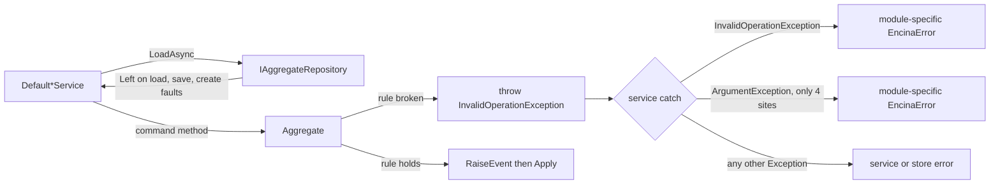

# ROP and exceptions: distributed locks and compliance aggregates (spikes #1799 and #1798)

This page is for the maintainer, who has to choose how distributed lock providers and event-sourced compliance aggregates report failures, and for a contributor who needs to see the evidence behind that choice. It records what the code does today at `origin/main` a21e4c763, what the issues claim that the code does not support, and the open options for each spike. It recommends nothing and decides nothing: both issues stay open until the maintainer picks an option, and each decision will get its own ADR (numbers reserved in [the ADR index](../architecture/adr/index.md#reserved-numbers)).

**Status:** evidence gathered 2026-10-21 and re-verified against the worktree at a21e4c763 on 2026-10-22. **Issues:** [#1799](https://github.com/dlrivada/Encina/issues/1799) (lock providers) and [#1798](https://github.com/dlrivada/Encina/issues/1798) (aggregates). **Reserved ADRs:** 052 (lock provider failure contract) and 053 (aggregate rule violations and ROP), both "Reserved, ADR not written".

Pre-1.0, backward compatibility and breaking-change cost are not criteria ([AGENTS.md](../../AGENTS.md) section 1). Where the issues weigh "breaking change" as a con, that criterion does not apply and is left out of the comparisons below.

## 1. Question and time box

Both issues ask the same underlying question: where does Encina allow an exception to be the way a failure is reported, and where must the failure be a `Left`?

| Issue | Question | Surface in scope |
| --- | --- | --- |
| [#1799](https://github.com/dlrivada/Encina/issues/1799) | Should `IDistributedLockProvider` report contention and faults through `Either<EncinaError, T>` instead of `LockAcquisitionException` and raw provider exceptions? | `src/Encina.DistributedLock/IDistributedLockProvider.cs` and its implementations |
| [#1798](https://github.com/dlrivada/Encina/issues/1798) | Should event-sourced compliance aggregates return `Either` from command methods instead of throwing `InvalidOperationException`, and how should services tell a rule violation from an infrastructure failure? | The compliance aggregates under `src/Encina.Compliance.*/Aggregates/` and their `Default*Service` classes |

Time box: one research pass per issue, read-only, on `origin/main` a21e4c763. No prototype was built. Unverified outside sources are marked "not verified" in the sections that cite them.

## 2. Shared ground

### 2.1 ADR-001 and ADR-006 disagree

| Document | What it says about exceptions |
| --- | --- |
| [ADR-001](../architecture/adr/001-railway-oriented-programming.md), "Exception Policy" | Exceptions are allowed only in startup and configuration code (fail-fast, line 193 onward). Runtime failures must be `Left`, and the list at lines 222-226 names database connection issues, operational failures, timeout scenarios and network errors. It still documents an "Exception Safety Net" (line 228) where the dispatcher converts a handler exception into an error. |
| [ADR-006](../architecture/adr/006-pure-rop-exception-handling.md) (written in Spanish), "Decision" | Removes that safety net. Only `OperationCanceledException` is special (lines 54-59); any other exception propagates and crashes the process (line 61). |

Consequences for these spikes: an exception that escapes a service is fatal under ADR-006, and ADR-001 lists lock-style faults as `Left`. [#1800](https://github.com/dlrivada/Encina/issues/1800) (open) proposes one unified ADR: guards and startup throw, expected failures are `Either`, framework boundaries translate to `Either`. That wording is "translate", not "exempt". ADR-052 and ADR-053 depend on the final text of that ADR.

### 2.2 No ROP architecture rule exists today

`src/Encina.Testing.Architecture/EncinaArchitectureRules.cs` has no rule on return types, throws or `catch` blocks; `Either` appears only in XML-doc examples (lines 397 and 592). ROP is enforced by prose. [#1795](https://github.com/dlrivada/Encina/issues/1795) (open) proposes the first rule with a baseline allowlist, and is where any exemption chosen in these spikes would be recorded. The "update the ROP rule" deliverable in #1799 therefore has nothing to update until #1795 lands or this spike creates the first exemption list.

### 2.3 Existing `Either` precedents

| API | Shape | Source |
| --- | --- | --- |
| `IDeadLetterStore.TryClaimForReplayAsync` | `Task<Either<EncinaError, bool>>`: `true` claimed, `false` lost the race, `Left` infrastructure fault | `src/Encina.Messaging/DeadLetter/IDeadLetterStore.cs:102` |
| `EitherHelpers.TryAsync` and siblings | Re-throw `OperationCanceledException`, convert every other exception with `EncinaErrors.FromException` | `src/Encina/Results/EitherHelpers.cs:38,41,65,68,89,92,116,119` |
| Polly `IBulkheadManager.TryAcquireAsync`, `IRateLimiter.AcquireAsync` | `ValueTask` of a result struct, not `Either` | `src/Encina.Polly/Bulkhead/IBulkheadManager.cs:23`, `src/Encina.Polly/RateLimiting/IRateLimiter.cs:15` |

So "Either everywhere except cancellation" is already the convention of the helpers, and "lost the race" as `Right(false)` already exists.

### 2.4 Error flow today for aggregates

## 3. Distributed locks (#1799)

### 3.1 Public surface

`IDistributedLockProvider` (`src/Encina.DistributedLock/IDistributedLockProvider.cs`):

| Member | Line | Returns | Documented behaviour |
| --- | --- | --- | --- |
| `TryAcquireAsync` | 77 | `Task<IAsyncDisposable?>` | `null` when not acquired within the wait |
| `AcquireAsync` | 93 | `Task<IAsyncDisposable>` | waits until acquired; `LockAcquisitionException` "if the lock cannot be acquired due to an error" (line 92) |
| `IsLockedAsync` | 108 | `Task<bool>` | point-in-time check, not for synchronisation |
| `ExtendAsync` | 121 | `Task<bool>` | `false` when the lock is not held |

`ILockHandle : IAsyncDisposable` (`src/Encina.DistributedLock/ILockHandle.cs:15`) carries `ExtendAsync` (line 51), but the provider methods return `IAsyncDisposable`, so a caller reaches the handle members only by a cast. The concrete handles are private nested classes.

### 3.2 Providers: five SPEC-000 sets versus what exists

[SPEC-000](../specifications/SPEC-000-encina-1.0-baseline-and-release-scope.md) REQ-027 and DEC-003 require five lock providers before 1.0: InMemory, Redis, SQL Server, PostgreSQL ([#207](https://github.com/dlrivada/Encina/issues/207)) and MySQL ([#208](https://github.com/dlrivada/Encina/issues/208)). Under `src/` three exist (`Encina.DistributedLock.InMemory`, `.Redis`, `.SqlServer`) plus two duplicates inside the caching packages (`src/Encina.Caching.Memory/MemoryDistributedLockProvider.cs`, `src/Encina.Caching.Redis/RedisDistributedLockProvider.cs`). Each of the five classes is registered with `TryAddSingleton<IDistributedLockProvider, ...>`:

- `src/Encina.DistributedLock.InMemory/ServiceCollectionExtensions.cs:70`
- `src/Encina.DistributedLock.Redis/ServiceCollectionExtensions.cs:130`
- `src/Encina.DistributedLock.SqlServer/ServiceCollectionExtensions.cs:88`
- `src/Encina.Caching.Memory/ServiceCollectionExtensions.cs:67`
- `src/Encina.Caching.Redis/ServiceCollectionExtensions.cs:160`

PostgreSQL and MySQL providers do not exist yet, so they can be written to whichever contract is chosen.

### 3.3 Callers

Command: `git grep -n -E "TryAcquireAsync|AcquireAsync|IsLockedAsync|ILockHandle|IDistributedLockProvider" -- src`, excluding the lock and caching packages themselves. The only hits are in `Encina.Polly`, which defines its own unrelated bulkhead and rate-limit abstractions. No production code in `src/` consumes `IDistributedLockProvider`; the claim "callers must change call sites" costs nothing in `src/`. Callers are tests, NBomber scenarios, benchmarks and the package README. The planned consumers are background services (for example the reliable-delivery purge in [#2383](https://github.com/dlrivada/Encina/issues/2383) and the blocked-data sweep in [#1189](https://github.com/dlrivada/Encina/issues/1189)), which [AGENTS.md](../../AGENTS.md) section 3 requires to fail the operation on error rather than swallow it. All of them will be written after this decision.

### 3.4 How each provider signals contention, timeout, cancellation and faults

| Provider | Contention or timeout (`TryAcquireAsync`) | `AcquireAsync` | Cancellation | Infrastructure fault |
| --- | --- | --- | --- | --- |
| InMemory (`InMemoryDistributedLockProvider.cs`) | `null` (line 82) | loops until acquired (line 98) | `ThrowIfCancellationRequested` (lines 53, 64, 92, 100) | not applicable |
| Redis (`RedisDistributedLockProvider.cs`) | `null` (line 87) | loops until acquired (line 103) | `ThrowIfCancellationRequested` (lines 58, 69, 97, 105); `StringSetAsync` receives no token (lines 127-131) | Redis exceptions propagate raw from `StringSetAsync` |
| SQL Server (`SqlServerDistributedLockProvider.cs`) | `null` (line 80) | throws `LockAcquisitionException` when the result is negative (line 119) and wraps every other exception, cancellation included, in it (lines 121-124) | `OpenAsync` cancellation propagates raw; cancellation inside `AcquireAsync`'s `catch` is wrapped (line 121) | `TryAcquireAsync`: any exception, `SqlException` included, is rethrown raw after cleanup (lines 82-86) |
| Caching.Memory, Caching.Redis duplicates | `null` | loop | `OperationCanceledException` | raw |

Facts that matter for the options:

1. `LockAcquisitionException` is thrown in exactly one place, the SQL Server provider (`grep` of `src` for the type name finds only the type, the interface documentation and those three lines). The other four implementations never throw it, so the interface contract and four of five behaviours disagree.
2. In the SQL Server provider, `result >= 0` means acquired (lines 70 and 110); every negative `sp_getapplock` result (timeout, cancelled, deadlock victim, error) collapses to `null` in `TryAcquireAsync`. A caller cannot tell "held elsewhere" from "SQL Server reported a failure".
3. `ExtendAsync` in the SQL Server provider is a no-op returning `true` (lines 154-162, tracked in [#2405](https://github.com/dlrivada/Encina/issues/2405)).
4. Contention and timeout are already non-exceptional in `TryAcquireAsync` for every provider.
5. No lock error codes exist: a search of `src` for `LockErrorCodes` finds nothing.

### 3.5 What the issue text gets wrong

| Issue claim | What the code shows |
| --- | --- |
| `AcquireAsync` throws `LockAcquisitionException` | Only the SQL Server provider does (section 3.4). |
| "The ROP rule does not account for this exception type" | No ROP rule exists (section 2.2). |
| "Callers must change call sites" (option A) and "callers must call both methods" (option C) | There are no callers in `src/` (section 3.3). |
| Option C: `AcquireAsync` stays exception-based for timeout and transport errors; fewer exceptions for normal contention | Contention and timeout are already `null` in `TryAcquireAsync`, and `AcquireAsync` has no timeout. A `CanAcquire`-style check has the time-of-check/time-of-use flaw that `IsLockedAsync`'s documentation (lines 105-106) already warns about. |
| Option B: "framework-boundary limits" exemption | The exemption exists in neither ADR-001 nor ADR-006; ADR-001 lists connection, timeout and network failures as `Left` (section 2.1). |
| Effort "High" for option A | Scope is five existing classes, no `src/` callers, and the unit, guard and integration test files, NBomber scenarios and benchmarks that reference `DistributedLockProvider` (34 files under `tests/` on 2026-10-22; `Select-String -Path tests\**\*.cs -Pattern DistributedLockProvider -List`); effort is still real because [AGENTS.md](../../AGENTS.md) section 9 requires every test type to follow. |

### 3.6 Industry practice

| Library | Contention | Blocking acquire | Source |
| --- | --- | --- | --- |
| madelson/DistributedLock | `TryAcquire` returns `null` | `Acquire` throws `TimeoutException` on timeout | <https://github.com/madelson/DistributedLock> (README read) |
| RedLock.net | `IsAcquired` flag on the returned lock | waits until acquired or timeout | <https://github.com/samcook/RedLock.net> (README read) |
| NServiceBus | saga concurrency conflict is an exception, retried by recoverability; no public lock API | not applicable | <https://docs.particular.net/nservicebus/sagas/concurrency> (read) |
| Wolverine | internal leader-election lock; no public lock API | not applicable | <https://wolverinefx.net/guide/durability/leadership-and-troubleshooting.html> (read) |
| ABP Framework, GM.DistributedLock | nullable handle from `TryAcquireAsync` | not verified | search results only, not opened |
| MassTransit, Brighter, MediatR | not verified | not verified | not opened |

No surveyed .NET lock library returns `Either`; a search found no LanguageExt-style lock library. Ecosystem practice is `null` or a flag for contention and exceptions for faults and for the blocking timeout. NServiceBus and Wolverine keep locks internal, so they are no precedent either way. Whether ecosystem norm or Encina's own ROP rule weighs more is the maintainer's call.

### 3.7 Options for #1799

Options A, B and C are the issue's. **Option D was added by this spike.**

| | A: `Either` for both acquire methods | B: documented exception exemption | C: hybrid `CanAcquire` check plus exceptions | D (added by the spike): `Either` with contention as `Right(None)` |
| --- | --- | --- | --- | --- |
| Shape | `TryAcquireAsync` and `AcquireAsync` return `Either<EncinaError, ILockHandle>`; a lock that is not obtained is a `Left` | Keep today's signatures; document `LockAcquisitionException` and raw provider exceptions as an exemption | Add a `CanAcquire` style check; `AcquireAsync` stays exception-based for faults | `TryAcquireAsync` returns `Either<EncinaError, Option<ILockHandle>>` (contention or timeout is `Right(None)`, faults are `Left`); `AcquireAsync` returns `Either<EncinaError, ILockHandle>`; `OperationCanceledException` still propagates; `LockAcquisitionException` removed |
| ROP alignment | Full | Contradicts ADR-001 lines 222-226 unless #1800 defines an exemption | Partial; "predictable versus exceptional" is ambiguous | Full |
| Pros | One result shape; providers map faults once with `EitherHelpers.TryAsync`; no try/catch for consumers; error codes assertable | Smallest change now; matches the .NET lock-library norm; only the SQL Server wrap needs fixing | Familiar to callers of `IsLockedAsync` | Same shape as `TryClaimForReplayAsync`; the common outcome (contention) is not an error, so logs and metrics do not count it as a failure; fixes the SQL Server collapse of negative results; returns `ILockHandle` so `ExtendAsync` and `ExpiresAtUtc` are reachable |
| Cons | Contention looks like an error; `await using` cannot be applied directly to an `Either` | Every future consumer writes try/catch; AGENTS.md "errors never swallowed in background infrastructure" would need an explicit exception rule; the type falls into "Unknown" for ADR-029 | Two calls with a known race; still needs try/catch; no library does it | Needs `LockErrorCodes` (none exist) and a documented `Match` pattern or helper extension for `await using` |
| Effort | Medium to high: five providers, the test files counted in 3.5 plus contract tests, NBomber, benchmark and README | Low: fix the SQL Server wrap and the interface documentation; add an allowlist entry in #1795 | Medium: new method on five providers | Medium to high: same surface as A plus error codes |
| Provider coverage | PostgreSQL and MySQL written to the contract; contract tests cover all five (AC-027) | Providers need only the SQL Server fix | All providers need the new method | As A |

### 3.8 Evidence summary for #1799

- Option B's exemption is not in ADR-001 or ADR-006; ADR-001 lines 222-226 list connection, timeout and network failures as `Left`. B needs #1800 to create an exemption category before it is consistent with the ADRs.
- Option C's `CanAcquire` has the same check-then-act flaw as `IsLockedAsync`, and the timeout it claims to remove from `AcquireAsync` does not exist there.
- A and D are both consistent with ADR-001 and the existing `TryClaimForReplayAsync` precedent. The difference is whether contention is a `Left` (A) or a `Right(None)` (D).
- Cost of change in `src/` is low for any option because there are no callers.

### 3.9 Open items independent of the option

- Duplicate providers in `Encina.Caching.Memory` and `Encina.Caching.Redis` (the two `TryAddSingleton` lines above).
- The SQL Server `AcquireAsync` wrap of `OperationCanceledException` contradicts the interface documentation (`IDistributedLockProvider.cs:91`).
- The Redis calls ignore the cancellation token (lines 127-131).
- The interface documentation says "Redlock" semantics for the Redis provider; the code is a single-instance `SET NX PX`.

## 4. Compliance aggregates (#1798)

### 4.1 Inventory

There are 16 compliance aggregates, all `sealed class X : AggregateBase` (`src/Encina.DomainModeling/AggregateBase.cs:64`; `RaiseEvent` at line 109, abstract `Apply` at line 128). None returns `Either`: command methods are `void`, or a static factory returning the aggregate. There is no `Decide` or `Commit` method and `IAggregate` has no command contract, so the issue's "aggregate interface" does not exist.

Counts at a21e4c763 over the 16 files under `src/Encina.Compliance.*/Aggregates/`:

| Measure | Count | How to reproduce (PowerShell over the 16 aggregate files) |
| --- | ---: | --- |
| `throw new` | 81 | `(Select-String -Path $files -Pattern 'throw new').Count` |
| of which `InvalidOperationException` | 74 | pattern `throw new InvalidOperationException` |
| of which `ArgumentException` (3) or `ArgumentOutOfRangeException` (4) | 7 | patterns `throw new ArgumentException`, `throw new ArgumentOutOfRange` |
| Guard calls `ThrowIf*` (115 `ArgumentException`, 2 `ArgumentOutOfRangeException`, 13 `ArgumentNullException`) | 130 | patterns `ArgumentException.ThrowIf`, `ArgumentOutOfRangeException.ThrowIf`, `ArgumentNullException.ThrowIfNull` |

The issue's "84 `throw new InvalidOperationException`" is not reproduced: the 81 `throw new` include 7 argument exceptions, and the test-support files the issue may have counted (`AggregateTestBase`, `AggregateShouldlyExtensions`) are not aggregates. Most `InvalidOperationException` throws are state-machine guards (for example `ConsentAggregate.cs:210-212`, "cannot withdraw in status X"); a few are data invariants (`ConsentAggregate.cs:239-243`, expire with no expiration date). Argument validation comes after the state guard and before `RaiseEvent` (`ConsentAggregate.cs:212-218`).

### 4.2 Unused ROP support in the domain model

`src/Encina.DomainModeling/BusinessRule.cs` already has `IBusinessRule`, `BusinessRuleExtensions.Check` (`Either<BusinessRuleError, Unit>`, line 163), `CheckFirst` (line 177), `CheckAll` (`Either<AggregateBusinessRuleError, Unit>`, line 197), and `ThrowIfNotSatisfied` with the sealed `BusinessRuleViolationException` (line 71, `ErrorCode` at line 81), described at line 68 as for "throw-based flow control in aggregates". No file under `src/Encina.Compliance.*` uses any of it. `BusinessRuleError` (line 112) is a record with `ErrorCode` and `ErrorMessage`, not an `EncinaError`, so an adapter would be needed.

### 4.3 Repository behaviour: do infrastructure errors reach the service catch?

`IAggregateRepository<T>` (`src/Encina.Marten/IAggregateRepository.cs`) returns `Task<Either<EncinaError, ...>>` from `LoadAsync` (lines 19 and 30), `SaveAsync` (line 41) and `CreateAsync` (line 51). `MartenAggregateRepository`:

- `LoadAsync` catches `Exception` and returns `Left` (lines 116-125); not-found is `Left` (lines 99-102); event replay runs inside that try (line 105).
- `SaveAsync` returns `Left` for concurrency conflicts, except when `EncinaMartenOptions.ThrowOnConcurrencyConflict` is true, where it rethrows (lines 226-229; option at `src/Encina.Marten/EncinaMartenOptions.cs:29`, no initializer so `false`; same in `src/Encina.Marten/Snapshots/SnapshotAwareAggregateRepository.cs:196`). Any other exception returns `Left` (lines 257-266).
- `CreateAsync` returns `Left` for stream collisions and other failures (lines 312-330).

So in the default configuration, Marten and database failures do not reach a service's `catch (InvalidOperationException)`. The catch is type-based, so it also catches any `InvalidOperationException` thrown by something else in the same try: a cache provider call, a read-model repository, tenant resolution, `ObjectDisposedException` (which derives from `InvalidOperationException`), a dependency-injection error, a test double or a custom repository. Nothing enforces that no collaborator throws one. The repository recognises concurrency and stream-collision failures by exception type name (`IsConcurrencyException`, `MartenAggregateRepository.cs:362-369`; the collision check at lines 374-380), so it does not depend on the base type. Whether Marten's concurrency exception derives from `InvalidOperationException` is not verified. The issue's claim that infrastructure errors are indistinguishable is therefore "partly true but narrower than stated".

### 4.4 The catches in the services

Count: 56 `catch (InvalidOperationException` occurrences across 15 `Default*Service` classes (`Select-String -Pattern 'catch \(InvalidOperationException'` over `src/Encina.Compliance.*`). Each is followed by a catch-all `Exception` branch that returns a service or store error. Four further `catch (ArgumentException` sites exist (`DefaultApprovedTransferService.cs:98`, `DefaultDPIAService.cs:112`, `DefaultLawfulBasisService.cs:129` and `:288`); in the methods where they occur there is no `InvalidOperationException` catch, and all other argument-guard failures fall to the catch-all. The issue cites three catch sites in `DefaultConsentService.cs` (lines 233, 291, 357); they exist.

Per package, the `InvalidOperationException` catches map to different errors:

| Package | Catches | Mapped to |
| --- | ---: | --- |
| BreachNotification | 6 | invalid state transition (id, operation) |
| Consent | 3 | invalid state transition with the literal `"current"` and a fixed target status |
| CrossBorderTransfer (Approved 2, SCC 2, TIA 4) | 8 | invalid state transition, "already revoked", and others |
| DPIA | 7 | `StoreError` (an infrastructure error) |
| DataResidency (Location 5, Policy 2) | 7 | invalid state transition (id, operation) |
| DataSubjectRights | 6 | invalid request |
| LawfulBasis | 5 | invalid state transition, "already decided", "already revoked" |
| ProcessorAgreements (DPA 4, Processor 2) | 6 | validation failed |
| Retention (Record 5, Policy 2, LegalHold 1) | 8 | invalid state transition (id, operation) |

### 4.5 Real defects found

These exist in today's code whichever option is chosen.

| Defect | Evidence |
| --- | --- |
| A rule broken for one reason is reported as another | `DefaultSCCService.cs:129-133` maps every `InvalidOperationException` from `AddSupplementaryMeasure` to "already revoked", but the aggregate throws for revoked (`SCCAgreementAggregate.cs:131`) and for expired (line 136). `DefaultConsentService.cs:233-236` reports `"current"` to `"Withdrawn"` for any such exception; `Expire` without an expiration date (`ConsentAggregate.cs:241`) surfaces as an invalid transition. |
| A domain error reported as an infrastructure error | `DefaultDPIAService.cs` maps all seven catches (lines 166, 224, 273, 322, 370, 418, 464) to `StoreError`. |
| Exception text is copied into `EncinaError.Message` | `DefaultDSRService.cs:231-234` (invalid request), `DefaultDPAService.cs:155-158` (validation failed), `DefaultApprovedTransferService.cs:98-101` (transfer blocked), LawfulBasis (invalid state transition with a reason), `DefaultDPIAService.cs` (store error). An `InvalidOperationException` that originates in infrastructure would put its message in a client-visible error, which [AGENTS.md](../../AGENTS.md) section 3 forbids reaching logs and storage. |
| Details dropped | The retention services catch without a variable and log nothing from the exception (`DefaultRetentionRecordService.cs:149, 192, 242, 284, 326`; `DefaultRetentionPolicyService.cs:160, 202`; `DefaultLegalHoldService.cs:191`). |
| Inconsistent argument-validation mapping | Only four sites catch `ArgumentException`; the rest reach the generic catch-all. |
| Six packages own an `invalid_state_transition` code with three incompatible factory signatures | `BreachNotificationErrors.cs:379` and `DataResidencyErrors.cs:222` and `RetentionErrors.cs:427` take `(Guid, string operation)`; `ConsentErrors.cs:186` and `CrossBorderTransferErrors.cs:254` take `(string from, string to)`; `LawfulBasisErrors.cs:136` takes `(string operation, string reason)`. DSR, DPIA and ProcessorAgreements have no such code. No shared domain-invariant code exists in core. |

The tests do not detect the ambiguity. `tests/Encina.UnitTests/Compliance/DataResidency/DefaultDataLocationServiceTests.cs:180-192` is named `..._ShouldReturnServiceError` and mocks `LoadAsync` to throw `InvalidOperationException`, but the service maps it to an invalid-state-transition error whose text happens to contain the operation name the test asserts. `tests/Encina.UnitTests/Compliance/CrossBorderTransfer/Services/DefaultSCCServiceTests.cs:65-74` and `DefaultTIAServiceTests.cs:64` model "database down" as `InvalidOperationException` and assert only that the result is `Left`.

### 4.6 Test surface

`AggregateTestBase<TAggregate, TId>` (`src/Encina.Testing/EventSourcing/AggregateTestBase.cs:44`) stores a caught exception (line 49; the catch is at lines 130-137), so it is exception-based. In `tests/Encina.GuardTests/Compliance` and `tests/Encina.UnitTests/Compliance`, `Select-String -Pattern 'Should\.Throw<InvalidOperationException'` finds 207 lines, 200 of them in files whose path contains "aggregate". Options that change the aggregate signature rewrite these and the testing base class.

### 4.7 ADRs

[ADR-019](../architecture/adr/019-compliance-event-sourcing-marten.md) shows `Withdraw` throwing `InvalidOperationException` as the documented aggregate pattern (lines 173-178) and states "aggregate command methods validate invariants" (line 336), without saying exceptions are an exempt category. [ADR-001](../architecture/adr/001-railway-oriented-programming.md) rules out exceptions for expected failures in handlers. [ADR-027](../architecture/adr/027-marten-as-the-event-sourcing-provider.md) and [ADR-029](../architecture/adr/029-recoverability-error-classification.md) say nothing on aggregate exceptions. No ADR records a decision on this topic, which is the gap ADR-053 would fill.

### 4.8 Industry practice

| Source | Practice | Status |
| --- | --- | --- |
| Marten command-handler workflow | business checks in the handler; violations are `InvalidOperationException` | <https://martendb.io/scenarios/command_handler_workflow.html> (read) |
| Wolverine aggregate handler workflow | handlers return events; rules enforced by throwing; missing aggregate handled separately | <https://wolverinefx.net/guide/durability/marten/event-sourcing.html> (read) |
| Chassaing's Decider | `decide` returns events; rejection can be an event; `Result` only at append | <https://thinkbeforecoding.com/post/2021/12/17/functional-event-sourcing-decider> (read) |
| Dudycz | no prescription; follow the language's conventions | <https://event-driven.io/en/how_to_validate_business_logic/> (read) |
| Axon | exceptions thrown in aggregates become exceptional command results | <https://discuss.axoniq.io/t/best-practices-in-error-handling/915> (read) |
| F# deciders, Fraktalio fmodel-rust, Eventuous | mixed: `Result` at the outer decider, error events, or `Result<TState>` from command services | search snippets only, not fully read |
| NServiceBus sagas, MassTransit state machines, EventStoreDB samples, Evans and Vernon | no source opened | not verified |

Mainstream .NET event-sourcing practice throws inside the decision code and translates at the application boundary; the functional lineage returns events or a result. None of the sources catches a generic BCL exception type as the rule-violation signal.

### 4.9 Options for #1798

Options A, B and C are the issue's. **Option D was added by this spike.** A fifth shape, pure `Decide(state, command)` functions returning `Either<EncinaError, IReadOnlyList<Event>>` with the aggregate only folding events, is noted as a possible long-term form of A rather than a separate option; it changes `AggregateBase`, `AggregateTestBase`, ADR-019 samples and Marten replay.

| | A: command methods return `Either` | B: documented exemption, services translate | C: adapter catching `InvalidOperationException` at the boundary | D (added by the spike): one typed, coded exception and one shared mapping |
| --- | --- | --- | --- | --- |
| Pros | Classification is a value checked by the compiler; `Apply` stays pure; matches ADR-001 for expected failures; no exception on the rule-violation path | Smallest change; matches the Marten and Wolverine practice of throwing in decision code; no aggregate signature changes | Concentrates the catch in one place; no aggregate signature changes | Removes the per-package divergence of mappings (4.4) and the `ex.Message` copy through one shared mapping; small test impact; infrastructure exceptions are no longer caught by the rule-violation catch |
| Shape | `void` commands become `Either<EncinaError, Unit>`; state and invariant rules become `Left` before `RaiseEvent`; argument guards stay as exceptions | ADR declares aggregate exceptions exempt; services keep `catch (InvalidOperationException)` | New adapter layer routing the 15 services through one catch | Aggregates throw one typed, coded rule-violation exception (reusing `BusinessRuleViolationException` or adding a `DomainRuleViolationException`); services catch only that type through one shared helper that maps code to `EncinaError` |
| ROP alignment | Full | Exemption recorded in ADR; consistent with Marten and Wolverine practice | Same as B plus a layer | Exemption, but typed |
| Verifiability of classification | Compile-time: a `Left` is a value, infrastructure errors cannot be confused with it | Same type-based weakness as today | Same weakness | Good: only the domain type is caught; infrastructure `InvalidOperationException` falls to the generic error; testable per code |
| Fixes the defects in 4.5 | Yes, one code per rule | Only with an audit of all 56 catch sites | No | Yes if each throw carries a code |
| Effort | High: 81 throws in 16 aggregates, 56 catch sites and the service call sites collapse into `Match`, rewrite about 200 aggregate throw assertions and the service tests, shared error catalogue, `AggregateTestBase` and Shouldly extensions | Low for the ADR; fixing the defect classes in 4.5 is still separate work, plus a #1795 allowlist entry | Medium: the adapter plus routing 15 services; does not remove untyped catching | Low to medium: base type, 74 mechanical throw substitutions, 56 catch sites rewritten to the typed catch, one shared mapping |
| Cons | Widest change; `void` command API changes shape in every caller | Without a typed exception it keeps the weakness of 4.3; the issue's wording of B does not remove the 4.5 defects | Keeps the untyped catch, so the ambiguity of 4.3 remains; adds a layer | Still an exemption to ROP that ADR-001/006/053 must name; #1795 needs a narrow allowlist ("aggregates may throw this type only") |
| Impact on `AggregateTestBase` | Rewrite (`When` captures a `Left`) | None | None | Small: exception type changes |

### 4.10 Evidence summary for #1798

- ADR-006 makes an escaping exception fatal, so any exception-based option (B, C, D) requires the service translation to be exact; today it is not (section 4.5).
- Option B as the issue words it (catch `InvalidOperationException` in the service) leaves the type-based ambiguity of section 4.3 and the six incompatible mappings in place. B on its own changes the ADR text and leaves the catch type-based.
- Option C keeps the same untyped catch behind an additional layer.
- The issue's "repository failures reported as domain errors" is theoretical in the default configuration (section 4.3); "domain errors reported as the wrong error, and exception text copied into `EncinaError.Message`" is present today (section 4.5).
- The `BusinessRule` support in the domain model is unused by every compliance aggregate (section 4.2).

## 5. Unknowns

| Unknown | Why it matters |
| --- | --- |
| Whether Marten's `ConcurrencyException` and `EventStreamUnexpectedMaxEventIdException` derive from `InvalidOperationException` | Decides whether `ThrowOnConcurrencyConflict = true` can leak into the service catch (section 4.3) |
| NServiceBus, MassTransit, EventStoreDB, Evans and Vernon positions on aggregate rejections | Not opened; the industry table is incomplete |
| ABP, GM.DistributedLock, MassTransit, Brighter lock behaviour | Search results only; the lock industry table relies on madelson/DistributedLock and RedLock.net |
| How `await using` should work with an `Either` result (extension helper versus documented `Match`) | Needed by options A and D of #1799 |
| Whether the 1.0 `invalid_state_transition` code and factory become a single core factory | Needed by options A and D of #1798 |
| Final text of #1800 | ADR-052 and ADR-053 depend on how it defines "framework boundary" |

## Related

- [ADR-001](../architecture/adr/001-railway-oriented-programming.md), [ADR-006](../architecture/adr/006-pure-rop-exception-handling.md), [ADR-018](../architecture/adr/018-cross-cutting-integration-principle.md) (locks are cross-cutting function 7), [ADR-019](../architecture/adr/019-compliance-event-sourcing-marten.md), [ADR-029](../architecture/adr/029-recoverability-error-classification.md)
- [SPEC-000](../specifications/SPEC-000-encina-1.0-baseline-and-release-scope.md) REQ-027, DEC-003, AC-027
- [Railway-oriented programming assessment, 2026-10-05](assessments/2026-10-05-railway-oriented-programming.md)
- Issues: [#1795](https://github.com/dlrivada/Encina/issues/1795) (ROP architecture rule), [#1800](https://github.com/dlrivada/Encina/issues/1800) (reconcile ADR-001 and ADR-006), [#207](https://github.com/dlrivada/Encina/issues/207), [#208](https://github.com/dlrivada/Encina/issues/208) (PostgreSQL and MySQL lock providers), [#2405](https://github.com/dlrivada/Encina/issues/2405) (SQL Server `ExtendAsync`)
- Same format: [LanguageExt v5 spike (#1899)](languageext-v5-spike-1899.md)
