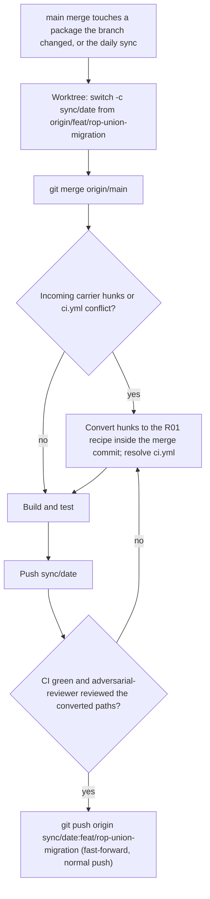

# ROP union migration: branch rules

This page is for contributors and the orchestrator who need to know where a slice of the ROP union migration (#3667) is merged, how the integration branch stays in step with `main`, when a pull request to `main` must wait, how the migration lands on `main` (Z0), and which checks of `AGENTS.md` section 9 are replaced on the branch. It explains the rules and their reasons; it is not a step-by-step procedure for a single slice (the sync commands and the collector table below are kept here as the record of the rule, not as a how-to). The union itself is decided in [ADR-064](../architecture/adr/064-rop-result-union.md) and investigated in [the 3662 spike](rop-unions-spike-3662.md). The recipe that converts a carrier hunk is `docs/engineering/rop-conversion-recipe.md` (created later by R01), and the migration's own README is `rop-migration/README.md` (T00); neither exists yet, so both are named here in plain text.

The page covers placement, sync, hold, Z0, the collector and the section 9 deviation. It does not cover the migration state, the generated build set or the gate mechanism (T00 and I03).

## 1. Placement: main or the branch

The base-branch rule of 2026-11-25 splits the migration items between two bases. Everything that is valid on the old carrier lands on `main` with full CI. Only the carrier change itself runs on the integration branch `feat/rop-union-migration`.

| Item | Base | Notes |
| --- | --- | --- |
| Platform L0 slices P01, P02, P03, P04, P09 and K0 | `main` | Full CI. |
| Hosted-service, closed-hierarchy and startup-validator follow-through (H, C1-C3, D1-inv) | `main` | Valid on the old carrier. |
| `EncinaError` struct-to-class change (E family) | `main` | Valid on the old carrier. |
| `RequestIdentity` hierarchy (C4) | `main` | Valid on the old carrier. |
| K-items: K0 measures the per-package CRAP backlog, `K-<P>` lowers it | `main` | `K-<P>` blocks the first src slice of package `<P>`. |
| R02a through R04, the S slices, Z slices other than Z0, Z1d and Z4 | `feat/rop-union-migration` | The carrier change itself. Z slices other than Z0, Z1d and Z4 go to the branch. |
| Z0, Z1d, Z4 | `main` | Z0, Z1d and Z4 are PRs into `main`. |

Three consequences follow.

- The branch is cut at B0 after F1, I01 and I02 merge. B0 is an orchestrator step, not an issue.
- A branch item blocked by a `main` item waits until that item is merged on `main` and synced into the branch (section 2). An S slice never starts before the H, C, E, C4 and K items of its own package are synced.
- New carrier code may still be written on `main`, but only with symbols that have an R01 mapping in `docs/engineering/rop-conversion-recipe.md`, so that the conversion during a sync is mechanical.

Why not everything on the branch: `ci.yml` runs only on pull requests to `main`, so slice PRs into the branch would lack `pr-size`, `crap-gate` and `target-ratchet` unless I01 and I03 add them (maintainer decision of 2026-11-20).

## 2. Sync: main into the branch

The branch is kept current by a periodic local merge of `main` into it, done by the orchestrator, with a normal push and never a force-push or a rebase, after build and tests (maintainer decision of 2026-11-20). The details are from the decomposition of #3667, section 3.4.

The orchestrator syncs daily, or after a `main` merge that touches a package the branch has changed. In a worktree:

```powershell
git switch -c sync/<yyyy-MM-dd> origin/feat/rop-union-migration
git merge origin/main
```



Rules of the sync:

| Rule | Detail |
| --- | --- |
| Conversion | Incoming carrier hunks in files of packages the branch has changed are converted to the R01 recipe inside the merge commit. |
| Review | An adversarial-reviewer reviews `git diff <merge>^1 <merge> -- <converted paths>` before the branch moves. |
| Publishing | Push `sync/<date>`; when its CI is green and the review is done, fast-forward the branch with `git push origin sync/<date>:feat/rop-union-migration`. Never force, never rebase. The `sync/<date>` push is validated by the branch's `ci.yml` push trigger, added by I03 (a sub-issue of #3667). |
| 300-line cap | At most 300 converted lines per sync. When one `main` squash commit brings more, the sync merges `main` up to the commit before it, and that commit gets its own sync. |
| Branch protection | A pull request with the required checks (`ci-result`) for slice PRs; not enforced for administrators, so the sync merge can be pushed. A direct push to the branch is for verified sync merges only. The setting itself is made at B0. |

### ci.yml conflicts

I03 edits the branch's `ci.yml`, and `main` changes the same file often (Dependabot, platform PRs). The sync resolves these conflicts inside the sync merge: it keeps the branch-only steps and takes main's other changes.

## 3. Hold on main pull requests

While a package is in progress on the branch, a window defined by slice state (its first src slice is merged and its last src slice is not yet, not only by level numbers), the orchestrator does not merge `main` PRs whose diff has carrier hunks in that package. A carrier hunk contains one of `Either`, `Option<`, `Unit`, `LanguageExt`, `Match(` or `Bind(`. Other PRs, test-only PRs and non-carrier src changes flow.

| Topic | Rule |
| --- | --- |
| Window length | Short: Core L6-L8, Messaging L9-L11, any other package at most 3 levels. A package is never frozen for its whole span. |
| Hotfixes | Go to both branches. |
| EPIC work | #3449 (error catalog tests), #3719 (sharding error categories) and #4007 (EventId moves such as CM-1 Core and CM-4 Messaging) flow, except inside such a window. #3719's Core sharding error changes should land before S-Core-01 or wait for L8. |

## 4. Z0: landing on main

Z0 is a single squash pull request into `main` carrying the label `size-exception-approved`, applied by the maintainer at merge time. Merge commits are disabled and `main` requires linear history. A compile switch that kept both carriers would be a compatibility layer (`AGENTS.md` section 3), so it is not an option. The body of the Z0 pull request is the output of the collector (section 5): the sorted `Fixes #` set. After Z0 and Z4 this page stays as the record of the rules.

## 5. The collector

`tools/ai/collect-rop-fixes.ps1` prints the set of issues that the slice PRs merged into the branch close. Slice PRs carry `Fixes #<issue>` in the body.

| Aspect | Behavior |
| --- | --- |
| Parameters | `-Base` (default `feat/rop-union-migration`), `-Repository` (default `dlrivada/Encina`), `-Limit` (read only the first N merged PRs the API returns, newest created first; 0, the default, reads all). |
| Source | REST only, `gh api --paginate` on `repos/dlrivada/Encina/pulls?state=closed&base=<b>&per_page=100`; never `gh pr list`, per [the GitHub API quota note](github-api-quota.md). |
| Selection | Keeps PRs with a non-null `merged_at`; a null body is treated as empty. |
| Matching | Every GitHub closing keyword, case-insensitive: close, closes, closed, fix, fixes, fixed, resolve, resolves, resolved; optional colon; `#N`, `dlrivada/Encina#N` or the issue URL form `https://github.com/dlrivada/Encina/issues/N` (for example `Fixes https://github.com/dlrivada/Encina/issues/12`), always separated from the keyword (or its colon) by whitespace, so `Fixes#12` does not match. `GH-N` is not matched, because this repository does not use it. |
| Output | stdout: the de-duplicated set sorted numerically ascending, one `Fixes #N` per line and nothing else. stderr: a one-line summary. |
| Base check | Before reading pull requests, it checks that the base branch exists (`gh api repos/<repo>/branches/<b>`), because a mistyped or missing base would otherwise return an empty list with HTTP 200. A missing branch prints an error to stderr and exits 1. An existing base with 0 merged PRs prints an empty set and exits 0. |
| Failure | A failed API call exits non-zero and prints no partial set, because an incomplete set would leave slice issues open. |

```powershell
pwsh -NoProfile -File tools/ai/collect-rop-fixes.ps1
```

## 6. Deviation from AGENTS.md section 9

On the branch, three checks of `AGENTS.md` section 9 are replaced by other checks (decomposition of #3667, section 3.10). This is a recorded deviation, not a change of the rules: it needs a maintainer approval gate, acknowledged once by the maintainer in the same batch as Z0's `size-exception-approved` label. It applies from L6 (S-Core-01), while the acknowledgement is scheduled at Z0.

| # | Check on a normal PR | Why it cannot run on the branch | Checked instead by | Owner of a failure |
| --- | --- | --- | --- | --- |
| 1 | `crap-gate` on changed methods | Intermediate src slices have a package with no coverage while it is half converted. | The package completion gate (cumulative `git diff origin/main...HEAD -- src/<P>/`) and Z0's whole-diff `crap-gate`. | `K-<P>` before the package's first src slice; `S-<P>-C` for a residue. |
| 2 | Per-file targets of touched src files | From L6 to L18 almost no test runs. | `coverage-report.cs --check-targets` at package completion, blocking on the branch, and Z0 (CI Full, every flag). | `S-<P>-G` |
| 3 | A failure on the last test slice although it did not touch the failing method | A conversion changes the return type of almost every method (see below). | The backlog is removed on `main` first (`K-<P>`), so the completion gate should only see conversion-induced changes. | `S-<P>-C` |

The backlog step explains row 3. Because a conversion changes the return type of almost every method, every pre-existing method above CRAP 10 becomes a changed method at package completion and would fail the gate for reasons that predate the migration. K0 measures that backlog per package and `K-<P>` fixes it on `main` before the package's first src slice.
