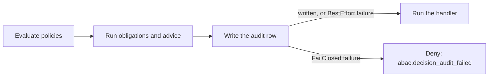

# How to audit ABAC decisions

This guide shows a developer who already runs `Encina.Security.ABAC` how to record every decision the enforcement point makes in the operation audit store, and what to check so the trail means what you expect. It is pre-1.0. The entry shape, limits and error codes are in the [decision audit reference](reference/decision-audit.md); what a row tells an auditor is in [What the ABAC decision audit tells you](audit-decisions-explained.md); the design is [ADR-047](../../architecture/adr/047-abac-decision-audit.md).

## Turn the audit on

Register `AddEncinaSecurity` before `AddEncinaABAC`, enable the audit and register an `IOperationAuditStore` (ABAC never registers one):

```csharp
services.AddEncinaSecurity();
services.AddEncinaABAC(options => options.AuditDecisions());
services.AddScoped<IOperationAuditStore, MyOperationAuditStore>(); // or the store of your provider package
```

`AuditDecisions()` sets `DecisionAudit.Enabled = true`. With no store registered, the host fails to start; with `InMemoryOperationAuditStore` it warns that the trail is lost on restart. See [Startup check](reference/decision-audit.md#startup-check). The audit is incompatible with `EnforcementMode = Disabled` and the host refuses to start with both.

### Keep the registration order

Pipeline behaviors run in registration order, so `AddEncinaSecurity` must come before `AddEncinaABAC`. The order matters for the meaning of the row: the ABAC record is the ABAC decision, not the final outcome of the request. A later behavior, or the handler, can still fail the request after ABAC let it through, and the row stays `Success`.

No startup warning exists for the wrong order. The execution-order contract that will replace the convention is tracked in #1783.

## Read the outcome correctly

- In `Warn` mode, `Success` means ABAC let the request through, not that the policy permitted it. A would-deny verdict is stored as `Success` with the metadata `abac.enforced` set to `false`. Filter on that key to find the requests Warn mode waved through. The mapping is in [Outcome mapping](reference/decision-audit.md#outcome-mapping).
- No row means "not evaluated", never "granted". Only requests that reach the enforcement point are audited: a request without `[RequirePolicy]` or `[RequireCondition]`, one outside the `Outcomes` you selected, or one that never got that far leaves no row. Errors are exempt from the `Outcomes` filter: an indeterminate decision, an evaluation failure and an unauthenticated caller are always recorded when the audit is enabled.
- Code that calls `IPolicyDecisionPoint` directly is not audited. Only the `ABACPipelineBehavior` records decisions.
- The row identifies who acted with `abac.identity_kind`, an explicit actor kind, and the caller in `UserId` (`service:<name>` for a service identity).

## Declare the resource id

`EntityId` holds the id of the resource the request touches, and only an explicit declaration fills it. Implement `IABACResourceIdentity` on the request:

```csharp
public sealed record GetPatientRecordQuery(Guid PatientId) : IQuery<PatientRecord>, IABACResourceIdentity
{
    public string? ResourceId => PatientId.ToString();
}
```

Or return a resource attribute from your `IAttributeProvider` under the name `ABACDecisionAuditOptions.ResourceIdAttributeName` (default `resourceId`). The interface wins when both exist. A request that declares neither leaves `EntityId` empty: the audit never guesses an id from property names, and there is no `AuditRequestConventions` type to configure. Return `null` from `ResourceId` for list and search requests.

## Know what happens when the write fails

The enforcement point decides first, then writes the record, then lets the request proceed. Obligations and advice run during the decision, so they have already run when the write happens. A failed write does not undo them.



| Decision | Write fails, `FailClosed` (default) | Write fails, `BestEffort` |
|----------|-------------------------------------|---------------------------|
| Request would proceed | Denied with `abac.decision_audit_failed`; its obligations and advice already ran | Proceeds; the failure is logged |
| Request denied anyway | Stays denied with its original error; the failure is logged | Same |

An obligation handler that sends a notification or changes state therefore can have run for a request the audit then denied. Make such handlers idempotent, or move the effect to the handler of the request. The decision id of the row (`OperationAuditEntry.Id`) correlates the two. The recorder, its timeout and the retry behavior are in the [reference](reference/decision-audit.md#recorder).

## Combine it with the operation audit

When `AddEncinaAudit` and its `AuditPipelineBehavior` (package `Encina.Security.Audit`) also audit the request, one request produces two rows: the ABAC row (`Action` = `ABACDecision`) and the operation row. Join them on `CorrelationId`. The two rows can disagree, because the ABAC row is the decision and the operation row is the result.

## Plan storage and retention

- Outside Marten, the ADO.NET, Dapper, EF Core and MongoDB operation stores keep ids and metadata in clear. `EntityId` and `TenantId` are not encrypted by any store, including `MartenOperationAuditStore`, which encrypts `UserId`, `IpAddress`, `UserAgent`, `Metadata` and the payload fields, and leaves `EntityId` and `TenantId` in clear. A resource id such as a patient id is therefore readable by anyone with access to the audit database. Use opaque ids as resource ids, or restrict access to the store. Provider notes are in [Providers](reference/decision-audit.md#providers).
- `OperationAuditOptions.RetentionDays` defaults to 2555 days. `OperationAuditOptions.EnableAutoPurge` defaults to `false`, so nothing is purged until you enable it:

```csharp
services.AddEncinaAudit(options =>
{
    options.RetentionDays = 2555;
    options.EnableAutoPurge = true;
});
```

## Service identities and personal data

A caller can be a user or a service identity registered with `AddEncinaServiceIdentity`. Before you rely on the rows, check these:

- A `service:<name>` id is not personal data by itself, and it is stored in clear without the personal-data regime (outside Marten, which encrypts every `UserId` alike). A user id keeps that regime.
- The whole row is still health data when the resource is health data: apply your retention and access rules to the row as a whole, not per column.
- Never name a service after a person. `AddEncinaServiceIdentity` documents that a service name describes a function and is never assigned to one person; a name that identifies a person defeats the distinction.
- The record carries the single request identity. A service acting on behalf of a user does not record the user as a second identity; a second identity is recorded once an on-behalf concept exists, and Encina has none today.
- The actor kind is explicit in `abac.identity_kind`, so do not infer it from the shape of `UserId`.
