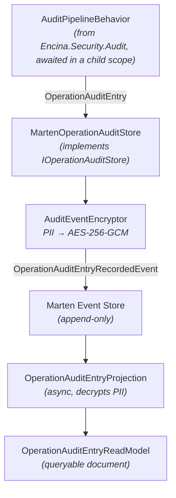
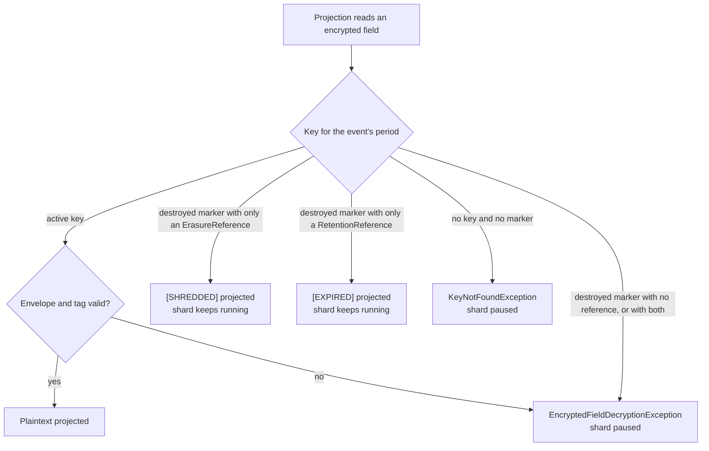

# Encina.Audit.Marten — Event-Sourced Audit with Temporal Crypto-Shredding

## Overview

`Encina.Audit.Marten` is a specialized `IOperationAuditStore` provider that uses Marten's PostgreSQL event store for **immutable, compliance-grade audit trails** with temporal crypto-shredding.

Unlike the 13 database providers (ADO.NET, Dapper, EF Core, MongoDB) which store audit entries as mutable rows, this provider stores them as **append-only encrypted events**. PII fields are encrypted with time-partitioned AES-256-GCM keys, enabling GDPR data minimization via key destruction without breaking event stream integrity.

## Compliance Mapping

| Regulation | Article | Requirement | How This Package Addresses It |
|------------|---------|-------------|-------------------------------|
| **SOX** | Section 404 | Immutable audit trail of internal controls | Append-only event streams cannot be modified or deleted |
| **NIS2** | Art. 10 | Logging with integrity guarantees | Event stream integrity preserved even after crypto-shredding |
| **GDPR** | Art. 5(1)(e) | Data minimization — storage limitation | Temporal key destruction renders PII unreadable after the retention period; the marker records a retention reference and the fields read `[EXPIRED]`, see [Retention expiry reads [EXPIRED]](#retention-expiry-reads-expired) |
| **GDPR** | Art. 5(2) | Accountability | The destroyed-key marker records why a field is unreadable: an erasure reference or a retention reference |
| **GDPR** | Art. 17 | Right to erasure | Temporal key destruction recorded with an erasure reference (`[SHREDDED]`) achieves provable erasure; a retention purge records a retention reference instead and reads `[EXPIRED]` |
| **HIPAA** | Section 164.312(b) | Audit controls | Comprehensive access tracking with configurable retention |
| **PCI-DSS** | Req. 10.2 | Logging and monitoring | Full audit trail of cardholder data operations |

## Architecture



`AuditPipelineBehavior` awaits the `IOperationAuditStore.RecordAsync` call in its own child scope (`IServiceScopeFactory`). By default (`OperationAuditOptions.FailureMode = OperationAuditFailureMode.FailClosed`) a failed write makes a successful request return the error `audit.write_failed`; `OperationAuditFailureMode.BestEffort` is the explicit opt-out and logs the dropped write at Warning.

## Configuration

```csharp
services.AddEncinaAuditMarten(options =>
{
    // Time partitioning for encryption keys
    options.TemporalGranularity = TemporalKeyGranularity.Monthly;

    // Which fields to encrypt (PiiFieldsOnly or AllFields)
    options.EncryptionScope = AuditEncryptionScope.PiiFieldsOnly;

    // Retention before key destruction (SOX = 7 years)
    options.RetentionPeriod = TimeSpan.FromDays(2555);

    // Background auto-purge
    options.EnableAutoPurge = true;
    options.PurgeIntervalHours = 24;

    // Optional: name the approved retention policy in the destroyed-key marker
    // (default null: audit-retention:<ISO 8601 RetentionPeriod>)
    options.RetentionPolicyId = "audit-retention-policy-2026";

    // Health check
    options.AddHealthCheck = true;
});
```

## Encryption Scope

### PiiFieldsOnly (default, recommended)

Encrypts: `UserId`, `IpAddress`, `UserAgent`, `RequestPayload`, `ResponsePayload`, `Metadata`.

Plaintext: `Action`, `EntityType`, `EntityId`, `Outcome`, `TimestampUtc`, `CorrelationId`, `TenantId`, `RequestPayloadHash`.

After key destruction, compliance officers can still see "someone did X to entity Y at time Z" without knowing who, in read-model entries that were already projected. A retention purge shows `[EXPIRED]` (option `MartenOperationAuditOptions.ExpiredPlaceholder`, default `[EXPIRED]`), never `[SHREDDED]`: `[SHREDDED]` appears only when the destroyed marker carries an erasure reference. Projecting an event whose key was destroyed without any reference fails instead (see [Recover from an unreadable audit event](#recover-from-an-unreadable-audit-event)).

### AllFields

Encrypts everything. After key destruction, nothing new can be projected or queried for the affected periods. Use only when structural metadata is considered sensitive.

## Temporal Key Granularity

| Granularity | Key Format | Keys/Year | Shredding Precision | Use Case |
|-------------|-----------|-----------|---------------------|----------|
| Monthly | `2026-03` | 12 | ~30 days | GDPR strict minimization |
| Quarterly | `2026-Q1` | 4 | ~90 days | Balance of precision and overhead |
| Yearly | `2026` | 1 | ~365 days | Long retention (SOX 7-year) |

## Performance

<!-- docref-table: bench:audit-marten/* -->
| Operation | Latency | Notes |
|-----------|---------|-------|
| Encrypt 1 PII field (16B) | ~900 ns | AES-NI hardware accelerated |
| Encrypt full entry (6 PII fields) | ~8.6 us | Typical command overhead |
| Key lookup (existing) | ~60 ns | ConcurrentDictionary O(1) |
| Shredded path (null key) | ~0.4 ns | Zero-cost when key destroyed |
| **Load test throughput** | **508K entries/sec** | 8 workers, 2KB payload |
| **P50 latency** | **8.7 us** | |
| **P99 latency** | **0.24 ms** | |
<!-- /docref-table -->

The encryption overhead represents **< 1%** of total audit recording cost (PostgreSQL I/O dominates at 1-5 ms).

## Testing

| Type | Count | Coverage |
|------|-------|----------|
| Unit | 60 | Encryption round-trip, key lifecycle, options, encryptor |
| Guard | 13 | Null parameter validation |
| Property | 6 | FsCheck round-trip invariants |
| Integration | 7 | Real PostgreSQL via Docker/Testcontainers |
| Benchmark | 17 | EncryptedField, TemporalKeyProvider, AuditEventEncryptor |
| Load | 1 | 8-worker concurrent encryption with P50/P95/P99 |

## Recover from an unreadable audit event

This section is for the operator of an application that uses `Encina.Audit.Marten` and whose audit read models have stopped updating. It shows how to recognise the cause, repair it and rebuild the projection. Background: [ADR-020](../architecture/adr/020-temporal-crypto-shredding-audit-store.md) describes the temporal crypto-shredding audit store, and [ADR-034](../architecture/adr/034-crypto-shredding-through-the-stj-contract.md) the fail-closed reads of the per-subject store. The behaviour described here was decided in issue #2770 and narrows ADR-020 where it says any destroyed key reads as `[SHREDDED]`; ADR-020 carries dated amendment notes, and no separate ADR records it yet.

### What happens

When the projection reads an event whose encrypted field cannot be read for an unexplained reason, it throws `EncryptedFieldDecryptionException` and Marten's async daemon pauses that shard. Encina chooses integrity before availability: damaged or unexplained audit data is never shown as plaintext and never shown as erased. A key destruction is explained only by a reference stored in the destroyed-key marker (`TemporalKeyDestroyedMarker`), and a destruction carries exactly one kind of reference (`KeyDestructionReference` is a closed record with two derivations):

- `ErasureReference` (`RequestId`, `RequestedAtUtc`, `Actor`): a recorded erasure request. The field reads `[SHREDDED]` (`IsShredded = true`) and the shard keeps running, because a lawful erasure must be provable. `HasErasureReference()` requires a non-blank request id and actor and a non-default request date.
- `RetentionReference` (`PolicyId`, `CutoffUtc`, `ExecutedAtUtc`, `Actor`): a retention policy execution. The field reads `[EXPIRED]` (`IsExpired = true`) and the shard keeps running. `HasRetentionReference()` requires all four values.

`TemporalKeyDestroyedMarker.Classify()` returns a `KeyDestructionKind`: `Erasure`, `Retention`, or `Unrecorded` (neither reference, or both, which a marker never carries unless it is damaged or tampered with). `DestroyKeysBeforeAsync` returns `Left` with `audit.marten.invalid_erasure_reference` or `audit.marten.invalid_retention_reference` for an incomplete reference and destroys nothing. Why retention expiry is an expected event and not a fault: GDPR Art. 5(1)(e) (storage limitation), while the marker still answers why a field is unreadable (Art. 5(2)).



The shards are `OperationAuditEntryProjection:All` and `ReadAuditEntryProjection:All`. A paused shard does not retry. Marten applies events in ranges as one batch, so the healthy events of the failing range are also not projected until the shard runs again. Nothing is projected wrongly, and the read side keeps serving the last projected state meanwhile.

### Set Marten's projection error flags

A paused shard only happens when Marten does not skip the failing event. Marten's default is to skip (`SkipApplyErrors = true`), which would drop an audit event from the read model without a stop. Encina does not change these flags, because they are store-wide and also govern the application's own projections. The application MUST set all four to `false` in its `AddMarten` configuration:

```csharp
services.AddMarten(options =>
{
    options.Projections.Errors.SkipApplyErrors = false;
    options.Projections.Errors.SkipSerializationErrors = false;
    options.Projections.RebuildErrors.SkipApplyErrors = false;
    options.Projections.RebuildErrors.SkipSerializationErrors = false;
});
```

A failing event of any projection of the store, not only the audit ones, then pauses that shard instead of being skipped.

`AuditProjectionErrorPolicyStartupGuard` (an `IHostedLifecycleService`) checks this in `StartingAsync`, after the application's final Marten configuration is built, whatever the registration order. If any of the four flags is `true`, it throws `InvalidOperationException` and the host stops. The message is fixed, names the offending flags (`Errors.SkipApplyErrors`, `Errors.SkipSerializationErrors`, `RebuildErrors.SkipApplyErrors`, `RebuildErrors.SkipSerializationErrors`) and holds no secrets. The failure is logged as error event 2591.

To start with skipping enabled anyway, set `MartenOperationAuditOptions.AllowSkippedProjectionErrors = true` (default `false`). The host then starts and logs warning event 2590 with the number of skipping flags. Accept the risk first: an audit event that fails to project can be lost from the read model without a stop. Decision record: the 2026-10-27 amendment of [ADR-020](../architecture/adr/020-temporal-crypto-shredding-audit-store.md).

### Recognise it

1. Look for an Error entry in the logger you gave to `BuildProjectionDaemonAsync` (category `Marten.Daemon` in the integration test) that reads "Subscription OperationAuditEntryProjection:All failed while creating a SQL batch", with an inner `JasperFx.Events.Daemon.ApplyEventException` ("Failure to apply event #`<sequence>` Id(`<event guid>`)") whose inner exception is the one below.
2. `EncryptedFieldDecryptionException` derives from `CryptographicException`. Its message is fixed and holds only the code `audit.marten.encrypted_field_unreadable`. Its `Reason` property says which of the five cases applies.
3. The message never contains plaintext, a key id, a period or the envelope. Use the sequence number or event id from the log to find the row in the `mt_events` table, and read its stream and period from there.
4. A daemon check shows the same thing: `IProjectionDaemon.StatusFor(shard)` is `AgentStatus.Paused`, and `HasAnyPaused()` is `true`.

| `Reason` | Meaning | Usual repair |
|----------|---------|--------------|
| `EnvelopeMalformed` | The value starts with the `__enc` marker but is not a readable envelope (invalid JSON, a missing or wrongly typed `ct`, `n` or `t`, invalid Base64) | Restore the event data from a backup |
| `NotEncrypted` | The value has no `__enc` marker although every stored value should be encrypted | Find out how plaintext got into the event, then restore the data |
| `InvalidKeyOrParameters` | The key material, nonce or tag has the wrong size | Restore the key document or the event data |
| `IntegrityCheckFailed` | The authentication tag did not verify: tampered ciphertext or tag, or a key that does not match | Treat as a security incident, then restore the data or the correct key |
| `KeyDestroyedWithoutErasureRecord` | The period's key was destroyed, but the marker has neither an erasure nor a retention reference, or has both (damaged or tampered, not trusted) | Restore the key, or add the reference only for a real erasure request or a real retention execution (see [Retention expiry reads [EXPIRED]](#retention-expiry-reads-expired)) |

A key with neither an active key document nor a destroyed marker for the event's period throws `KeyNotFoundException` instead (the message names the period and says there is no active key and no destroyed marker). The daemon does not retry it either: the shard pauses. Restore the key document.

### Repair the cause and rebuild

1. Repair the cause: restore the missing key document, restore or repair the damaged event data, or write the confirmed reference into the destroyed marker (an erasure reference only when the erasure request really exists, a retention reference only when a retention execution really destroyed the key).
2. Rebuild the projection. This is the recovery the integration test below verifies:

```csharp
using var daemon = await store.BuildProjectionDaemonAsync();

await daemon.RebuildProjectionAsync("OperationAuditEntryProjection", cancellationToken);
// For the read audit trail: "ReadAuditEntryProjection"
```

The integration test `AfterTheCauseIsRepaired_RebuildingTheProjectionProjectsEveryEvent` in `tests/Encina.IntegrationTests/Infrastructure/Marten/Audit/AuditProjectionUnreadableEventIntegrationTests.cs` runs this sequence against a real PostgreSQL: after the key is restored, the rebuild projects every event, including the one that stopped the shard.

### Retention expiry reads [EXPIRED]

`MartenOperationAuditStore.PurgeEntriesAsync` and `MartenReadAuditStore.PurgeEntriesAsync` (and so the auto-purge retention service) pass a `RetentionReference` to `DestroyKeysBeforeAsync`: policy id `MartenOperationAuditOptions.RetentionPolicyId` when set, otherwise `audit-retention:<ISO 8601 RetentionPeriod>` (for example `audit-retention:P2555D`), the purge cutoff, the execution time from the injected `TimeProvider`, and actor `system`. Projecting events of a purged period, including in a rebuild, therefore yields the `[EXPIRED]` placeholder (`IsExpired = true`) and does not pause the shard. A rebuild passes over purged periods.

The query helpers treat `[EXPIRED]` like `[SHREDDED]`: the `MetadataJson` of an expired or shredded entry is not parsed (the metadata is empty), `UserId` and `IpAddress` filters cannot match placeholder values, and a `Purpose` filter contains the placeholder.

`RetentionPolicyId` (`string?`, default `null`) is rejected with an `OptionsValidationException` at `AddEncinaAuditMarten` when it is empty or whitespace. Operators who run manual purges should set it to the identifier of the retention policy their organisation approved, so the marker names that policy (GDPR Art. 5(2)); the automatic and the manual purge both use it.

A retention purge hard-deletes the key document, so the key cannot be restored except from a backup of the key documents. A marker written without any reference (before this change, or by a direct `DestroyKeysBeforeAsync(..., reference: null)` call) still fails with `KeyDestroyedWithoutErasureRecord` and pauses the shard. Operator resolution for that case is not available until the later change tracked as PR 2b of issue #2770.

For a marker with no reference you can today:

- Restore the key document from a backup, when the destruction was a mistake or the data must stay readable.
- Edit the destroyed marker document directly through a Marten session to add the confirmed reference, only when it is true: an erasure reference (request id, actor and a non-default request date) when an erasure request really exists for that period, or a retention reference (policy id, cutoff, execution time and actor) when a retention execution really destroyed the key. No Encina API does this yet. Do not add an erasure reference to the marker of a retention purge: that falsifies the erasure evidence. A marker must never carry both kinds; it then classifies as `Unrecorded` and the shard pauses.

`DestroyKeysBeforeAsync` cannot attach a reference to a period that is already destroyed: its marker exists, so the period is skipped and the reference passed in the call is not recorded.

### Limits today

- Encina does not set Marten's projection error flags; the application does (see [Set Marten's projection error flags](#set-martens-projection-error-flags)). Marten has no per-projection policy, so the flags apply to the whole store.
- You cannot skip or label a single event. Operator resolution commands (mark an event `[UNREADABLE]`, confirm `[SHREDDED]` or `[EXPIRED]` out of band for a marker with no reference, re-project one event, exclude an event, each one audited) arrive in a later change, tracked as PR 2b of issue #2770. They are not available yet.

## Related

- [Audit Trail Logging](audit-tracking.md) — Core `IOperationAuditStore` interface and pipeline behavior
- [Crypto-Shredding](crypto-shredding.md) — GDPR Art. 17 per-subject crypto-shredding (Encina.Marten.GDPR)
- [Benchmark Results](../benchmarks/audit-marten-benchmark-results.md) — Detailed benchmark data
- [Load Test Baselines](../testing/load-test-baselines.md) — Throughput and latency baselines
