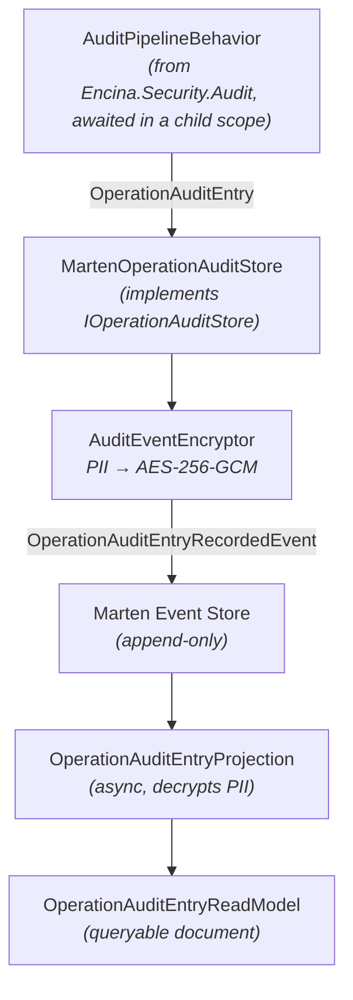
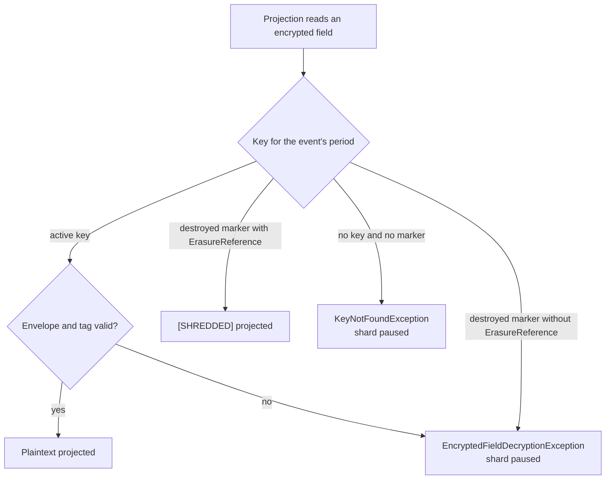

# Encina.Audit.Marten — Event-Sourced Audit with Temporal Crypto-Shredding

## Overview

`Encina.Audit.Marten` is a specialized `IOperationAuditStore` provider that uses Marten's PostgreSQL event store for **immutable, compliance-grade audit trails** with temporal crypto-shredding.

Unlike the 13 database providers (ADO.NET, Dapper, EF Core, MongoDB) which store audit entries as mutable rows, this provider stores them as **append-only encrypted events**. PII fields are encrypted with time-partitioned AES-256-GCM keys, enabling GDPR data minimization via key destruction without breaking event stream integrity.

## Compliance Mapping

| Regulation | Article | Requirement | How This Package Addresses It |
|------------|---------|-------------|-------------------------------|
| **SOX** | Section 404 | Immutable audit trail of internal controls | Append-only event streams cannot be modified or deleted |
| **NIS2** | Art. 10 | Logging with integrity guarantees | Event stream integrity preserved even after crypto-shredding |
| **GDPR** | Art. 5(1)(e) | Data minimization — storage limitation | Temporal key destruction renders PII unreadable after the retention period; projecting those periods again fails typed, see [Recover from an unreadable audit event](#recover-from-an-unreadable-audit-event) |
| **GDPR** | Art. 17 | Right to erasure | Temporal key destruction recorded with an erasure reference (`[SHREDDED]`) achieves provable erasure; a retention purge records none |
| **HIPAA** | Section 164.312(b) | Audit controls | Comprehensive access tracking with configurable retention |
| **PCI-DSS** | Req. 10.2 | Logging and monitoring | Full audit trail of cardholder data operations |

## Architecture



`AuditPipelineBehavior` awaits the `IOperationAuditStore.RecordAsync` call in its own child scope (`IServiceScopeFactory`). By default (`OperationAuditOptions.FailureMode = OperationAuditFailureMode.FailClosed`) a failed write makes a successful request return the error `audit.write_failed`; `OperationAuditFailureMode.BestEffort` is the explicit opt-out and logs the dropped write at Warning.

## Configuration

```csharp
services.AddEncinaAuditMarten(options =>
{
    // Time partitioning for encryption keys
    options.TemporalGranularity = TemporalKeyGranularity.Monthly;

    // Which fields to encrypt (PiiFieldsOnly or AllFields)
    options.EncryptionScope = AuditEncryptionScope.PiiFieldsOnly;

    // Retention before key destruction (SOX = 7 years)
    options.RetentionPeriod = TimeSpan.FromDays(2555);

    // Background auto-purge
    options.EnableAutoPurge = true;
    options.PurgeIntervalHours = 24;

    // Health check
    options.AddHealthCheck = true;
});
```

## Encryption Scope

### PiiFieldsOnly (default, recommended)

Encrypts: `UserId`, `IpAddress`, `UserAgent`, `RequestPayload`, `ResponsePayload`, `Metadata`.

Plaintext: `Action`, `EntityType`, `EntityId`, `Outcome`, `TimestampUtc`, `CorrelationId`, `TenantId`, `RequestPayloadHash`.

After key destruction, compliance officers can still see "someone did X to entity Y at time Z" without knowing who, in read-model entries that were already projected. Retention purge shows no `[SHREDDED]` placeholder: `[SHREDDED]` appears only when the destroyed marker carries an erasure reference. Projecting an event whose key was destroyed without an erasure reference fails instead (see [Recover from an unreadable audit event](#recover-from-an-unreadable-audit-event)).

### AllFields

Encrypts everything. After key destruction, nothing new can be projected or queried for the affected periods. Use only when structural metadata is considered sensitive.

## Temporal Key Granularity

| Granularity | Key Format | Keys/Year | Shredding Precision | Use Case |
|-------------|-----------|-----------|---------------------|----------|
| Monthly | `2026-03` | 12 | ~30 days | GDPR strict minimization |
| Quarterly | `2026-Q1` | 4 | ~90 days | Balance of precision and overhead |
| Yearly | `2026` | 1 | ~365 days | Long retention (SOX 7-year) |

## Performance

<!-- docref-table: bench:audit-marten/* -->
| Operation | Latency | Notes |
|-----------|---------|-------|
| Encrypt 1 PII field (16B) | ~900 ns | AES-NI hardware accelerated |
| Encrypt full entry (6 PII fields) | ~8.6 us | Typical command overhead |
| Key lookup (existing) | ~60 ns | ConcurrentDictionary O(1) |
| Shredded path (null key) | ~0.4 ns | Zero-cost when key destroyed |
| **Load test throughput** | **508K entries/sec** | 8 workers, 2KB payload |
| **P50 latency** | **8.7 us** | |
| **P99 latency** | **0.24 ms** | |
<!-- /docref-table -->

The encryption overhead represents **< 1%** of total audit recording cost (PostgreSQL I/O dominates at 1-5 ms).

## Testing

| Type | Count | Coverage |
|------|-------|----------|
| Unit | 60 | Encryption round-trip, key lifecycle, options, encryptor |
| Guard | 13 | Null parameter validation |
| Property | 6 | FsCheck round-trip invariants |
| Integration | 7 | Real PostgreSQL via Docker/Testcontainers |
| Benchmark | 17 | EncryptedField, TemporalKeyProvider, AuditEventEncryptor |
| Load | 1 | 8-worker concurrent encryption with P50/P95/P99 |

## Recover from an unreadable audit event

This section is for the operator of an application that uses `Encina.Audit.Marten` and whose audit read models have stopped updating. It shows how to recognise the cause, repair it and rebuild the projection. Background: [ADR-020](../architecture/adr/020-temporal-crypto-shredding-audit-store.md) describes the temporal crypto-shredding audit store, and [ADR-034](../architecture/adr/034-crypto-shredding-through-the-stj-contract.md) the fail-closed reads of the per-subject store. The behaviour described here was decided in issue #2770 and narrows ADR-020 where it says any destroyed key reads as `[SHREDDED]`; ADR-020 carries a dated amendment note, and no separate ADR records it yet.

### What happens

When the projection reads an event whose encrypted field cannot be read, it throws `EncryptedFieldDecryptionException` and Marten's async daemon pauses that shard. Encina chooses integrity before availability: damaged or unexplained audit data is never shown as plaintext and never shown as erased. Only a key destruction recorded together with a complete erasure request reference (`ErasureReference`: `RequestId`, `RequestedAtUtc`, `Actor`; `TemporalKeyDestroyedMarker.HasErasureReference()` requires a non-blank request id and actor and a non-default request date) reads as the `[SHREDDED]` placeholder, because a lawful erasure must be provable.



The shards are `OperationAuditEntryProjection:All` and `ReadAuditEntryProjection:All`. A paused shard does not retry. Marten applies events in ranges as one batch, so the healthy events of the failing range are also not projected until the shard runs again. Nothing is projected wrongly, and the read side keeps serving the last projected state meanwhile.

### Recognise it

1. Look for an Error entry in the logger you gave to `BuildProjectionDaemonAsync` (category `Marten.Daemon` in the integration test) that reads "Subscription OperationAuditEntryProjection:All failed while creating a SQL batch", with an inner `JasperFx.Events.Daemon.ApplyEventException` ("Failure to apply event #`<sequence>` Id(`<event guid>`)") whose inner exception is the one below.
2. `EncryptedFieldDecryptionException` derives from `CryptographicException`. Its message is fixed and holds only the code `audit.marten.encrypted_field_unreadable`. Its `Reason` property says which of the five cases applies.
3. The message never contains plaintext, a key id, a period or the envelope. Use the sequence number or event id from the log to find the row in the `mt_events` table, and read its stream and period from there.
4. A daemon check shows the same thing: `IProjectionDaemon.StatusFor(shard)` is `AgentStatus.Paused`, and `HasAnyPaused()` is `true`.

| `Reason` | Meaning | Usual repair |
|----------|---------|--------------|
| `EnvelopeMalformed` | The value starts with the `__enc` marker but is not a readable envelope (invalid JSON, a missing or wrongly typed `ct`, `n` or `t`, invalid Base64) | Restore the event data from a backup |
| `NotEncrypted` | The value has no `__enc` marker although every stored value should be encrypted | Find out how plaintext got into the event, then restore the data |
| `InvalidKeyOrParameters` | The key material, nonce or tag has the wrong size | Restore the key document or the event data |
| `IntegrityCheckFailed` | The authentication tag did not verify: tampered ciphertext or tag, or a key that does not match | Treat as a security incident, then restore the data or the correct key |
| `KeyDestroyedWithoutErasureRecord` | The period's key was destroyed, but the marker has no `ErasureReference` | Restore the key, or add the reference only for a real erasure request (see [Retention-period destruction now stops the projection](#retention-period-destruction-now-stops-the-projection)) |

A key with neither an active key document nor a destroyed marker for the event's period throws `KeyNotFoundException` instead (the message names the period and says there is no active key and no destroyed marker). The daemon does not retry it either: the shard pauses. Restore the key document.

### Repair the cause and rebuild

1. Repair the cause: restore the missing key document, restore or repair the damaged event data, or write the confirmed erasure reference into the destroyed marker (only when the erasure request really exists).
2. Rebuild the projection. This is the recovery the integration test below verifies:

```csharp
using var daemon = await store.BuildProjectionDaemonAsync();

await daemon.RebuildProjectionAsync("OperationAuditEntryProjection", cancellationToken);
// For the read audit trail: "ReadAuditEntryProjection"
```

The integration test `AfterTheCauseIsRepaired_RebuildingTheProjectionProjectsEveryEvent` in `tests/Encina.IntegrationTests/Infrastructure/Marten/Audit/AuditProjectionUnreadableEventIntegrationTests.cs` runs this sequence against a real PostgreSQL: after the key is restored, the rebuild projects every event, including the one that stopped the shard.

### Retention-period destruction now stops the projection

`MartenOperationAuditStore` and `MartenReadAuditStore` call `DestroyKeysBeforeAsync` for retention with `erasureReference: null`. Those markers have no erasure reference, so projecting events of those periods (for example in a rebuild) now fails with `KeyDestroyedWithoutErasureRecord` and pauses the shard. The same holds for every marker written before this change. No GDPR erasure flow in the repository calls `DestroyKeysBeforeAsync` with a reference yet (follow-up work), so today only a direct caller that passes an `ErasureReference` produces a marker that reads as `[SHREDDED]`.

A retention purge hard-deletes the key document. The key cannot be restored, except from a backup of the key documents. For a store whose periods were destroyed by retention purge, rebuilding therefore cannot succeed past the first purged period: the rebuild stops at the first event of that period and pauses the shard again. Operator resolution for this case is not available until the later change tracked as PR 2b of issue #2770.

Today you can:

- Restore the key document from a backup, when the destruction was a mistake or the data must stay readable.
- Edit the destroyed marker document directly through a Marten session to add the confirmed erasure reference, only when an erasure request really exists for that period and the key was destroyed because of it. No Encina API does this yet. Do not add a reference to the marker of a retention purge or any other destruction that was not an erasure: that falsifies the erasure evidence, because the marker would then claim a lawful erasure that never happened. The reference must be complete (request id, actor and a non-default request date), or `HasErasureReference()` stays `false`.

`DestroyKeysBeforeAsync` cannot attach an erasure reference to a period that is already destroyed: its marker exists, so the period is skipped and the reference passed in the call is not recorded.

### Limits today

- The configuration `ConfigureMartenOperationAuditProjections` sets `Projections.Errors.SkipApplyErrors`, `SkipSerializationErrors` and the same two options of `Projections.RebuildErrors` to `false`. Marten's default (`SkipApplyErrors = true`) would silently skip a failing audit event. Marten has no per-projection policy, so this applies to the whole store: other projections in the same Marten store also stop on an apply or serialization error instead of skipping it.
- You cannot skip or label a single event. Operator resolution commands (mark an event `[UNREADABLE]`, confirm `[SHREDDED]` out of band, re-project one event, exclude an event, each one audited) arrive in a later change, tracked as PR 2b of issue #2770. They are not available yet.

## Related

- [Audit Trail Logging](audit-tracking.md) — Core `IOperationAuditStore` interface and pipeline behavior
- [Crypto-Shredding](crypto-shredding.md) — GDPR Art. 17 per-subject crypto-shredding (Encina.Marten.GDPR)
- [Benchmark Results](../benchmarks/audit-marten-benchmark-results.md) — Detailed benchmark data
- [Load Test Baselines](../testing/load-test-baselines.md) — Throughput and latency baselines
