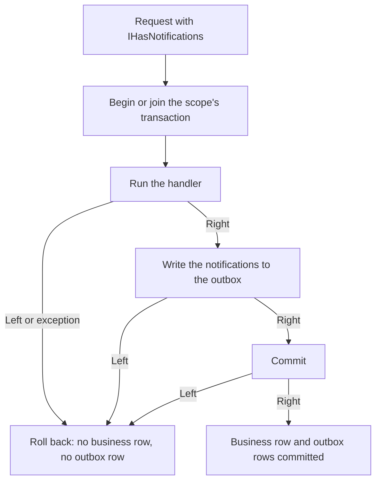

# How to write the outbox inside the request's transaction

This guide shows you how to make the events a request emits and the business change it makes commit or roll back together, on the ADO.NET, Dapper and EF Core providers (SQL Server, PostgreSQL, MySQL). It assumes you already use one of the `Encina.ADO.*`, `Encina.Dapper.*` or `Encina.EntityFrameworkCore` packages and know what the outbox is. The code samples use ADO.NET; on Dapper, pass `transaction: accessor.Current` to each Dapper call instead of setting `command.Transaction`, and register with `AddEncinaDapper`. On EF Core, see [the EF Core section](#ef-core-one-transaction-per-request). The API is pre-1.0 and may still change.

The reasons behind the design (one shared transaction, join and rollback-only, the interim per-family switch) are in [ADR-037](../architecture/adr/037-transactional-outbox.md). The members of every type are in the generated API reference (`/api/` on the site).

## Which providers write inside the transaction

Encina delivers this one provider family at a time. The ADO.NET, Dapper and EF Core providers write the outbox inside the request's transaction today.

| Provider | Outbox row written | Status |
| --- | --- | --- |
| ADO.NET SQL Server (`Encina.ADO.SqlServer`) | inside the request's transaction | done |
| ADO.NET PostgreSQL (`Encina.ADO.PostgreSQL`) | inside the request's transaction | done |
| ADO.NET MySQL (`Encina.ADO.MySQL`) | inside the request's transaction | done |
| Dapper SQL Server (`Encina.Dapper.SqlServer`) | inside the request's transaction | done ([#719](https://github.com/dlrivada/Encina/issues/719)) |
| Dapper PostgreSQL (`Encina.Dapper.PostgreSQL`) | inside the request's transaction | done ([#719](https://github.com/dlrivada/Encina/issues/719)) |
| Dapper MySQL (`Encina.Dapper.MySQL`) | inside the request's transaction | done ([#719](https://github.com/dlrivada/Encina/issues/719)) |
| EF Core SQL Server (`Encina.EntityFrameworkCore`) | inside the request's transaction | done, proven on a real database ([#718](https://github.com/dlrivada/Encina/issues/718)) |
| EF Core PostgreSQL (`Encina.EntityFrameworkCore`) | inside the request's transaction | done, proven on a real database ([#718](https://github.com/dlrivada/Encina/issues/718)) |
| EF Core MySQL (`Encina.EntityFrameworkCore`) | inside the request's transaction | the code is shared; its EF tests are skipped until Pomelo supports EF Core 10 ([#2086](https://github.com/dlrivada/Encina/issues/2086)) |
| MongoDB | after the pipeline, outside the transaction | not yet |

On MongoDB, `OutboxPostProcessor` still writes the outbox row after the pipeline. If you use it, the guarantee of this guide does not apply to you yet. The post-processor returns the first `Left` of the outbox store instead of swallowing it, so a failed write is reported to the caller, but the business change is already committed. MongoDB is a later slice of [#718](https://github.com/dlrivada/Encina/issues/718).

## Step 1: Enable the outbox and the transaction

Register your provider with the outbox on. `UseTransactions` is optional here: with the outbox only, Encina opens the transaction itself around the handler.

```csharp
services.AddEncinaADO(connectionString, config =>
{
    config.UseOutbox = true;
    config.UseTransactions = true;
});
```

`AddEncinaADO(string, Action<MessagingConfiguration>)` exists on the three ADO.NET packages. It registers the scoped connection, the outbox store, `TransactionalOutboxPipelineBehavior<,>`, the scoped `IDbTransactionAccessor` and, when `UseTransactions` is on, the transaction behavior. The outbox table is created by `Scripts/001_CreateOutboxMessagesTable.sql` in your provider package. `AddEncinaDapper(Action<MessagingConfiguration>)`, `AddEncinaDapper(string, Action<MessagingConfiguration>)` and `AddEncinaDapper(Func<IServiceProvider, IDbConnection>, Action<MessagingConfiguration>)` on the three Dapper packages register the same behavior, accessor, stores and `UnitOfWorkDapper`.

## Step 2: Mark the request with `IHasNotifications`

A request that implements `IHasNotifications` (namespace `Encina.Messaging.Outbox`) returns the notifications to publish. Encina reads them after the handler returns, so the handler can build them from what it did.

```csharp
public sealed record OrderPlaced(int OrderId) : INotification;

public sealed record PlaceOrder(int OrderId) : IRequest<int>, IHasNotifications
{
    public IEnumerable<INotification> GetNotifications() => [new OrderPlaced(OrderId)];
}
```

A request that does not implement the interface skips the behavior without opening a transaction.

## Step 3: Run your own commands in the same transaction

Your handler shares the transaction through `IDbTransactionAccessor` (namespace `Encina.Messaging.Transactions`). Use its `Connection`, and assign `Current` to every command that must be atomic with the outbox row.

```csharp
public sealed class PlaceOrderHandler(IDbTransactionAccessor accessor) : IRequestHandler<PlaceOrder, int>
{
    public async Task<Either<EncinaError, int>> Handle(PlaceOrder request, CancellationToken cancellationToken)
    {
        using var command = accessor.Connection.CreateCommand();
        command.Transaction = accessor.Current;
        command.CommandText = "INSERT INTO Orders (Id) VALUES (@id)";

        var parameter = command.CreateParameter();
        parameter.ParameterName = "@id";
        parameter.Value = request.OrderId;
        command.Parameters.Add(parameter);

        await ((DbCommand)command).ExecuteNonQueryAsync(cancellationToken);

        return request.OrderId;
    }
}
```

`DbCommand` is `System.Data.Common.DbCommand`. Return a `Left` to roll everything back: no business row and no outbox row remain. A handler that throws rolls back too, and the exception reaches the caller.

If you forget `command.Transaction = accessor.Current`, SQL Server and MySQL reject the command with an `InvalidOperationException` while the transaction is active; PostgreSQL runs it inside the transaction without complaint. Set it on every command so the code behaves the same on all three.

## What happens when the request runs



A failed outbox write or a failed commit fails the request: the caller gets the `Left`, never a success.

### Composition with transactions and the unit of work

All participants share one transaction per request scope. The first to ask owns it and is the only one that commits; the others join.

| You enable | Who owns the transaction | Result |
| --- | --- | --- |
| `UseOutbox` only | the outbox behavior | begins around the handler, writes the outbox rows, commits |
| `UseTransactions` and `UseOutbox` | `TransactionPipelineBehavior` | the outbox behavior joins; the transaction behavior commits once |
| either of the above, and a handler that calls `IUnitOfWork.BeginTransactionAsync` | whoever began first | the unit of work joins; its `CommitAsync` is a no-op (see the two consequences below the table) |
| a joined unit of work calls `RollbackAsync` | the owner | the owner's commit rolls back and the request fails with `transaction.rollback_only` |
| `UseTransactions` only | `TransactionPipelineBehavior` | no outbox rows; `IDbTransactionAccessor.Current` is available to the handler |

Two consequences follow from joining:

- A joiner's `CommitAsync` returning success does not mean the data is durable. Only the owner's commit does.
- A joiner that asks for an isolation level different from the active transaction's gets `transaction.isolation_level_mismatch`.

The messaging stores of the scope (outbox, inbox, saga, scheduled message) enlist in the same transaction. When `UseRecoverability` is on, Recoverability is registered before the transaction and runs outside it, so a retry begins a new transaction (a named-stage contract is planned in [#2184](https://github.com/dlrivada/Encina/issues/2184)).

## EF Core: one transaction per request

On `Encina.EntityFrameworkCore` the shared transaction is the `IDbContextTransaction` of the scope's `DbContext`. `DbContextTransactionAccessor` (registered as `IDbTransactionAccessor` and `ITransactionLeaseSource`, with `TryAdd`, so your own registration wins) is shared by the EF `TransactionPipelineBehavior<,>`, `UnitOfWorkEF` and `TransactionalOutboxPipelineBehavior<,>`. The handler needs no accessor: its `SaveChangesAsync` runs inside the transaction because it is the `DbContext`'s current transaction.

```csharp
services.AddEncinaEntityFrameworkCore<AppDbContext>(config =>
{
    config.UseOutbox = true;
});

public sealed record PlaceOrder(int OrderId) : IRequest<int>, IHasNotifications
{
    public IEnumerable<INotification> GetNotifications() => [new OrderPlaced(OrderId)];
}

public sealed class PlaceOrderHandler(AppDbContext db) : IRequestHandler<PlaceOrder, int>
{
    public async Task<Either<EncinaError, int>> Handle(PlaceOrder request, CancellationToken cancellationToken)
    {
        db.Orders.Add(new Order { Id = request.OrderId });
        await db.SaveChangesAsync(cancellationToken);
        return request.OrderId;
    }
}
```

`OrderPlaced` and `IHasNotifications` are the ones of Step 2. `OutboxPostProcessor` is no longer used for EF Core (MongoDB still uses it).

### What you enable

| You enable | Who owns the transaction | Result |
| --- | --- | --- |
| `UseOutbox` only | the outbox behavior | a request with notifications runs in one transaction; a failed outbox write or commit fails the request and rolls the business change back |
| `UseTransactions` (a request with `[Transaction]` or `ITransactionalCommand`) and `UseOutbox` | EF `TransactionPipelineBehavior<,>` | the outbox behavior joins; the transaction behavior commits once |
| either of the above, and a handler that calls `IUnitOfWork.BeginTransactionAsync` | whoever began first | `UnitOfWorkEF` joins; its commit is a no-op, its rollback makes the owner's commit fail with `transaction.rollback_only` |
| a transaction you began on the scope's `DbContext` | you | Encina joins it and never commits it (see below) |

### A retrying execution strategy

With a retrying execution strategy (`EnableRetryOnFailure`) and a transaction that Encina would open itself, `BeginOrJoinAsync` returns `Left` with `transaction.not_supported`. This is checked per request, not at startup, and the handler is never wrapped in `strategy.ExecuteAsync`, because re-running a business handler is the application's decision (maintainer decision D2=A, 2026-10-22, [ADR-037](../architecture/adr/037-transactional-outbox.md)). Choose one:

- Disable the retrying strategy for the contexts that use the transactional outbox.
- Begin the transaction yourself inside the request scope. Joining an external transaction is allowed under a retrying strategy.

### A transaction you began yourself

If the application began `Database.CurrentTransaction` on the request scope's `DbContext`, Encina joins it and never commits it. A failing outbox write, or a participant that rolls back, really rolls it back (fail closed). If that transaction ended during the handler, the request fails with `transaction.rollback_only` and no outbox row is written.

Encina dispatches every request in its own DI scope. A transaction begun on a `DbContext` of the caller's scope is therefore not visible to the request. Share it from application code that runs inside the request pipeline (for example an outermost pipeline behavior) or from the handler.

## Errors you can get

| Code | When |
| --- | --- |
| `transaction.rollback_only` | a participant rolled back; the owner's commit rolled the transaction back instead |
| `transaction.commit_failed` | the commit itself failed; the transaction was rolled back |
| `transaction.begin_failed` | the connection could not open or the transaction could not begin |
| `transaction.isolation_level_mismatch` | a joiner asked for another isolation level than the active one |
| `transaction.not_supported` | the scope's connection is not a `System.Data.Common.DbConnection` |
| `transaction.lease_disposed` | a lease was used after it was disposed or after its transaction ended |

The codes are the constants of `TransactionErrors`. A failed outbox write returns the error code of the outbox store (for example `outbox.add_failed`).

## Observe it

- Log events 2963 to 2970 of `MessagingLog` (joined, marked rollback-only, commit refused because rollback-only, commit failed, notifications written, write failed, behavior skipped, rollback failed), and 2834 to 2836 for transaction started, committed and rolled back.
- Activity source `Encina.Messaging.Transactions`: one activity per owned transaction, with the tags `encina.transaction.owner`, `encina.transaction.outcome` and `db.system`.
- Counters `encina.outbox.enqueued` (by outcome, written or failed, and `db.system`) and `encina.transaction.rollback_only`.

## Limits

- Only the ADO.NET, Dapper and EF Core providers write inside the transaction today (table above).
- On the MongoDB path the outbox is still written after the business commit: retrying a request whose outbox write failed repeats a change that was already committed (until its slice lands).
- EF Core: a retrying execution strategy refuses a transaction Encina would begin (`transaction.not_supported`, above).
- EF Core: domain events are dispatched by `DomainEventDispatcherInterceptor` in `SavedChangesAsync`, which is before an explicit transaction commits. They are published before the commit, and the interceptor is unchanged (maintainer decision D3=A, 2026-10-22).
- EF Core: read/write separation and database-per-tenant contexts (`TenantDbContextFactory`) are separate `DbContext` instances and are not enlisted. The accessor binds to the single scoped `DbContext`.
- EF Core does not register the Recoverability, routing slip, content router, scatter-gather or soft-delete behaviors; those exist on the ADO.NET and Dapper paths only.
- EF Core on MySQL shares the code but its EF tests are skipped until Pomelo supports EF Core 10 ([#2086](https://github.com/dlrivada/Encina/issues/2086)).
- The Inbox write that must survive a rollback (`InboxStoreEF` independent writes) keeps its isolated context; see [ADR-048](../architecture/adr/048-inbox-record-vs-business-transaction.md).
- Only the four messaging stores (outbox, inbox, saga, scheduled message) and the unit-of-work repositories enlist. Other ADO.NET components that use the scoped connection, such as the audit, anonymization and ABAC stores, read/write separation and shard connections, do not enlist ([#1934](https://github.com/dlrivada/Encina/issues/1934)). On SQL Server and MySQL the driver rejects their commands while the transaction is active; PostgreSQL silently joins them.
- Resolving `IUnitOfWork` inside a request that Encina dispatches fails when the request scope is disposed: the ADO.NET and Dapper units of work (`UnitOfWorkADO`, `UnitOfWorkDapper`) implement only `IAsyncDisposable`, and Encina disposes its request scope synchronously. This is a known defect. ([#2556](https://github.com/dlrivada/Encina/issues/2556))
- `AddEncinaADO` and `AddEncinaDapper` for PostgreSQL and MySQL do not support `UseModuleIsolation`; the SQL Server ones do.
- On Dapper, a store constructed without an `IDbTransactionAccessor` autocommits each command. The other Dapper components that use the shared connection (other repositories, bulk operations, audit, ABAC, anonymization) do not enlist ([#1934](https://github.com/dlrivada/Encina/issues/1934)).

## Related

- [ADR-037](../architecture/adr/037-transactional-outbox.md): why the outbox is written inside the transaction through a shared lease.
- [ADR-048](../architecture/adr/048-inbox-record-vs-business-transaction.md): how the inbox enlists in and stays independent of the same transaction.
- [ADR-050](../architecture/adr/050-modules-may-require-modules.md): the Outbox requires Transactions.
- [Encina.EntityFrameworkCore README](https://github.com/dlrivada/Encina/blob/main/src/Encina.EntityFrameworkCore/README.md): the EF Core package reference.
- [Inbox pattern](../messaging/inbox.md) and [Pipeline behaviors](pipeline-behaviors.md).
- [Messaging overview](../messaging/index.md).
