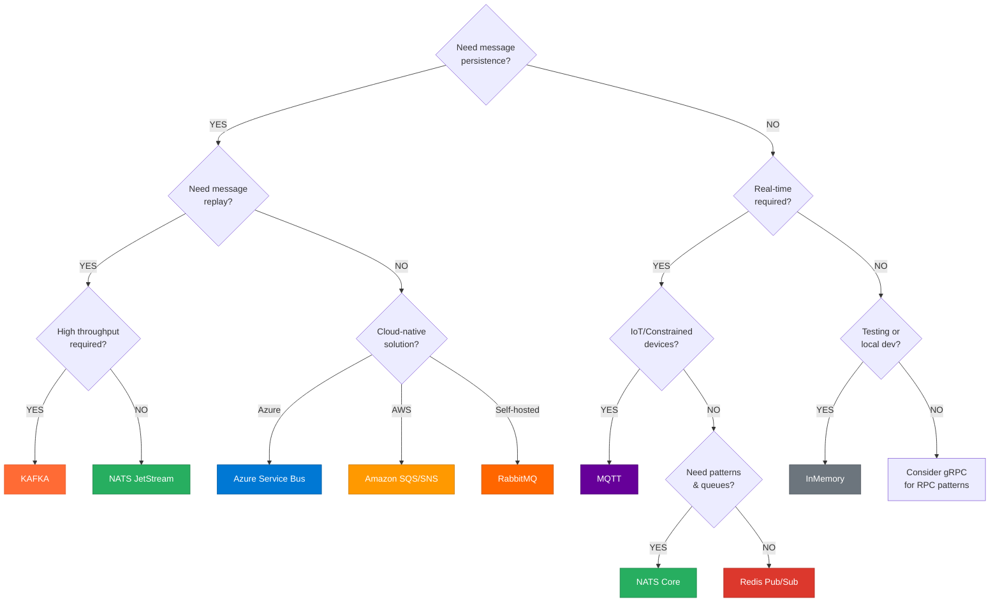
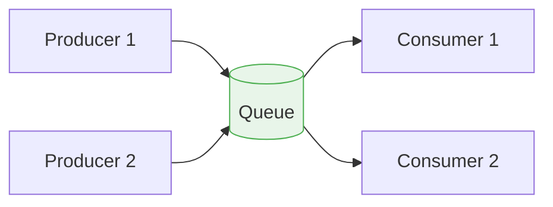
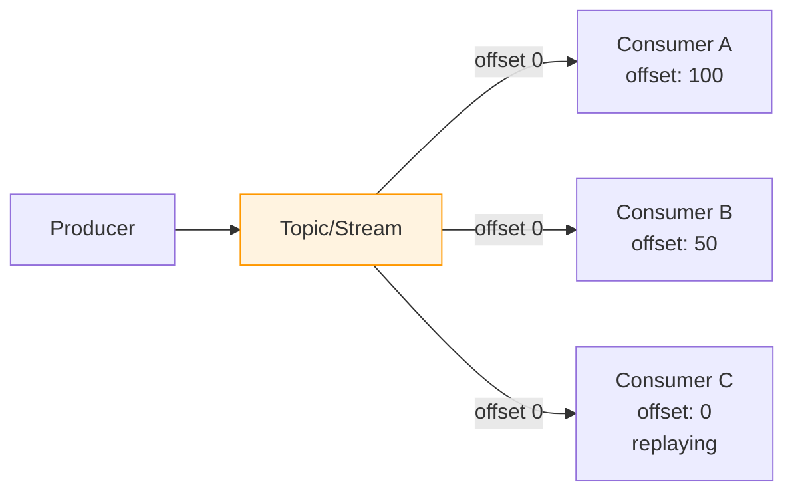
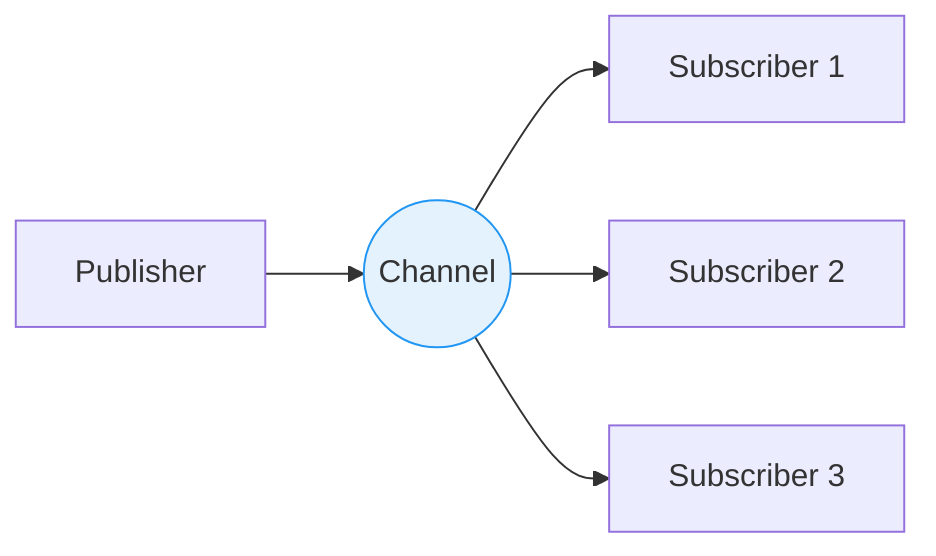

# Messaging Transports in Encina

This guide explains the messaging transport options available in Encina and helps you choose the right one for your use case.

> **Publish-only today.** The RabbitMQ, Kafka, NATS, Azure Service Bus and Amazon SQS packages only send messages (RabbitMQ and NATS also expose `RequestAsync`): they have no inbound consume and no dead letter. Redis.PubSub and MQTT also have `SubscribeAsync`, and InMemory has `Subscribe`; no transport package has dead-letter handling. The sections about queues, offsets and replay describe the brokers, not what Encina does with them. Tracking issue: [#1609](https://github.com/dlrivada/Encina/issues/1609).

## Table of Contents

1. [Overview](#overview)
2. [Decision Flowchart](#decision-flowchart)
3. [Transport Categories](#transport-categories)
4. [Transport Comparison](#transport-comparison)
5. [Detailed Transport Guides](#detailed-transport-guides)
6. [Testing with InMemory](#testing-with-inmemory)
7. [FAQ](#faq)

---

## Overview

Encina provides **10 messaging transport packages**, each exposing its own publisher or bridge interface and options class. Unlike a unified abstraction, each transport is purpose-built to leverage its unique characteristics.

| Category | Transports | Primary Use Case |
| --- | --- | --- |
| **Message Broker** | RabbitMQ, AzureServiceBus, AmazonSQS | Task distribution, work queues |
| **Event Streaming** | Kafka, NATS JetStream | Event sourcing, audit logs, replay |
| **Pub/Sub** | Redis.PubSub, NATS Core, MQTT | Real-time notifications, IoT |
| **In-Memory** | Encina.InMemory | Testing, local development |
| **API Bridge** | gRPC, GraphQL | Request/response, API integration |

> **Design Philosophy**: Each transport exposes its native API. We don't hide features behind a lowest-common-denominator interface. Kafka users get offsets and partitions. RabbitMQ users get exchanges and bindings.

---

## Decision Flowchart

Use this flowchart to choose the broker by its own properties. It does not say what Encina can do with that broker today; the [Transport Comparison](#transport-comparison) has an "Encina today" column for that.



### Quick Selection Guide

The recommendations name the broker that fits the scenario. For the five publish-only packages, Encina publishes to it today and does not consume from it.

| Scenario | Recommended Transport |
| --- | --- |
| **Microservices task distribution** | RabbitMQ |
| **Event sourcing / Event streaming** | Kafka |
| **Real-time notifications** | NATS Core (publish side) or Redis.PubSub |
| **IoT device messaging** | MQTT |
| **Cloud-native (Azure)** | Azure Service Bus |
| **Cloud-native (AWS)** | Amazon SQS/SNS |
| **High-performance pub/sub with optional persistence** | NATS |
| **Unit/Integration testing** | Encina.InMemory |
| **Request/Response patterns** | gRPC |
| **Frontend API bridge** | GraphQL |

---

## Transport Categories

Each category below first describes how the brokers of that kind behave, then states what the Encina packages of the category do today.

### Message Broker (Queue-based)

Best for **task distribution** where each message should be processed exactly once by one consumer.



**Broker characteristics:**

- Messages removed after consumption
- Load balancing across consumers
- At-least-once delivery
- No replay capability

**Transports:** RabbitMQ, AzureServiceBus, AmazonSQS

**Encina today:** the producer side only. The three packages send to queues and topics; the consumer side in the diagram is application code outside Encina.

### Event Streaming (Log-based)

Best for **event sourcing** where you need to replay events and maintain audit logs.



**Broker characteristics:**

- Messages retained (time/size based)
- Multiple consumers read independently
- Offset-based consumption
- Full replay capability

**Transports:** Kafka, NATS JetStream

**Encina today:** the producer side only. `ProduceAsync` returns the partition and offset of the delivered message; reading from an offset or replaying is not part of the package.

### Pub/Sub (Broadcast)

Best for **real-time notifications** where all subscribers should receive every message.



**Broker characteristics:**

- Fire-and-forget broadcast
- No persistence (ephemeral)
- Subscribers must be online
- Lowest latency

**Transports:** Redis.PubSub, NATS Core, MQTT

**Encina today:** Redis.PubSub and MQTT publish and subscribe. NATS Core publishes (and sends requests with `RequestAsync`) but has no subscribe.

### In-Memory (Testing)

Best for **unit and integration testing** without external dependencies.

**Characteristics:**

- No external infrastructure needed
- Fast execution
- Perfect for CI/CD pipelines
- Its own API (`IInMemoryMessageBus`), not a stand-in for the interfaces of the other transports

**Transports:** Encina.InMemory

### API Bridge (RPC)

Best for **request/response patterns** and frontend integration.

**Characteristics:**

- Synchronous communication
- Server-side bridges that run requests through `IEncina` (gRPC streaming and GraphQL subscriptions are not implemented)
- Frontend-friendly (GraphQL)
- Not true messaging (no queuing)

**Transports:** gRPC, GraphQL

---

## Transport Comparison

The Model, Ordering, Persistence, Replay and Consumer Model columns describe the broker or protocol. The last-but-one column says what the Encina package does today.

| Transport | Model | Ordering | Persistence | Replay | Consumer Model | Encina today (publish / subscribe / dead letter) | Use Case |
| --- | --- | --- | --- | --- | --- | --- | --- |
| **RabbitMQ** | Broker | Per-queue FIFO | Until consumed | No | Push | publish, request / no / no | Task distribution |
| **Kafka** | Stream | Per-partition | Time/size | Yes | Pull | publish / no / no | Event streaming |
| **NATS Core** | Pub/Sub | Subject-based | No | No | Push | publish, request / no / no | Real-time |
| **NATS JetStream** | Stream | Per-stream | Yes | Yes | Pull/Push | publish with acknowledgment / no / no | Event streaming |
| **Azure Service Bus** | Broker | Per-queue FIFO | Until consumed | No | Push | publish, schedule / no / no | Enterprise |
| **Amazon SQS** | Queue | Best-effort | 14 days max | No | Pull | publish / no / no | Serverless |
| **Redis Pub/Sub** | Pub/Sub | None | No | No | Push | publish / yes / no | Cache invalidation |
| **MQTT** | Pub/Sub | Per-topic | QoS-based | No | Push | publish / yes / no | IoT |
| **InMemory** | In-process bus | Inline on publish | No | No | Push (subscribers) | publish, enqueue / yes / no | Testing |
| **gRPC** | RPC | Per-request | No | No | Request | server-side bridge / no / no | API calls |
| **GraphQL** | RPC | Per-request | No | No | Request | server-side bridge / no / no | Frontend |

---

## Detailed Transport Guides

Every publisher is registered as a scoped service (the InMemory bus is a singleton), and its publish and send methods return `Either<EncinaError, T>`: a failure is a `Left`, not an exception ([ADR-001](../architecture/adr/001-railway-oriented-programming.md), [ADR-006](../architecture/adr/006-pure-rop-exception-handling.md)). The samples show the options the publisher code reads; the option classes have more properties.

### RabbitMQ

**Package:** `Encina.RabbitMQ`

**When to use:**

- Classic message broker patterns (work queues, pub/sub, routing)
- You publish to a named exchange with a routing key
- You are comfortable with AMQP concepts

**Encina today:** `IRabbitMQMessagePublisher` has `PublishAsync` (exchange and routing key), `SendToQueueAsync` (default exchange, queue name as routing key) and `RequestAsync`. The package does not declare exchanges or queues, so create them in the broker first. It has no consume and no dead-letter handling.

```csharp
services.AddEncinaRabbitMQ(options =>
{
    options.HostName = "localhost";
    options.ExchangeName = "my-exchange";
});

// Publishing (IRabbitMQMessagePublisher publisher)
var result = await publisher.PublishAsync(
    new OrderCreated(orderId),
    routingKey: "orders.created",
    cancellationToken: ct);
```

---

### Kafka

**Package:** `Encina.Kafka`

**When to use:**

- You publish events to topics, optionally keyed by a partition key
- You want the partition and offset of each delivered message

**Encina today:** `IKafkaMessagePublisher` has `ProduceAsync`, `ProduceBatchAsync` and `ProduceWithHeadersAsync`. It has no consumer, so reading from an offset or replaying is done with the Kafka client directly.

```csharp
services.AddEncinaKafka(options =>
{
    options.BootstrapServers = "localhost:9092";
    options.DefaultEventTopic = "events";
});

// Publishing with partition key (IKafkaMessagePublisher publisher)
var result = await publisher.ProduceAsync(
    new OrderCreated(orderId),
    key: orderId.ToString(), // Same order always goes to same partition
    cancellationToken: ct);

result.Match(
    Right: delivery => logger.LogInformation(
        "Delivered to partition {Partition} at offset {Offset}", delivery.Partition, delivery.Offset),
    Left: error => logger.LogWarning("Publish failed: {Code}", error.GetCode().IfNone("Encina.unknown")));
```

---

### NATS

**Package:** `Encina.NATS`

**When to use:**

- High-performance pub/sub with optional persistence
- You want both modes in one package
- Microservices communication
- Edge computing scenarios

**Encina today:** `INATSMessagePublisher` has `PublishAsync` (core), `RequestAsync` and `JetStreamPublishAsync`. There is no subscribe or consume. The package does not create streams; the JetStream stream for your subjects must already exist.

NATS offers two modes:

#### NATS Core (Pub/Sub)

```csharp
services.AddEncinaNATS(options =>
{
    options.Url = "nats://nats.internal.example.com:4222";
});

// Fire-and-forget publish (INATSMessagePublisher publisher)
await publisher.PublishAsync(new OrderCreated(orderId), subject: "orders.created", cancellationToken: ct);
```

#### NATS JetStream (Streaming)

```csharp
services.AddEncinaNATS(options =>
{
    options.Url = "nats://nats.internal.example.com:4222";
    options.UseJetStream = true;
});

// Publish with acknowledgment: the Right value carries the stream and sequence
var ack = await publisher.JetStreamPublishAsync(new OrderCreated(orderId), cancellationToken: ct);
```

`JetStreamPublishAsync` returns a `NATS_JETSTREAM_NOT_ENABLED` error when `UseJetStream` is not set.

#### Endpoint validation

`EncinaNATSOptions.Url` accepts one URL or a comma-separated list. Each entry must use the `nats`, `tls`, `ws` or `wss` scheme, and its host must not be loopback, link-local, a cloud metadata endpoint or an unspecified address (`Encina.Validation.EndpointValidator`, issue #852). Private ranges are allowed. Only literal hosts are checked, so a DNS name that resolves to an internal address (DNS rebinding) is not detected at configuration time.

The default `nats://localhost:4222` is loopback, so `services.AddEncinaNATS()` with no arguments throws `Microsoft.Extensions.Options.OptionsValidationException` at registration. For local development or a sidecar on the same host, opt out explicitly; one warning is logged per options instance at startup:

```csharp
services.AddEncinaNATS(options =>
{
    options.Url = "nats://localhost:4222";
    options.AllowLocalEndpoints = true;   // local development only
});
```

`AllowLocalEndpoints` is the only opt-out: link-local, metadata and unspecified addresses are always rejected. Validation runs again at host startup.

---

### Azure Service Bus

**Package:** `Encina.AzureServiceBus`

**When to use:**

- Azure-native applications
- You send to queues, publish to topics or schedule delivery
- Hybrid cloud scenarios

**Encina today:** `IAzureServiceBusMessagePublisher` has `SendToQueueAsync`, `PublishToTopicAsync`, `ScheduleAsync` (returns the sequence number) and `CancelScheduledAsync`. It has no receiver, session processing or dead-letter handling.

```csharp
services.AddEncinaAzureServiceBus(options =>
{
    options.ConnectionString = "Endpoint=sb://...";
    options.DefaultQueueName = "orders";
});

// Scheduled delivery (IAzureServiceBusMessagePublisher publisher, TimeProvider timeProvider)
var scheduled = await publisher.ScheduleAsync(
    new SendReminder(orderId),
    scheduledEnqueueTime: timeProvider.GetUtcNow().AddHours(24),
    cancellationToken: ct);
```

---

### Amazon SQS/SNS

**Package:** `Encina.AmazonSQS`

**When to use:**

- AWS-native applications
- Serverless architectures (Lambda integration)
- You send to SQS queues and publish to SNS topics

**Encina today:** `IAmazonSQSMessagePublisher` has `SendToQueueAsync`, `PublishToTopicAsync`, `SendBatchAsync` and `SendToFifoQueueAsync`. It has no receive or poll loop and no dead-letter handling.

```csharp
services.AddEncinaAmazonSQS(options =>
{
    options.Region = "us-east-1";
    options.DefaultQueueUrl = "https://sqs.us-east-1.amazonaws.com/123456789/my-queue";
    options.DefaultTopicArn = "arn:aws:sns:us-east-1:123456789:my-topic";
});

// Publishing to the SNS topic (IAmazonSQSMessagePublisher publisher); the Right value is the message id
var published = await publisher.PublishToTopicAsync(new OrderCreated(orderId), cancellationToken: ct);

// Sending to the SQS queue
var sent = await publisher.SendToQueueAsync(new OrderCreated(orderId), cancellationToken: ct);
```

#### Endpoint validation

`DefaultQueueUrl` is optional. When set it must be an absolute `https` URL whose host is not loopback, link-local, a cloud metadata endpoint or an unspecified address (`Encina.Validation.EndpointValidator`, issue #852). For LocalStack or another local emulator, set `AllowInsecureHttp = true` (plain `http`) and `AllowLocalEndpoints = true` (loopback); each logs one warning per options instance at startup. Link-local, metadata and unspecified addresses have no opt-out. Validation throws `Microsoft.Extensions.Options.OptionsValidationException` when `AddEncinaAmazonSQS` is called and runs again at host startup. Only literal hosts are checked, so DNS rebinding is not detected at configuration time.

```csharp
services.AddEncinaAmazonSQS(options =>
{
    options.DefaultQueueUrl = "http://localhost:4566/000000000000/my-queue";
    options.AllowInsecureHttp = true;     // LocalStack only
    options.AllowLocalEndpoints = true;   // LocalStack only
});
```

---

### Redis Pub/Sub

**Package:** `Encina.Redis.PubSub`

**When to use:**

- Cache invalidation across instances
- Real-time notifications where persistence isn't needed
- You already have Redis in your stack

**Encina today:** `IRedisPubSubMessagePublisher` has `PublishAsync` (the Right value is the number of receiving clients), `SubscribeAsync` and `SubscribePatternAsync`. The channel passed to `PublishAsync` is used as given, while `SubscribePatternAsync` prepends `ChannelPrefix` (default `encina`) to the pattern. There is no dead-letter handling.

```csharp
services.AddEncinaRedisPubSub(options =>
{
    options.ConnectionString = "localhost:6379";
});

// Publish (IRedisPubSubMessagePublisher publisher)
await publisher.PublishAsync(new CacheInvalidated("user:123"), channel: "encina:cache-events", cancellationToken: ct);

// Subscribe to pattern: "cache-*" matches the channel "encina:cache-events"
await using var subscription = await publisher.SubscribePatternAsync<CacheInvalidated>(
    "cache-*",
    async (channel, message) =>
    {
        await InvalidateCacheAsync(message);
    },
    ct);
```

---

### MQTT

**Package:** `Encina.MQTT`

**When to use:**

- IoT devices with limited bandwidth
- Unreliable networks (QoS levels handle this)
- Sensor data collection
- Mobile applications

**Encina today:** `IMQTTMessagePublisher` has `PublishAsync`, `SubscribeAsync` (one topic) and `SubscribePatternAsync` (a topic filter). There is no dead-letter handling.

```csharp
services.AddEncinaMQTT(options =>
{
    options.Host = "localhost";
    options.Port = 1883;
    options.ClientId = "sensor-collector";
});

// Publish with QoS (IMQTTMessagePublisher publisher)
await publisher.PublishAsync(
    new SensorReading(22.5),
    topic: "sensors/kitchen/temperature",
    qos: MqttQualityOfService.AtLeastOnce,
    cancellationToken: ct);

// Subscribe with wildcard
await using var subscription = await publisher.SubscribePatternAsync<SensorReading>(
    async (topic, reading) =>
    {
        await ProcessReadingAsync(reading);
    },
    "sensors/+/temperature",
    cancellationToken: ct);
```

---

### gRPC

**Package:** `Encina.gRPC`

**When to use:**

- You expose `IEncina` requests and notifications to gRPC clients from your own server
- Synchronous service-to-service communication

**Encina today:** `IGrpcEncinaService` is a server-side bridge. `SendAsync` and `PublishAsync` take the assembly-qualified type name and the JSON-serialized message, and run it through `IEncina`. The package has no outbound client and no server address option. `StreamAsync` returns a `GRPC_STREAMING_NOT_IMPLEMENTED` error, so the page makes no streaming claim. The options class `EncinaGrpcOptions` exists, but the bridge does not read it yet ([#3409](https://github.com/dlrivada/Encina/issues/3409)).

```csharp
services.AddEncinaGrpc();

// Inside your own gRPC service implementation
public sealed class OrdersGrpcService(IGrpcEncinaService encinaService)
{
    public async ValueTask<byte[]> CreateOrderAsync(byte[] requestJson, CancellationToken ct)
    {
        var result = await encinaService.SendAsync(
            typeof(CreateOrder).AssemblyQualifiedName!,
            requestJson,
            ct);

        return result.Match(
            Right: responseJson => responseJson,
            Left: error => throw new InvalidOperationException(error.GetCode().IfNone("Encina.unknown")));
    }
}
```

---

### GraphQL

**Package:** `Encina.GraphQL`

**When to use:**

- Frontend API needs
- Clients need flexible queries
- You're using HotChocolate

**Encina today:** `IGraphQLEncinaBridge` has `QueryAsync` and `MutateAsync`, which run an `IRequest<TResult>` through `IEncina` with `EncinaGraphQLOptions.ExecutionTimeout` as the deadline. `SubscribeAsync` returns a `GRAPHQL_SUBSCRIPTIONS_NOT_IMPLEMENTED` error (`GRAPHQL_SUBSCRIPTIONS_DISABLED` when `EnableSubscriptions` is false). Of the options, only `ExecutionTimeout` and `EnableSubscriptions` are read ([#3409](https://github.com/dlrivada/Encina/issues/3409)). The HotChocolate server is configured by your application, not by `AddEncinaGraphQL`.

```csharp
services.AddEncinaGraphQL();
services.AddGraphQLServer()
    .AddQueryType<QueryRoot>()
    .AddMutationType<MutationRoot>();

// Bridge Encina commands to mutations
public sealed class MutationRoot
{
    public async Task<OrderDto> CreateOrder(
        [Service] IGraphQLEncinaBridge bridge,
        CreateOrder mutation,
        CancellationToken ct)
    {
        var result = await bridge.MutateAsync<CreateOrder, OrderDto>(mutation, ct);

        // Only the error code reaches the client, never EncinaError.Message
        return result.Match(
            Right: order => order,
            Left: error => throw new GraphQLException(error.GetCode().IfNone("Encina.unknown")));
    }
}
```

---

## Testing with InMemory

**Package:** `Encina.InMemory`

`Encina.InMemory` is a separate in-process bus with its own interface, `IInMemoryMessageBus`. It has `PublishAsync` (runs the subscribers of that message type before it returns), `EnqueueAsync` (queues the message for background workers), `Subscribe<T>` (returns an `IDisposable`), `PendingCount` and `SubscriberCount`. It does not replace the interfaces of the other transports: code that publishes through `IKafkaMessagePublisher` is tested by substituting that interface.

```csharp
// In your test setup
services.AddEncinaInMemory();

// Your test
[Fact]
public async Task Bus_WhenPublished_DeliversToSubscriber()
{
    // Arrange
    var bus = _serviceProvider.GetRequiredService<IInMemoryMessageBus>();
    var received = new List<OrderCreated>();
    using var subscription = bus.Subscribe<OrderCreated>(message =>
    {
        received.Add(message);
        return ValueTask.CompletedTask;
    });

    // Act
    var result = await bus.PublishAsync(new OrderCreated(orderId));

    // Assert
    Assert.True(result.IsRight);
    Assert.Equal(1, bus.SubscriberCount);
    Assert.Single(received);
    Assert.Equal(orderId, received[0].OrderId);
}
```

**Benefits:**

- No Docker containers needed
- Fast test execution
- Full control over message timing

---

## FAQ

### Should I use a unified messaging interface?

**No.** Encina intentionally exposes transport-specific APIs because:

1. Each transport has unique features that would be lost in abstraction
2. Users choose transports precisely for their differences
3. A lowest-common-denominator API removes the value of each transport

If you need transport abstraction, consider MassTransit or NServiceBus (different architectural approach).

### Can I use multiple transports in one application?

**Yes.** Each transport is independent:

```csharp
services.AddEncinaKafka(options => options.BootstrapServers = "localhost:9092");   // For event streaming
services.AddEncinaRabbitMQ(options => options.HostName = "localhost");            // For task distribution
services.AddEncinaRedisPubSub(options => options.ConnectionString = "localhost:6379"); // For cache invalidation
```

### How do I handle transport failures?

Every publish and send method returns `Either<EncinaError, T>`, so a failed send is a `Left` you handle at the call site. `Encina.Polly` adds retry, circuit breaker, rate limit and bulkhead behaviors to requests sent through `IEncina`, configured with attributes on the request type:

```csharp
services.AddEncinaPolly();

[Retry(MaxAttempts = 3)]
[CircuitBreaker(FailureThreshold = 5, DurationOfBreakSeconds = 60)]
public sealed record PublishOrderCreated(Guid OrderId) : ICommand<Unit>;
```

Resilience for the message transports and for the gRPC and GraphQL bridges is in 1.0 scope ([SPEC-000](../specifications/SPEC-000-encina-1.0-baseline-and-release-scope.md) REQ-030, [ADR-055](../architecture/adr/055-resilience-family.md)).

### When should I use gRPC vs a message broker?

| Pattern | Use |
| --- | --- |
| **Request/Response** | gRPC |
| **Fire-and-forget** | Message Broker |
| **Event notification** | Pub/Sub |
| **Event streaming (publish side)** | Kafka/NATS JetStream |

gRPC is synchronous; message brokers are asynchronous.

### How do I switch transports?

Since each transport has its own API, switching requires code changes. However, if your handlers use Encina's core abstractions (`ICommandHandler<,>`, `INotificationHandler<>`), only the transport registration and publishing code needs to change.

---

## Further Reading

- [RabbitMQ Documentation](https://www.rabbitmq.com/docs)
- [Apache Kafka Documentation](https://kafka.apache.org/documentation/)
- [NATS Documentation](https://docs.nats.io/)
- [Azure Service Bus Documentation](https://learn.microsoft.com/en-us/azure/service-bus-messaging/)
- [Amazon SQS Documentation](https://docs.aws.amazon.com/sqs/)
