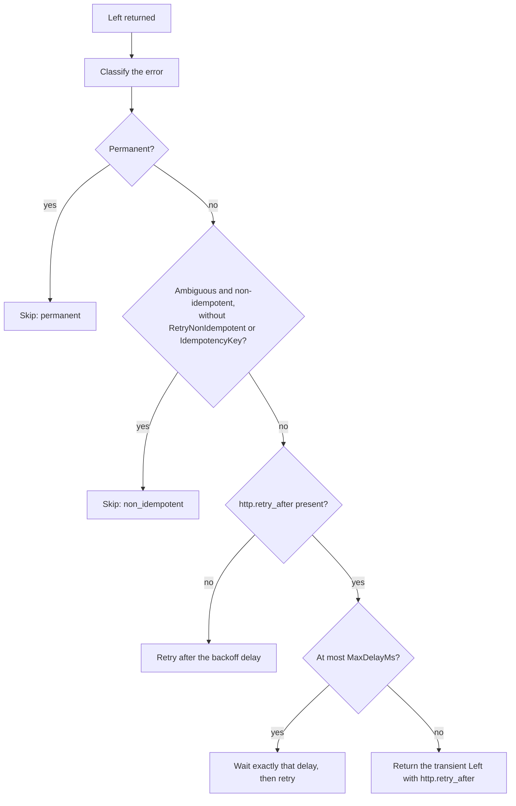

# Encina.Polly

Resilience pipeline behaviors for Encina using [Polly](https://github.com/App-vNext/Polly). Provides retry, circuit breaker, rate limiting, and bulkhead patterns as composable pipeline behaviors.

## Retry

`[Retry]` on a request type enables `RetryPipelineBehavior<,>`, registered by `AddEncinaPolly()`.

```csharp
services.AddEncina(config => { });
services.AddEncinaPolly();

[Retry(MaxAttempts = 3, BackoffType = BackoffType.Exponential, MaxDelayMs = 30000)]
public record CallExternalApiQuery(string Url) : IRequest<ApiResponse>;
```

The behavior takes an `Encina.Recoverability.IErrorClassifier`. `AddEncinaPolly` registers `DefaultErrorClassifier` with `TryAdd`; `AddEncinaRecoverability` with a custom `RecoverabilityOptions.ErrorClassifier` replaces it in any registration order. `TimeProvider` is an optional constructor parameter.

| Situation | Behavior |
|---|---|
| Classified `Permanent` | Never retried, even with `RetryOnAllExceptions = true` |
| Classified `Transient` | Retried regardless of `RetryOnAllExceptions` |
| Classified `Unknown`, returned as a `Left` | Retried regardless of `RetryOnAllExceptions` (only `Permanent` is skipped) |
| Classified `Unknown`, thrown as an exception | Retried only with `RetryOnAllExceptions = true`, except `TimeoutException`, `HttpRequestException` and `IOException`, which are retried without it |
| `http.retry_after` is at most `MaxDelayMs` | Waits exactly the header delay (no jitter, on the injected `TimeProvider`) and retries in process |
| `http.retry_after` is larger than `MaxDelayMs` | The transient error is returned unchanged with `http.retry_after`, so an outer layer (the delayed-retry processor) reschedules it; the outbox processor does not classify, it only schedules its next attempt no earlier than that delay |
| Ambiguous failure of a non-idempotent send (`outbound.ambiguous`) | Not retried, unless `[Retry(RetryNonIdempotent = true)]` (only for providers that deduplicate) or `IRequestContext.IdempotencyKey` is non-empty |
| 429, 503, and connection failures that prove the request was not processed | Retried |

The order in which the behavior decides whether to retry a returned error:



The error codes and metadata come from `Encina.Recoverability.OutboundErrorCodes` and `OutboundErrorMetadataKeys`; `Encina.Refit` produces them (see the [Encina.Refit README](../Encina.Refit/README.md)).

### Telemetry

| Signal | Name | Notes |
|---|---|---|
| Counter | `encina.retry.attempts_total` | One per retry performed |
| Counter | `encina.retry.skipped_total` | Tag `reason`: `permanent`, `non_idempotent` or `retry_after_exceeds_max` |
| Activity | `Encina.Retry` | On the `Encina` activity source |

Tags are the request name, the error code and `encina.tenant_id`; never a response body, a message or a URL.

## Performance

Overhead of resilience attributes compared to no-attribute baseline:

<!-- docref-table: bench:polly/* -->
<!-- /docref-table -->

*Auto-generated from benchmark data. See [methodology](../../docs/testing/performance-measurement-methodology.md).*
